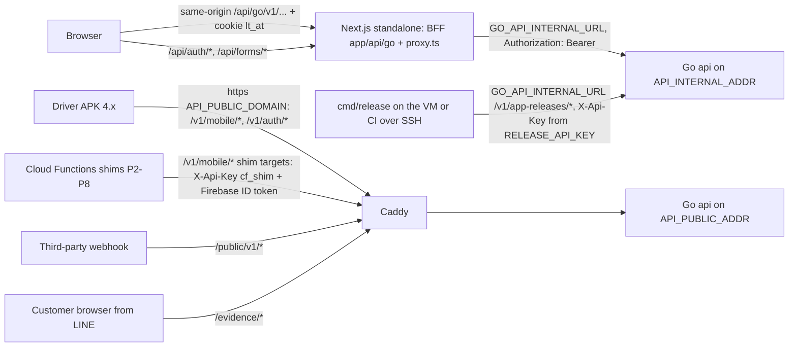
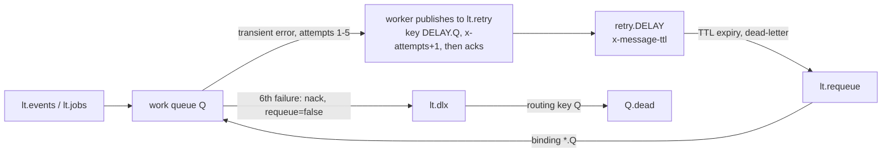

# Appendix B — API catalog, realtime topics, queues and Redis map

Part of the mv-go migration spec (Firebase -> Go 1.27 + Fiber v3.5 + PostgreSQL 18 + RabbitMQ + Redis + MinIO). Main document: [developer-spec.md](../../../developer-spec.md) (§5 API surface, §7 async, §8 realtime, §10 web tier, §11 mobile). Sibling appendices: [A — data model](./A-data-model.md), [C — auth and RBAC](./C-auth-rbac.md), [D — seed and mock data](./D-seed-and-mock-data.md), [E — web fetch audit](./E-web-fetch-audit.md). Decision record: [ADR 0029](../../adr/0029-migrate-firebase-stack-to-go-postgres.md).

This appendix is the route-level design input for `logitrack-api/api/openapi.yaml`. Table and column names follow Appendix A; capability keys follow the catalog in Appendix C §C.2; phases follow the strangler plan in main spec §12 (P0 foundations, P1 master data, P2 operations, P3 billing/finance, P4 HR/payroll, P5 comms, P6 security center/platform/dashboard, P7a mobile app, P7b storage flip, P8 decommission).

Citation shorthand in the "Replaces" columns: `web:` = `logitrack-web/`, `fn:` = `logitrack-web/functions/src/`, `mob:` = `logitrack-mobile/lib/`. A bare file name with a line (for example `taskService.ts:45`) is cited exactly as the fact-base reports cite it; the full path is in those reports. `.vibe-rules.md` line numbers are as of commit 4f552099 (the ADR 0029 edit shifts later lines). No secret values appear anywhere in this appendix; only environment variable names.

This appendix is normative for route paths, realtime topics, RabbitMQ exchanges/queues/routing keys and Redis keys (resolutions R36-R90): where another document of the set disagrees on one of these, this appendix wins and the other copies it.

## B.1 Conventions

### B.1.1 Base paths and route groups

| Prefix | Purpose | Listener |
|---|---|---|
| `/v1/*` | Versioned JSON API for staff (web through the BFF) | internal |
| `/v1/auth/*` | Login, Google OIDC, refresh, logout, password reset, tenant switch, SSE ticket, Firebase session exchange (P7a) | public (and internal) |
| `/v1/mobile/*` | Driver app API (APK 4.x from P7a), the targets of the five Cloud Functions callable shims (from P2, §B.2.22), the anonymous version-gate settings | public (and internal) |
| `/public/v1/*` | Inbound webhooks and postbacks from third parties, signature-verified per provider. **No routes exist today** (§B.2.24) | public (and internal) |
| `/evidence/*` | Server-rendered evidence gallery opened from LINE Flex cards | public (and internal) |
| `/healthz` | Liveness | public (and internal) |
| `/readyz`, `/startupz`, `/.well-known/jwks.json`, `/v1/bridge/*` | Readiness, migration gate, JWKS for the web edge gate, Firebase custom-token bridge for the BFF | internal |
| `/metrics` | Prometheus, separate `METRICS_ADDR`, never routed by Caddy | metrics port only |

`/v1` is additive-only (MANDATORY API-versioning rule `.vibe-rules.md:365-393`): a breaking change is a new path or `/v2`; retired routes return `Deprecation`/`Sunset` headers before deletion.

### B.1.2 Listener column (ingress policy, plan §4b, R35)

The `api` process runs two Fiber listeners from the same route registry:

| Listener | Bind | Serves | Anything else |
|---|---|---|---|
| internal | `API_INTERNAL_ADDR` on the compose network / loopback only; reached by the Next.js BFF at `GO_API_INTERNAL_URL` | **every** route in this appendix | n/a |
| public | `API_PUBLIC_ADDR` behind Caddy on `API_PUBLIC_DOMAIN` (nginx on the first deployment) | only `/v1/mobile/*`, `/v1/auth/*`, `/public/v1/*`, `/evidence/*`, `/media/*` (local storage backend, owner-approved widening of 2026-10-10, T11), `/healthz`; groups additionally filtered by the allow-list `PUBLIC_ROUTE_GROUPS` | **404 `not_found`** (never 401/403, so the internal surface is not disclosed) |

In the tables, `internal` means the route exists only on the internal listener; `public` means it is mounted on the public listener **and**, like every route, on the internal listener. Every row carries exactly one of these two values. `X-Forwarded-For` is honoured only from `TRUSTED_PROXY_CIDRS` (Caddy on the public side, the `web` container on the internal side) so IP rate limits see the real client.

Path decisions this appendix takes to satisfy the ingress policy:

- Every endpoint the driver app calls lives under `/v1/mobile/*` (§B.2.21, R42), including the identity aliases `/v1/mobile/me`, `/v1/mobile/me/sessions`, `/v1/mobile/me/devices` and the SSE stream `GET /v1/mobile/events?ticket=`. Where the same service also backs a staff route (for example `GET /v1/tasks/{id}` and `GET /v1/mobile/tasks/{id}`), both rows exist and the Notes column names the shared service; the handler differs only in principal checks.
- The five Cloud Functions callable shims call `/v1/mobile/*` routes on the public listener (§B.2.22, R45). The five shims use seven target routes: three are routes APK 4.x also uses (`GET /v1/mobile/me`, `POST /v1/mobile/tasks/{id}/stops`, `POST /v1/mobile/broadcasts/{id}/read`); `POST /v1/mobile/trips/{id}/billing/compute` and the three `.../line-notify` routes exist only for the shims (APK 4.x gets the same effects from the outbox).
- Staff-only mobile administration lives under `/v1/app-installations/*` and `/v1/app-releases/*` on the **internal** listener, including APK publishing (R43): the publish CLI `cmd/release` runs on the private network (on the VM, or in a CI job over SSH) and calls `GO_API_INTERNAL_URL` with an API key of scope `release_publisher` read from `RELEASE_API_KEY` (R82). No release route exists on the public listener.
- The anonymous marketing forms (`waitlist`, `partner-interest`) are posted by the browser to the unauthenticated BFF route handlers `POST /api/forms/waitlist` and `POST /api/forms/partner-interest` (R77), which forward to the internal `POST /v1/waitlist` and `POST /v1/partner-interest`, rate-limited by `RATE_LIMIT_PUBLIC_FORMS` (R44). `/public/v1/*` stays empty and is reserved for signed third-party postbacks.

### B.1.3 Web path (BFF) and mobile path

The browser never calls Go. The generic BFF proxy (`app/api/go/[...path]/route.ts`, `runtime='nodejs'`, `dynamic='force-dynamic'`) maps `/api/go/<rest>` to `{GO_API_INTERNAL_URL}/<rest>`, reads the HttpOnly cookie `lt_at`, sends `Authorization: Bearer`, `X-Request-Id`, `X-Forwarded-For` (and `X-Act-On-Tenant` when present), streams the body back, strips hop-by-hop headers, forwards the abort signal, applies `GO_API_INTERNAL_TIMEOUT_MS` (not to `/v1/events`), and rejects mutations whose `Origin`/`Sec-Fetch-Site` is not same-origin (`WEB_PUBLIC_ORIGIN`). It holds no business logic, **never refreshes** (it cannot see `lt_rt`), and answers `404` for `v1/auth/(login|google|refresh|tenant|logout|logout-all|sse-ticket|exchange)` and `v1/bridge/*` (R38), so token-bearing responses only ever pass through the dedicated auth routes below; `v1/auth/password/*` passes through it (forgot, reset and the ticket form of change return no tokens). Go returns tokens in the JSON body to its internal caller (`platform: "web"`) and never sets cookies; only the BFF sets them (R38):

| BFF route (Next.js) | Go route it calls (internal) | Cookie effect |
|---|---|---|
| `POST /api/auth/login` | `POST /v1/auth/login` (`platform: "web"`) | sets `lt_at` and `lt_rt`; a `403 password_change_required` (with `details.passwordChangeTicket`, no tokens, R79) is passed to the page and sets no cookie |
| `GET /api/auth/google/nonce` | `GET /v1/auth/google/nonce` | none |
| `POST /api/auth/google` | `POST /v1/auth/google` (GIS ID token + the nonce above) | same as login |
| `POST /api/auth/refresh` | `POST /v1/auth/refresh` with the `lt_rt` value in the body | rotates both; a no-op `204` (no upstream call) while `lt_at` has more than 120 s left (R37), unless the body is `{"force": true}` (sent only after `claims_changed`, R78). Refused (no `lt_rt`, or Go `401`): both cleared, `401` passed through; any other failure (Go `429` or `5xx`, Go unreachable `502` or timed out `504`) keeps both and passes the status and envelope through |
| `GET /api/auth/refresh?next=` | `POST /v1/auth/refresh` with the `lt_rt` value (always rotates, no 120 s no-op) | rotates both, then `303` to `next` (a same-origin path under `/app`, else `/app`). Refused (Go `401`, or no `lt_rt`): both cleared, `303` `/login?next=` (`&reason=revoked` for `session_revoked`). Go unreachable or failing: `503` (`504` on timeout) with `Retry-After`, cookies kept. Top-level navigations only: any other `Sec-Fetch-Mode` is `400` without rotating. Serves page navigations that `proxy.ts` redirected (R37); concurrent requests with one `lt_rt` share one rotation per web process (main spec §10.4) |
| `POST /api/auth/logout` | `POST /v1/auth/logout` (bearer from `lt_at`, `refreshToken` from `lt_rt`) | clears both |
| `POST /api/auth/tenant` | `POST /v1/auth/tenant` | replaces `lt_at` |
| `POST /api/auth/firebase-token` (from the P0 login switch until TW7 at the end of P6, R40, R80) | `POST /v1/bridge/firebase-token` | none; returns a Firebase custom token for pages that still read Firestore; removed with TW7 (done, issue #87: no route, no browser caller; the Go route answers 404 in mode `mobile`) |
| `POST /api/forms/waitlist`, `POST /api/forms/partner-interest` (unauthenticated, R77) | `POST /v1/waitlist`, `POST /v1/partner-interest` | none; reads no cookie and sends no `Authorization`; forwards `X-Forwarded-For` so the per-IP `RATE_LIMIT_PUBLIC_FORMS` buckets see the visitor; same Origin check as every mutation |
| `/api/go/*` (generic proxy) | every other internal route, e.g. `GET /v1/events` (bearer from cookie) | none; `text/event-stream` is passed through unbuffered |

Cookies (R36): `lt_at` = access JWT, `HttpOnly; Secure; SameSite=Lax; Path=/` (so `proxy.ts` sees it on `/app/*`), `Max-Age` from `JWT_ACCESS_TTL`; `lt_rt` = refresh token, `HttpOnly; Secure; SameSite=Lax; Path=/api/auth`, `Max-Age` from `REFRESH_TOKEN_TTL_WEB`. `Secure` follows `SESSION_COOKIE_SECURE`, the domain `SESSION_COOKIE_DOMAIN`.

Refresh flow (R37, R78): on a `401` whose `error.code` is `token_expired` (or `unauthenticated` because no access token is present) the browser fetch helper `goFetch` runs **one** shared refresh (`POST /api/auth/refresh`, serialised across tabs with `navigator.locks`) and retries the request once. When `details.reason` is `claims_changed` the refresh is sent with `{"force": true}`, which skips the 120 s no-op. Inside the lock the `localStorage["lt:lastRefreshAt"]` and `["lt:lastForcedRefreshAt"]` timestamps (no token material) let a tab that waited skip a refresh another tab already completed after its trigger; a `claims_changed` caller counts only a forced one (T17). Any other 401 (`session_revoked`, `invalid_token`), or a failed refresh, clears the TanStack cache and goes to `/login?next=`. Go accepts a rotated refresh token for 30 s while its successor has not been presented (concurrent tabs) before treating reuse as theft (§B.2.2).

`proxy.ts` (Next 16 edge gate, matcher `/app/:path*`, R39) verifies `lt_at` with `jose` against `GET {GO_API_INTERNAL_URL}/.well-known/jwks.json` (cached by `kid`; `iss` = `JWT_ISSUER`, `aud` = `JWT_AUDIENCE`), then calls internal `GET /v1/me` cached per `(sid, ver, tid)` for 60 s and checks `ROUTE_CAPABILITIES` (moved from `web:lib/capabilities.ts`, re-keyed to colon keys). A missing or expired `lt_at` redirects to `GET /api/auth/refresh?next=<path>`; the exact path `/app` redirects to the role's home route (R89; detail in Appendix E §E.8.4). The web server therefore also reads `JWT_ISSUER`, `JWT_AUDIENCE`, `JWT_ACCESS_TTL` and `REFRESH_TOKEN_TTL_WEB`. No build-time API URL or domain-flag variable exists; domain flags come from `GET /v1/config/web-flags` (Go env `WEB_FLAG_OVERRIDES`), cached as TanStack key `['webFlags']` for 60 s (R41). The only public web variable added is `NEXT_PUBLIC_GOOGLE_OIDC_CLIENT_ID`.

The driver app calls the public listener directly with `Authorization: Bearer <access JWT>` and the refresh token in the JSON body (stored in `flutter_secure_storage`), dart-defines `API_BASE_URL`, `SSE_BASE_URL`, `GOOGLE_OIDC_CLIENT_ID`. An APK 4.x that still holds a Firebase session from 3.x exchanges its Firebase ID token for a Go session once at `POST /v1/auth/exchange` (P7a, R42) and uses Go tokens only afterwards. Mobile SSE uses a ticket (`POST /v1/auth/sse-ticket` -> `GET /v1/mobile/events?ticket=`); the web never uses tickets (its stream is same-origin through the BFF with the cookie).

### B.1.4 Capability / auth column vocabulary

| Value | Meaning |
|---|---|
| `public` | No principal. Always rate-limited (Notes give the bucket). |
| `authenticated` | Any valid principal (JWT with live `sid` and matching `ver`, or an API key where stated). Row visibility is still enforced by RLS (Appendix C §C.3). |
| `<module>:<action>` | A capability key from the Appendix C catalog: **81 keys (77 + 4 platform)**, i.e. 77 tenant/scope keys including `mobile:create_hub` plus 4 `platform:*` keys (R73), colon form, defined once in Go `internal/authz/catalog.go`. Capabilities are resolved per request from `rbac:caps:*` (§B.6), never read from the token. `a \| b` = any-of; `a + b` = both. |
| `driver:self` | Principal is a driver (`drv` claim, or the driver resolved through `users.legacy_auth_uid` from a Firebase ID token forwarded by a callable shim, §B.2.22; the APK itself exchanges its Firebase ID token once through `POST /v1/auth/exchange`, §B.2.21, and then holds a Go token) and the row's `driver_id` (or `helper_driver_id`, or the driver's active/assigned truck for maintenance) is that driver. Driver routes are always `mobile:<x> + driver:self` (R5). |
| `platform` | Principal holds a platform role in `user_platform_roles` (`platform_admin`; `support` only where the Notes say read-only). Platform principals act on a tenant only through `X-Act-On-Tenant` (internal listener only; each request is audited as `platform_cross_tenant_access` in its own committed transaction before the handler runs, Appendix C §C.3.9). Exception: the identity writes whose row lists `platform` as an alternative (`PUT`/`DELETE /v1/tenants/{id}/members/{userId}`, `POST /v1/users` with `tenantId`) are authorised by the platform role itself, without the header; iam writes them under `WithSystem` and audits them in the transaction (`user_role_changed`, `user_created`, Appendix C §C.8). Platform reads of another tenant's users and members still need the header (`GET /v1/users` with `*`, `GET /v1/tenants/{id}/members` with `<id>` or `*`). |
| `apikey` | Machine principal from an `api_keys` row, presented as `X-Api-Key`; the key's `capabilities[]` must contain the listed key. Key scopes (`api_keys.scope`, R82): `cf_shim` (public listener, only the shim targets of §B.2.22, and only together with a Firebase ID token, which yields a `driver:self` principal; the key alone grants nothing), `release_publisher` (internal listener, the two APK publish routes of §B.2.18; held by `cmd/release` as `RELEASE_API_KEY`), `integration` / `script` (internal listener, any route the key's capabilities allow). A route admits a key only when its registration names the key's scope (`auth.AllowAPIKeys`, T32K); every other authenticated route (`RequireAuth`, and the two `/v1/auth` routes that authenticate their caller themselves, `POST /v1/auth/logout` and `POST /v1/auth/password/change` in both forms) answers an `X-Api-Key` with `403 permission_denied` (`details.reason = api_key_scope`), or `401 invalid_token` when an `Authorization` header came with it or the key is unknown or dead (Appendix C §C.4.3 (3)), as does the public listener for every scope but `cf_shim`. Anonymous routes (`public` in the auth cell: login, Google sign-in, refresh, password forgot / reset, health) ignore the header. The routes of this catalog that admit keys say so in their auth cell; until P2 `cf_shim` keys are refused everywhere (their shim targets ship with T32, M2). |

Scope axes are applied by the data layer, not by extra tokens in this column: a customer-scoped principal (`cs` claim, `user_scopes` rows of kind `customer` referencing `billing_parties.id`) sees only rows linked to its parties; a dispatcher (`dsp` claim, `user_scopes` kind `dispatcher`; the only two kinds, R86) reads across tenants; both scope principals are served exclusively from the `scope_*` projection views (`security_invoker`, Appendix C §C.3.7, R85) and never from the carrier-internal tables (billing snapshots, rate tables, statements, expenses, maintenance, payroll, penalties, compensation config); own-fleet staff also reach the rows of carriers that work for the own fleet (`tenants.contractor_tenant_id`, GUC `app.subtenant_ids`, R60); `tenant_id` on new rows is stamped by the resolver chain task -> trip -> driver -> truck -> self -> form and never taken from a header or body (the one exception is `PATCH /v1/tasks/{id}` `tenantId`, dispatcher/platform only, audited, R13).

Steward-only keys (R60): `fleet:manage_customers`, `fleet:manage_subcontractors`, `operations:manage_sources`, `operations:calculate_distances`, `security:view_status`, `security:manage_mobile_release` and `waitlist:view` govern global master data, and writes to public holidays (`tenant_id` NULL) and platform-wide broadcasts change data every tenant sees. They take effect only for own-fleet staff or `platform_admin` (GUC `app.steward`); held by anyone else they resolve to `403 permission_denied`.

### B.1.5 Request and response conventions

- **JSON**: UTF-8, field names camelCase in every request and response body, auth bodies included (`accessToken`, `refreshToken`, `idToken`, `installId`, `expiresIn`; R48). One convention for web and mobile; the AU draft's snake_case bodies are normalised to it. Timestamps RFC 3339 UTC; date-only strings `yyyy-MM-dd` are Bangkok calendar dates; `?year&month` are Bangkok months; money is a JSON number in THB with 2 decimals for billing (stored `NUMERIC(14,2)`, R20) and integer THB for payroll and penalties.
- **Success envelope**: `200/201 {"data": <object|array>, "nextCursor": "<opaque>"?, "meta": {...}?}`; `202 {"data": {"jobId": "<uuid>"}}` for async work tracked in `jobs` (R14, R64); `204` for deletes and fire-and-forget actions.
- **Error envelope** (R48, R76): exactly `{"error": {"code": "<stable_code>", "message": "<text>", "details": {...}, "requestId": "<id>"}}`; there is no second localised text field. Clients key off `code` only and render the text from their own en/th i18n catalogues (MANDATORY i18n rule); `message` is a fallback for logs and machine callers.

| HTTP | Codes |
|---|---|
| 400 | `bad_request` (malformed JSON, unknown query parameter), `header_not_allowed` (`X-Act-On-Tenant` on the public listener) |
| 401 | `unauthenticated` (no credential), `invalid_credentials` (login), `token_expired` (`details.reason` = `expired` \| `claims_changed`, R78), `session_revoked`, `invalid_token`, `invalid_signature` (webhooks) |
| 403 | `permission_denied` (`details.missingCapability`), `tenant_required`, `not_task_owner`, `truck_not_in_tenant`, `no_account` (Google sign-in without a linked user), `account_disabled`, `driver_profile_required`, `password_change_required` (login, Google sign-in and exchange: `details.passwordChangeTicket`, `details.expiresIn`, no tokens, R79) |
| 404 | `not_found` (also every non-allow-listed path on the public listener) |
| 405 | `method_not_allowed` (path exists, method does not; added in T01) |
| 409 | `already_exists` (also a user creation whose email another Firebase account holds while the bridge mirrors: `details.reason = "firebase_account_exists"`, Appendix C §C.6.4), `failed_precondition`, `idempotency_conflict`, `duplicate_trip_id`, `duplicate_seal`, `duplicate_tax_invoice`, `duplicate_destination`, `billing_period_locked` (`details.blockedInvoiceNumber`), `frozen_snapshot`, `payroll_locked`, `statement_not_draft`, `announcement_immutable` |
| 413 | `payload_too_large` (body over the 4 MiB API limit; uploads go to presigned URLs; added in T01). The local storage backend's two upload routes (`PUT /v1/uploads/local/{key}`, `PUT /media/{key}`) give a request whose head carries a valid upload signature its signed size as the limit (at most `UPLOAD_MAX_BYTES`, T11), decided from the request head before the body is read; an unsigned or tampered head keeps the 4 MiB limit |
| 422 | `invalid_argument` (`details.fields[]`), `no_customer`, `no_rate`, `no_vehicle_class` (R15), `no_billing_date` (R19), `no_ended_at` (standby), `tenant_orphan`, `capability_not_overridable`, `too_many_scopes` (more than 20 parties per user) |
| 423 | `locked` (login lockout after 5 failures in 15 min per email) |
| 426 | `version_blocked` (`details.minAllowedVersion`, `details.apkDownloadUrl`) |
| 429 | `resource_exhausted` (`Retry-After` header; also a spreadsheet import while the process already reads `xlsx.MaxConcurrentReads` files, T22) |
| 500 / 503 | `internal`, `unavailable`, `bridge_unavailable` (the Firebase account mirror failed, so the change was not committed, Appendix C §C.6.4) |

- **Pagination**: keyset only. `?limit=` (default 50, max 500; `GET /v1/trips/monitor` pages are 200) and `?cursor=` (opaque base64 of `(sort_value, id)`); default order `created_at DESC, id DESC`; endpoints that sort by another column (`last_message_at`, `delivered_at`, `ended_at`, `last_seen_at`, `last_login_at`, `date`) still tie-break on `id`. Response carries `nextCursor` (absent on the last page). No offset pagination and no silent caps (the seven web caps listed in Appendix E disappear).
- **Idempotency-Key**: required on rows marked `✱` in the Path column (driver-app writes that the offline outbox replays). Header `Idempotency-Key: <uuid>`; scope `(user_id, key)`; fingerprint = sha256 of method + path + body. Hot copy in Redis `idem:http:{userId}:{key}` for 24 h with in-flight lock `idem:lock:{userId}:{key}` (SET NX PX 30000); durable copy in `idempotency_keys(scope, key)` until `expires_at = created_at + IDEMPOTENCY_TTL` (default **168h**), consulted on a Redis miss (R53). A replay returns the stored status and body byte for byte with `Idempotent-Replayed: true`; a different fingerprint returns `409 idempotency_conflict` (`details.reason = "fingerprint_mismatch"`), a duplicate while the first request still runs `409 idempotency_conflict` (`details.reason = "in_flight"`, `Retry-After: 1`). Only `2xx` responses are recorded: any other outcome committed nothing, so its claim is released and the client may retry with the same key. A missing or non-uuid header is `400 bad_request` (`details.reason` `missing` or `malformed`). The `in_progress` row is the durable claim (its `created_at` fences `Complete`/`Release`); with the Redis lock it is a 30 s lease, and a claim older than that is taken over because its holder is presumed dead, so a Redis outage degrades to PostgreSQL alone. To keep a live holder from being taken over, the route runs under a 25 s deadline counted from before the lease is taken, and `✱` handlers do their database and storage work under the request context: a request that cannot finish in time is cancelled, rolled back and released before its lease ends. A handler that ignored its context and outlived the lease could run a second time for a retry; the natural keys below then decide, and the late response is stored nowhere (`Complete` reports the takeover), so the Redis and PostgreSQL copies never disagree. The `✱` routes without a natural key (check-in, deliver, stops deliver, resubmit-photos, maintenance check-in and complete, `PATCH` expenses, `POST /v1/mobile/hubs`) depend on that deadline (T09: `internal/platform/httpx/idempotency`). Durable natural keys remain the last line of defence (R63): the same uuid travels in the body as `clientOpId` and is stored as `client_op_id` with a partial `UNIQUE (driver_id, client_op_id)` on `incident_reports`, `standby_records`, `vehicle_expenses`, `leave_requests` and driver-created `tasks`; `chat_messages.client_message_id` is unique per chat; plus `trip_records.trip_no` UNIQUE, `vehicle_expenses (driver_id, tax_inv_id) WHERE type='fuel'`, the per-stop delivery index and the `broadcast_reads` PK.
- **Mobile headers**: `X-App-Version`, `X-App-Build`, `X-App-Flavor`, `X-Install-Id`, `X-Platform`. The version-floor middleware (env `MOBILE_VERSION_FLOOR_ENFORCE`) answers `426 version_blocked` on every `✱` route and on `GET /v1/mobile/me` when `X-App-Version` is below `settings['mobile_app'].minAllowedVersion` (ADR 0007 semantics, now server-side). Shim principals (§B.2.22) carry no app headers and are exempt; the APK 3.x floor is still enforced on the device from `GET /v1/mobile/settings` or the Firestore projection.
- **Tenant context**: the access token carries one active tenant (`tid`, `rol`), kept per session in `sessions.active_tenant_id`; `POST /v1/auth/tenant` re-issues it for another membership (R83). Cross-tenant work is platform-only, on the internal listener only, through `X-Act-On-Tenant: <uuid>` (acts as that tenant's `tenant_admin`; reads need `platform:cross_tenant_read`, writes `platform:cross_tenant_write`) or `X-Act-On-Tenant: *` (read-only bypass, `GET`/`HEAD` only); the public listener answers `400 header_not_allowed`. Each request writes one `security_events` row `platform_cross_tenant_access` in its **own committed transaction before** the handler's transaction begins (a read-only `*` transaction cannot insert; no audit, no access; Appendix C §C.3.9, R85).
- **Rate limits**: GCRA in Redis `rl:{bucket}:{key}`; buckets and limits are listed in §B.6.3 and repeated in the Notes of the affected rows.
- **Caching headers**: master-data reads (`/v1/hubs`, `/v1/holidays`, `/v1/mobile/settings`, `/v1/mobile/hubs`) return `ETag` and honour `If-None-Match` (304).

### B.1.6 OpenAPI 3.1 as the single source of truth (R27)

Each row in §B.2 becomes exactly one OpenAPI operation in `logitrack-api/api/openapi.yaml`: `operationId = <domain>.<verb><Resource>`, vendor extensions `x-listener: internal|public`, `x-capability: [...]`, `x-phase: P0..P8`, `x-idempotent: true` for `✱`, `x-replaces: [...]`. After the first generation the YAML file is the contract (ADR 0029 decision on SSOT): `shared-docs/schemas` Zod schemas and Dart models are generated or validated from it (openapi-typescript for the web, openapi-generator for Dart), request validation middleware uses it (kin-openapi), and CI fails when the Fiber route registry (method, path, listener, capability) and the OpenAPI document diverge. This appendix is then regenerated from the YAML, not edited by hand.

## B.2 Endpoints by domain

One row per operation. `✱` after a path = `Idempotency-Key` required (§B.1.5). "Phase" = the strangler phase in which the Go route ships (the web page or APK switches to it in the same phase unless the Notes say otherwise). "in tx" in the Notes = the `security_events` row is inserted in the same PostgreSQL transaction as the change (privileged or authorization-relevant change); "audit via consumer" = written by the `security.audit` queue (§B.5.3). Request/response field lists are indicative; the OpenAPI document generated from these rows is normative (§B.1.6).

### B.2.1 Health, discovery and web configuration

| Method | Path | Capability / auth | Listener | Phase | Replaces | Notes |
|---|---|---|---|---|---|---|
| GET | `/healthz` | public | public | P0 | — | Process alive; no dependency checks; used by Caddy and compose healthchecks on both listeners |
| GET | `/readyz` | public | internal | P0 | — | PostgreSQL `SELECT 1`, Redis `PING`, RabbitMQ channel (worker/scheduler), MinIO `BucketExists`; `503` while draining. Worker and scheduler answer it on `METRICS_ADDR` (T10): worker = PostgreSQL + an open RabbitMQ session (topology asserted); scheduler = PostgreSQL + Redis on every replica, plus the broker connection on the leader only (a standby holds none). A failure is `503 unavailable` with `details {reason: dependencies, checks: {name: "unreachable"}}` |
| GET | `/startupz` | public | internal | P0 | — | `200` once goose version >= the binary's required version |
| GET | `/.well-known/jwks.json` | public | internal | P0 | new (W4); retires the per-load `setAdminClaims` call `web:context/auth.tsx:52` as the edge's role source | Ed25519 public keys for `JWT_ACTIVE_KID` and the previous key (`JWT_SIGNING_KEY_FILE`, `JWT_PREVIOUS_KEY_FILE`); `Cache-Control: public, max-age=300`; consumed only by web `proxy.ts` over the private network |
| GET | `/v1/config/web-flags` | public | internal | P0 | build-time domain flag of the delivery-plan draft (removed, R35) | `{"data": {"domains": {"auth": "go", "masterdata": "firebase", ...}}}`, all nine domains of main spec §12.1, each `go` or `firebase`: a `PG_OWNED_DOMAINS` domain is `go`, then each `WEB_FLAG_OVERRIDES` entry (`domain=go\|firebase`) replaces its domain; both variables are parsed at start-up (a bad value stops the api) and the answer carries `Cache-Control: no-store`, so the 60 s TanStack `['webFlags']` poll is the only delay; contains no secrets; a domain rollback needs no web rebuild (`internal/webcfg`, T17) |

### B.2.2 Auth (`/v1/auth/*`, semantics owned by Appendix C §C.8 "Auth and tenancy endpoints", R4)

| Method | Path | Capability / auth | Listener | Phase | Replaces | Notes |
|---|---|---|---|---|---|---|
| POST | `/v1/auth/login` | public | public | P0 | `web:context/auth.tsx:150-153` + `web:lib/updateUserLastLogin.ts:93`; `mob:auth_repository.dart:71-109`; claims callables `setAdminClaims` (`fn:auth.ts:12`), `setDriverClaims` (`fn:auth.ts:75`) | Body `{email, password, platform: web\|android\|ios\|script, installId?, appVersion?, geo?}` -> `{accessToken, expiresIn, refreshToken, tenants[{id, nameTh, nameEn, kind, role}], defaultTenantId}` (web: returned in the JSON body to the BFF, which sets the cookies; Go never sets cookies, R38). A `must_change_password` user gets **no tokens**: `403 password_change_required` with `details.passwordChangeTicket` (single use, Redis `auth:pwchg:{ticket}`, 10 min) redeemed at `POST /v1/auth/password/change` (R79). Wrong email or password (also unknown, `deleted` or `reset_required` users) -> `401 invalid_credentials`; a correct password on a disabled account -> `403 account_disabled`. Argon2id, or Firebase-scrypt verify then rehash (Appendix C §C.5). The new `sessions` row stores `active_tenant_id` = `defaultTenantId` and `install_id`; a live session of the same user on the same install is revoked first (`device_relogin`, partial unique index on `sessions (user_id, install_id)`, R83). `last_login_*` written in tx; outbox `user.logged_in` (not audited, R22). Rate limits (`RATE_LIMIT_LOGIN`) `rl:login_ip` 10/min/IP, `rl:login_fail` 5 failures/15 min/email -> `423 locked` + `login_lockout` audit via consumer |
| GET | `/v1/auth/google/nonce` | public | public | P0 | — | `{nonce, expiresIn}`; Redis `auth:google:nonce:{nonce}` 10 min, single use; web only (GIS), called by BFF `GET /api/auth/google/nonce`. `rl:google_nonce_ip` 60/min/IP; `404` while `GOOGLE_OIDC_ALLOWED_CLIENT_IDS` is unset (T06) |
| POST | `/v1/auth/google` | public | public | P0 | `mob:auth_repository.dart:111-179` (Google sign-in); web Firebase popup sign-in | `{idToken, nonce?, platform, installId?, appVersion?}`; go-oidc against `accounts.google.com`, `aud` in `GOOGLE_OIDC_ALLOWED_CLIENT_IDS` (web client and the APK's existing server client id), `email_verified`, nonce required for `platform=web`; resolves `auth_identities (provider='google', provider_subject=sub)`, else links a user with the same verified email (`google_identity_linked` in tx); otherwise `403 no_account` (no self-signup). Response and session handling as login (`amr` `google`; a `must_change_password` user gets `403 password_change_required`, a disabled one `403 account_disabled` before any link). A rejected token, and a nonce that is used, unknown or not the token's, is `401 invalid_token`; a body `nonce` must be the token's and an unused issued one on every platform, and a GIS token (`azp` = `aud`, or no `azp`) with a `nonce` claim needs it in the body even on `android`/`ios`; a driver-app token (`azp` ≠ `aud`) sent without a body nonce may carry the SDK's own nonce (GoogleSignIn-iOS always adds one), which is ignored. Linking by email needs Google to be authoritative for the address (`@gmail.com`/`@googlemail.com`, or `hd` set), else `403 no_account`; a link by `sub` is unaffected; Google unreachable `503 unavailable`; `404` while `GOOGLE_OIDC_ALLOWED_CLIENT_IDS` is unset (T06, Appendix C §C.4.10). `rl:google_ip` 30/min/IP |
| POST | `/v1/auth/exchange` | public | public | P7a | Firebase session of an upgraded APK (`mob:auth_repository.dart:71-179` sign-in state carried from 3.x) | Session exchange (R42): `{idToken, platform: android\|ios, installId, appVersion?}` with a **Firebase** ID token, verified by go-oidc against issuer `https://securetoken.google.com/{FIREBASE_PROJECT_ID}` (audience `FIREBASE_PROJECT_ID`); user by `users.legacy_auth_uid = sub`, must be `status='active'` with `auth_time >= password_changed_at`; response as login (a new Go session, `amr` mapped from the Firebase `sign_in_provider`: `password` -> `pwd`, `google.com` -> `google`). Exists only while `AUTH_FIREBASE_BRIDGE_MODE` is `mobile` or `both` (otherwise `404`); web sessions cannot use it (the generic BFF proxy returns `404`). `rl:exchange_ip` 30/min/IP; outbox `user.logged_in` |
| POST | `/v1/auth/refresh` | public | public | P0 | Firebase SDK token refresh; `mob:main_layout.dart:194-238` | `{refreshToken}` -> rotated pair in the same family (`refresh_tokens`). A rotated token presented again within 30 s while its successor is unused (concurrent tabs or a retried mobile request) gets a sibling successor (R37); any other reuse revokes the family and session, bumps `auth_version`, writes `refresh_token_reuse` (critical) in tx and emits `session.revoked` (`reason=refresh_reuse`). TTL `REFRESH_TOKEN_TTL_WEB` (7 d sliding / 30 d absolute) or `REFRESH_TOKEN_TTL_MOBILE` (90 d). `rl:refresh_session` 60/min |
| POST | `/v1/auth/tenant` | authenticated | public | P0 | new (multi-tenant) | `{tenantId}` (must be an active membership) -> `{accessToken, expiresIn}` with that `tid`/`rol`; writes `sessions.active_tenant_id`, which every later refresh re-issues as `tid` (R83), and `users.last_tenant_id`, where the next sign-in opens (T62); a switch to another tenant records `tenant_switched` (filed under the new tenant, naming it only); refresh token unchanged; web through BFF `POST /api/auth/tenant` |
| POST | `/v1/auth/logout` | authenticated | public | P0 | `mob:auth_repository.dart:181-190` | `{refreshToken?, installId?}` -> `204`; revokes the current session, deletes the install's `device_tokens` row (body `installId`, else the session's). The bearer or the refresh token alone suffices, so the BFF can sign out a session whose access token has expired; a bearer of an already revoked session is `204`; no valid credential at all is `401 unauthenticated`. Outbox `user.sessions_revoked` (`reason=logout`) |
| POST | `/v1/auth/logout-all` | authenticated | public | P0 | — | `204`; revokes every own session, `auth_version++`, outbox `user.sessions_revoked` -> SSE `session.revoked` (`reason=logout_all`) |
| POST | `/v1/auth/password/forgot` | public | public | P0 | Firebase reset mail `web:features/auth/hooks/useForgotPassword.ts:16`; mobile had none | `{email, locale?}` -> **202** with an empty body always (R4), also for unknown, disabled and deleted users and over the rate limits; outbox `auth.password_reset_requested` -> `notify.email`, whose consumer creates the `password_reset_tokens` row (`PASSWORD_RESET_TTL`, 30 min) and sends the link (Appendix C §C.4.9). `rl:forgot_email` 3/h, `rl:forgot_ip` 20/h |
| POST | `/v1/auth/password/reset` | public | public | P0 | — | `{token, newPassword}` -> `204`; revokes all sessions; `password_reset_completed` in tx. An unknown, used or expired token is `422 invalid_argument` (`details.fields[0].field = "token"`); a policy violation `422` on `newPassword` (Appendix C §C.4.8). `rl:reset_ip` 10/h |
| POST | `/v1/auth/password/change` | authenticated, or public with a `passwordChangeTicket` | public | P0 | — | Bearer: `{currentPassword, newPassword}` -> `204`, other sessions revoked (`currentPassword` required: missing -> `422 invalid_argument` reason `required`, wrong -> reason `mismatch`; a user without a password, such as a Google-only one, sets one through `/password/forgot` + `/password/reset`, Appendix C §C.5.6). Ticket (R79): `{passwordChangeTicket, newPassword}` -> `204` without tokens (`GETDEL auth:pwchg:{ticket}`); the client then logs in again (web through `POST /api/auth/login`). Either way `must_change_password=false`, `password_changed_at` set, `password_changed` in tx. A wrong `currentPassword` or a bad ticket is `422 invalid_argument` (never a 401, which would sign the client out); the policy is checked before the ticket is consumed. When the body carries `passwordChangeTicket` the ticket form is used and any `Authorization` header is ignored (the generic BFF proxy forwards `lt_at` whenever the cookie exists); a ticket issued before a later `auth_version` bump is void. `rl:reset_ip` 10/h |
| POST | `/v1/auth/sse-ticket` | authenticated (session platform `android` or `ios`, else `403`) | public | P7a | — | Driver app only: `{ticket, expiresIn: 60}`, Redis `auth:sse:{ticket}` single use, consumed by `GET /v1/mobile/events?ticket=`. The web never calls it (same-origin cookie stream through the BFF; the generic proxy returns `404`) |

### B.2.3 Current principal and Firebase bridge (`/v1/me*`, `/v1/bridge/*`, semantics: Appendix C §C.6 and §C.8)

| Method | Path | Capability / auth | Listener | Phase | Replaces | Notes |
|---|---|---|---|---|---|---|
| GET | `/v1/me` | authenticated | internal | P0 | `setAdminClaims` (`fn:auth.ts:12`, called on every auth change `web:context/auth.tsx:52`); `checkAdminStatus` (`fn:auth.ts:140`, dead); `permissions_config` reads `web:hooks/usePermission.ts:51` | `{id, email, displayName, photoUrl, tenant{id,nameTh,nameEn,kind,role}\|null, tenants[], platformRoles[], dispatcher, steward, driver{id}\|null, customerScopes[{billingPartyId,name}], capabilities[], mustChangePassword, legacyAuthUid (bridge only)}`; TanStack `['me']` 5 min replaces the auth listener and every `usePermission` read; `proxy.ts` caches it per `(sid, ver, tid)` for 60 s for route checks (R39). Driver app: `GET /v1/mobile/me` |
| PATCH | `/v1/me` | authenticated | internal | P0 | `web:lib/updateUserLastLogin.ts:93` | `{displayName?, photoKey?, lastLoginGeo?{lat,lng,source,accuracyM}}` (`photoKey` from `POST /v1/uploads/presign`, committed to `users.photo_file_id`); role, status and scopes are not self-editable (closes self-writable `users/{uid}`, `firestore.rules:57-60`) |
| GET | `/v1/me/tenants` | authenticated | internal | P0 | — | `[{id, nameTh, nameEn, kind, role, status}]` for the tenant switcher |
| GET | `/v1/me/sessions` | authenticated | internal | P0 | — | Own `sessions` (platform, device label, app version, IP, last seen). Driver app: `GET /v1/mobile/me/sessions` |
| DELETE | `/v1/me/sessions/{sid}` | authenticated | internal | P0 | — | `204`; revokes one own session. Driver app: `DELETE /v1/mobile/me/sessions/{sid}` |
| PUT | `/v1/me/devices` | authenticated | internal | P5 | `users.fcmTokens` (`mob:fcm_service.dart:28-50`) + `drivers.fcmToken` (`mob:driver_repository.dart:73-83`) | `{installId, token, platform, appFlavor}` upsert `device_tokens` PK `(user_id, install_id)`, `token` UNIQUE, `driver_id` nullable (R4); ships with `notify.fcm` in P5 (until P7a the ETL mirror fills `device_tokens` from the 3.x token fields). Driver app: `PUT /v1/mobile/me/devices`. As built (T13): `204`; `installId` 1-200 bytes like the login's (`sessions.install_id` must be able to equal it, R83), the prefix `legacy:` is reserved for ETL rows (`422`, reason `reserved`); `token` printable ASCII up to 4096 bytes; `platform` `ios\|android\|web\|other`; `appFlavor` optional `dev\|prod`; `app_version` from the `X-App-Version` header (kept when absent); `driver_id` = the caller's linked driver read in the transaction, never a claim; a session signed in on an install (`sessions.install_id`) registers that install only (`422`, reason `install_mismatch`); the token moves in the same transaction from the caller's own rows (token refresh, reinstall, the caller's ETL `legacy:` row) and from another user's row only when it is the install the caller's session signed in on (shared phone; `security_events` `device_token_moved`, warning); any other holder keeps it: `409 already_exists`, `details.reason = "token_held_by_another_device"`; at most 10 rows per user (the least recently seen beyond them are deleted, never the install being registered); registrations of one token are serialised by a transaction advisory lock on the token (and retried on a unique violation or deadlock) |
| DELETE | `/v1/me/devices/{installId}` | authenticated | internal | P5 | none (tokens are never removed today) | `204`. Driver app: `DELETE /v1/mobile/me/devices/{installId}`. As built (T13): the caller's own row only, `204` whether or not it existed |
| POST | `/v1/bridge/firebase-token` | authenticated | internal | P0 | per-load claims refresh `web:context/auth.tsx:51-59` | Exists only while `AUTH_FIREBASE_BRIDGE_MODE` is `web` or `both` (otherwise `404`): `{customToken, expiresIn}` = RS256 Firebase custom token for the same uid carrying legacy claims `admin, role, driverId, customerScopeId, partnerScopeId` (R8, R40). Minted only for own-fleet staff, `platform_admin` and users imported from a legacy partner/customer claim; dispatchers and carrier/customer users created in Go get `403 permission_denied` (no Firestore session, because the legacy rules let any signed-in user read tasks, trips and drivers). Called only by BFF `POST /api/auth/firebase-token` (the generic proxy returns `404` for `v1/bridge/*`); deleted at the end of P6 with TW7 |

### B.2.4 Tenants, memberships and quarantine (semantics: Appendix C §C.8)

| Method | Path | Capability / auth | Listener | Phase | Replaces | Notes |
|---|---|---|---|---|---|---|
| GET | `/v1/tenants` | `platform:manage_tenants` \| `fleet:manage_subcontractors` (steward, carriers only) | internal | P0 (T19, owner addition 2026-10-10; was P1) | — | `?kind=own_fleet\|carrier\|quarantine&status&cursor`; carriers are tenants of kind `carrier` (no `subcontractors` table, R6/R7) |
| POST | `/v1/tenants` | `platform:manage_tenants` | internal | P0 (T19, owner addition; was P1) | `web:features/subcontractors/services/subcontractorService.ts:86-107` (platform path) | `{kind: carrier, code, nameTh, nameEn?, legalType, contractorTenantId?}` + profile (`legalType` required for a carrier by the `tenants` CHECK of 0002); creates the `billing_parties` row in the same tx; `tenant_created` in tx; outbox `tenant.created`. The quarantine tenant is inserted by migration `0002` with the fixed id `00000000-0000-7000-8000-00000000000f`, and the single `own_fleet` row (partial unique) by `cmd/seed` / `cmd/etl` with `OWN_FLEET_TENANT_ID` (R56); neither is created here. Own-fleet stewards onboard carriers through `POST /v1/subcontractors` |
| GET | `/v1/tenants/{id}` | `platform:manage_tenants` \| `fleet:manage_subcontractors` (steward) \| authenticated (member of `{id}`) | internal | P0 (T19, owner addition; was P1) | — | Profile incl. `lineGroupId`, `billingDateBasis`, `contractorTenantId`, status history |
| PATCH | `/v1/tenants/{id}` | `platform:manage_tenants` | internal | P0 (T19, owner addition; was P1) | `subcontractorService.ts:86-107` | `code`, `kind`, `status` (appends `status_history`), `contractorTenantId` (the tenant a carrier works for, R56/R60; a change writes `tenant_contractor_changed` in tx and deletes `cache:tenant:subtenants:*` of both tenants); `nameTh`/`nameEn` (platform admins, T18; other profile edits use `PATCH /v1/subcontractors/{id}`); a `status` or `kind` change of the `own_fleet` or `quarantine` row -> `409 failed_precondition`; `tenant_updated` in tx for every change; suspending or reactivating a carrier bumps `auth_version` of every active member in the same tx (`claims_changed`, Appendix C §C.4.7: a suspended tenant is never issued as `tid`, T19); outbox `tenant.updated` |
| GET | `/v1/tenants/{id}/members` | `users:view` (tenant in reach) \| `platform` (through `X-Act-On-Tenant: <id>` or `*`) | internal | P0 | `getUsers` (`fn:users.ts:8`) per-tenant view | `?role&cursor` -> `[{user, role, status, lastLoginAt}]` |
| POST | `/v1/tenants/{id}/members` | `users:assign_role` + `users:manage` (tenant in write reach) \| `platform` | internal | M6 (T62) | new (one user in several organisations) | `{email, role, displayName?, locale?}` (`role` a tenant role other than `driver`, `CanAssignRole`): the account holding the address gets the membership (`auth_version++`, `claims_changed`); with none, the account is created without a password and invited by a reset link (R29; outbox `user.created` with `sendInvite`, a platform-level `user_created` row). Either way `201 {tenantId, userId, role, status}`: the answer never says whether the account existed nor where else it belongs. `membership_added` in tx (tenant-scoped, no detail of the account). `409 already_exists` `reason=already_member` when the address is already a member of this tenant; `403` self, tenant outside the reach; `403 platform_target` when the address holds a platform role or a dispatcher grant and the caller is not a human `platform_admin` (as `PUT`/`DELETE`; nothing is written, and this is the one answer that differs for an existing account: it says the address is privileged) |
| PUT | `/v1/tenants/{id}/members/{userId}` | `users:assign_role` (tenant in reach) \| `platform` | internal | P0 | `updateUserRole` (`fn:users.ts:42`) | `{role?, status?}` (`tenant_role` CHECK; `status` `active`\|`suspended`, T62; an absent role keeps the current one, an absent status is `active`, so a role PUT also reactivates; no self-escalation; only `tenant_admin`/platform may grant `tenant_admin`); `auth_version++`, SSE `session.revoked` with `reason=claims_changed` (the user refreshes and stays signed in, R50), `membership_added` (new) or `membership_role_changed` (role or status) in tx (P0 wrote `user_role_changed`). A linked driver keeps its active driver membership (`409 failed_precondition driver_linked`). Ships in P0 with the Security Center users page (R49) |
| DELETE | `/v1/tenants/{id}/members/{userId}` | `users:assign_role` (tenant in reach) \| `platform` | internal | P0 | `updateUserRole` (`fn:users.ts:42`) | `204`; same side effects, `membership_removed`. Removing the last usable membership leaves the account with no `tid` at its next refresh |
| GET | `/v1/tenants/quarantine/rows` | `platform:cross_tenant_read` | internal | P1 | — | `?table&cursor` -> rows with `tenant_source='quarantine'` plus the resolver trace (R11); counts also raised by the `tenancy.orphan-scan` job. P1 because the full initial ETL load runs at the start of P1 (R71) |
| POST | `/v1/tenants/quarantine/rows/{table}/{id}/rehome` | `platform:cross_tenant_write` | internal | P1 | — | `{tenantId}` -> `204`; sets `tenant_id` and `tenant_source='form'`, children follow with the link they follow (`task`, `trip`), the `file_objects` the moved rows own follow too (`tenancy.Rehome`, main spec §13.5); `tenant_rehomed` in tx (actor the platform admin; `details {table, id, fromTenantId, toTenantId, moved[]}`, the shape `etl quarantine resolve --action=rehome` already writes with a NULL actor and `details.by`); outbox `driver.updated`, `truck.updated` (`changed: ["tenantId"]`) and `companies.changed` for the drivers, trucks and companies it moved (as built T24S: their projected Firestore documents carry the tenant; both re-home paths); bulk re-home of legacy driverless tasks after owner confirmation (D6) |

**As built (T24L, issue #44): the quarantine review.** `internal/iam` serves both routes in the system context (the quarantine tenant is readable only under bypass), after the route guard. `GET /v1/tenants/quarantine/rows?table&limit&cursor`: the rows of every table a quarantined row can live in (the tables `tenancy.Rehome` supports plus `transactions`, the immutable ledger: listed, never moved), keyset `(created_at, id)` oldest first (`limit` 1-500, default 50), items `{table, id, legacyDocId, label, createdAt, trace: {chain[], steps[{link, ref, match, rowId, tenantId, quarantined}], outcome}}` (the chain of main spec §13.5 per table; `ref` / `match` are the legacy reference and match kind the row kept, R12; `outcome` `chain_exhausted` or `follows_parent`), `meta.byTable` the count per table; an unknown `table` `422 invalid_argument` (`one_of`), an undocumented parameter `400`. The api login cannot read schema `etl`, so the trace carries no `etl.quarantine` findings (the ETL report and `etl quarantine list` do). `POST …/rehome {tenantId}`: `404` for an unknown table or a row outside the quarantine tenant, `409 failed_precondition` `immutable_ledger` for a `transactions` row (corrected by a new entry on the right tenant, never re-homed), `422 tenantId` (`required`, `not_found` for an unknown or quarantine target), `409 failed_precondition` `needs_reference` (a CHECK needs the driver or truck the row lacks) or `linked_row_quarantined` (a linked task or trip is still quarantined; the deferred tenant-consistency checks run before the answer), `204` with `tenant_rehomed` (`details.via` names the route); nothing is written on a refusal. The ETL settles its own bookkeeping on its next command (Appendix A §A.3.0 as built).

**Web contract of the tenants page (T18 owner addition, 2026-10-10; T19 implements these routes in P0).** The Security Center tenants page (`logitrack-web/features/tenants/api/tenants.ts`, route `/app/security-center/tenants`, `platform:manage_tenants`) sends: `GET /v1/tenants?kind&status&limit&cursor`, items `{id, kind, code, nameTh, nameEn, status, legalType, contractorTenantId, createdAt}`; `POST /v1/tenants {kind: "carrier", code, nameTh, nameEn?, legalType}` (`legalType` `individual|company` is required for a carrier by the `tenants` CHECK of `0002_identity`); `PATCH /v1/tenants/{id}` with `nameTh`, `nameEn` (`null` clears it) and, for a carrier tenant only and only when it changed, `status` (suspending asks for confirmation first; the own-fleet row's status is read-only on the page, and Go refuses a `status` or `kind` change of the own-fleet and quarantine rows, so the guard does not rest on the UI). Refinement: the owner asked for name edits on this page, so platform admins edit names here, while a carrier's own `tenant_admin` keeps the profile route `PATCH /v1/subcontractors/{id}` (Appendix C §C.8 row updated). `GET /v1/tenants/{id}/members?role=tenant_admin&limit&cursor` with `X-Act-On-Tenant: <id>` for a platform principal (the page is platform-only, so always; without it RLS shows only the members of the caller's own reach, Appendix C §C.3.5), rows `{user: {id, email, displayName}, role, status, lastLoginAt}`; `PUT /v1/tenants/{id}/members/{userId} {role: "tenant_admin"}` and `DELETE`, without the header (§B.1.4). A tenant's first admin is created with `POST /v1/users {role: "tenant_admin", tenantId}` (§B.2.5), also without the header; the "assign an existing user" search is `GET /v1/users?q&status=active` with `X-Act-On-Tenant: *`.

### B.2.5 Users administration (semantics: Appendix C §C.8)

PostgreSQL is the users writer from P0, so every user write route below ships in P0 and the Security Center users page switches its write actions (and its list) to Go in P0 (R49, issues T18/T19). Only `DELETE /v1/users/{id}` and the overview counter stay P6. Revocation semantics (R50): role, scope, driver-link and platform-role changes bump `users.auth_version` and emit SSE `session.revoked` with `reason=claims_changed` (clients refresh and stay signed in); only disable, password events, admin session revocation and refresh-token reuse end sessions.

Target rule (T19, Appendix C §C.8 as built "Reach"; T62 split): every route below that acts on a user `{id}` (all but the two reads `GET /v1/users` and `GET /v1/users/{id}`) acts on the whole account and needs the user in the caller's reach (`404` otherwise) **and** a user the caller outranks: unless the caller is a human `platform_admin`, it is refused with `403 permission_denied` and `details.reason` `platform_target` (the user holds a platform role or a dispatcher grant), `steward_only` (a customer scope, for a caller that is not a steward), `outside_reach` (a membership in a tenant outside the caller's reach) or `tenant_admin_only` (`tenant_admin` of a tenant the caller does not administer). Without it a shared membership would hand over the whole account (the temporary password is returned to the caller, an email change takes the reset link). The membership routes (`POST /v1/tenants/{id}/members`, `PUT`/`DELETE /v1/tenants/{id}/members/{userId}`) change one membership only (T62): they need the tenant in the write reach (`403`), the user in reach (`404`), and refuse only `platform_target`; `tenant_admin` of that tenant stays with `CanAssignRole` (`tenant_admin_only`). So the `tenant_admin` of B manages the B membership (role, suspend, remove) of a user who also belongs to A, while the account-wide routes above answer it `403 outside_reach`. `GET /v1/users` and `GET /v1/users/{id}` carry `manageAccount` (boolean) and, when false, `accountReason` (`self`, `deleted`, or one of the reasons above) so the users page greys out what does not apply (every row of the list, every read of one user); `memberships` lists only the memberships inside the caller's reach, and a user refused as `outside_reach`, `steward_only` or `platform_target` is read without its `scopes` and `legacyAuthUid` (their billing parties and the Firebase uid are another organisation's).

| Method | Path | Capability / auth | Listener | Phase | Replaces | Notes |
|---|---|---|---|---|---|---|
| GET | `/v1/users` | `users:view` \| `platform` | internal | P0 | `getUsers` (`fn:users.ts:8`, `listUsers(1000)` unpaginated); users listeners `web:security-center/users/page.tsx:372`, `SessionManagementActiveUsers.tsx:148`; `syncExistingUsers` (`fn:users.ts:435`, retired) | `?q&role&status&sort=last_login_at&cursor`; tenant-scoped (tenants in reach) for `users:view`, all tenants for platform through `X-Act-On-Tenant: *` (`support` read-only; one `platform_cross_tenant_access` row per request, main spec §19.2 question 20); fixes the 50-row cap (W9) |
| POST | `/v1/users` | `users:manage` | internal | P0 | `createUser` (`fn:users.ts:177`; callers `security-center/users/page.tsx:484`, `features/drivers/components/EditDriverForm.tsx:183`); `onUserCreated` (`fn:triggers.ts:12`, now inline) | `{email, displayName, role, tenantId? (platform, no header; or a tenant of the caller's write reach, T25), driverId?, billingPartyIds?, sendInvite?}` -> `{user, temporaryPassword?}` shown once (absent when `sendInvite`); `role` is a tenant role or `customer` (a scope-only account: `billingPartyIds` 1-20 and `users:assign_role`, no `tenantId`/`driverId`, Appendix C §C.8); never emails a password, invite = reset link (R29); `user_created` in tx; outbox `user.created` -> `notify.email`, and with `driverId` also `driver.updated` (`changed: ["userId"]`, after the bridge gave the login its Firebase uid, T24S: the projected driver's `authId` follows the login) |
| GET | `/v1/users/{id}` | `users:view` \| `platform` | internal | P0 | — | User with memberships, scopes, driver link |
| PATCH | `/v1/users/{id}` | `users:manage` | internal | P0 | — | `{displayName?, email?}`; an email change bumps `auth_version` and is mirrored to Firebase; not self; `user_updated` in tx (T19) |
| POST | `/v1/users/{id}/invite` | `users:manage` | internal | P0 | — | `202`; (re)sends the invite as a password-reset link (R29); `user_invited` in tx; outbox `user.invited` -> `notify.email` |
| POST | `/v1/users/{id}/disable` | `users:manage` | internal | P0 | `setUserDisabled` (`fn:users.ts:299`) + `users.forceLogoutAt` listener `web:context/auth.tsx:91-129` | `{reason}` -> `204`; not self; `auth_version++`, sessions revoked, SSE `session.revoked` (`reason=disabled`), `user_disabled` in tx |
| POST | `/v1/users/{id}/enable` | `users:manage` | internal | P0 | `setUserDisabled` (`fn:users.ts:299`) | `204`; `user_enabled` in tx |
| DELETE | `/v1/users/{id}` | `platform` | internal | P6 (Go route pulled forward 2026-10-11, T51) | `onUserDeleted` (`fn:triggers.ts:35`) | Soft delete (`status='deleted'`), sessions revoked, `user_deleted` in tx. As built (T51): `platform_admin` only; the same transaction removes memberships, scopes, platform roles and the Google identity (`auth_identities` `google`, so the freed address's Google account can link to a new account; `firebase_legacy` stays) and unlinks the `drivers` row (listed in `user_deleted.details`; outbox `driver.updated`, `changed: ["userId"]`, T24S); sessions end with reason `disabled`; the deleted account leaves every tenant's and steward's reach and is read or listed (`?status=deleted`) only under `X-Act-On-Tenant: *` (Appendix C §C.8 "Reach"); `user_deleted` is a platform-level row unless the platform admin acts as a tenant (Appendix C §C.4.13); not self `403`, unknown or deleted `404` |
| POST | `/v1/users/{id}/password/temporary` | `users:manage` (+ `drivers:set_password` when the user is a driver) | internal | P0 | password branch of `updateDriverAccount` (`fn:triggers.ts:137`, admin check commented out) | `{temporaryPassword}` once; `must_change_password=true`; sessions revoked (`reason=password_reset`); `user_password_temporary_issued` in tx; caller-chosen passwords are never accepted |
| GET | `/v1/users/{id}/sessions` | `users:revoke_sessions` | internal | P0 | `listUsers` metadata used by `SessionManagementActiveUsers.tsx` | Device, platform, app version, IP, last seen; a read: the read reach applies (a platform admin under `X-Act-On-Tenant: *`, as `GET /v1/users/{id}`), plus the target rule |
| DELETE | `/v1/users/{id}/sessions` | `users:revoke_sessions` | internal | P0 | `revokeUserRefreshTokens` (`fn:authSessions.ts:9`; callers `security-center/users/page.tsx:603`, `SessionManagementActiveUsers.tsx:180`) | `204`; not self (rule kept from `authSessions.ts:23-28`); `user_sessions_revoked` in tx; SSE `session.revoked` (`reason=admin_revoke`) |
| DELETE | `/v1/users/{id}/sessions/{sid}` | `users:revoke_sessions` | internal | P0 | same | `204`; one session |
| PUT | `/v1/users/{id}/driver-link` | `drivers:edit` + `users:manage` | internal | P0 | `linkDriverToUser` (`fn:users.ts:371`, logs nothing today) | `{driverId}`; one tx: `drivers.user_id`, driver membership in the driver's tenant, `auth_version++`; SSE `session.revoked` (`reason=claims_changed`); `driver_linked` in tx; outbox `driver.updated` (`changed: ["userId"]`) for the driver and for the one the link left (T24S); the user's current driver row must be in the caller's reach too (`409 failed_precondition` `linked_in_other_tenant`, T19) |
| DELETE | `/v1/users/{id}/driver-link` | `drivers:edit` + `users:manage` | internal | P0 | `linkDriverToUser` unlink path | `204`; `auth_version++`, `claims_changed`; `driver_unlinked` and outbox `driver.updated` (`changed: ["userId"]`, T24S) in tx |
| PUT | `/v1/users/{id}/scopes/{kind}` | `users:assign_role` (kind `customer`) \| `platform:manage_platform_roles` (kind `dispatcher`) | internal | P0 | `customerScopeId`/`partnerScopeId` edits through `updateUserRole` (`fn:users.ts:42`) | `kind` = `customer` \| `dispatcher` only (R86; any other value `422 invalid_argument`, T19 acceptance); customer scopes also need a steward or platform caller (T19, Appendix C §C.8 as built); `{billingPartyIds[]}` (at most 20, else `422 too_many_scopes`) -> `user_scopes` rows referencing `billing_parties.id` (R6); `auth_version++`, `claims_changed`; `user_scope_changed` in tx |
| DELETE | `/v1/users/{id}/scopes/{kind}` | same as PUT | internal | P0 | same | `204` |
| POST | `/v1/users/{id}/platform-roles` | `platform:manage_platform_roles` | internal | P0 | hardcoded `ADMIN_EMAILS` bootstrap (`fn:auth.ts:5-7`), together with `cmd/seed` reading `PLATFORM_ADMIN_EMAILS` | `{role: platform_admin\|support}`; not self; `auth_version++`, `claims_changed`; `platform_role_granted` in tx |
| DELETE | `/v1/users/{id}/platform-roles/{role}` | `platform:manage_platform_roles` | internal | P0 | — | `204`; `claims_changed`; `platform_role_revoked` in tx |
| GET | `/v1/stats/users-by-role` | `security:view_overview` | internal | P6 (Go route pulled forward 2026-10-11, T51) | `DashboardStats.tsx:112-116`, `web:lib/fetchSecurityOverviewStats.ts:32-38` | Counts per tenant role and platform role. As built (T51): tenant context required (a platform principal sends `X-Act-On-Tenant`); the users of `GET /v1/users`'s reach that are not deleted: `{scope:{all, tenantId}, total, none, tenantRoles:{6 roles}, scopes:{customer, dispatcher}, platformRoles:{platform_admin, support}}`, every value listed, a user counted once per role it holds (tenant roles only in reach tenants) |

**Web contract of the users page (T18; T19 implements these routes in P0).** `logitrack-web/features/users/api/users.ts` sends only documented parameters (Go answers an unknown one with `400 bad_request`):
- `GET /v1/users?q&role&status&sort=last_login_at&limit=50&cursor`; each item, and `GET /v1/users/{id}`, is `{id, email, displayName, photoUrl, status (active|disabled|reset_required|deleted), mustChangePassword, lastLoginAt, createdAt, legacyAuthUid, memberships: [{tenantId, tenantNameTh, tenantNameEn, tenantKind, role, status}], scopes: [{kind (customer|dispatcher), billingPartyId, name}], platformRoles: [], driver: {id, displayName} | null}`. `legacyAuthUid` (the `users/{uid}` document id) lets the revoke action of the Security Center overview, whose active-users list still reads Firestore until P6 (Appendix E §E.5 row 29), find the Go user: `GET /v1/users?q=<email>`, matched on `legacyAuthUid` only. The document's owner can rewrite its `email` (`firestore.rules` `match /users/{uid}`), so the email only narrows the search and there is no email fallback; every bridged user has a `legacyAuthUid` (imported, or set at its first mint, Appendix C §C.6.3). The dialog shows the resolved Go account before anything is revoked.
- Reach: a platform principal (`platform_admin`, `support` in `['me'].platformRoles`) sends `X-Act-On-Tenant: *` on every `GET /v1/users` (the list, the admin search of the tenants page, the legacy-account lookup), as Appendix C §C.8 and §C.3.9 require; the query key carries `reach` (`['users',{q,role,status,reach}]`), so a cached page of another reach is never shown. Cost: one `platform_cross_tenant_access` audit row per request, so about 60 rows per hour per open platform tab with the 60 s poll; whether platform reads of these identity routes should skip the header instead is main spec §19.2 question 20. Writes never carry it (§B.1.4).
- `POST /v1/users {email, displayName, role, tenantId?, driverId?, billingPartyIds?, sendInvite?}`: `role` is a tenant role, or `customer` for a scope-only account (no membership) that then carries `billingPartyIds` (1 to 20; Appendix C §C.8 row updated); `tenantId` comes from platform admins and from the tenants page, and (refinement T25, PR #131 review) from any caller naming a tenant of its write reach: the driver forms send the driver's tenant, so an own-fleet steward creates the login of a carrier's driver in that carrier, as the membership routes already let it manage that carrier's members (`tenant_admin` there stays the carrier's own admin's or a platform admin's, `403 tenant_admin_only`); a tenant outside the reach is still `403 platform_only`. Response `{user, temporaryPassword?}`, the password shown once.
- `POST /v1/users/{id}/disable {reason}` (`reason` may be empty), `/enable {}`, `/password/temporary {}`, `/invite {}`; `DELETE /v1/users/{id}/sessions`; `PUT /v1/users/{id}/scopes/customer {billingPartyIds}`, `DELETE` for an empty selection; `PUT|DELETE /v1/users/{id}/driver-link`; `POST /v1/users/{id}/platform-roles {role}`, `DELETE /v1/users/{id}/platform-roles/{role}`; role changes `PUT|DELETE /v1/tenants/{id}/members/{userId}`.
- Pickers: customer scopes from `GET /v1/customers?fields=minimal` (§B.2.10, `{id, billingPartyId, code, name}`), the driver link from `GET /v1/drivers?fields=minimal&q&limit=20` (§B.2.7). Both are P1 rows of this catalog: until they ship the pickers show the error text, so customer scopes and driver links cannot be set from the P0 page (drivers rows only arrive with the P1 load anyway, T24); whether T19 ships `GET /v1/customers?fields=minimal` early is an owner decision (main spec §19.2).

### B.2.6 Roles, API keys, security events

| Method | Path | Capability / auth | Listener | Phase | Replaces | Notes |
|---|---|---|---|---|---|---|
| GET | `/v1/roles` | authenticated \| `apikey` (scope `integration` or `script`, no capability; T32K) | internal | P0 | `CAPABILITY_META` / role defaults in `web:lib/capabilities.ts` and `web:lib/roles.ts` | `{capabilities, roles, stewardCapabilities}`: catalog `[{key, module, class, titleEn, titleTh}]` (`class` = `tenant` \| `global` \| `self` \| `scope` \| `platform`, Appendix C §C.2.2) + default role matrix `[{role, axis, capabilities}]` + the 7 global keys; generated also as `shared-docs/schemas/capabilities.ts` (with `ROUTE_CAPABILITIES`, T07) |
| GET | `/v1/roles/matrix` | `security:manage_roles` | internal | P6 (Go route pulled forward 2026-10-11, T51) | `permissions_config` reads (`web:hooks/usePermission.ts:51`; `roles/page.tsx:385-398`) | `?tenantId` (platform) -> `{roles:[{role, capabilities:{key:{default, effective, overridden}}}]}` so the UI can diff (ends the reset-to-hardcoded bug `roles/page.tsx:422-426`). As built (T51, Appendix C §C.2.5): the layer is `?tenantId` (`platform_admin`), `?layer=platform` (the platform-wide layer, `platform_admin`), else the effective tenant, else the platform-wide layer (`platform_admin`); `?layer=tenant` names a tenant layer explicitly (`?tenantId` or the effective tenant, else `403 tenant_required`, never the platform-wide layer); `{layer, tenantId, tenantKind, roles:[{role, overridable, capabilities:{key:{default, effective, overridden, overridable, platformOverride?}}}]}` over the 76 keys of classes tenant, global and self. People only (an `X-Api-Key` here is `403`, `details.reason = api_key_scope`, T32K) |
| PUT | `/v1/roles/matrix` | `security:manage_roles` | internal | P6 (Go route pulled forward 2026-10-11, T51) | batch write `roles/page.tsx:388-398` + `logSecurityEvent` (`fn:securityEvents.ts:34`, caller `roles/page.tsx:401`) | `{overrides:[{role, capability, allowed}]}` into `role_capability_overrides`; `platform:*`, `dispatch:*` and `users:assign_role` rejected for tenant callers; `role_matrix_saved` with full diff in tx; `INCR rbac:ver`; SSE `roles.changed`. As built (T51): `?tenantId` / `?layer=platform` / `?layer=tenant` as GET; the body is the layer's complete override set (absent rows removed; a new row equal to the inherited value is not stored unless the platform-wide layer holds a row for that cell, in which case the tenant row is kept so it survives platform-wide changes; a row the layer holds is kept when the body repeats it, so a GET -> PUT round trip removes nothing); `200` with the new matrix and `meta.changes` (`0`: no write, no event, no `INCR`); `422 capability_not_overridable` `details.overrides[].reason` (`tenant_admin`, `not_grantable`, `platform_wide_only`, `global_own_fleet`, `role_class`); `roles.changed` is a realtime-only outbox event; a platform-wide save notifies every tenant's `tenant:{tid}:config`; people only (an `X-Api-Key` here is `403`, `details.reason = api_key_scope`, T32K: a save names a `users` row) |
| GET | `/v1/api-keys` | `security:manage_api_keys` | internal | P2 (pulled forward to M0, T32K) | `/app/security-center/api-keys` (no backend today) | `?limit&cursor`, newest first. Each item `{id, name, scope, keyPrefix, capabilities, tenantId, tenantNameTh, tenantNameEn, ratePerMin, status (active\|expired\|revoked), createdBy, createdByEmail, createdAt, expiresAt, lastUsedAt, revokedAt, revokedBy}`; never the secret or its hash; `Cache-Control: no-store`. Reach: the keys of the effective tenant; a `platform_admin` also the platform keys (`tenantId` null) unless acting through `X-Act-On-Tenant: <uuid>`; `X-Act-On-Tenant: *` every key. People only (an `X-Api-Key` here is `403`). Routes ship in P2 for the shims (R49), pulled forward to M0 at the owner's request (T32K, 2026-10-11); the API-keys page switches in P6 (T54) |
| POST | `/v1/api-keys` | `security:manage_api_keys` | internal | P2 (pulled forward to M0, T32K) | — | `{name, scope: integration\|script\|cf_shim\|release_publisher, capabilities[], expiresAt?, tenantId?}` -> `201` `{id, keyPrefix, secret, ...the list item}` (`Cache-Control: no-store`; secret `ltk_<keyPrefix>_<43 base64url>` shown once; stored as sha256(secret + `API_KEY_PEPPER`), the whole secret hashed); platform-level keys (`tenantId` null or absent, required for `cf_shim` and `release_publisher`) require `platform` (`403`, `details.reason = platform_admin_only`); anyone else creates keys of its effective tenant only (`tenant_out_of_reach`) holding only capabilities it holds itself (`capability_not_held`, `details.missingCapability`). `422 invalid_argument`: a `name` empty after trimming (`required`), over 100 characters (`too_long`) or holding a control character, NUL among them (`invalid`), a `scope` outside the CHECK list (`one_of`), no or unknown capabilities, `platform:*` / `dispatch:*`, a non-tenant key on a tenant key or a tenant key on a platform key, `cf_shim` holding other than `mobile:*`, `release_publisher` other than `security:manage_mobile_release`, `expiresAt` not RFC 3339 or not in the future, an unknown or quarantine `tenantId`; `409 failed_precondition` (`tenant_inactive`) for a pending or suspended tenant; `503 unavailable` (`api_keys_off`) while `API_KEY_PEPPER` is unset. People only; `api_key_created` in tx. `scope` is stored in `api_keys.scope` (CHECK `integration`, `script`, `cf_shim`, `release_publisher`, R82). First consumers: the Cloud Functions callable shims (scope `cf_shim`, Functions param `LOGITRACK_API_KEY`, §B.2.22, T32) and `cmd/release` (scope `release_publisher`, env `RELEASE_API_KEY`, §B.2.18, T52) |
| DELETE | `/v1/api-keys/{id}` | `security:manage_api_keys` | internal | P2 (pulled forward to M0, T32K) | — | `204`; sets `revoked_at` and `revoked_by`; `api_key_revoked` in tx; the key is `401 invalid_token` (`details.reason = revoked`) from its next request on every replica (the key row is read per request); a key outside the caller's reach is `404`; a second revoke is `204` without a new row. People only |
| GET | `/v1/security-events` | `security:view_audit` | internal | P6 (Go route pulled forward 2026-10-11, T51) | `audit/page.tsx:104-113`, `web:hooks/useSecurityEventsFeed.ts:65` | `?type&from&to&cursor`; append-only table (no UPDATE/DELETE grants); TanStack `['security','events',{range,type}]` infinite. As built (T51): tenant context required; read under the principal, so RLS decides (a tenant its rows, incl. the user administration its own staff perform, which carries the caller's effective tenant; `X-Act-On-Tenant: *` every row incl. the platform-level ones with `tenant_id` NULL: `login_failed`, `login_lockout`, `refresh_token_reuse`, `platform_cross_tenant_access` of `*`, platform role and dispatcher grants, and the administration of a platform admin acting without a tenant context, Appendix C §C.4.13); `?type` a type or a comma list (max 20), `?severity`, `?from`/`?to` RFC 3339 (`created_at >= from`, `< to`); rows `{id, createdAt, type, severity, summary, details, actorUserId, actorEmail, actorLegacyUid, targetUserId, tenantId, requestId}` (`actorEmail` is the actor's address recorded when the row was written, so a tenant reads who acted even when the actor is outside its user reach; older rows are named on read); `meta.types` = the catalogue of Appendix C §C.4.13 for the type filter |
| GET | `/v1/security/overview` | `security:view_overview` | internal | P6 (Go route pulled forward 2026-10-11, T51) | `web:lib/fetchSecurityOverviewStats.ts` | Counters (users by status, failed logins 24 h, revoked sessions, outdated installs, open quarantine rows). As built (T51): tenant context required; `{generatedAt, scope:{all, tenantId}, users:{total, byStatus}, sessions:{active, revoked24h, revokedByReason24h}, logins:{failed24h, lockouts24h}, events:{last24h, last7d, bySeverity24h, hourly24h[24], daily7d[7]}, installations, quarantine, system}`; `installations` (`{total, seen7d, belowFloor, belowLatest, unknownVersion, minAllowedVersion, latestVersion}` against `settings('mobile_app')`) needs `security:view_mobile_clients`, `quarantine` (`{rows, byTable}`: rows still in the quarantine tenant) `X-Act-On-Tenant: *` and `platform:cross_tenant_read`, `system` (the body of `GET /v1/security/status`, a convenience for a caller that also holds that key) `security:view_status`; otherwise each is null; the reach counters leave deleted accounts out |
| GET | `/v1/security/status` | `security:view_status` | internal | P6 (Go route pulled forward 2026-10-11, T51) | `/app/security-center/status` (static card today) | As built (T51): the status page's data, gated like its page (`security:view_status` alone: `support` holds it without `security:view_overview`; a global key, so never a carrier's); no tenant context (platform-wide counters, no tenant data; `X-Act-On-Tenant` is accepted, not needed); `{database, redis, scheduler:{leaderPresent}, outbox:{pending, oldestSeconds}, jobs:{queued, running, failed24h, succeeded24h}}`; broker queue depths stay on `/metrics`; `Cache-Control: no-store` |

### B.2.7 Drivers

| Method | Path | Capability / auth | Listener | Phase | Replaces | Notes |
|---|---|---|---|---|---|---|
| GET | `/v1/drivers` | `drivers:view` \| `dispatch:view_operations` | internal | P1 | full scans `taskService.ts:45`, `billing.ts:884,1217,1570`, `expenses.ts:99,165,194`, `BroadcastComposer.tsx:58`; listeners `DriversList.tsx:63`, `useDriverMonitor.ts:471`, `incident-reports/page.tsx:155`, `standby-records/page.tsx:207` | `?status&q&fields=minimal&cursor`; keyset page plus `meta.statusCounts` (`{<status>: n}` over every row matching the other filters, not just the page), so the drivers page stats no longer count only the first 100 rows; dispatcher and customer-scope principals read the `scope_drivers` view (no PII, Appendix C §C.3.7); `fields=minimal` = `{id, displayName}` for pickers; TanStack `['drivers',{status,q,fields}]` 5 min (polled 60 s while visible on the drivers page only, Appendix E); removes the 100-row cap. Driver-app helper picker: `GET /v1/mobile/drivers?fields=minimal` (R33) |
| POST | `/v1/drivers` | `drivers:create` | internal | P1 | `createDriverAccount` (`fn:triggers.ts:48`, no auth check; callers `web:app/app/drivers/actions.client.ts:82`, `features/drivers/api/drivers.ts:87`) | driverSchema fields (`fullNameTh` required, `customerDriverIds`); no default password ever (`fn:triggers.ts:66-69`). As built (T23): the profile only, no account side effect (Appendix C §C.2.3 row 13, main spec §4.10): `login`, `password`, `loginPassword` are `422 not_allowed`; the web provisions the login right after with `POST /v1/users {role: "driver", driverId}` (a generated temporary password shown once, R29, `user_created` in that tx); `status_history` "Initial Registration"; tenant = the carrier tenant named in the body (own-fleet callers only) else the caller's tenant; outbox `driver.created` |
| GET | `/v1/drivers/{id}` | `drivers:view` | internal | P1 | `web:features/drivers/api/drivers.ts:96` | Includes `activeTruck` and `currentAssignment`; PII fields (ID card number, birth date, document keys) only with `drivers:view_pii` |
| PATCH | `/v1/drivers/{id}` | `drivers:edit` (as built T23: + `drivers:view_pii` to write a PII field; the login email changes through `PATCH /v1/users/{id}`, `users:manage`) | internal | P1 | `updateDriverAccount` (`fn:triggers.ts:137`, admin check commented out; callers `drivers/actions.client.ts:151`, `drivers.ts:142`) | Partial; passwords are never set here (`POST /v1/users/{id}/password/temporary`); `status` change appends `status_history` with actor; `tenantId` (broker-carrier move) accepted only from `platform` or a steward; the same tx moves the driver membership and writes `driver_tenant_moved` (Appendix C); outbox `driver.updated` |
| GET | `/v1/drivers/{id}/documents/{kind}` | `drivers:view_pii` | internal | P1 | public-read `drivers/**` Storage objects (ID card, licence; `storage.rules`) | `kind = profile\|id_card\|license` -> `302` to a 5-minute presigned GET; prefix `drivers/` is private |

**As built (T23, issue #43).** `internal/drivers` serves `/v1/drivers*` in `db.WithPrincipal` (RLS G-tenant decides; the list, the counts and the detail also name the reach, `authz.Principal.TenantReach`). **List:** keyset `(created_at, id)`, `?status&q&fields&tenantId&limit&cursor` (`q` matches the Thai full name, first and last name, licence number, mobile and e-mail); items `{id, tenantId, tenantNameTh, tenantNameEn, tenantKind, userId, legacyDocId, legacyAuthUid (refinement T25, PR #131 review: the driver's legacy Firebase uid, `drivers.legacy_auth_uid`, null without one; the drivers list's Chat action needs it while the chat pages key chats by it, until P5; `GET /v1/users` already shows the same uid to staff), displayName, firstName, lastName, fullNameTh, mobile, email, status (active|inactive|on_duty), employmentType (full_time|subcontractor|part_time), contractYears, employmentStart, employmentEnd, hireDate, probationPassed, assignToProject, truckLicenseId, licenseType, licenseExpiredDate, activeTruck {truckId, truckPlate, taskId, startedAt}, currentAssignment {id, truckId, truckPlate, truckModel, assignedAt}, createdAt, updatedAt}` (no PII and no file: the list's avatar reads the detail or `GET /v1/files`; `currentAssignment` is the active row `current_assignment_id` names, its truck columns null when the caller cannot read the row, and null when that row is revoked or cancelled); `meta.statusCounts` holds all three statuses. `fields=minimal` = `[{id, displayName}]` (`displayName` the Thai full name, else first and last name), the staff and dispatcher picker: the route's guard refuses driver principals (`403`), whose helper picker is `GET /v1/mobile/drivers` (§B.2.21, R33). A dispatcher or customer-scope principal reads `scope_drivers` by display name: `[{id, tenantId, displayName, firstName, lastName, fullNameTh, mobile, status, activeTruckId}]`, keyset on the name. **Detail:** the item plus `profileKey`, `profileUrl`, `customerDriverIds [{customerId, customerCode, customerName, idTypeKey, value}]`, `statusHistory` (newest first) and `login {userId, email, status, mustChangePassword}` (null without a link or when the users row is outside the caller's RLS); with `drivers:view_pii` also `idCard`, `idCardExpiredDate`, `birthDate`, `idCardKey`, `idCardUrl`, `licenseKey`, `licenseUrl` (URLs of 5 minutes) and `Cache-Control: private, no-store`; without it these keys are absent. **Writes:** the fields of the item (camelCase, canonical vocabularies) plus `statusNote`, `profileKey`, `idCardKey`, `licenseKey` (purposes `driver_profile`, `driver_id_card`, `driver_license`; `null` unlinks) and `customerDriverIds [{customerId, idTypeKey, value}]` (replaces the set; at most 100; keys from the customer's `driverIdTypes` or one the driver already holds, `422 customerDriverIds[i].idTypeKey not_found`); required `firstName`, `lastName`, `fullNameTh`, `mobile`; the Thai ID checksum, an 8-character `truckLicenseId` (`invalid_length`) and an age of 20-55 on the Bangkok calendar (`out_of_range`) apply to new or changed values only; writing a PII field needs `drivers:view_pii` (`403`). Refused with `422`: `login`, `password`, `loginPassword` (`not_allowed`), `userId`, `authId`, `activeTruck`, `currentAssignment`, `currentAssignmentId` (`not_editable`): the account is the users administration's (§B.2.5), the home truck the truck assignments', the live truck the driver app's. A `PATCH` that changes nothing writes nothing. **Broker-carrier move:** a `tenantId` other than the driver's travels alone (`422 tenantId exclusive`) and is `iam.Admin.MoveDriver` in one system transaction: a steward or `platform_admin` (`403 steward_only`), a target in its write reach (`422 not_in_reach`), active and not the quarantine tenant (`409 tenant_inactive`, `422 not_found`), a driver without an active assignment in any tenant or active truck (`409 driver_holds_truck`; a `current_assignment_id` naming a row that is no longer active does not count: the move clears it and turns `on_duty` into `active` with its entry, and `driver_tenant_moved` names it, `details.clearedAssignmentId`); the linked user's driver membership moves (`409 role_in_tenant` when it holds another role there; `claims_changed`), the row and its own files move under `app.tenant_move` (`tenancy.MoveDriver`), `driver_tenant_moved` (`tenant_id` the target, `details {driverId, from, to, userId?, files, clearedAssignmentId?}`) and `driver.updated` (`changed: ["tenantId"]`, both tenants' fleet topics) are written; the answer is the driver, or `204` when it left the caller's reach. **Documents:** an unknown kind, a driver outside the reach and a missing document are `404`. **Events:** `driver.created`, `driver.updated` (`changed[]`), payload `{entity: "driver", id, changed?}`, topic `tenant:{tid}:fleet`.

### B.2.8 Trucks, renewals, assignments, vehicle locations

| Method | Path | Capability / auth | Listener | Phase | Replaces | Notes |
|---|---|---|---|---|---|---|
| GET | `/v1/trucks` | `fleet:view_trucks` \| `dispatch:view_operations` | internal | P1 | full scans `taskService.ts:40`, `expenses.ts:100,180`, `maintenance.ts:71,272`, `truckService.ts:119`; listener `useTrucksList.ts:29` | `?ownership&tenantId&status&type&q&cursor`; removes the 100-row cap; `['trucks',{filters,cursor}]` 5 min |
| POST | `/v1/trucks` | `fleet:create_truck` | internal | P1 | `web:app/app/trucks/new/action.client.ts:22,56` (check-then-add race) | truckSchema (Thai plate regex); `UNIQUE (tenant_id, license_plate)` -> `409 already_exists`; vehicle class mapped once by the truckType mapper, unknown -> `NULL` (never guessed); `status_history`; outbox `truck.created` |
| POST | `/v1/trucks/import` | `fleet:create_truck` | internal | P1 | `TruckImportDialog.tsx:159-164` | Multipart XLSX (or CSV) or `{rows[]}` -> `{created, updated, unchanged, errors[], dryRun}`; per-row reasons (as built below) |
| GET | `/v1/trucks/renewals` | `fleet:view_renewals` | internal | P1 | `renewals/actions.client.ts:36-40`, `TruckComplianceCards.tsx:61`, `ComplianceSummary.tsx:33` | `?due=<days>`; registered before `/v1/trucks/{id}` |
| GET | `/v1/trucks/{id}` | `fleet:view_trucks` | internal | P1 | `action.client.ts:100` | Truck + status history + current assignment (derived from `truck_assignments`, R14) |
| PATCH | `/v1/trucks/{id}` | `fleet:edit_truck` | internal | P1 | `truckService.ts:344,370` | Partial incl. GPS vehicle id (old matrix row `edit_telemetry` folded); status change appends `status_history {status, date, changedBy, notes}`; outbox `truck.updated` |
| POST | `/v1/trucks/{id}/renewals` | `fleet:manage_renewals` | internal | P1 | `RenewalForm.tsx:110-190`, `truckService.ts:104-114` | `{type: tax\|insurance, status?, amount, paymentMethod, date, expiryDate, receiptKey?, notes, coverage?}` (+ insurer and policy fields, as built below); one tx: truck fields, `status_history`, `transactions` ledger row; outbox `truck.renewed`. Gate corrected from the read capability (R5) |
| POST | `/v1/trucks/{id}/pm-check` | `accounting:audit_expense` | internal | P3 | `checkMaintenanceAlert` (`fn:triggers.ts:432`, no auth; callers `audit/page.tsx:175,203,229`) | `{mileage}` -> `{created, maintenanceId?, outcome}` (threshold 2000 km, port of `core/maintenance`); also runs inside fuel-expense approval; outbox `maintenance.created`; as built (T40): served by `internal/maintenance` on the `/v1/trucks` group, see §B.2.15 |
| GET | `/v1/truck-assignments` | `fleet:view_assignments` | internal | P1 | `truck-assignment/actions.client.ts` reads | `?status&truckId&driverId&q&cursor`; history list is keyset + virtualised (W9) |
| POST | `/v1/truck-assignments` | `fleet:manage_assignments` | internal | P1 | `truck-assignment/actions.client.ts:70-135,217-291` (rules-only transaction) | `{truckId, driverId}`; one tx: assignment row, `drivers.current_assignment_id`, driver status on-duty; outbox `assignment.created` |
| POST | `/v1/truck-assignments/{id}/revoke` | `fleet:manage_assignments` | internal | P1 | `actions.client.ts:151-200` | Outbox `assignment.revoked` |
| GET | `/v1/vehicle-locations` | `fleet:view_live_map` \| `dispatch:view_operations` | internal | P6 | `CurrentVehiclePosition.tsx:33`, `DashboardVehicleMapClient.tsx:80` | `?truckId[]`; latest position per truck from `vehicle_locations` (Cartrack every 3 min, latest only as today); SSE topic `tenant:{tid}:vehicle_locations`. Gate corrected (R5). As built (T53): `internal/fleet/locations`; `?truckId` repeated, bracketed or comma-separated (at most 500, a non-uuid `422`); every row the caller's RLS admits, no page (one row per truck that currently holds its GPS id: the sync removes the position of a truck whose id was cleared or moved to another truck at its next run, as the legacy document keyed by the GPS id followed its tracker); a dispatcher reads the `scope_vehicle_locations` projection (0019, Appendix C §C.3.7: no `gpsVehicleId`, `driverName`, `odometerKm`, `fuelLevel`, `fuelPercentage`, `engineOn` or `positionDescription`); `cache:vehicle_locations:{tenantId}` is not used (§B.6.2) |
| GET | `/v1/admin/cartrack/probe` | `platform` | internal | P6 | diagnostic scripts `functions/scripts/{check-creds,test-cartrack,test-cartrack-full}.js` (credentials committed; rotate before push) | Calls the Cartrack status endpoint with the server-side `CARTRACK_API_USERNAME`/`CARTRACK_API_PASSWORD` and returns HTTP status + vehicle count only. As built (T53): `platform_admin`; the credentials are the worker's alone (main spec §16.1), so the route submits a `cartrack.sync` job with `params {"probe": true}` (`lock:job:cartrack.sync:probe`; a second probe meanwhile `409 already_exists` with `details.jobId`) and waits up to 25 s for the worker: `200 {jobId, status, httpStatus, vehicleCount}` (a Cartrack 401 is an answer: `succeeded`), `failed` with the cause when no answer came, the 2xx answer could not be read (not JSON, too large, cut short; `httpStatus` kept, no `vehicleCount`) or the client is off, `202 {jobId, status}` while it still runs (`GET /v1/jobs/{id}`); a probe writes no position |

**As built (T22, issue #42).** `internal/fleet` serves `/v1/trucks*` in `db.WithPrincipal` (RLS G-tenant decides; the list, the detail and the renewal overview also name the reach, `authz.Principal.TenantReach`, so a dispatcher's scope branch on `trucks` serves only the `scope_trucks` projection, never the full row). **List:** keyset `(created_at, id)`, `?ownership=own|subcontractor&tenantId&status&type&q&limit&cursor`; `type` matches the vehicle class or the master type word; `q` searches plate, province, brand, model (and exact GPS id or VIN); `q` and `type` (and the renewals' `q`) take at most 100 characters (`422 too_long`), and text that is not UTF-8 or holds a control character, NUL among them, is `422 invalid` before SQL (TW8; `fleet.mapDBError` also maps SQLSTATE 22021 to `422 body invalid_encoding`, as drivers and iam do, so no unchecked text is a 500). A dispatcher (or a customer-scope principal) gets `[{id, tenantId, licensePlate, province, vehicleClass, type, status}]` from `scope_trucks`, keyset by plate (`ownership` is `422 not_available` there). **Truck payload:** the master fields in canonical vocabularies (`status` `active|inactive|maintenance|insurance_claim|sold`, `paymentMethod` `cash|transfer|company_credit`, `insuranceType` `1|2|2+|3|3+`, renewal statuses `pending|in_progress|completed`), dates `yyyy-MM-dd`, `type` = `trucks.type_raw`, `vehicleClass` derived, `legacyStatus` the raw legacy value of the current status (`Available`; a status change clears it); `taxExpenseThb`, `insurancePremiumThb` and `paymentMethod` are `null` unless the caller also holds `fleet:view_renewals`, `fleet:manage_renewals` or `fleet:edit_truck` (`fleet:view_trucks` is the non-financial view). The detail adds `statusHistory[]` (newest first), `currentAssignments[]` (`truck_assignments` with `status='active'`, R14) and `files` (`{kind: [{key, url}]}`); the receipt kinds `taxReceipt` and `insuranceReceipt` show the amounts the cost fields hide, so they are listed only with the same capabilities, and `GET /v1/files` serves a `truck_receipt` object to staff in reach only with `fleet:view_renewals` (main spec §9.5). **Writes:** `tenantId` on `POST` (default the effective tenant; else a carrier of its contractor reach, `422 not_in_reach` otherwise) replaces the legacy `ownershipType` + `subcontractorId`; `ownershipType` is derived from the tenant (own fleet `own`, carrier `subcontractor`) and never read; `PATCH` refuses another `tenantId` (`422 not_editable`). Only a steward (own-fleet staff, or a platform admin acting as a tenant) sets or changes `gpsVehicleId`: the id is unique across tenants (`trucks_gps`, the key of the platform's one Cartrack account), so a carrier's new or different value is `422 gpsVehicleId not_editable` before any write (on `POST`, `PATCH` and every import row, `dryRun` included), and the unique index cannot be used to probe or squat another tenant's id; a carrier may send its truck's stored id back or clear it, and a steward still meets `409 already_exists` `field: gpsVehicleId`. The plate rule is the truck form's (`^([ก-ฮ]{2}|[0-9][ก-ฮ]{2})-?[0-9]{1,4}$`, six characters at least), checked on every new or changed plate; a legacy plate sent back unchanged stays editable. The images and documents the form required for own-fleet trucks stay a form rule (the import has none). `statusNote` is the reason of the `status_history` row a status change appends; a `PATCH` that changes nothing writes nothing. `files: {kind: [keys]}` replaces the kinds present (`imageFrontRight`, `imageFrontLeft`, `imageBackRight`, `imageBackLeft`, `documentTax`, `documentRegister` hold one file; `taxReceipt`, `insuranceReceipt`, `insuranceDocument`, `legacyImage`, `other` take up to 20 new files per request: files the truck already links do not count, renewals append without a total cap, and a request carries at most 1000 keys, `422 files too_many`); keys from `POST /v1/uploads/presign` (purposes `truck_photo`, `truck_document`, `truck_receipt`, `insurance_document`; the receipt kinds take `truck_receipt` only) are committed in the truck transaction, a key the truck already links stays linked whoever uploaded it. **Renewals:** `GET /v1/trucks/renewals?due=<0-366 days>&ownership&status&tenantId&q&limit&cursor` lists `[{truckId, …, nextDueDate, tax: {expiryDate, renewalStatus, state, daysRemaining, amountThb, responsible}, insurance: {…, company, policyNumber, coverage}}]` most urgent first (keyset on the earlier expiry date; a truck missing either date sorts first and counts as due, `state` `overdue`, as the legacy overview did); `state` is `in_progress` \| `overdue` \| `expiring_soon` (30 days) \| `ok` on the Bangkok calendar; `daysRemaining` counts calendar days however far the date is. `POST /v1/trucks/{id}/renewals` takes `{type, status?, amount, paymentMethod?, date?, expiryDate, receiptKey?, notes?, responsible?}` plus `startDate?, provider?, policyId?, policyNumber?, coverage?, documentKeys?, documents?, insuranceNotes?` (insurance; a type-specific field with a value on the other type is `422 not_available`, a null or blank one counts as absent; refinement T25, PR #131 review: `responsible` is the tax responsible on a tax renewal and `maintenanceResponsible` on an insurance one, where the legacy form wrote its insurance "person in charge"; `insuranceNotes` is the truck's insurance notes, which the legacy form wrote with the renewal; `documents` is the whole insurance-document list after the renewal, the keys the truck links sent back as themselves, new keys committed, a stored document left out unlinked (`[]` unlinks them all; at most 1000 keys, 20 new; a key also in `documentKeys` or equal to `receiptKey` is `422 documents invalid`); `notes` is only the ledger row's note and defaults to the legacy text, so the web never sends it); `status` `completed` (default: `amount` and `expiryDate` required) writes the truck fields, links the receipt (`taxReceipt` / `insuranceReceipt`) and documents, appends `status_history` `tax_renewed` / `insurance_renewed` (reason in the legacy "Expiry: …" form) and the `transactions` row (`tenant_id` of the truck, `tenant_source='truck'`, `tx_date` = `date` or the Bangkok today, the legacy `sub_type`, `receipt_file_id`), outbox `truck.renewed`, `201 {truck, transaction}`; `pending` / `in_progress` saves the truck fields and files only (`200`, `transaction: null`, outbox `truck.updated` when something changed). **Import:** `POST /v1/trucks/import` takes `multipart/form-data` (`file`: XLSX, first sheet, or CSV; form fields `tenantId`, `dryRun`) or JSON `{tenantId?, dryRun?, rows: [{licensePlate, …}]}`, at most 2000 rows; headers are the legacy template's, the API field names or Thai; dates are Excel serials, `yyyy-MM-dd` or `dd/MM/yyyy`, a Buddhist-era year (2400 and later) converted in all three, date cells included (a cell typed 31/03/2567 on a Gregorian locale holds the serial of 2567-03-31 and is read as 2024-03-31); an empty status is `active`. The file is read within bounds (`internal/platform/xlsx`): 16 MiB uncompressed, at most 1000 archive entries, the XML elements of the parts excelize reads whole and the shared strings (64 per accepted row), all `422 file invalid`; at most 256 columns (`422 file too_many_columns`, `params.max`) and 50000 spreadsheet lines, blank ones included (`422 file too_many_rows`); at most two reads run in the process at once, another import is `429 resource_exhausted` with `Retry-After: 2`. Each row is validated like `POST /v1/trucks` and written in its own savepoint; a plate the target tenant already has updates that truck with the row's non-empty cells (with `fleet:edit_truck`, else `licensePlate taken`); answer `200 {created, updated, unchanged, errors: [{row, licensePlate, fields: [{field, reason, params?}]}], dryRun}` (`row` = spreadsheet row, header row 1, or the 1-based index of `rows[]`; reasons include `duplicate_in_file` and `ownership mismatch`); a sheet without a plate column is `422 file missing_column`. **Events:** `truck.created`, `truck.updated` (`changed[]`), `truck.renewed` (a completed renewal: it changes the truck row and emits only this key), payload `{entity: "truck", id, changed?}`, topic `tenant:{tid}:fleet`; `firestore.shadow` binds all three truck keys (§B.5.3) and the projection re-reads the truck by id whatever the key. The vehicle-class mapper is `vehicleclass.Of` (`internal/fleet/vehicleclass`, main spec §6.4: web `lib/truckType.ts` read through the billing fold, so legacy spellings `PICKUP`, `4WH`, `6W`, `10W`, `18W` land on their class; unknown is `NULL`, R15); the ETL maps trucks and tasks through the same function. The web and mobile mappers are narrower until P7 (main spec §6.4, coexistence): web P1 screens take `vehicleClass` from the API.

**As built (T23, issue #43).** `internal/fleet` serves `/v1/truck-assignments*` in `db.WithPrincipal`. **List:** `?status (active|revoked|cancelled)&truckId&driverId&q&limit&cursor`, keyset `(created_at, id)`, the caller's reach (the row's tenant is its truck's); `q` (TW8, issue #88: the history's search on the server, at most 100 characters, else `422 q too_long`; not UTF-8 or holding a control character, NUL among them, `422 q invalid`, refused before SQL; blank is no filter) matches a case-insensitive substring of the plate, the model, the driver's Thai full name or first + last name, or the admin label (a driver the caller cannot read matches on the truck and admin columns only); `[{id, tenantId, truckId, truckPlate, truckModel, driverId, driverName, status, adminUserId, adminLabel, createdAt, revokedAt}]` (`adminLabel` is the legacy `adminName`; the truck and driver columns are null when the caller cannot read them). **Create** `{truckId, driverId}` -> `201` with the row: the driver is locked first (concurrent assignments of one driver serialise), an inactive driver is `409 failed_precondition driver_inactive`, a driver with an active assignment in any tenant `409 driver_assigned` (`details.assignmentId`; several drivers may share a truck, as the legacy page allowed; the check counts the driver's active rows whatever tenant they carry, through the SECURITY DEFINER helper `driver_active_assignment()` of `0013` (Appendix C §C.3.3), because a row carries its truck's tenant: carrier staff cannot read the own fleet's row that holds their driver, and still get the 409), a truck outside the reach `422 truckId not_found`, a driver whose tenant is neither the truck's nor linked to it by `contractor_tenant_id` (either direction) `422 driverId not_in_truck_tenant`; one transaction writes the row (`tenant_id` of the truck, `tenant_source 'truck'`), `drivers.current_assignment_id`, the driver's status `on_duty` with its `status_history` entry (reason `truck assigned: <plate>`) and outbox `assignment.created`. **Revoke** -> `200` with the row: `404` outside the reach, `409 failed_precondition not_active` unless active; one transaction sets `revoked` and `revoked_at`, releases the driver and appends `assignment.revoked`. The release runs in the SECURITY DEFINER helper `assignment_release_driver()` of `0013` (Appendix C §C.3.3), so it completes even when the revoker cannot read the driver (a carrier revoking the row of its truck that binds an own-fleet driver): when the driver's `current_assignment_id` names this row, a row that is no longer active (loaded data) or nothing, it moves to the driver's newest other active row in any tenant (legacy data) or clears, and `on_duty` turns back to `active` with its entry (actor: the revoker; an inactive driver stays inactive, unlike `actions.client.ts:190-196`); a `current_assignment_id` naming another active row stays. The driver's `currentAssignment` (§B.2.7) shows only an active row: a pointer at a revoked or cancelled row is no home truck, and the broker-carrier move clears it instead of refusing `driver_holds_truck` (Appendix C §C.1.4). Neither write touches `drivers.active_truck_*` or `tasks.truck_id`. **Events:** payload `{entity: "truck_assignment", id, truckId, driverId}` on `tenant:{tid}:fleet` of the truck's tenant and, when it differs, the driver's (on a revoke too, whether or not the revoker can read the driver). Not added: a partial unique index on `truck_assignments (driver_id) WHERE status = 'active'` backing `driver_assigned` in the database; the legacy data may hold drivers with several active rows, so it waits for the T24 load's duplicate check (owner's call).

### B.2.9 Hubs and distances

| Method | Path | Capability / auth | Listener | Phase | Replaces | Notes |
|---|---|---|---|---|---|---|
| GET | `/v1/hubs` | authenticated | internal | P1 | 11 inline reads + `taskService.fetchHubs`: `taskService.ts:20`, `job-assign/page.tsx:119`, `first-mile`/`line-haul :98`, `income:297`, `rate-card:392`, `sources:141`, `billing.ts:747,1181`, `useDriverMonitor:506`; server `fn:lineNotify.ts:81`, `fn:tripBillingOnDelivered.ts:125` | **Single DTO** (W8): `{id, sourceId, sourceNameTh, sourceNameEn, latitude, longitude, stationType, linkedCustomerId, linkedCustomerName, linkedCustomerKind, createdByDriver}`; pages adapt with TanStack `select` (replaces 4 shapes); `?stationType&q`; ETag; Redis `cache:hubs:all`; `['hubs']` 10 min; new `features/hubs/api` on the web |
| GET | `/v1/hubs/maps` | authenticated | internal | P1 | `buildHubMaps` (`fn:tripBillingOnDelivered.ts:124-141`), `web:lib/placeFilter.ts`, `hubDisplay.ts` | `{nameToCode:{...}, codeToName:{...}}` as two separate objects backed by two Redis keys (never merged, `.vibe-rules.md:2379`); display/filter use only — billing resolves codes from PostgreSQL inside the pricing transaction |
| POST | `/v1/hubs` | `operations:manage_sources` | internal | P1 | `hub-dialog.tsx:168` | hubSchema (`sourceNameTh` required, `sourceNameEn` optional); `UNIQUE (source_id)` -> `409`; outbox `hubs.changed` (cache delete + SSE). Driver-created hubs: `POST /v1/mobile/hubs` |
| PATCH | `/v1/hubs/{id}` | `operations:manage_sources` | internal | P1 | `hub-dialog.tsx:166` | Partial; `hubs.changed` |
| POST | `/v1/hubs/import` | `operations:manage_sources` | internal | P1 | `pickup-import-dialog.tsx:310-347`, `scripts/import-hubs.ts` | XLSX/JSON rows upserted by `source_id`; `hubs.changed` |
| GET | `/v1/distances` | authenticated | internal | P1 | `HubDistancePanel.tsx:30` | `?hubId=` -> rows of `hub_soc_distances` (one table with `direction`, R14) |
| GET | `/v1/distances/{originId}/{destinationId}` | authenticated | internal | P1 | `mob:hub_soc_distances_repository.dart:50-80` (staff copy) | `{distanceKm, durationMinutes, direction}`; direction derived from station types |
| GET | `/v1/distances/meta` | authenticated | internal | P1 | `metadata/distances_last_calculated` (`sources/page.tsx:169`) | `{lastCalculatedAt}` from `settings` |
| POST | `/v1/jobs/distances.compute` | `operations:calculate_distances` | internal | P1 | `computeHubSocDistances` (`fn:distances.ts:243`; caller `sources/page.tsx:281`) | `202 {jobId}`; queue `distances.compute`; duplicate guard `lock:job:distances.compute:all`; at most 4 runs a Bangkok month (`409 failed_precondition`, `monthly_run_limit`; platform admin exempt, T21); SPX/SPK network grouping port of `fn:core/distances.ts`; stale pairs kept |

**As built (T21, issue #41).** `internal/hubs` serves these routes on the internal listener behind `auth.RequireAuth`; requests run in `db.WithPrincipal` (RLS global-read-steward-write, plus the driver hub insert), and the steward keys `operations:manage_sources` / `operations:calculate_distances` are only ever effective for own-fleet staff or a platform admin acting as a tenant (`X-Act-On-Tenant: <uuid>`): a carrier holding either key by override gets `403 permission_denied`, and RLS refuses its write (`42501`) even without the guard (R60). **DTO:** `GET /v1/hubs` answers the whole master ordered by code (a few hundred rows, no pagination) as `{id, sourceId, sourceNameTh, sourceNameEn, latitude, longitude, stationType, network, linkedPartyId, linkedCustomerId, linkedCustomerName, linkedCustomerKind, createdByDriver, updatedAt}` (`network`, `linkedPartyId`, `updatedAt` additive): `linkedCustomerId` is the customer (`linkedCustomerKind: customer`) or carrier tenant (`partner`) the hub's billing party bills, `linkedCustomerName` the legacy denormalised `CODE — Name`; `?stationType` (HUB \| SOC, legacy spellings accepted) and `?q` (code or names) filter in memory. `cache:hubs:all`, `cache:hubs:n2c` and `cache:hubs:c2n` are loaded in a READ ONLY `db.WithSystem` transaction so every reader caches the same value (carrier names are not readable by every principal), and each response masks `linkedCustomerId` / `linkedCustomerName` where the caller's RLS would not read that row, so the list equals the RLS-backed read of each hub (a customer-scope principal sees only its own parties, of any kind, 0012, and for any other party also no `linkedCustomerKind`, since RLS hides the party row itself; carrier staff see another carrier's name only in their reach; `linkedPartyId` is a column of the global-read `hubs` and is never masked; `internal/hubs` joins the `WithSystem` allow-list of Appendix C §C.3.2 for these loads and the job). `GET /v1/hubs` and `/v1/hubs/maps` send a strong `ETag` (sha256 of the body), `Cache-Control: private, no-cache`, and answer `304` to a matching `If-None-Match`. **Maps:** `nameToCode` comes from `hub_name_aliases` and leaves out every alias that is itself a hub code, so a destination already stored as a code (`SPK890174`) resolves to itself and never into another hub or back into a name; the writes below keep that true of the stored data (invariant 8, which pricing's `compute.NewHubMaps` over `hubs.name_th` / `name_en` + `hub_name_aliases` also relies on, §6 "Hub maps"), so this read filter is defence in depth for legacy data loaded by the ETL; a hub's own name aliases carry its current spelling (a rename that changes only the case rewrites the `citext` key's spelling, so the current name stays a key); `codeToName` is `hubs.name_th`; two Redis hashes, never merged. **Writes:** `sourceId` is stored trimmed and upper case (`UNIQUE (source_id)` on `citext`: `SPK-gw` and `SPK-GW` collide, `409 already_exists` with `details.field = sourceId`); `sourceNameTh` required, coordinates both or neither (`422 invalid_argument`); the link is `linkedPartyId`, or the legacy pair `linkedCustomerId` + `linkedCustomerKind` (`customer` \| `partner`), `null` unlinks; `network` is recomputed on every write from the code and the linked party's code (`hubDistanceNetworkGroup`). **Name rule (invariant 8, developer-spec §17 item 8):** a name a write sets (create, a changed name on `PATCH` or import, the driver's `sourceName`) may not be another hub's code, case-insensitively: `422 invalid_argument` with reason `is_hub_code` on `sourceNameTh` / `sourceNameEn` / `sourceName` (`rows[i].<field>` on import); a new or renamed code may not be another hub's alias or Thai or English name: `409 already_exists` with `details.field = sourceId` (`rows[i].sourceId` on import) and `details.reason = taken_as_name` (a code that is another hub's code stays `reason = taken`); a name equal to the hub's own code is allowed (it is never an alias), a legacy name a write does not change is not checked again (and never stored as an alias), and a renamed hub drops its own aliases equal to its new code. Every hub write takes the transaction advisory lock `hubs:names` first, so two writes cannot cross the rule. Each write keeps `hub_name_aliases` equal to the hub's names (blank and own-code names skipped, the first writer of a name keeps it; a name a hub gives up goes to the oldest hub still carrying it), appends `hubs.changed {ids}` (SSE `global`) and drops the three hub keys after COMMIT; a `PATCH` that changes nothing writes nothing. `POST /v1/hubs/import` takes `{rows: [{sourceId, sourceNameTh?, sourceNameEn?, latitude?, longitude?, stationType?, linkedPartyId? \| linkedCustomerId? + linkedCustomerKind?}]}` (at most 2000; the web parses the XLSX, as today): an existing code takes the fields its row carries (absent, `null` or blank keeps the value: a workbook's empty cell arrives as `""`; import never clears, clearing is a `PATCH`), a new one needs a name (`sourceNameTh`, else `sourceNameEn`, the legacy organic rule) and defaults to `HUB`; any invalid row or a code twice refuses the whole import (`422`, `details.fields[].field = rows[i].<field>`); the answer is `{created, updated, unchanged, items[{index, id, sourceId, outcome}]}` and one `hubs.changed` carries every changed id. The driver's hub (`mobile:create_hub` + `driver:self`) is `hubs.Service.CreateDriverHub` (`{sourceId, sourceName, stationType?}`, the APK's `addHubByDriver` subset; `created_by_driver = true`, name in both columns as the APK stores it); coordinates are steward-only (a body that sends `latitude` / `longitude` has them ignored), so a driver hub enters the Distance Matrix once a steward sets them with `PATCH /v1/hubs/{id}`, as in the legacy app; its route `POST /v1/mobile/hubs` is mounted with the mobile group at P7a. **Distances:** `GET /v1/distances?hubId&direction&limit&cursor` (keyset on `id`) lists `{id, hubId, hubSourceId, socKey, direction, network, distanceMeters, distanceKm, durationSeconds, durationMinutes, hubLat, hubLng, socLat, socLng, updatedAt}`; `hubId` is a uuid or a code, and a SOC's id lists the rows of its key; `GET /v1/distances/{originId}/{destinationId}` takes uuids or codes (a SOC also by its key, e.g. `SOCE`; the path segments are percent-decoded, so a code with a space or Thai text such as `SOCE%20(...)` or `SPK890103-%E0...` resolves as in `?hubId`, and a malformed escape is `404`) and answers `404` for HUB -> HUB, SOC -> SOC, an unknown point or a pair never computed; `GET /v1/distances/meta` is `{lastCalculatedAt, pairs?}` (`null` before the first run; `cache:settings:distances_last_calculated`). **Job:** `POST /v1/jobs/distances.compute` (no body) submits the job owned by the caller and filed under its effective tenant, so that tenant's staff holding `operations:calculate_distances` read it (`jobs.TypeCapabilities`, §B.2.20); a second submission while one runs is `409 already_exists` with `details.jobId`, and a fifth run in a Bangkok month (queued, running and succeeded runs count, and so does a failed run that completed at least one billed request, `progress.done > 0`; a run refused on its first request is free) is `409 failed_precondition` with `details.reason = monthly_run_limit`, `limit`, `runs` (the 4 runs a month of the `.vibe-rules.md` Hub-SOC Distance section, as of commit 4f552099), except for a platform admin. The worker's consumer (queue `distances.compute`) reads the hubs and SOCs with coordinates in legacy document order (SOC codes starting with `0` skipped, one SOC per network and key), plans per network exactly as `computeRowsForNetwork` (HUB -> SOC: every SOC per request, `min(25, 100 / socs)` hubs; SOC -> HUB: `max(1, 100 / min(hubs, 25))` SOCs against up to 25 hubs; more than 25 SOCs in a network is a warning and that network is skipped), never pairs SPX with SPK, spaces requests 200 ms apart, reports `{done, total}` per request, then writes every pair of both directions (`ON CONFLICT (hub_id, soc_key, direction)`, `distance_km` / `duration_min` rounded as `Math.round(x * 100) / 100`; pairs not computed stay), `settings['distances_last_calculated'] = {at, pairs, hubs, socs, jobId}`, outbox `settings.changed {key}` (cache only, no realtime topic) and the job's success `{written, hubsCount, socsCount, requests, calculatedAt, networks, warnings?}` in one transaction, and releases the lock. With `DISTANCE_MATRIX_ENABLED` off (locally), an API refusal (`Distance Matrix API: <status>`, the key never in a message), no SOC, no hub or no pair, the job ends `failed` with that text and writes nothing (a run that failed after billed requests records `{requests, hubsCount, socsCount}` as the failed job's result). The client (`internal/platform/gmaps`) is an interface; tests use an in-process fake, so no test calls Google.

### B.2.10 Customers, subcontractors, companies

| Method | Path | Capability / auth | Listener | Phase | Replaces | Notes |
|---|---|---|---|---|---|---|
| GET | `/v1/customers` | authenticated (`fields=minimal`) \| `fleet:manage_customers` (full) | internal | P1 | `web:features/customers/api/customers.ts:32-54` | `?fields=minimal&q&cursor`, ordered by `code`; minimal = `{id, billingPartyId, code, name}`; `['customers']` 10 min |
| POST | `/v1/customers` | `fleet:manage_customers` | internal | P1 | `customers.ts:69-99` | customerSchema (`billingDateBasis`, `lineGroupId`, `driverIdTypes`, `paymentTermsDays`, address, `logoKey`); creates the `billing_parties` row in the same tx; outbox `customers.changed` (cache delete, SSE `global`, Firestore projection P1-P5 because Cloud Functions still read customers, R71) |
| GET | `/v1/customers/{id}` | `fleet:manage_customers` | internal | P1 | `customers.ts:32-54` | Full record |
| PATCH | `/v1/customers/{id}` | `fleet:manage_customers` | internal | P1 | `customers.ts:69-99` | Deletes `cache:customer:{id}`; outbox `customers.changed` |
| GET | `/v1/subcontractors` | authenticated (`fields=minimal`) \| `fleet:manage_subcontractors` \| `platform:manage_tenants` (full) | internal | P1 | `subcontractorService.ts:53`, `NewDriverForm.tsx:94` | Carrier-profile view of `tenants(kind='carrier')` + `billing_parties` (no separate table, R6); `?fields=minimal&q&status&limit&cursor`, ordered by `nameTh`; minimal = `{id, code, nameTh, nameEn, status, billingPartyId}` (rows by RLS `tenants.p_read`; a scope principal gets `{id, code, nameTh, nameEn}` from `scope_tenants`, T20) |
| POST | `/v1/subcontractors` | `fleet:manage_subcontractors` (active tenant must be `own_fleet`) \| `platform:manage_tenants` | internal | P1 | `subcontractorService.ts:86-107` | Creates a `carrier` tenant (`contractorTenantId` = the own fleet) + its billing party (keeps today's ability of own-fleet admins to onboard carriers; steward key, R60); `tenant_created` in tx; outbox `tenant.created` (Firestore projection of the carrier profile P1-P5, R71) |
| GET | `/v1/subcontractors/{id}` | `fleet:manage_subcontractors` \| authenticated (member of that tenant) | internal | P1 | `subcontractorService.ts:53` | Profile (the visibility rule of `GET /v1/tenants/{id}`, carriers only) with `documents[]` (`tenant_files`, presigned URLs; `id_card` documents and `idCardNumber` only for platform, stewards and the tenant's own `tenant_admin`) |
| PATCH | `/v1/subcontractors/{id}` | `fleet:manage_subcontractors` \| the tenant's own `tenant_admin` | internal | P1 | `subcontractorService.ts:86-107` | Profile fields only (names, legal type, ID card / tax id, contact, fleet, regions, `lineGroupId`, `documentKeys`, `billingDateBasis`; `tenants` has no bank columns); a carrier `tenant_admin` may edit only its own tenant and never `billingDateBasis` (a setting of the global billing party: stewards, `403` `steward_only`); `code/kind/status/contractorTenantId` stay on `PATCH /v1/tenants/{id}` (`422` `not_editable` here); `tenant_updated` in tx; outbox `tenant.updated` |
| GET | `/v1/companies` | `company:view` | internal | P1 | `companies.ts:28-60` | Invoice issuers of the caller's tenant reach (own tenant + carriers working for it; all under `X-Act-On-Tenant: *`); `?type&q&limit&cursor`, newest first |
| GET | `/v1/companies/owner` | `company:view` | internal | P1 | `companies.ts:28-60` | Owner company (header of invoices/receipts) when the caller's tenant reach holds it (`404` otherwise, e.g. for a carrier) |
| POST | `/v1/companies` | `company:manage` (active tenant) | internal | P1 | `companies.ts:66-104` | companySchema incl. `withholdingTaxRate` (required, no default; snapshotted onto each statement, R18) and `logoKey`, `stampKey`, `signatureKey` (private objects, read server-side by the PDF renderer; `GET /v1/files` needs `company:view`); `companyType: owner` only in the own fleet (`422` `owner_own_fleet_only`), one owner (`409 already_exists`); outbox `companies.changed` (SSE `global`, Firestore projection P1-P5, R71) |
| PATCH | `/v1/companies/{id}` | `company:manage` | internal | P1 | `companies.ts:66-104`, `company-profile/page.tsx:143` | Partial; outbox `companies.changed` |

**As built (T20, issue #40).** `internal/parties` serves `/v1/customers*` and `/v1/companies*` in `db.WithPrincipal` (RLS decides, and the list queries still name the reach, main spec §4.7, Appendix C §C.3.8: the company list and owner reads pass `all_tenants` / `tenant_ids` from `authz.Principal.TenantReach`, the effective tenant of a staff principal plus its contractor reach, which is exactly what `p_tenant_staff` applies; the customer list passes a customer-scope principal's parties); `internal/iam` serves `/v1/subcontractors*` next to the T19 tenant routes (reads in `db.WithPrincipal`, writes in `db.WithSystem` after Go authorization, since no RLS policy lets a steward write another tenant's profile). Customers: `code` is stored upper case (`^[A-Z0-9][A-Z0-9_-]{0,31}$`, unique case-insensitively, `409 already_exists` `field: code`); `taxId`, a company's `taxId` and a carrier's `idCardNumber` / `taxId` pass the 13-digit Thai checksum (`422 invalid_argument`, `details.fields[]`); `branchType` is `hq` \| `branch` for customers and `headquarters` \| `branch` for companies, a branch needs its 5-digit `branchNumber`; `driverIdTypes[]` (at most 20, unique `key`) replaces the set on `PATCH`; `billingDateBasis` lives on the customer's billing party; a customer-scope principal's minimal list holds only its own parties (and RLS narrows `customers`, `billing_parties`, `customer_driver_id_types` for it, migration `0012`, Appendix C §C.3.5); `PATCH` with no change writes nothing. Files: `logoKey`, `stampKey`, `signatureKey` (and a carrier's `documentKeys`, purpose `tenant_document`) are keys of `POST /v1/uploads/presign`, committed in the entity transaction (main spec §9.4); payloads carry `…Key` and a presigned `…Url`; `null` unlinks a file (its object stays, main spec §9.3). A `PATCH` may send the loaded record back: a key the entity already links in that slot stays linked without a new commit, whoever uploaded it (the rule of a carrier's `documentKeys`), so an editor who is neither the uploader nor in its tenant (own-fleet staff on a carrier's company through contractor reach, a platform admin acting as another tenant, a logo the ETL registered) can save; only a new key must be an upload of the caller or of its tenant (`422` `not_found` otherwise). `POST /v1/subcontractors` follows the legacy wizard rule (an individual needs `idCardNumber`, a company `taxId`) and answers the profile; carriers are onboarded from the own fleet (`fleet:manage_subcontractors` with the own fleet active) or by `platform:manage_tenants`, both with `contractorTenantId` = the own fleet (`409 failed_precondition` `no_own_fleet` without one); API keys are refused on the carrier-profile writes (audit rows name a user).

### B.2.11 Tasks (staff)

| Method | Path | Capability / auth | Listener | Phase | Replaces | Notes |
|---|---|---|---|---|---|---|
| GET | `/v1/tasks` | `operations:view_first_mile` \| `operations:view_line_haul` \| `dispatch:view_operations` | internal | P2 | listeners `first-mile/page.tsx:171-182`, `line-haul:171-182`, `job-assign:179-186`, `useDriverMonitor.ts:643-661`; `taskService.ts:51-84`; `documentId in` chunks `billing.ts:851`, `useDriverMonitor:678-697`, `income:453` | `?taskType&date&from&to&status[]&driverId&truckId&q&cursor`; sort `plan_date DESC` with a date filter else `created_at DESC`; customer scope and dispatcher projection by RLS and the `scope_tasks` view; `['tasks',{date,type,driverId,status}]` 30 s + `keepPreviousData` |
| GET | `/v1/tasks/{id}` | `operations:view_first_mile` \| `operations:view_line_haul` \| `driver:self` | internal | P2 | `EditTripDetailsDialog.tsx:138-144` | Task with stops, check-in fields, `tripId`; `driver:self` allowed per R33 (driver app reaches the same service at `GET /v1/mobile/tasks/{id}`) |
| GET | `/v1/tasks/by-number/{taskNo}` | `operations:view_first_mile` \| `operations:view_line_haul` | internal | P2 | `mob:trip_photo_order.dart:84-88` (lookup by number) | Returns an array: legacy numbers are not unique (web pads 3 digits, mobile does not) |
| POST | `/v1/tasks` | `operations:manage_tasks` | internal | P2 | `createOrUpdateTask` (`fn:tasks.ts:70`; callers `useFirstMileTask.ts:276`, `useLineHaulTask.ts:283`); direct `addDoc` `useFirstMileTask.ts:349`, `useLineHaulTask.ts:354`; `notifyTaskUpdate` (`fn:triggers.ts:312`, no auth); client `countTasksForDay`/`getNextRunOrder`; dead `getNextTaskId` (`fn:triggers.ts:397`), `getNextRunOrderForDriver` (`fn:tasks.ts:241`) | `{sourceHub, destination, date, time, taskType, jobCategory?, actualPickupAt?, truckId?, driverId?, helperDriverId?, billingCustomerId, isMultiDelivery?, deliveryStops?[]}`. Server: `task_no` from the SECURITY DEFINER allocator `next_task_seq()` over `task_number_counters (task_type, plan_date)`, **global across tenants** (R10, R66), format `FM\|LH-ddMMyyyy-NNN`; `run_order = max+1` per driver in tx under the per-driver advisory lock `operationsdb.LockDriverQueue` (T27; the `PATCH /v1/tasks/{id}` assignment takes the same lock, never a `drivers` row lock); driver/plate/linked-customer snapshots from master tables; vehicle class from the mapper, unknown -> `NULL` (R15); status `assigned\|pending`; tenant = driver's tenant, else caller's tenant with `tenant_source='form'` (R13). Outbox `task.created`, `task.assigned` -> `notify.fcm`. Firestore write-back until P7b (main spec §13) |
| PATCH | `/v1/tasks/{id}` | `operations:manage_tasks` \| `platform:cross_tenant_write` (the R13 reassignment of a platform admin without `X-Act-On-Tenant`) | internal | P2 | `updateDoc` `useFirstMileTask.ts:384`, `income/page.tsx:227`, `EditTripDetailsDialog.tsx:251`, `billing.ts:468` | Partial; `jobCategory` absent = unchanged; status is not rewritten unless `driverId` changes (fixes `fn:tasks.ts:120-137`); helper change checks payroll lock (`409 payroll_locked`); `date` change on a delivered trip emits `task.plan_date_changed` -> billing restamp under the period lock; `tenantId` accepted only from dispatcher/platform, `task_tenant_reassigned` in tx (R13). Outbox `task.updated`, `task.reassigned` (FCM unassigned/assigned). As built (T28): the reassignment slice only, below |
| POST | `/v1/tasks/{id}/cancel` | `operations:manage_tasks` | internal | P2 | `first-mile/page.tsx:243`, `line-haul:243`, `job-assign:306` | `{reason?}`; outbox `task.cancelled` -> FCM `_task_cancelled` |
| POST | `/v1/tasks/import` | `operations:manage_tasks` | internal | P2 | `first-mile/import-dialog.tsx:304-355`, `line-haul:310-346`, `job-assign:312-350` | XLSX/JSON -> `{created[], errors[]}`; numbers sequenced server-side; plates resolved to fleet (unknown plate = row rejected, blank plate allowed); `notify=false` default |
| POST | `/v1/tasks/{id}/stops` | `operations:manage_tasks` | internal | P2 | `addDeliveryStop` (`fn:multiDeliveryTrips.ts:341`) staff use | `{destination, sourceId?, isCustom?, destinationLinkedPartyId?, destinationCustomerLinkKind?}` -> stops[]; bootstraps stop 1 from `task.destination`; `409 duplicate_destination`; driver path `POST /v1/mobile/tasks/{id}/stops` |
| POST | `/v1/tasks/{id}/notify-line` | `operations:edit_trip_details` | internal | P5 | force path of `sendCustomerLineNotification` (`fn:lineNotify.ts:259`, any user could force today) | `{force?}` -> `202 {jobId, status}`; publishes `job.notify.line.force` (check-in card). As built (T49): the task in the caller's write reach (`FOR UPDATE` under RLS, else `404`); `409 already_exists` (`details.jobId`) while a job for the same card waits; an API key or `X-Act-On-Tenant: *` `403` |
| GET | `/v1/tasks/{id}/trip` | `operations:view_first_mile` \| `operations:view_line_haul` | internal | P2 | `first-mile/page.tsx:136-141`, `job-assign:154` | Trip or `404` |

**As built (T28, issue #48): the R13 reassignment slice of `PATCH /v1/tasks/{id}`.** Until T31 lands the rest of the route, the body is `{tenantId, driverId?}`: `tenantId` is required (a uuid), `driverId` a uuid or `null` (leave the task without a driver), and every other field is `422 invalid_argument` `not_supported` (refused, never dropped); a query parameter is `400`. Only a dispatcher holding `operations:manage_tasks` or a `platform_admin` holding `platform:cross_tenant_write` may send it (`403 permission_denied` `details.reason=dispatcher_or_platform_only`; an API key never). A dispatcher must read the task (otherwise `404`) and its own RLS must let it update the task: the task's tenant is its organisation's tenant or in that tenant's contractor reach (`authz.Principal.TenantReach`, the reach of `p_tenant_staff`), i.e. a call-out it has not handed over yet. Another carrier's task that it reads only through its parties' scope is `403 permission_denied` `details.reason=task_not_in_reach` whatever the body, so the dispatcher never changes another carrier's task, neither its tenant nor its driver (Appendix C §C.9.2 #12); a call-out handed to a carrier is then that carrier's (whether a dispatcher may take one back is an owner question on #48). The path is strictly the R13 move: `tenantId` equal to the task's tenant with a driver change is `422 tenantId same_tenant` (a driver change without a move is T31's ordinary update under the caller's RLS, where a platform admin needs `X-Act-On-Tenant`), and a request that changes nothing answers `200` with `moved: false` and writes nothing. `iam.TaskMover` runs one system transaction (main spec §4.7): the task row locked (`409 failed_precondition task_changed` when a dispatcher's view moved meanwhile; a quarantined task is `404`, it moves only through the re-home), the target existing and not the quarantine tenant (`422 tenantId not_found`) and active (`409 tenant_inactive`), the task `pending` or `assigned` (`409 task_not_open`) and without trip records (`409 task_has_trips`); a new driver of the target tenant only (`422 driverId not_found` / `not_in_tenant` / `same_as_helper`, `409 driver_inactive`), the current driver kept only when it belongs to the target (`409 driver_not_in_tenant`), the helper and the truck kept only when their tenant is the target or linked to it by `contractor_tenant_id` either way (`409 helper_not_in_tenant`, `409 truck_not_in_tenant`). `tenancy.MoveTask` moves the task (`tenant_source='form'`) with its standby records (`'task'`) and the files they own under `app.tenant_move` for that move only; a driver change sets `pending` <-> `assigned` and the end of the driver's queue under `LockDriverQueue`, clearing the legacy driver reference (a kept driver keeps its status and queue position); `task_tenant_reassigned` (warning, actor the caller, `details {taskId, taskNo, from, to, driverId, previousDriverId, by, standbyRecords, files}`) is appended twice with the same details, `tenant_id` the target and the source, so the staff of the tenant that now runs the task and of the one that lost it both read the move; outbox `task.reassigned` (`{id, driverId, previousDriverId, ...}` for notify.fcm) when the driver changed, else `task.updated` with `changed: ["tenantId"]` (a move that keeps the driver: the silent `tasks_changed`, never a second "assigned" push), on `tenant:{to}:tasks`, `tenant:{from}:tasks`, `dispatch:{party}:tasks` of every party of the task and `driver:{id}` of the drivers concerned. The answer is `200 {data: {id, taskNo, tenantId, tenantSource, previousTenantId, status, driverId, previousDriverId, runOrder, moved}}` (`previousDriverId` only when the driver changed).

**As built (T30, issue #50): the four task reads.** `GET /v1/tasks` takes `?taskType&date|from&to&status&driverId&truckId&q&limit&cursor` (`date` and `from`/`to` are Bangkok plan days, both inclusive, and exclusive of each other; `status` repeatable or comma-separated, canonical lower_snake); a plan-day range lists on `(plan_date, id)`, latest day first, otherwise `(created_at, id)`, newest first; keyset `?limit` 1-500 (default 50), no cap. The task type is checked against the caller: `operations:view_first_mile` reads first-mile tasks, `operations:view_line_haul` line-haul ones, `dispatch:view_operations` both; a `taskType` the caller does not read is `403 permission_denied` (`details.missingCapability`), and a one-type reader without `taskType` lists its type; the same rule answers `403` on `GET /v1/tasks/{id}` and drops the other type from `by-number`. Each row carries its planned stops (`stops[]`, stop 1 the task's destination), its newest trip (`trip: {id, tripNo, status}`), the driver's and helper's display names (`driverName`, `helperName`: Thai full name, else first and last name) and the resolved places (`source`, `destinationPlace`: `{raw, key, label, resolved}`, the place rule of the monitor below); staff rows add `tenantSource`, `billingPartyId`, `sourceLinkedPartyId`, `destinationLinkedPartyId`, `legacyTruckType`, `cancelledAt`, `cancelReason` and each stop's `destinationLinkedPartyId`. A dispatcher or a customer-scope principal reads `scope_tasks` and `scope_task_stops` (0017) only, without those fields. `GET /v1/tasks/{id}` admits a driver acting as itself (`driver:self`, R33: its own or helper task, without the party links; another driver's task is `404`) and signs the check-in photo and app screenshot (`checkInPhoto`, `checkInAppScreenshot`: `{fileId, key, url}`, 15 min). As built (T34, issue #54): `GET /v1/tasks` also takes `sourceHub` and `destination`, the boards' source-hub and SOC filters (W9: a filter is in the request, never over the loaded rows): each is a place filter value of the monitor's vocabulary (`code:<CODE>` the hubs of that code and, for `SOCE|SOCN|SOCW`, the SOC key; `hub:<uuid>`; `raw:<text>`; `__none__`; absent or `all`: no filter; anything else `422 sourceHub|destination invalid`) matched on the task's own source and destination place (`source.key`, `destinationPlace.key`: the hub stored at write, else the SOC key stored or of the raw text, else the trimmed raw text), on both axes, in the staff query and over `scope_tasks` alike. The board sends `destination=code:SOCN` and `sourceHub=code:<hub code>`. `GET /v1/tasks/by-number/{taskNo}` (percent-decoded) returns every match of the caller's reach, oldest first. `GET /v1/tasks/{id}/trip` answers the task's newest trip exactly as `GET /v1/trips/{id}`, or `404` when the task has none. The driver's queue service of `GET /v1/mobile/tasks` (P7a, T57) is `operations.Service.DriverQueue`: own and helper tasks in the queue order of ADR 0028 (`compareTasksForDriverQueue`, `task_repository.dart:16-70`), computed in SQL before the limit: the dispatch instant `queueAt` (`actual_pickup_at`, else the Bangkok plan day at `plan_time`, 00:00 without one), then `run_order` with the tasks that have none first, then `created_at`, then `id`. Without `status[]` it is the open queue (`pending`, `assigned`, `checked_in`, `in_transit`: the tasks the check-in gate walks; completed and cancelled ones never block it); `status[]` (history included) reads those statuses in the same order. A keyset page on that key, `limit` 1-500 (default 500): a longer queue gets `nextCursor`, never a silent cut (TW8); each item is the task with its `queueAt`. The route ships with T57.

**As built (T31, issue #51): the task writes** (`POST /v1/tasks`, `PATCH /v1/tasks/{id}`, `POST /v1/tasks/{id}/cancel`, `POST /v1/tasks/{id}/stops`, `POST /v1/tasks/import`) are described with the trip, standby and incident writes after §B.2.13. The T28 slice of `PATCH /v1/tasks/{id}` above stays the path of a body whose `tenantId` differs from the task's tenant (or names a task the caller does not read); every other body is the ordinary update, so a `tenantId` equal to the task's tenant with a driver change is no longer `422 tenantId same_tenant` but that update.

### B.2.12 Trips, incidents, evidence

| Method | Path | Capability / auth | Listener | Phase | Replaces | Notes |
|---|---|---|---|---|---|---|
| GET | `/v1/trips` | `operations:view_driver_monitor` \| `accounting:view_income` \| `dispatch:view_operations` | internal | P2 | `income/page.tsx:336-342` (500-row window, browser date filter), `standby-backfill-dialog.tsx:212-217`, `EditTripDetailsDialog.tsx:773` | `?from&to&axis=created\|delivered\|billing&driverId&status[]&customerId&truckId&cursor`; generic keyset list sorted by the axis column, then `id`. The Income page uses `?axis=delivered&from&to&customerId` (keyset on `(delivered_at, id)`, infinite query `['income',{from,to,cust,kind}]`), replacing the 500-row window that silently dropped older trips; exports page through the same cursor; `billing*` fields only with `accounting:view_income`, never for dispatchers |
| GET | `/v1/trips/monitor` | `operations:view_driver_monitor` \| `dispatch:view_operations` | internal | P2 | `useDriverMonitor.ts:443-467` (unbounded trips listener) + side listeners `:471`, `:488`, `:649`; billing-join effect `:799` (re-reads every rate card on each change); per-row compute `:825`; export loop `:327-350` | **W8 aggregate**: server join of trips + task (check-in/depart, ADR 0001; assigned round) + driver Thai name + incident count + hub display + stored price preview from `trip_billing_snapshots` (with `accounting:view_income` only; never computed on read); plate (ADR 0005) and origin/destination (ADR 0006) filters server-side incl. "unresolved" buckets; keyset page 200; infinite query `['trips','monitor',{from,to,filters}]` 30 s, invalidated by SSE `trip.*`, `standby.*`, `incident.created` and `task.*` debounced 2 s; dispatchers get the `scope_trips` projection |
| GET | `/v1/trips/{id}` | `operations:view_driver_monitor` \| `accounting:view_income` | internal | P2 | `EditTripDetailsDialog.tsx` reads | Trip with photos (presigned URLs), stops progress, billing block per capability |
| GET | `/v1/trips/by-no/{tripNo}` | `operations:view_driver_monitor` \| `accounting:view_income` | internal | P2 | Firestore reads by document id, where the trip document id is the typed trip number (fact base, main spec §1) | `trip_no` UNIQUE (mutable) |
| POST | `/v1/trips/{id}/deliver` | `operations:edit_trip_details` | internal | P2 | admin close in `features/drivers/components/EditTripDetailsDialog.tsx` | `{deliveredAt, lat?, lng?, photos[]?, via: "admin_web"}`; one tx: status delivered, `delivered_at`, task completed, driver active truck cleared; outbox `trip.delivered` -> `billing.compute`, `notify.line` |
| PATCH | `/v1/trips/{id}` | `operations:edit_trip_details` | internal | P2 | `driver-monitor/EditTripDetailsDialog.tsx:305`, `features/drivers/components/EditTripDetailsDialog.tsx:492-759`, `income/page.tsx:265` | `{photos[], sealCode, partnerCode, ocrData, deliveredAt?, needsAdminReview?, reviewStatus?, origin?, destination?, stops[]? (T34)}`; an edited origin re-derives the job type, stops and route mirrored on the task (as built below); a `deliveredAt` change on a priced trip checks the period lock read from PostgreSQL in the tx (`409 billing_period_locked`, R17); outbox `trip.updated`, `trip.delivered_at_changed` (restamp) |
| POST | `/v1/trips/{id}/cancel` | `operations:edit_trip_details` | internal | P2 | `EditTripDetailsDialog.tsx:782-797` | Outbox `trip.cancelled` |
| POST | `/v1/trips/bulk-cancel` | `operations:edit_trip_details` | internal | P2 | `EditTripDetailsDialog.tsx:782-797` (bulk in-transit cancel) | `{ids[]}` -> `{cancelled[], failed[]}` |
| POST | `/v1/trips/{id}/rename` | `operations:edit_trip_details` (tenant role `tenant_admin`) \| `platform` | internal | P2 | `renameTripRecord` (`fn:renameTripRecord.ts:51`, copy + delete; caller `EditTripDetailsDialog.tsx:894`) | `{newTripNo}` (port of `fn:core/tripDocId.ts` validation); `UPDATE trip_no` + `trip_no_history` row (R14); object keys do not move; `trip_record_renamed` in tx |
| POST | `/v1/trips/{id}/job-category` | `accounting:edit_rate_card` | internal | P3 | `setTripJobCategory` (`fn:tripBillingOnDelivered.ts:679`; caller `EditTripDetailsDialog.tsx:621`) | `{jobCategory: primary\|supplementary}` -> compute response; writes the **full** provenance set and checks period locks in tx (fixes `fn:tripBillingOnDelivered.ts:849-902`); outbox `trip.repriced` |
| POST | `/v1/trips/{id}/billing/compute` | authenticated; `forceRecompute` requires `accounting:recompute_force` | internal | P3 | `computeTripBillingSnapshot` (`fn:tripBillingOnDelivered.ts:624`; web callers `income/page.tsx:232,872`, `billing-document/page.tsx:491`, `EditTripDetailsDialog.tsx:642,660,732`, `useDriverMonitor.ts:825`) | Synchronous; response `{ok, skipped?, billingEstimateThb?, error?, blockedInvoiceNumber?, billingDateMoved?}` (unchanged shape); rate tables and period locks read from PostgreSQL in the pricing tx (`SELECT ... FOR SHARE`), never Redis (R17); frozen snapshot -> `billing_date` restamp only; unpriced reasons `no_customer`, `no_rate`, `no_vehicle_class`, `no_billing_date` (R62). Mobile calls from APK 3.x arrive through the shim target `POST /v1/mobile/trips/{id}/billing/compute` (§B.2.22) |
| PUT | `/v1/trips/{id}/billing/manual` | `accounting:override_price` | internal | P3 | `writeTripBillingSnapshot` (`billing.ts:444-466`), `EditBillingDialog.tsx:120-190` (second browser writer) | `{billingEstimateThb, jobCategory}` -> `trip_billing_snapshots.manual_override=true` (`computed_by='manual_edit'`); period lock in tx; the single manual-price exception; outbox `trip.repriced` |
| POST | `/v1/trips/{id}/notify-line` | `operations:edit_trip_details` | internal | P5 | `EditTripDetailsDialog.tsx:744,861` | `{force?}` -> `202 {jobId, status}`; delivered card (as the task row, T49) |
| POST | `/v1/trips/{id}/evidence/revoke` | `operations:edit_trip_details` | internal | P5 | — (tokens are irrevocable today) | `204`; sets `trip_records.evidence_token_revoked_at`, after which `/evidence/{token}` answers `404`; a new token is minted on the next forced LINE send (`POST /v1/trips/{id}/notify-line` with `force`) (R47). As built (T49): lock and revoke in one request transaction; a trip outside the write reach `404`; twice keeps the first instant. A legacy token (16 characters, sent by the legacy callable, linked from `cloudfunctions.net/tripEvidence?k=`, which reads Firestore): while `comms` is not in `PG_OWNED_DOMAINS` `409 failed_precondition` (`details.reason = "legacy_evidence_link"`), nothing changed; once it is, `evidenceToken` is first removed from every Firestore `trip_records` / `standby_records` document holding it through the api's write-back writer (conditional on the version read; a failure is `503 unavailable`, `details.reason = "write_back"`, nothing revoked), then `204`; without a writer the row is revoked and the answer is `200 {revoked: true, legacyLinkOpen: true}` (the legacy gallery may still open it until §19 Q10's redirect). A token Go minted is `204` whatever `comms` says |
| GET | `/v1/trips/{id}/photos` | `operations:view_driver_monitor` | internal | P2 | `web:lib/download-image-urls-zip.ts` | `[{key, type, url (presigned 15 min), geocoding, rank}]` in ADR 0018 workflow rank; the photo ZIP download stays in the browser as a lazy jszip chunk (no server ZIP endpoint, R69) |
| GET | `/v1/incidents` | `operations:view_incidents` \| `dispatch:view_operations` | internal | P2 | listener `incident-reports/page.tsx:101-106,132-137`; `useDriverMonitor.ts:482-503`; `EditTripDetailsDialog.tsx:87` | `?from&to&tripId&driverId&cursor`; customer scope = incidents of visible trips (closes `firestore.rules:93-96` and the "0 trips shows everything" path `incident-reports/page.tsx:185`); removes the 200-row cap |
| POST | `/v1/incidents` | `operations:edit_trip_details` | internal | P2 | `ReportIncidentModal.tsx:71-84` | Admin-reported incident `{tripId?, delayCause, description?, lat, lng, truckId?, photoKeys{map, situation1, situation2}}`; tenant from trip else driver; outbox `incident.created` |
| GET | `/evidence/{token}` | public | public | P5 | `tripEvidence` (`fn:tripEvidence.ts:118`) | HTML gallery with the Thai labels of `fn:tripEvidence.ts:25-49`; images as presigned GETs (`EVIDENCE_PRESIGN_TTL`, 15 min); `Cache-Control: private, max-age=300`; token non-expiring but revocable (`evidence_token_revoked_at IS NULL` is checked, R30/R47); 400/404/500 HTML pages kept; `rl:evidence_ip` 60/min (`RATE_LIMIT_EVIDENCE`); `evidence_viewed` audit via consumer |
| GET | `/evidence` | public | public | P5 | `tripEvidence?k=` query form (`fn:lineNotify.ts:239-242`) | `?k=<token>`; same handler. Old `cloudfunctions.net/tripEvidence?k=` links resolve only while that function stays as a redirect (main spec §19) |

**As built (T30, issue #50): the trip and incident reads and the monitor.** Common rules: `from` / `to` are a Bangkok day `yyyy-MM-dd` (the day included) or an RFC 3339 instant (`[from, to)`); keyset pages with opaque cursors bound to their axis (`?limit` 1-500, default 50; the monitor 1-200, default 200); an undocumented parameter is `400`; a dispatcher or a customer-scope principal reads the `scope_*` projections only (`scope_trips`, `scope_trip_stops`, `scope_trip_photos`, `scope_incidents`, `scope_drivers`, Appendix C §C.3.7), so its payloads carry no billing, party, price, review, OCR, evidence, stamping or HR field. Photos are signed after the referencing row was read under the caller's rights, for 15 minutes.

- `GET /v1/trips`: `axis=created` (default, `status` allowed) | `delivered` | `billing` (Bangkok days, both inclusive); `customerId` is the billed party. Staff rows add `tenantSource`, `truckType` (raw), `distanceKm`, `sealTime`, `durationMinutes`, `deliveredVia`, `needsAdminReview`, `reviewStatus`, `reviewReason`, `resubmittedAt`, `ocrData` and, when `billing.IncomeBillingVisible` (`accounting:view_income`, never a dispatcher), the `billing` block: `billing.TripBillingOf`'s projection read in a request transaction of the caller (§B.2.14 as built, T39: `{billingPartyId, customerId, billingDate, priced, estimateThb, unpricedReason, baseRateThb, stopChargeThb, rateEntryId, rateImportId, lookupHubCode, lookupDestinationCode, fuelAdjustmentId, rateMultiplier, addThbPerTrip, fuelEffectiveFromDate, roundEffectiveFromDate, fuelBandLowerThb, fuelBandUpperThb, referenceFuelPriceThb, isMultiDelivery, manualOverride, jobCategoryAtPricing, computedBy, computedAt, stops[{stopIndex, destinationCode, baseRateThb, finalRateThb}]}`, every price field null without a snapshot the caller may read, R61) plus `billingAxisDate`: the fields the Income page and its Excel export read (`income/page.tsx:339-379, 730-734`). `GET /v1/trips/{id}` and `/by-no` carry the same block. A scope principal's `axis=billing` and `customerId` are `422 not_available`.
- `GET /v1/trips/{id}` and `/by-no/{tripNo}` (percent-decoded): the trip with `stops[]`, `photos[]` (ADR 0018 rank) and, for staff, `renames[]`; by number falls back to the most recent pre-rename number with `matchedPreviousNo: true` (staff only: `trip_no_history` is staff-only, so a scope principal resolves current numbers only). `GET /v1/trips/{id}/photos` answers `[{id, type, known, stopId, fileId, key, url, geocoding: {lat, lng, address, at}, rank, createdAt}]` with `Cache-Control: private, no-store`.
- `GET /v1/trips/monitor`: `?from&to` (or `?month=yyyy-MM`, a Bangkok month) required, at most 366 days; `status` (`incident` also matches a trip with an incident report), `jobType`, `driverId`, `customerId` (staff), `partner` (a code or `__none__`), `plate` (`id:<truckId>` | `plate:<raw plate>` | `__none__`), `vehicleClass` (a class or `__none__`), `origin`, `destination` (`code:<CODE>` | `raw:<text>` | `__none__`; a multi-drop trip matches by any of its stops), `q` (a substring of the trip or task number or the driver's name), `limit` 1-200 (default 200), `cursor`, `facets=false`. Pages newest first on `created_at` (the loading time), keyset `(created_at, id)`; every filter runs in SQL. A row is `{id, tenantId, tripNo, status, jobType, jobCategory, createdAt, updatedAt, deliveredAt, taskId, taskNo, taskStatus, checkInAt, runOrder, planAt, driverId, driverName, origin, destination, stops[{index, place, status, deliveredAt, completedSeq}], truck{truckId, plate, key, vehicleClass, vehicleClassKey}, partnerCode, sealCode, isMultiDelivery, incidentCount, photoCount}` plus, for staff, `deliveredVia`, `needsAdminReview`, `reviewStatus` and, with `accounting:view_income` (never a dispatcher), `price` (`{estimateThb, unpricedReason, manualOverride, jobCategoryAtPricing, isMultiDelivery, computedAt}`, the stored snapshot, null before pricing: a subset of `billing.TripBillingOf`, the one billing projection of a trip that `GET /v1/trips` and the trip detail carry whole as `billing`, read in the page's transaction so RLS applies R61, F59). The truck is the trip's snapshot, else its task's, never the driver's live truck (ADR 0005 §6); the place of a value is the hub stored at write (the `nameToCode` resolution of the ETL and the mirror, main spec §13.4), else its SOC key (stored, or SOCE/SOCN/SOCW and their spellings), else the trimmed raw text as its own bucket, else none (ADR 0006; labels as `lib/hubDisplay.ts`). Places are resolved at load, not on read (ADR 0006 §8 resolved in the browser on every read; ADR 0029's data model stores the hub): a trip loaded before its hub or alias existed stays a `raw:` bucket until it is re-resolved, which before cut-over is the `hub_unresolved` finding and `etl quarantine resolve --action=retry`; after cut-over nothing re-resolves (the owner may ask for a re-resolve step or a read-time fallback later), and in return a renamed hub no longer orphans its old trips. Values are trimmed with JavaScript's `trim` set (tab, line breaks, NBSP, the Unicode spaces, BOM; `lib/placeFilter.ts`, `lib/truckPlate.ts`) on both sides, in SQL (`btrim(x, trim_chars)`) and in Go, so a stored `'Bangna\t'` is the option `raw:Bangna`, its row key and its filter; the text inside is kept verbatim, and a `raw:`, `plate:` or `partner` filter value takes back any option the facets list (control characters included; only invalid UTF-8 and NUL, which no stored text holds, are `422`). The first page (no cursor, unless `facets=false`) carries `meta.facets = {total, statusCounts, incident, origins[], destinations[], plates[], vehicleClasses[], partners[]}`, counted over the whole range (and `customerId`), every option `{value, label, count}` plus `isUnresolved` (places) or `isOrphan` (plates): built from the trips, so every option matches a trip, the unresolved places, the orphan plates and the none buckets have their own options, and no trip is unreachable by every option (ADR 0005 §4, ADR 0006 §2-4).
- `GET /v1/incidents`: newest first on `created_at`, no cap; each report with `tripNo`, `driverName` and `mapPhoto`, `situation1Photo`, `situation2Photo` (`{fileId, key, url}`); staff rows add `tenantSource`, `reportedByUserId`, `legacyTripRef`, `updatedAt`. A scope principal reads the incidents of the trips it sees (`scope_incidents`): a customer whose parties have no trip reads none.

### B.2.13 Standby (staff)

| Method | Path | Capability / auth | Listener | Phase | Replaces | Notes |
|---|---|---|---|---|---|---|
| GET | `/v1/standby` | `operations:view_driver_monitor` \| `dispatch:view_operations` | internal | P2 | listener `standby-records/page.tsx:166-171`; `billing.ts:828-835,1466-1483`; `income:401-407` | `?from&to&customerId&driverId&cursor`, sort `ended_at DESC`; removes the 300-row cap (date filter was applied to the newest 300) |
| POST | `/v1/standby/backfill` | `operations:create_standby` | internal | P2 | `standby-backfill-dialog.tsx:301-357` | Driver body + `driverId`; `backfilled_by_admin=true`; same tx effects as the driver submit; outbox `standby.completed` |
| PATCH | `/v1/standby/{id}/customer` | `accounting:edit_rate_card` | internal | P3 | `assignStandbyCustomerAndPrice` (`billing.ts:1613-1632`) | `{customerId}` -> `customer_resolved_from='manual'`, then compute; repricing an already-priced record additionally requires `accounting:recompute_force`; outbox `standby.customer_assigned` |
| POST | `/v1/standby/{id}/billing/compute` | authenticated; `forceRecompute` requires `accounting:recompute_force` | internal | P3 | `computeStandbyBillingSnapshot` (`fn:standbyBilling.ts:228`; caller `billing.ts:1629`) | `{ok, skipped?, blocked?, invoiceNumber?, billingEstimateThb?, error?}`; closes the ungated force (`fn:standbyBilling.ts:238-261`); `ended_at` axis; unpriced reasons `no_customer`, `no_rate`, `no_ended_at` stored in `billing_unpriced_reason` (R62); customer resolution keeps ignoring `task.billingCustomerId` for parity (R19) |
| POST | `/v1/standby/{id}/notify-line` | `operations:edit_trip_details` | internal | P5 | `standby-records/page.tsx:143` | `{force?}` -> `202 {jobId, status}` (as the task row, T49) |
| POST | `/v1/standby/{id}/evidence/revoke` | `operations:edit_trip_details` | internal | P5 | — | `204`; sets `standby_records.evidence_token_revoked_at`; a new token is minted on the next forced LINE send (R47) (as the trip row, T49, legacy tokens included: `409 failed_precondition` before P5, `200 {revoked, legacyLinkOpen}` without a Firestore writer) |

**As built (T30, issue #50): `GET /v1/standby`.** `?sort=created|ended&from&to&driverId&customerId&limit&cursor`: the default lists every record newest first on `created_at` (a record without `ended_at`, unpriced `no_ended_at`, stays listed; refines "sort `ended_at` DESC"), `sort=ended` the completed records by `ended_at`, latest first; `from` / `to` bound the sort column; `customerId` matches the record's customer or billed party (staff; a scope principal `422 not_available`). Each record carries `driverName` and its photos (`[{type, overlayText, fileId, key, url}]`); staff rows add `tenantSource`, `customerPartyId`, `customerResolved`, `customerResolvedFrom`, `backfilledByAdmin`, `migratedFromTripNo`, `updatedAt`, and the `billing` block (`{estimateThb, partyId, rateSource, rateEntryId, effectiveFromDate, unpricedReason, computedAt, billingTenantId}`) only for the billing carrier's staff (`operations.Project`, Appendix C §C.3.4) holding `accounting:view_income`. A dispatcher or a customer-scope principal reads `scope_standby` and `scope_standby_photos`.

**As built (T31, issue #51): the operations writes.** Thirteen internal routes behind `auth.RequireAuth` and their capability (`operations:manage_tasks` for the task routes, `operations:edit_trip_details` for the trip routes and `POST /v1/incidents`, `operations:create_standby` for the backfill); an API key never writes them; a platform admin writes as the tenant it names in `X-Act-On-Tenant` (without it `403 permission_denied` with `details.reason=act_on_tenant_required` where the route guard lets it through, i.e. `PATCH /v1/tasks/{id}`). Bodies are JSON objects read field by field: an unknown field is `422 <field> not_supported`, a PATCH changes only the fields it names and `null` clears an optional one; no query parameter (`400`). The answers are the rows as the matching read route answers them (`GET /v1/tasks/{id}`, `GET /v1/trips/{id}`, a `GET /v1/standby` or `GET /v1/incidents` item; created rows `201`, else `200`), without the task-type read check of the boards (the writer holds the write key).

- **Which store.** `PG_OWNED_DOMAINS` decides (main spec §12.1). With `operations` in it (the staging VM, every environment from P7b) the route writes PostgreSQL in the caller's request transaction (`db.WithPrincipal`: RLS decides every row, a row the caller cannot update is `404`) and appends its events there (below). Without it the route writes the Firestore documents first, in the legacy shape of main spec §13.8, through `internal/writeback` (one `documents:commit` per request: all of its documents or none), never PostgreSQL next to them; it then waits up to 3 s for `cache:mirror_ack:{collection}:{docId}` at the commit time (the mirror's listener, T29) and answers like the PostgreSQL path, else `202 {"data": {"pending": true, "id", "collection", "docId", "updateTime", "document"}}` (the fields written; `pending: true` added to the import's and the bulk cancel's own answers). A Firestore-owned domain without `WRITEBACK_FIRESTORE_PROJECT_ID` answers `503 unavailable` with `details.reason=write_back_unconfigured`; a failed Firestore write `503` `write_back`; a Firestore precondition (the document a create would write exists, the one an update names is gone, the one a read-modify-write read changed; Firestore answers the missing document of an `exists` precondition with `404 NOT_FOUND` "No document to update", which `gcp.Firestore.Commit` reports as the precondition, while any other 404, a missing database or project, stays a `503`) `409 failed_precondition` `document_changed`; a master row a document must name by its Firestore id (driver, truck, party, task, trip) without one yet `409 failed_precondition` `not_projected` with `details.field`. Evidence photos uploaded to Go's storage cannot travel through the write-back yet (the mirror links Firebase Storage URLs only, and the trip and standby loaders replace a document's whole photo set, so a photo entry without one would be dropped): `photos` / `photoKeys` are `422 write_back_unsupported` there (main spec §13.8; the follow-up is on issue #51). A user-valued field of a write-back document (`reportedByUid`, `renamedBy`) carries the caller's Firebase uid (`users.legacy_auth_uid`), else, for a login born in Go, its `users.id`, which the mirror also resolves (`etl docCtx.userID`).
- **`POST /v1/tasks`** `{taskType (first_mile|line_haul, FIRST_MILE|LINE_HAUL accepted), date (a Bangkok day yyyy-MM-dd: its Bangkok midnight; or an RFC 3339 instant), time? (HH:MM), actualPickupAt?, sourceHub, sourceHubId?, destination, destinationHubId?, billingPartyId (required, ADR 0027), sourceLinkedPartyId?, destinationLinkedPartyId?, jobCategory? (PRIMARY|SUPPLEMENTARY, default PRIMARY on create), truckId?, truckType?, driverId?, helperDriverId?, isMultiDelivery?, deliveryStops?[{destination, destinationHubId?, destinationLinkedPartyId?, sourceId?, isCustom?}]}`. Places resolve to their hub as the load resolves them (SOCE/SOCN/SOCW keys first, then the hub codes the text carries; main spec §13.4), and a hub's linked party fills the source or destination link the body leaves out (the legacy forms' hub-derived link). The truck's plate and vehicle class are snapshotted from the truck master (an unknown class stays `NULL` with the raw type, R15; a `truckType` other than the truck's class is `422 truckType not_truck_class`); the driver, helper, truck and parties must be rows the caller reads (`422 <field> not_found`), the helper is never the driver (`422 helperDriverId same_as_driver`), an inactive driver is `409 failed_precondition driver_inactive`; the links keep the R13 mover's tenant rules (Appendix C §C.1.7, §C.9.2 #12; readable is wider than writable, a dispatcher reads other carriers' drivers and trucks through its parties' scope): the helper and the truck belong to the task's tenant or to one linked to it by `contractor_tenant_id` (R60) in the writer's own write reach (its tenant and contractor reach, never the dispatcher scope), else `422 <field> not_in_tenant` (the driver decides the tenant on create); stops: two or more, unique after trimming and upper-casing (`422 deliveryStops too_few`, `409 duplicate_destination`). PostgreSQL path: `operations.Stamp` (the driver's tenant `driver`, else the caller's active tenant `form`: a dispatcher's driverless call-out lands in its organisation's tenant, R13), the number from `next_task_seq()` inside the insert transaction (`FM|LH-ddMMyyyy-NNN`, R10; a day's counter at the int ceiling is `409 failed_precondition task_counter_exhausted`, never `500`), an assigned task at the end of its driver's queue under `LockDriverQueue`; status `assigned` with a driver, else `pending`; outbox `task.created` and, with a driver, `task.assigned` (the one visible push). Write-back path: `Stamp` checks the caller may write the tenant the row lands in (the mirror stamps the row), the number is allocated in a transaction of its own (a failed Firestore write leaves a gap, never a duplicate), the document is created under a minted uuidv7 that the mirror keeps as the row's id (R25); the queue position (`max(run_order) + 1` under the driver's queue lock) is also held in `cache:run_order:{driverId}` for 15 minutes and every later write-back position passes it (`cache.Cache.ReserveRunOrder`; a position the body sets raises it), because the task reaches PostgreSQL only when the mirror loads it and two assignments of one driver within the mirror's lag would otherwise share a position (a Redis failure keeps `max + 1`, logged). A driverless task created through the write-back is stamped by the mirror, which has no writer tenant for it: it lands in the quarantine tenant (D6) like any legacy driverless task, so a dispatcher's call-out needs the PostgreSQL path or a driver.
- **`PATCH /v1/tasks/{id}`**: a `tenantId` other than the task's (or a task the caller does not read) is the T28 move above; otherwise the ordinary update of the create's fields plus `status` (`pending` | `assigned` only: the lifecycle moves through check-in, delivery and cancel; `422 status not_settable`) and `runOrder` (with a driver, under its queue lock). Status and run order change only with the driver or when the body sets them (fixes `fn:tasks.ts:120-137`): a new driver of a pending, assigned or cancelled task makes it `assigned` (a cancelled one reopens, its cancellation cleared) at the end of the new driver's queue, no driver makes an assigned task `pending` and takes it out of the queue; the driver of a checked-in, in-transit or completed task does not change (`409 task_in_progress`), neither do the planned stops of a task past `assigned`. A dispatcher's update of another carrier's task changes 0 rows (`404`, Appendix C §C.9.2 #12). The driver, helper and truck rules apply to new or changed values only: a body that sends the task's current driver or helper back (a form posting its full state) is not refused because that driver has been deactivated since; a new driver must belong to the task's tenant (`422 driverId not_in_tenant`: another tenant's driver joins the task only through the T28 move with `tenantId`), a new helper or truck to that tenant or a linked one in the writer's reach (as on create). A class-only `truckType` of a task that keeps a truck of known class must be that truck's class (`422 truckType not_truck_class`, the truck's class wins as on create; `truckId: null` with a class clears the truck; a truck of unknown class takes one). Locks read in the update's transaction (on the write-back path before the Firestore commit), nothing written when one refuses: a moved Bangkok plan day of a task whose trip is delivered (or billing-stamped) and billed to a party on the plan axis (ADR 0027) reads the period lock of the trip's billing instant (its billing date, else the task's plan instant) and the new plan instant (`409 billing_period_locked` with `blockedInvoiceNumber`, main spec §6.10, as `PATCH /v1/trips/{id}` `deliveredAt`); the helper's payroll lock (the legacy dialog's check, server-enforced): a change of the helper moves the day from the old helper's pay round to the new one's, and a plan-day move of a task with a helper moves it between that helper's rounds (Bangkok period `YYYY-MM`, round R1 = days 1-15, R2 = 16 to the end, the round `hr` counts helper days in, by `plan_at`); an approved or paid payroll run of an affected helper there is `409 payroll_locked` with `details {field: helperDriverId, driverId, status, period, round}` (read through `task_helper_payroll_locks()`, SECURITY DEFINER, migration `0020`, so an operator without HR keys and a carrier admin whose old helper is the own fleet's are refused alike; draft and pending-approval runs are no lock). Events (the mirror's rules, T29): a driver set on a task without one `task.assigned`, a driver changed or removed `task.reassigned` (`driverId`, `previousDriverId`), anything else `task.updated` (`changed[]`); a moved Bangkok plan day adds `task.plan_date_changed`; a request that changes nothing writes nothing.
- **`POST /v1/tasks/{id}/cancel`** `{reason?}`: `cancelled` with `cancelled_at` and the reason, `task.cancelled` (the visible cancel push); a cancelled task is answered unchanged without an event, a completed one is `409 task_closed`. **`POST /v1/tasks/{id}/stops`** `{destination, destinationHubId?, destinationLinkedPartyId?, sourceId?, isCustom?}` (`addDeliveryStop`'s staff use): stop 1 bootstrapped from the task's destination, a destination the task has is `409 duplicate_destination`, the task becomes multi-drop; answer `{taskId, stops[]}`, event `task.updated`; the write-back appends to the document's own `deliveryStops` read from Firestore under its update time (retried three times on a concurrent change).
- **`POST /v1/tasks/import`** `{taskType, rows[{date, time?, sourceHub, destination, billingPartyId, jobCategory? (the cell text), truckType?, plate?, taskNo?, note?}], dryRun?, notify?}`: at most 1000 rows, 400 on the write-back path (`operations.WriteBackBatch`: the documents go in one Firestore commit, all of the import or none, so a failed commit leaves nothing to import twice; above it `422 rows too_many` with `details.fields[0].params.max`, before anything is numbered); each valid row is created as `POST /v1/tasks` creates (numbers sequenced server-side per row, no `count()+1`), each in a savepoint, so one row's refusal never undoes another; `jobCategory` goes through `compute.JobCategoryFromCell` (blank = PRIMARY, a misspelled cell such as `เสิรม` rejects the row); `plate` is matched to the fleet (upper case without JavaScript's `\s` and dashes on both sides, `normalizePlate`: NBSP, the Zs spaces, BOM and vertical tab included, `operations.plateStrip`; unknown `422 plate not_in_fleet`, two trucks `ambiguous`, blank allowed); `taskNo` (the sheet's shipment id) is kept verbatim, and a canonical padded one (`FM|LH-ddMMyyyy-NNN`) moves the global counter of its type and day past it, so it must name the import's type and its row's plan day (`422 taskNo mismatch`) with a sequence of at most 999 (`422 taskNo out_of_range`): an unrelated carrier cannot push a day's counter to the int ceiling and stop every tenant's creations of that day (a number kept by `CreateTask` past 99999, a legacy or mirrored one, moves no counter either); imported tasks are pending, so `notify: true` is `422 not_supported`. Answer `{created: [{row, id, taskNo}], errors: [{row, code, fields[]}], dryRun}` (a dry run lists the valid rows without ids).
- **`PATCH /v1/trips/{id}`** `{sealCode?, partnerCode?, ocrData? (object), deliveredAt?, needsAdminReview?, reviewStatus? (pending_review | null), reviewReason?, origin?, destination?, photos?[{type, key, lat?, lng?, address?, geocodedAt?}]}`: photos committed (purpose `trip_photo`) and merged by type; a `deliveredAt` change of a delivered trip with a billing party reads the period lock of the old and the new instant in the transaction (`409 billing_period_locked` with `blockedInvoiceNumber`, R17) and adds `trip.delivered_at_changed` (no realtime topic) to `trip.updated`. As built (T34, issue #54; the T31 handoff): `stops?[{destination, status? (pending|delivered|failed), deliveredAt?, lat?, lng?}]` is the whole new stop progress, its position the index (at most 50; each destination required, upper-cased and unique, `422 stops.destination required|duplicate`, `stops.status invalid`, with `params.index`): in the trip's `FOR UPDATE` transaction `trip_delivery_stops` is upserted by `stop_index` (a row keeps its id, so `trip_photos.stop_id` links survive; its `source_id` only while the destination does), the indexes past the new length are deleted, a stop keeps its own status and, while not pending, its delivery time and position unless the body names them (a pending stop has none; a newly delivered one gets the next `completed_seq`), and `is_multi_delivery` becomes `len > 1`. An edited `origin` re-derives `job_type` from the resolved place (a SOC key or a hub of station type SOC `line_haul`, another hub `first_mile`, an unresolved place leaves it; no free `jobType` field). The trip's task (when the caller can write it) mirrors the edit in the same transaction, exempt from the "not past `assigned`" rule (an admin correction): its route (`source_hub_*` with the hub's billing link, `destination_*`), its type (the number keeps its prefix), and its planned stops rewritten as stop 1..n, each with the fields of its old stop at the same destination (billing link, rates, sequence, `added_at`, `source_id`, `is_custom`), else the hub's billing link; `task.updated` carries the task's `changed[]` (`sourceHub`, `sourceLinkedPartyId` when the hub's billing link moves the task to another party, so the realtime projection sends that party's dispatchers a copy, `destination`, `taskType`, `deliveryStops`, `isMultiDelivery`), `trip.updated` adds `stops`, `isMultiDelivery`, `jobType`. The mirror is a task edit (Appendix C row 23): when it would change the task (in the caller's write reach), the caller needs `operations:manage_tasks` besides `operations:edit_trip_details`, else `403 permission_denied` with `details.missingCapability=["operations:manage_tasks"]` and nothing is written (on both paths), as `PATCH /v1/tasks/{id}` refuses the same change; a trip-only edit (seal, partner, delivery time, photos) needs `operations:edit_trip_details` only. A stop's completion order counts for a delivered stop only (the loader numbers every array position, so a pending or failed row's `completed_seq` is ignored and the same list sent again is no change). On the write-back path (operations Firestore-owned) one commit writes the trip document (`deliveryStopsProgress` with each stop's own `photos` and keys kept, in completion order as Appendix A reads the array (Q16: the loader's `completed_seq` is the array position): every entry the document holds keeps its position, an entry the loader cannot read (no usable index) stays unchanged, a removed stop leaves, added stops follow in plan order and the stops this edit delivers come last; the list is compared with the document's in plan order, so the same list is no write; `isMultiDelivery`, `totalDeliveryStops`, `jobType`) and the task document (`deliveryStops` with each stop's billing link kept, else the hub party's `destinationLinkedCustomer*`, `isMultiDelivery`, `taskType` literal, `sourceHub` with `sourceHubLinkedCustomer*`, `destination`), a read-modify-write under the update times read (a document changed in between is read again, twice, then `409 document_changed`); a party without a Firestore document is `409 not_projected`. A route or stop correction does not reprice: the web calls `POST /v1/trips/{id}/billing/compute` after it on a delivered trip, as the legacy dialog did. `POST /v1/trips/{id}/job-category` is T38's.
- **`POST /v1/trips/{id}/deliver`** `{deliveredAt?, lat?, lng?, photos?[]}` (the admin close of a stuck trip): an in-transit or incident trip becomes delivered with `deliveredVia=admin_web` (`deliveredAt`: the body's, else the trip's own, else now), its open task `completed` and the driver's active truck cleared when it still names that task, in one transaction (write-back: one batch over the trip, the task and the driver's `activeTruck`); outbox `trip.delivered` (billing.compute, notify.line) and the task's `task.updated`. Another status is `409 trip_not_open`. **`POST /v1/trips/{id}/cancel`**: the trip and its open task cancelled, `trip.cancelled` and `task.cancelled`; a cancelled trip is answered unchanged, a delivered one `409 trip_delivered`. **`POST /v1/trips/bulk-cancel`** `{ids[]}` (at most 200): the in-transit trips among them with their open tasks; answer `{cancelled[], failed[{id, reason: not_found|not_in_transit|not_projected, status?}]}`.
- **`POST /v1/trips/{id}/rename`** `{newTripNo}`: `operations:edit_trip_details` held as `tenant_admin` (a platform admin through `X-Act-On-Tenant`; others `403 tenant_admin_only`), as `renameTripRecord` was admin-only. The caller's RLS must let it update the trip (`404`), then `iam.TripRenamer` renames it in one system transaction (`security_events` is written in a system transaction only): `operations.RenameTrip` (delivered trips only `409 failed_precondition not_delivered`, `409 duplicate_trip_id`, `422 tripNo <reason>`), `trip_record_renamed` (warning, actor the caller, tenant the trip's) and `trip.updated` with `previousTripNo`. While Firestore owns the trips the rename stays `renameTripRecord`'s batch until T58: the document copied to the new number with `spxTripId`, `renamedFromTripId`, `renamedAt`, `renamedBy` (created only when no document holds the number), its `incidentReport` documents re-pointed, the old document deleted under the update time it was read with, all in one commit, the audit row after it; the mirror applies the batch as the same in-place rename (T29).
- **`POST /v1/standby/backfill`** `{driverId, taskId?, tripId?, startLocation, endLocation, startedAt, endedAt, note?, jobCategory?, truckId?, photos?[{type: customer_worksheet|site_photo, key, overlayText?}]}`: a completed record with `backfilled_by_admin`, the duration in minutes from the two instants (`422 endedAt before_start`), stamped `task` → `trip` → `driver`; a trip of another task than the one named is `422 tripId task_mismatch`; a driver other than the job's own (its task's or trip's) must belong to the record's tenant and a truck other than the job's to that tenant or a linked one in the writer's reach (`422 <field> not_in_tenant`, the link rules of `POST /v1/tasks`); in the same transaction its task becomes `completed` and its trip `standby`, as the legacy batch did; outbox `standby.completed` (billing.compute, notify.line), `task.updated`, `trip.updated`. An inactive driver is accepted (past work).
- **`POST /v1/incidents`** `{tripId?, driverId?, delayCause?, description, lat?, lng?, truckId?, photoKeys?{map, situation1, situation2}}`: an admin report (`reported_by_kind=admin`, `reported_by_user_id` the caller) on a trip or a driver (one of them required: `422 tripId required`; a trip names its driver when the body names none), stamped `trip` → `driver`, the truck's plate snapshotted, the photos committed with the report as owner (a driver other than the trip's must belong to the report's tenant, a truck other than the trip's to it or a linked one in the writer's reach: `422 <field> not_in_tenant`); outbox `incident.created`.
- **Events.** PostgreSQL path: the routing keys above with the realtime topics of §B.4.2 (`tenant:{tid}:tasks` or `:trips`, `dispatch:{partyId}:*` per party of the row, its task and its trip, `driver:{driverId}` of the driver, the helper and a previous driver for task events) and `payload.source=api`. Write-back path: only the writer's notify events, after the Firestore write (`task.assigned`, `task.reassigned`, `task.cancelled`, `task.updated`, `task.plan_date_changed`, `trip.delivered`, `standby.completed`), with the header `origin=writeback` (`outbox.OriginWriteBack`), `payload.source=writeback`, `payload.legacyDocId` (the document the write committed) and `payload.writeUpdateTime` (that commit's update time), and no realtime topic; the mirror's event of the same change (`origin=etl.sync`) carries the topics and feeds billing. `notify.fcm` plans a push from the task row, so it holds a write-back event (transient failures, the retry ladder) until `cache:mirror_ack:tasks:{legacyDocId}` reaches `writeUpdateTime`: read before the mirror applied the write, the row still shows the previous driver or status and the push would be lost, since the mirror's event pushes nothing. An acknowledgement lives 10 minutes, so a write older than that without one (expired, or lost to a Redis failure of the mirror) is taken as applied and planned from the row. So an assignment, a reassignment and a cancel push exactly once on either path, also when the write-back answered `202`.

### B.2.14 Billing: rate tables, fuel, rows, statements, documents, backfills

Money rule for every write in this table and in §B.2.12-§B.2.13: rate tables, fuel adjustments, service fees, standby rates, hub code maps and period locks are read from PostgreSQL inside the pricing transaction (`SELECT ... FOR SHARE` on the affected `billing_statements` rows); Redis copies serve the rate-card UI only (R17, R53). Rate tables, `trip_billing_snapshots`, `billing_counters` and `billing_statements` carry the **billing carrier's** tenant (the rate-card owner, the own fleet today), not the tenant that ran the trip (R61), so `accounting:*` capabilities apply in that tenant; the standby billing columns stay inline on `standby_records` and the service projection hides them from the executing tenant.

| Method | Path | Capability / auth | Listener | Phase | Replaces | Notes |
|---|---|---|---|---|---|---|
| GET | `/v1/billing/rate-entries` | `accounting:view_rate_card` | internal | P3 | `billing.ts:211-244` (part of the 7-collection reload after every mutation, `rate-card` page) | `?customerId&includeVoided&cursor`; order `effective_from DESC, import_id DESC`; served from `cache:ratecard:{partyId}`; `['rateCard','entries',cust]` 10 min, invalidated only by mutations of that tab |
| POST | `/v1/billing/rate-entries/import` | `accounting:edit_rate_card` | internal | P3 | `batchCreateCustomerRateEntries` (`billing.ts:131-173`), `RateCardImportDialog.tsx` | `{customerId, effectiveFromDateStr, rows[{hubId, rawHubName, destinationCode, vehicleClass, rateThb, distanceKm?, jobCategory}]}` -> `{importId: "rc_<ms>", count}`; codes normalised server-side (`extractHubId`, `normalizeDestinationCode` kept bug-compatible, `normalizeVehicleClass` folding for card rows); outbox `ratecard.changed` |
| POST | `/v1/billing/rate-entries` | `accounting:edit_rate_card` | internal | P3 | `billing.ts:175-209` | Single manual row (`manual_<ms>` import id) |
| POST | `/v1/billing/rate-entries/{id}/void` | `accounting:edit_rate_card` | internal | P3 | `billing.ts:255-267`; rules `firestore.rules:142-154` | `{reason}`; any other UPDATE/DELETE is rejected by the DB trigger (`409 announcement_immutable`); the void whitelist also allows `updated_at` (rules `:144`) |
| GET | `/v1/billing/fuel-adjustments` | `accounting:view_rate_card` | internal | P3 | `billing.ts:269-297` | `?customerId`; `['rateCard','fuelAdj',cust]` |
| POST | `/v1/billing/fuel-adjustments` | `accounting:edit_rate_card` | internal | P3 | `billing.ts:269-297`; band math `rate-card/page.tsx:659-711` | `{customerId, effectiveFromDateStr, mode: percent\|fixed_thb\|band, pct?, addThbPerTrip?, referenceFuelPriceThbPerLitre?, fuelBandBaselineFuelFloor?, fuelBandThbPerBaht?, announcementNote}`; band `addThbPerTrip` computed server-side (`computeFuelSurchargeThb`, satang math); outbox `ratecard.changed` |
| POST | `/v1/billing/fuel-adjustments/{id}/void` | `accounting:edit_rate_card` | internal | P3 | `billing.ts:409-425` | `{reason}`; void-only like rate entries |
| GET | `/v1/billing/service-fees` | `accounting:view_rate_card` | internal | P3 | `billing.ts:481-591` | `?customerId`; `['rateCard','serviceFees']` |
| POST | `/v1/billing/service-fees` | `accounting:edit_rate_card` | internal | P3 | `billing.ts:481-591` | `UNIQUE (billing_party_id, fee_type)` after ETL dedupe; `fee_type` `extra_stop\|standby` |
| PATCH | `/v1/billing/service-fees/{id}` | `accounting:edit_rate_card` | internal | P3 | `billing.ts:481-591` | Partial |
| DELETE | `/v1/billing/service-fees/{id}` | `accounting:edit_rate_card` | internal | P3 | `billing.ts:481-591` | `204` (service fees are deletable today; priced snapshots keep the amount) |
| GET | `/v1/billing/standby-rates` | `accounting:view_rate_card` | internal | P3 | `billing.ts:614-689` | `?customerId&includeVoided`; `['rateCard','standby']` |
| POST | `/v1/billing/standby-rates` | `accounting:edit_rate_card` | internal | P3 | `billing.ts:614-689` | `effectiveFrom` normalised to Bangkok midnight server-side (fixes `rate-card/page.tsx:1146`) |
| PATCH | `/v1/billing/standby-rates/{id}` | `accounting:edit_rate_card` | internal | P3 | `billing.ts:614-689` | Partial; standby rates are mutable today and stay so; priced `standby_records` keep their stored amount, so an edit affects only later pricing |
| POST | `/v1/billing/standby-rates/{id}/void` | `accounting:edit_rate_card` | internal | P3 | delete path in `billing.ts:614-689` | Soft delete `voided_at` (R20; replaces hard DELETE because `standby_records` FK the rate) |
| GET | `/v1/fuel/daily` | `accounting:view_fuel` | internal | P3 | `fuel-price-history/page.tsx:89-95`, `billing.ts:346-400` | `?from&limit` from `fuel_daily_snapshots` (insert-only) |
| GET | `/v1/fuel/daily/{dayKey}` | `accounting:view_fuel` | internal | P3 | `billing.ts:346-400` | One Bangkok day |
| GET | `/v1/fuel/monthly` | `accounting:view_fuel` | internal | P3 | `billing.ts:346-400` | `?limit=36` |
| GET | `/v1/fuel/retail` | `accounting:view_fuel` | internal | P3 | `getBangchakRetailOilPrices` (`fn:bangchakOilPrice.ts:30`; caller `accounting/fuel/page.tsx:322`, re-called on language switch) | `?locale=th\|en` -> `{locale, fetchedAt, source, items[]}`; Redis `cache:fuel:retail:{locale}` 1 h; `['fuel','bangchak',locale]` 60 min |
| POST | `/v1/jobs/bangchak.snapshot` | `accounting:edit_rate_card` + steward (R60; T37: the snapshots are platform-wide and the daily row insert-only) | internal | P3 | `syncBangchakFuelMonthlySnapshot` (`fn:syncBangchakFuelMonthlySnapshot.ts:10`; caller `rate-card/page.tsx:856`) | `202 {jobId}`; queue `bangchak.snapshot`; daily row insert-only, monthly row upserted only on success (fixes the error overwrite of `fn:core/persistFuelMonthlySnapshot.ts:88-96`); the 05:00 cron moves to the Go scheduler in P3 together with this route, because the fuel tables are PostgreSQL-written from P3 (R70) |
| GET | `/v1/billing/rows` | `accounting:billing_document` | internal | P3 | `fetchBillingTripRows` (`billing.ts:737-1094`, 6 sequential hops, browser-local month bounds `:741-742`) | **W8 aggregate**: `?customerId=<id>\|all&year&month&types[]&categories[]&plate?&vehicleClass?&reviewMonth?`; server-assembled rows (trip, `multidrop_stop` expansion, standby) on each party's axis (`billingDateBasis` plan or delivered), Bangkok month bounds, unpriced rows with reason codes; preview filters never change the invoice set; `['billing','rows',cust,y,m,{types,categories,plate,vehicleClass,reviewMonth}]` (every parameter that changes the answer is in the key, as built T39) 5 min, no refetch on focus |
| GET | `/v1/billing/rows/missing-billing-date` | `accounting:billing_document` | internal | P3 | `fetchTripsMissingBillingDate` (`billing.ts:1116`) | `?customerId&year&month`; trips delivered in the period without `billing_date` |
| GET | `/v1/billing/standby-diagnostics` | `accounting:billing_document` | internal | P3 | `fetchStandbyBillingDiagnostics` (`billing.ts:1455`) | `?customerId&year&month` -> `{unpriced[{id, reason: no_customer\|no_rate\|not_computed\|no_ended_at, reasonSource}], missingEndedAt[], missingEndedAtTruncated}` (as built T39, below); shares the standby query with `/v1/billing/rows` (removes the duplicated read); `['billing','standbyDiag',cust,y,m]` |
| GET | `/v1/billing/shopee-report` | `accounting:shopee_report` | internal | P3 | `fetchShopeeExpressReportTrips` (`billing.ts:1249`; reads every customer's delivered trips and filters in the browser, `billing.ts:1264-1270`) | `?customerId&year&month&half` -> rows (filtered server-side); `['billing','shopee',customerId,y,m,half]` |
| GET | `/v1/billing/shopee-report.pdf` | `accounting:shopee_report` | internal | P3 | client PDF in `web:lib/shopeeExpressReport.ts:14-15` (jspdf + autotable; signed run-sheet photos fetched and downscaled in the browser, `shopeeExpressReport.ts:44-99`) | `?customerId&year&month&half`. `302` to a presigned GET (`S3_PRESIGN_GET_TTL`) of the newest finished render for these parameters and the caller's tenant reach while it prints what the period's rows print now (as built T39: its `rowsVersion` digests the printed content); otherwise starts a render (`jobs` row + outbox `job.documents.shopee-report` -> queue `documents.render`, duplicate guard `lock:job:documents.shopee-report:{partyId}:{yyyymm}:{half}:{reach}`, one render at a time per reach) and answers `202 {jobId}`; the page waits for SSE `job.updated` (or polls `GET /v1/jobs/{id}`) and repeats the GET. Output under `documents/reports/{jobId}/`; jspdf leaves the web bundle at P3 exit (R69) |
| GET | `/v1/billing/statements` | `accounting:billing_result` | internal | P3 | `web:lib/billingStatement.ts:217-252` | `?customerId&status&year&month&cursor` |
| POST | `/v1/billing/statements` | `accounting:billing_document` | internal | P3 | `saveBillingStatement` (`billingStatement.ts:128-168`; counter incremented before `addDoc`, `:84-94` -> numbering gaps) | `{customerId, year, month, types[], categories[], note?, showActualPickup?}`; one tx: rows from stored snapshots (never repriced), invoice number from the SECURITY DEFINER allocator `next_invoice_seq()` (row lock on `billing_counters (billing_party_id, period_year, period_month)`, R66) -> `{CODE}-{YYYYMM}-{SEQ:03}` with no gap on failure, `withholding_tax_rate` snapshotted from the issuing company (R18), `billing_statement_lines` persisted; outbox `statement.created` -> `documents.render` (live from P3, R69: invoice summary PDF, detail XLSX and bundle ZIP into `statement_documents`) |
| GET | `/v1/billing/statements/{id}` | `accounting:billing_result` | internal | P3 | `billing-result/page.tsx` | Statement + `documents[]` `{kind, status, url?}` from `statement_documents` (R14) |
| GET | `/v1/billing/statements/{id}/lines` | `accounting:billing_result` | internal | P3 | `billing-result/page.tsx` | `billing_statement_lines` (row id, row type, amount) |
| POST | `/v1/billing/statements/{id}/status` | `accounting:manage_statements` | internal | P3 | `billingStatement.ts:256-267` | `{status: sent\|paid\|cancelled, paymentDate?, paymentMethod?}`; draft -> sent -> paid, any -> cancelled; `sent`/`paid` lock the period (port of `fn:core/billingPeriodLock.ts`); `paid` renders the receipt; outbox `statement.status_changed` |
| DELETE | `/v1/billing/statements/{id}` | `accounting:manage_statements` | internal | P3 | `billingStatement.ts:276-278` | Draft only, otherwise `409 statement_not_draft` |
| GET | `/v1/billing/statements/{id}/documents/{kind}` | `accounting:billing_result` | internal | P3 | client downloads `billing-document/page.tsx:475`, `billing-result/page.tsx:280` (jspdf / xlsx-js-style / jszip in the browser, `web:lib/billingDocument.ts:12-16`) | `kind = invoice_summary_pdf\|invoice_detail_xlsx\|bundle_zip\|receipt_pdf` -> `302` to a presigned GET of the rendered object; `409 failed_precondition` (`details.status` = `pending\|rendering\|failed`) while not ready. jspdf and xlsx-js-style leave the web bundle at P3 exit (R69) |
| POST | `/v1/billing/statements/{id}/documents/regenerate` | `accounting:manage_statements` | internal | P3 | client regeneration `billing-result/page.tsx:269-304` | optional body `{showActualPickup?}` (as built T39); `202 {jobId}`; renders invoice PDF, detail XLSX and ZIP from `billing_statement_lines` (a re-download equals the original); `paid` statements also re-render the receipt |
| POST | `/v1/jobs/billing.backfill-trips` | `accounting:edit_rate_card`; `forceRecompute` requires `accounting:recompute_force` | internal | P3 | `backfillTripBillingSnapshots` (`fn:tripBillingOnDelivered.ts:990`; callers `rate-card/page.tsx:728`, `income/page.tsx:835`) | `{fromDateStr, toDateStr, maxScan?, maxWrite?, forceRecompute?, customerId?}` -> `202`; result `{scanned, eligible, written, skipped, failed, blocked, blockedInvoices[], failures[], capped}`; guard `lock:job:billing.backfill:{customerId\|all}`; queue `billing.backfill` |
| POST | `/v1/jobs/billing.backfill-standby` | `accounting:edit_rate_card`; `forceRecompute` requires `accounting:recompute_force` | internal | P3 | `backfillStandbyBillingSnapshots` (`fn:standbyBilling.ts:362`; callers `rate-card/page.tsx:732`, `utilities/backfill/page.tsx:64`) | Same shape; period locks respected |
| POST | `/v1/jobs/billing.impact-report` | `security:view_overview` | internal | P3 | `billingImpactReport` (`fn:billingRoundMigration.ts:69`; caller `utilities/billing-impact/page.tsx:75`) | `{fromDateStr, toDateStr, maxScan?}` -> `202`; read-only by design (ADR 0009) |

**As built (T37, issue #57).** `internal/billing` serves the rate-table, statement and fuel routes above and `POST /v1/jobs/bangchak.snapshot` on the internal listener behind `auth.RequireAuth`; requests run in `db.WithPrincipal` (RLS G-tenant on the billing tables, the reads naming the tenant reach; the fuel tables are RLS-exempt). Writes need an effective tenant (`authz.RequireTenant`): it is the billing carrier stamped on every rate row, statement and counter (`tenant_source 'form'`, R61). Every rate-table and statement write (import, manual add, voids, fuel rounds, fees, standby rates, statement create / status / delete) needs that tenant to be the **own fleet** (its staff, or a platform admin acting on it with `X-Act-On-Tenant`); any other tenant is `403 permission_denied` with `details.reason = own_fleet_only`, whatever capability it holds (T37 review: a carrier `tenant_admin` holds `accounting:edit_rate_card`, billing parties are global and the fee slot is per party, so an unrelated carrier could otherwise squat or feed the own fleet's rate card). Carrier self-billing is the open owner decision of main spec §19 Q13. `customerId` in a request names a billing party: its `billing_parties` id, or the customer or carrier it bills (an id that names no party: `422 customerId not_found` on a write, an empty list on a read); responses carry `billingPartyId` (the party), `customerId` (the customer or carrier the party bills: `customers.id`, or the carrier's tenant id, the ids `GET /v1/customers` and the web's `['rateCard', table, customerId]` keys use) and `tenantId`. Refinements of the rows above:

- Lists: the four rate-table lists take `?customerId`; with it they are served from `cache:ratecard:{partyId}` (all four tables of the party, every tenant, voided rows included, loaded READ ONLY in `db.WithSystem` and filtered to the caller's tenant reach), without it from PostgreSQL. Rate entries page by keyset `(effective_from_at, import_id by bytes, id)` DESC (`?limit&cursor`); `?includeVoided=true` adds voided rate entries, fuel rounds (added here) and standby rates; fees and standby rates are returned whole (one party holds a handful).
- Rate entries: `effectiveFromDateStr` is a strict `yyyy-MM-dd` (no roll-over); the vehicle class goes through `vehicleclass.Of` (blank or outside the task enum `422`, R15), `jobCategory` through `JobCategoryFromCell` (an unknown cell `422`, never PRIMARY); an import is all or nothing (`rows[i].field`, at most 5000 rows); the manual row answers `201` with the row.
- Fuel adjustments: `pct` at most 4 decimals (`1 + pct/100`); band `fuelBandBaselineFuelFloor` / `fuelBandThbPerBaht` absent or 0 take 41 / 10 (the page's `|| 41`, `|| 10`) and are stored as used; each row carries `fuelBand {lowerThb, upperThb}` of its reference price (`FuelBandRange`).
- Service fees: `feeType` is any of the six `customer_service_fees` types (`extra_stop`, `waiting_time`, `special_handling`, `service_charge`, `standby`, `custom`), `unit` `per_trip|per_stop`; the party of a fee and of a standby rate does not change on `PATCH` (`422 customerId immutable`). Standby rates take `effectiveFromDateStr` like the other tables; a voided rate is `409 failed_precondition` on `PATCH` and on a second void.
- Voids answer `200` with the row; a second void of a rate entry or fuel round is `409 announcement_immutable` (`details.reason = already_voided`).
- Statements: the create body adds `issuerCompanyId?` (default the billing tenant's owner company, else its only active company); `types` / `categories` absent = all; nothing billable `409 failed_precondition` (`no_billable_rows`), a counter of another billing carrier `409 failed_precondition` (`counter_owned_by_other_carrier`); `201` with the statement. The status body is `{status}`: `billing_statements` has no payment date or method columns, so `paymentDate` / `paymentMethod` are not accepted into storage. `GET .../{id}` and the `201` list `documents[]` (`[]` before the render; absent from list rows) without URLs (the download route is T39); list and detail carry `generatedByName` (the creator's `users.display_name`, else email; null when the creator is not visible), so the billing-result page needs no per-creator `users` reads (Appendix E); `GET .../{id}/lines` adds `rowId` and `tripNo`. The invoice set is read under the caller's RLS and first counted without it: rows the caller cannot see (a trip or standby record this carrier priced but run by a tenant outside its reach, or quarantined) are `409 failed_precondition` (`rows_outside_reach`, `details.hiddenRows`), never left off silently; standby records count by their stored carrier `standby_records.billing_tenant_id` (`0015`; without one, the carrier of the rate entry the record names, else the own fleet). The withholding is computed from the rate the insert stored (R18). A status change takes the period's exclusive advisory lock before the row's `FOR UPDATE`. Pricing paths (T38) read the period lock with `billing.PeriodLock` (shared advisory lock of each period, then every statement of the months `FOR SHARE`, main spec §6.11) and the rate tables of one carrier with `billing.LoadPricingTables(party, carrier)` (carrier `billing.BillingCarrier`, the own fleet).
- Fuel: `GET /v1/fuel/daily` `?from&limit&cursor` (newest first), `GET /v1/fuel/monthly` `?limit` (default 36) `&cursor`; `GET /v1/fuel/retail` without `locale` is `th`, another value `422`; the feed off or failing is `503 unavailable` (`details.reason` `bangchak_disabled` / `bangchak_unavailable`), never cached. `POST /v1/jobs/bangchak.snapshot` takes `lock:job:bangchak.snapshot:all` and is steward-only (`authz.RequireSteward`): a carrier's `tenant_admin` holds `accounting:edit_rate_card`, but a run before 05:00 Bangkok on a price-change day would freeze the insert-only daily row every tenant's band rounds reference.

**As built (T39, issue #59).** The read aggregates and the documents of the rows above, on the internal listener behind `auth.RequireAuth`, in `db.WithPrincipal`:

- `GET /v1/billing/rows`, `GET /v1/billing/rows/missing-billing-date`, `GET /v1/billing/standby-diagnostics` describe the own fleet's invoicing: another tenant is `403 permission_denied` (`own_fleet_only`), whatever capability it holds, as the statements they preview. List parameters (`types`, `categories`) are repeated keys, the `[]` form or one comma-separated value; absent = all, empty or unknown `422`; an unknown parameter `400`. `customerId` names a party as in T37 (`all` for every party on the delivered axis, rows and diagnostics only); an id that names no party answers an empty period. The rows answer `{customerId, billingPartyId, year, month, basis, periodFrom, periodTo, types, categories, rows[], unpriced[], invoice, preview, typeCounts, categoryCounts, issues, filterOptions{plates, vehicleClasses, reviewMonths}, outsideReach, documentable}` (main spec §6.14 as built: the row fields, `inInvoiceSet` = the statement's lines for the toggles, `inPreview` narrowed by `?plate` (`id:{truckId}`, `plate:{plate}`, `__none__`), `?vehicleClass` (folded class, `__none__`) and `?reviewMonth` (`yyyy-MM`, `__none__`), which never change the invoice set; unpriced rows with `reason` + `reasonSource` `stored|dry_run`, the dry run adding `not_computed`, `task_missing`, `multi_insufficient_stops`). Diagnostics answer `{unpriced[], missingEndedAt[], missingEndedAtTruncated}` (the flat list of the row above is refined to this object); missing-billing-date a list of `{tripId, tripNo, deliveredAt, priced}`. Every parameter that changes the rows answer is in its W6 key (Appendix E §E.4): `plate`, `vehicleClass` and `reviewMonth` change `inPreview` and the `preview` totals, `types` and `categories` the invoice set, `inInvoiceSet` and `documentable`.
- `GET /v1/billing/shopee-report` (`?customerId&year&month&half=full|first|second`, default `full`) answers `{customerId, billingPartyId, year, month, half, periodFrom, periodTo, trips[], tripCount, driverCount, photoCount, missingPhotoCount}` under the caller's RLS; each trip carries `signedRunsheetPhotos[{photoType, fileId}]` and no price. `GET /v1/billing/shopee-report.pdf` needs a staff tenant reach (`403` otherwise: the worker renders the trips of the reach the request names); the job's parameters are `{partyId, year, month, half, reach, allTenants, tenantIds}` (`reach` a digest of the tenant reach, so a render is reused only for callers that see the same trips) and its result `{fileId, key, fileName, rowsVersion, tripCount, photoCount, missingPhotoCount}`; the route answers `302` (`Cache-Control: no-store`) to a signed download of the newest succeeded render whose `rowsVersion` equals the version of what the render would print now, else starts the job (`lock:job:documents.shopee-report:{partyId}:{yyyymm}:{half}:{reach}`: a running render answers its own `jobId`, only to callers of the same reach, who can read the job and receive its `job.updated`; another reach starts its own render) and answers `202 {jobId}`. `rowsVersion` is a SHA-256 digest of everything the PDF prints but its issue date: the customer and owner-company names of the header and, per trip in print order, its number, delivery time, driver and name, origin and destination labels (`hubs.name_en` / `name_th` through the snapshot's lookup codes or the task's raw names), vehicle class and plate (the task's before the trip's), parcel count and the files of its signed run-sheets. A correction of the trip, its task, driver, snapshot, a hub label or a run-sheet (one removed included) makes the render stale, and a change committed after a render read its rows does too; a write that changes nothing printed keeps it current. The worker and the route read that content the same way, in one READ ONLY system transaction that names the reach of the job's parameters (Appendix C §C.3.2), so the caller's RLS cannot make the two digests differ. `jobs.TypeCapabilities` lists `documents.shopee-report` (`accounting:shopee_report`) and `documents.regenerate` (`accounting:manage_statements`), so the tenant's staff holding them read the job.
- `GET /v1/billing/statements/{id}/documents/{kind}` (`invoice_summary_pdf|invoice_detail_xlsx|bundle_zip|receipt_pdf`; another value `404`) reads the statement under RLS (`404` when hidden) and answers `302` to a signed GET of the stored file (documents cap it at 15 min) with `Content-Disposition: attachment` and the names of main spec §9.9 as built; a document not rendered yet, rendering or failed is `409 failed_precondition` with `details.status` (`pending|rendering|failed`, `details.error` when failed), a receipt of an unpaid statement `409 failed_precondition` (`statement_not_paid`). `GET /v1/billing/statements/{id}` lists each document with `url` = this route once it is `ready` (the web calls it under the BFF prefix `/api/go`; it is not a presigned URL). `POST /v1/billing/statements/{id}/documents/regenerate` is own-fleet only like every statement write and answers `202 {jobId}` (`409 already_exists` with `jobId` while one runs).
- The detail sheet's optional `วันรับงานจริง` column (`tasks.actual_pickup_at`, ADR 0028; the Billing Document page's toggle) is stored with the statement, `billing_statements.show_actual_pickup` (`0016`): `POST /v1/billing/statements` takes `showActualPickup` (boolean, absent = `false`), the statement (detail and list) carries it, and `POST .../documents/regenerate` takes the optional body `{showActualPickup}` (boolean; absent = the stored choice; another type `400`), renders the detail sheet and bundle with that choice and stores it in the transaction that succeeds the job, so the column always names what the stored sheet shows.
- A render that cannot succeed (an error drawing a document) marks its kinds `failed` with the cause; on `statement.created` / `statement.status_changed` the message is acked as permanent (no retry ladder, no dead letter) and a regenerate recovers it; a storage or database failure returns to the retry ladder.
- `documents.rendered` carries `{billingPartyId, statementId, status, kinds[]}`.
- `billing.TripBillingOf` / `billing.IncomeBillingVisible` are the billing projection `GET /v1/trips` (§B.2.12, issue #50) attaches for `accounting:view_income`.

**As built (T38, issue #58).** Compute-on-delivery and the billing writes of the rows above (main spec §6.13 as built):

- `POST /v1/trips/{id}/billing/compute` and `POST /v1/standby/{id}/billing/compute` are served below the operations groups' routers (`operations.Groups` mounts `billing.TripRoutes` / `billing.StandbyRoutes`): a caller that does not read the record under its RLS gets `404`; amounts, invoice numbers, the unpriced `reason` and its `error` message are answered only to the own fleet's staff holding `accounting:view_income` (as the billing blocks of `GET /v1/trips`, §B.2.12); any other caller, a carrier that ran the record included, gets `{ok, skipped?, billingDateMoved?}` (standby: `{ok, skipped?, blocked?}`); `forceRecompute` needs `accounting:recompute_force` and the own fleet (`403 own_fleet_only`). A forced trip reprice blocked by a sent or paid old or new period is `409 billing_period_locked` (`details.blockedInvoiceNumber`, `periodYear`, `periodMonth`), nothing written; a blocked standby reprice keeps the callable's `200 {ok: true, skipped: true, blocked: true, invoiceNumber}`. For those callers both answers add `reason` (a stable code: the R62 reason, `task_missing`, `multi_insufficient_stops`, `not_delivered`, `stale`, `billing_not_owned`).
- `POST /v1/trips/{id}/job-category` takes `{jobCategory}` in any case, needs the own fleet besides `accounting:edit_rate_card`, answers the compute shape; refusals: `422` with the unpriced reason as code (`no_rate`, `no_customer`, `no_vehicle_class`, `no_billing_date`), `409 failed_precondition` (`not_delivered`, `task_missing`, `multi_insufficient_stops`), `409 billing_period_locked`; the same target on task and trip is `{ok: true, skipped: true}`. The task's category is a class C field (§B.5.3 synchronous write-back): with a write-back port configured it is merged into `tasks/{legacy_doc_id}` (`{jobCategory, updatedAt}`) before the transaction commits, and a failed merge is `503 unavailable` (`details.reason write_back`) with nothing kept.
- `PUT /v1/trips/{id}/billing/manual` needs the own fleet besides `accounting:override_price`; `billingEstimateThb` > 0 with at most 2 decimals and `jobCategory` (`PRIMARY|SUPPLEMENTARY`, any case) are required (`422 invalid_argument`); answers the compute shape; `computed_by 'manual_edit'`; a manual amount on a multi-drop trip is stored as one amount (no breakdown).
- `PATCH /v1/standby/{id}/customer` needs the own fleet besides `accounting:edit_rate_card`; `customerId` is a billing party or the customer or carrier it bills (`422 customerId not_found`); answers the standby compute shape; a priced record needs `accounting:recompute_force` and is repriced, and a blocked reprice rolls the customer change back (`409 billing_period_locked`). With a write-back port configured the customer is merged into `standby_records/{legacy_doc_id}` (`{customerId, customerResolved, customerResolvedFrom: 'manual', updatedAt}`, the legacy page's write) before the commit (`503` on failure, nothing kept).
- `POST /v1/jobs/billing.backfill-trips|backfill-standby|impact-report` (each its own group next to `/v1/jobs`) need the own fleet; the lock is `lock:job:{type}:{partyId|all}` (per type, so the two backfills of one month run side by side; the impact report `all`); `maxScan` / `maxWrite` outside their bounds are `422 out_of_range` (never clamped); the impact report refuses `maxWrite`, `forceRecompute` and `customerId` (`422 not_allowed`). The job types join `jobs.TypeCapabilities` (backfills `accounting:edit_rate_card`, impact report `security:view_overview`).

### B.2.15 Expenses and maintenance (staff)

| Method | Path | Capability / auth | Listener | Phase | Replaces | Notes |
|---|---|---|---|---|---|---|
| GET | `/v1/expenses` | `accounting:view_fuel` (type `fuel`) \| `accounting:view_other` (type `other`) \| `accounting:audit_expense` | internal | P3 | `getVehicleExpensesByType` (`features/accounting/api/expenses.ts:90-101`, scans every type and filters in the browser; drivers x2, trucks x2); audit full reload on status change `audit/page.tsx:106-108` | **W8 server filter**: `?type=fuel\|other&status&category&driverId&truckId&from&to&cursor` (`category` as built, T40), keyset on `(date, id)`; `type` and `status` are both optional (no `type` = every type the principal may read; no `status` = all statuses), and `status` is both in the query key and the SQL, so the audit page no longer reloads everything on a status switch; plate comes from the frozen row snapshot; never dispatcher; infinite query `['expenses',{type,status,category,driverId,truckId,from,to}]` 60 s, virtualised table (W9) |
| POST | `/v1/expenses` | `accounting:edit_fuel` \| `accounting:edit_other` | internal | P3 | `createFuelExpense`/`createOtherExpense` (`expenses.ts:394-481`) | Admin-entered (`status=approved`, `created_by`) |
| PATCH | `/v1/expenses/{id}` | `accounting:edit_fuel` \| `accounting:edit_other` | internal | P3 | `expenses.ts:322-370` | `distanceKm`, `adminNote`, truck (sets `truck_id` and plate together), amounts |
| POST | `/v1/expenses/{id}/status` | `accounting:audit_expense` | internal | P3 | `expenses.ts:279-319`, `audit/page.tsx:175,203,229` | `{status, adminNote?}`; approving a fuel row with odometer runs the PM check in the same tx; outbox `expense.approved` (+ `maintenance.created` when due) |
| POST | `/v1/expenses/bulk-status` | `accounting:audit_expense` | internal | P3 | `audit/page.tsx:175,203,229` | `{ids[], status}` -> rows |
| POST | `/v1/expenses/toll-import` | `accounting:edit_other` | internal | P3 | `expenses.ts:222-260`, `TollExpenseImportDialog.tsx` | XLSX/JSON -> `{created, skipped}`; `toll_import_sequence` server-side |
| GET | `/v1/maintenance` | `fleet:manage_maintenance` | internal | P3 | `web:features/maintenance/api/maintenance.ts:72,253-257` | `?truckId&status&type&cursor` (`type` PM/CM as built, T40); status normalised `pm_booking, scheduled, in_progress, completed, cancelled`; never dispatcher |
| POST | `/v1/maintenance` | `fleet:manage_maintenance` | internal | P3 | `maintenance.ts:110-143` (non-atomic) | One tx: `maintenance_records` row + truck status maintenance + `active_maintenance_id`; outbox `maintenance.created` |
| PATCH | `/v1/maintenance/{id}` | `fleet:manage_maintenance` | internal | P3 | `maintenance.ts:160-241` | Validated status transition; completion writes last service date, mileage, next service mileage, clears `active_maintenance_id`, restores truck status, all in one tx; outbox `maintenance.updated` |
| POST | `/v1/maintenance/{id}/remind` | `fleet:manage_maintenance` | internal | P3 | `notifyMaintenanceReminder` (`fn:triggers.ts:362`; caller `features/maintenance/api/maintenance.ts:53`) | `{title?, body?}` -> `202`; outbox `maintenance.reminder_requested` -> FCM `maintenance_scheduled` |

**As built (T40, issue #60).** `internal/expenses` serves `/v1/expenses*` and `internal/maintenance` serves `/v1/maintenance*` and `POST /v1/trucks/{id}/pm-check` (mounted on the `/v1/trucks` group by `fleet.Groups`), every statement in `db.WithPrincipal` (RLS G-tenant: the caller's reach, own tenant plus the carriers working for it; the list and lookup queries name the same reach, `authz.Principal.TenantReach`; a dispatcher or customer scope holds none of the capabilities and RLS gives it no row). **List (W8):** `GET /v1/expenses?type=fuel|other&status&category&driverId&truckId&from&to&limit&cursor`; `type` and `status` are SQL filters (the legacy `PENDING|APPROVED|REJECTED` accepted), no `type` = every type the caller may read (`accounting:view_fuel` reads `fuel`, `accounting:view_other` reads `other`, `accounting:audit_expense` both; a named type the caller may not read is `403 permission_denied` with `details.missingCapability`), `from`/`to` are inclusive Bangkok days on `expense_date`; keyset `(expense_at, id)` newest first, no cap; the first page carries `meta.statusCounts {pending, approved, rejected}` over the other filters (the audit page's tabs). On a table where tolls outnumber fuel logs the fuel page reads `vehicle_expenses_type_date` with the type in its index condition (the integration test checks the plan of the query as served). **Payload** `{id, tenantId, type, category, status, date (the instant), expenseDate (Bangkok day), amountThb, driverId, driverName, truckId, licensePlate (the row's frozen snapshot), volumeLiters, pricePerLiter, odometerKm, stationTaxId, taxInvId, refillLat, refillLng, note, description, adminNote, distanceKm, tollImportSequence, tollLocation, tollLane, tollSourceType, receiptKey, odometerKey, createdBy, createdAt, updatedAt}`; photos are object keys read through `GET /v1/files?key=`. **Writes:** `POST` takes `{type, driverId? | truckId?, date (RFC 3339, a Bangkok wall time or a day), amountThb, status? (default approved), …, receiptKey?, odometerKey?}` with the type's edit capability; the tenant is the driver's (`tenant_source 'driver'`, else the truck's), the truck defaults to the driver's active truck, else its home truck, and its plate is snapshotted; without `adminNote` the legacy texts ("บันทึกโดย admin (ข้อมูลจาก petro app)" / "บันทึกโดย admin") are kept; an approved fuel entry with an odometer reading runs the PM check like an approval (a refinement: the legacy page never checked admin entries) and locks its truck before inserting the row (the insert's foreign-key check takes `FOR KEY SHARE` on the truck, so taking the PM check's `FOR UPDATE` afterwards deadlocked two entries of one truck). Fuel-only fields (`volumeLiters`, `pricePerLiter`, `stationTaxId`, `taxInvId`, `odometerKey`) on an other row and other-only fields (`category`, the toll fields) on a fuel row are `422 not_available` (a null or blank one counts as absent). `PATCH` takes the same fields minus `type`, `driverId`, `status` (`422 not_editable`; `status` has its own route), `truckId` sets the truck and its plate snapshot together (null clears both), `receiptKey`/`odometerKey` null unlinks; outbox `expense.updated` lists `changed[]` (added to the expenses family, §B.4.2). **D5:** a fuel row's `(driver_id, tax_inv_id)` is checked under a transaction-scoped advisory lock and by the `vehicle_expenses_fuel_taxinv` index of `0010` (where it is applied): `409 duplicate_tax_invoice` with `details.field = taxInvId` on `POST`, `PATCH` and four concurrent entries alike. **Audit:** `POST /v1/expenses/{id}/status {status, adminNote?}` and `POST /v1/expenses/bulk-status {ids[] (≤ 500, every id in reach or `422 ids not_found` and nothing written), status, adminNote?}` lock the rows in id order; a blank note keeps the stored one; a request that changes nothing writes nothing; a row that becomes approved emits `expense.approved` (`expense.status_changed` otherwise, payload `previousStatus`) and, when it is a fuel row with a truck and an odometer reading, runs the PM check in the same transaction after every row is written, trucks in id order; the answer is the row(s) with `pmCheck: {created, maintenanceId, outcome} | null`. **PM check** (port of `checkMaintenanceAlert` and `core/maintenance`): the truck row is locked (`FOR UPDATE`), so concurrent approvals and bulk approvals of one truck create exactly one PM booking; outcomes `created`, `no_next_service_mileage`, `active_maintenance` (a terminal active record is cleared with the alert mark first), `already_alerted` (`last_alert_mileage`, 0 when unset, equals the reading), `open_maintenance` (a `pm_booking` or `scheduled` record exists), `within_threshold` (the truck's `current_mileage` moves), `truck_not_found` (outside the reach; the route answers `404`); a booking is `{type PM, serviceType "เช็คระยะตามรอบ", startDate = today on the Bangkok calendar (the legacy code used the UTC date), status pm_booking, the readings, the legacy automatic note with en-US digit grouping}`, becomes the truck's `active_maintenance_id`, sets `last_alert_mileage` and `current_mileage`, and emits `maintenance.created`; `POST /v1/trucks/{id}/pm-check {mileage (0-10,000,000)}` runs it alone. **Toll import:** `POST /v1/expenses/toll-import` takes `multipart/form-data` (`file`: XLSX first sheet or CSV, form fields `driverId`, `truckId`, `dryRun`) or JSON `{driverId, truckId, dryRun?, rows: [{sequence?, location?, lane?, sourceType?, date, amountThb}]}`, at most 5000 rows, read within the bounds of `internal/platform/xlsx` (`429 resource_exhausted` while two reads run); the column detection, the toll-type test (ผ่านทาง, ทางด่วน, expressway, easy pass, mflow, toll) and the date rules (Excel serial with its time, d/m/y with an optional time, a two-digit or Buddhist-era year, ISO) are the dialog's, on the Bangkok wall clock; every toll row becomes a pending other expense (category `toll`) of the driver (tenant) and truck (plate snapshot) with its sequence (the row's position when the file has none), place, lane, source type and the legacy description; answer `{created, skipped, skippedRows: [{row, reason}], dryRun}` with reasons `not_toll`, `invalid_date`, `invalid_amount`, `duplicate_in_file` and `duplicate` (the truck already holds a toll row of that instant, amount, place and lane: a re-imported history adds nothing; the imports of one truck run under a transaction-scoped advisory lock, so two overlapping imports of one history add it once); one `expense.created` per import (payload `count`, `source: toll_import`); a sheet without date, type and amount columns is `422 file missing_column`. **Maintenance:** `GET /v1/maintenance?truckId&status&type&limit&cursor` (keyset `(created_at, id)`, first-page `meta.statusCounts`), payload `{id, tenantId, truckId, licensePlate, truckBrand, truckModel, truckOwnership, truckStatus, type, serviceType, startDate, endDate, status, appointmentTime, pickupAppointmentAt, costLaborThb, costPartsThb, totalCostThb, invoiceAmountThb, displayCostThb (maintenanceDisplayCost), provider, providerLat, providerLng, paymentMethod, currentMileage, nextServiceMileage, driverSubmitted, checkInAt, checkOutAt, notes, files: {images, receipts, invoices} (keys), createdBy, updatedBy, createdAt, updatedAt}`; statuses are answered and stored lower_snake and taken in the legacy literals too (`PM Booking`, `Scheduled`, `In-Progress`); `POST` (status default `in_progress`, the form's) and `PATCH` lock the truck, then the record, and in one transaction write the record, its files (`files: {images|receipts|invoices: [keys]}`, purpose `maintenance_file`, kinds replaced), the truck (an open record becomes the truck's active maintenance unless another open one is; `in_progress` puts the truck in status `maintenance` with its `status_history` entry; `completed` and `cancelled` return an in-shop truck to `active`, clear the active maintenance and the alert mark, and `completed` writes `last_service_date` = `endDate`, `current_mileage` and, for PM, `next_service_mileage`; a completed record's corrected end date or mileages are re-applied, as the legacy form did), outbox `maintenance.created|updated` (topics `tenant:{tid}:fleet` and `driver:{id}` of the truck's drivers: active assignments and the active-truck driver) and `truck.updated`; transitions: `pm_booking` and `scheduled` to any other status, `in_progress` to `completed` or `cancelled`, `completed` and `cancelled` final (`409 failed_precondition` `details.reason invalid_transition` with `from`, `to`); `truckId` and the driver's fields (`driverSubmitted`, `checkInAt`, `checkOutAt`) are not editable. A PM booking moved to `scheduled` or `in_progress` emits `maintenance.reminder_requested` (the legacy page's `notifyMaintenanceReminder` call). `POST /v1/maintenance/{id}/remind {title? (≤ 100), body? (≤ 500)}` answers `202 {eventId}` for an open record whose truck has a driver (`409 failed_precondition` `not_open` / `no_driver` otherwise). **Pushes:** `notify.fcm` sends `maintenance_scheduled` (legacy data keys and channel) to the drivers of the record's truck, read server-side, for `maintenance.reminder_requested` and for `maintenance.created` of a record created `scheduled` (the status in the event; the legacy page pushed on no creation, and a PM booking or a record created `in_progress`, the form's default, has no appointment to announce); without staff text the title is "นัดเช็คระยะ" and the body the legacy "รถ {plate} วันที่ … เวลา … ที่ … — กรุณาเข้าอู่ตามนัด"; a record closed by the time the message is read pushes nothing. **Write-back (class C, until P7b):** not wired in T40: both services write PostgreSQL only (right on a PostgreSQL-owned domain and on the staging VM). On a Firestore-owned domain the class C write follows main spec §11.10 and §13.7 (Firestore written first in the legacy shape, PostgreSQL filled by the FS->PG mirror, the handler waits up to 3 s for `cache:mirror_ack`, else `202`) and lands with T31 on the port `internal/writeback` (`Writer.Merge` with update masks, a Firestore REST adapter over `internal/etl/gcp`, an in-memory stand-in); T40 ships the encoders it uses, `expenses.LegacyWrite` and `maintenance.LegacyWrite` (upper-case expense status, the maintenance literals with `in_progress` as the web's `in_progress` until `check_in_at` is set and `In-Progress` after, `driverId` = the Firebase uid, `truckId` = the trucks document id, `refillLocation "lat,lng"`; a created row writes every staff field, a change only the Firestore fields of the JSON fields it changed, so the fields the 3.x app writes on the same document stay the app's). **Contention:** a deadlock or serialization failure the database reports (`40P01`, `40001`) rolls the request back and answers `503 unavailable` with `details.reason = contention` (retryable), never `500`.

### B.2.16 Chats and broadcasts (staff)

| Method | Path | Capability / auth | Listener | Phase | Replaces | Notes |
|---|---|---|---|---|---|---|
| GET | `/v1/chats` | `chat:view` | internal | P5 | `ConversationsPanel.tsx:127-163`, `ChatStatusWidget.tsx:19-36`, `with-driver/page.tsx:32-34`, `chat/layout.tsx:69` | `?filter=queue\|mine\|all&driverId&status&cursor`, sort `last_message_at DESC`; `queue` = unassigned and not closed; per-chat `unreadForMe`; `['chats','queued']`, `['chats','mine']` 15 s |
| POST | `/v1/chats` | `chat:send` | internal | P5 | `with-driver/page.tsx:48-62` | `{driverId}` -> the driver's open chat or a new one (partial unique on non-closed chats, R14) |
| GET | `/v1/chats/{id}` | `chat:view` | internal | P5 | `room/page.tsx:73-74` | Chat + read state |
| GET | `/v1/chats/{id}/messages` | `chat:view` | internal | P5 | unbounded history listener `room/page.tsx:89-91` | `?before&limit=50` keyset DESC on `(created_at, id)`; `['chat',id,'messages']` infinite, SSE appends via `setQueryData` |
| POST | `/v1/chats/{id}/messages` | `chat:send` | internal | P5 | `room/page.tsx:165-194` + `notifyChatMessageCreated` (`fn:chat.ts:77`, no auth; caller `room/page.tsx:172`) | `{text?, imageKey?, clientMessageId}` (`client_message_id` unique per chat, R63); one tx: insert, `last_message_*`, auto-assign + `in_progress` on the first admin reply, sender read state; outbox `chat.message_created` -> FCM to the driver (to the assigned admin on driver messages only when `NOTIFY_ADMIN_ON_DRIVER_MESSAGE` is on) |
| POST | `/v1/chats/{id}/read` | `chat:view` | internal | P5 | `lastReadByAdmin.{uid}` written inside the snapshot callback (`room/page.tsx:108-113`, `:140`) | `{lastReadAt?}` -> `204`; `chat_read_state (chat_id, user_id)` |
| POST | `/v1/chats/{id}/assign` | `chat:send` | internal | P5 | `room/page.tsx:177-238` | `{adminUserId?}` (default self) |
| POST | `/v1/chats/{id}/close` | `chat:send` | internal | P5 | `room/page.tsx:177-238` | — |
| POST | `/v1/chats/{id}/reopen` | `chat:send` | internal | P5 | `room/page.tsx:177-238` | — |
| PATCH | `/v1/chats/{id}` | `chat:send` | internal | P5 | `room/page.tsx:177-238` | `{priority: normal\|urgent}` |
| GET | `/v1/broadcasts` | `broadcasts:view` | internal | P5 | `BroadcastComposer.tsx:139-144`, `BroadcastHistoryModal.tsx:97-102` | `?limit&cursor`; includes read counts from `broadcast_reads`; voided ones left out (as built T48, below) |
| POST | `/v1/broadcasts` | `broadcasts:send` | internal | P5 | `sendBroadcast` (`fn:chat.ts:135`; caller `BroadcastComposer.tsx:205`) | `{recipientUserIds[] \| recipientGroup, title, messageText}`; recipients persisted (`broadcast_recipients`); a platform-wide recipient group (drivers of every tenant) is accepted only from stewards (R60); outbox `broadcast.created` -> batched FCM; Firestore projection for installed APKs until P7b. Gate corrected (R5) |
| DELETE | `/v1/broadcasts/{id}` | `broadcasts:send` | internal | P5 | `BroadcastComposer.tsx:178`, `BroadcastHistoryModal.tsx:80` | Soft delete `broadcasts.voided_at` (R14) -> `204` |

**As built (T47, issue #67; the chat rows above and the six `/v1/mobile/chat*` rows of §B.2.21).** `internal/chats` serves both on one service, every statement in `db.WithPrincipal` (RLS decides: staff the chats of their tenant reach, contractor reach included, a driver its own; another tenant's chat is `404`); the staff routes admit people only. **List:** `?filter=queue|mine|all&status&driverId&limit&cursor` (`queue` the default; `limit` 50, at most 500; a bad value `422 invalid_argument`, an unknown parameter `400`), newest message first with a chat that has none last, keyset `(last_message_at, id)`; items `{id, tenantId, legacyDocId, driverId, driverName, driverUserId, driverLegacyUid, status, priority, assignedAdminUserId, assignedAdminName, assignedAt, closedAt, lastMessagePreview, lastMessageAt, lastMessageByUserId, lastMessageType, createdAt, updatedAt, unreadForMe, lastReadAt}`: `unreadForMe` counts the other side's messages after the caller's read state, in SQL (driver messages for staff, staff messages for the driver), `lastReadAt` is the caller's. **Detail** (`GET /v1/chats/{id}`, `GET /v1/mobile/chat`) adds `reads[{userId, lastReadAt, isDriver}]` and `driverLastReadAt`. **Open** (`POST /v1/chats {driverId}`, `POST /v1/mobile/chat`): the driver's chat that is not closed (`200`) or a new one in the driver's tenant (`201`, `chat.created`; an unknown driver `422` `driverId` `not_found`); one transaction-scoped advisory lock per driver serialises opens and reopens, so one open chat per driver holds before `0010` builds `chats_one_open_per_driver` too; on the write-back path that lock also covers the lookup of a chat document the mirror has not applied yet (a non-closed chat with the driver's `driverId`) and the creation of a new one, so retries and concurrent opens before the mirror catches up answer the same document (`202`, `docId`). **Messages:** `?before&limit` (`before` = the `nextCursor` of the previous page), newest first; items `{id, chatId, legacyDocId, senderUserId, senderRole, senderName, text, imageFileId, imageUrl, messageType, clientMessageId, createdAt}` (`imageUrl` signed for `S3_PRESIGN_GET_TTL`; `senderName` the staff's display name, null for a driver reader). **Send:** `clientMessageId` (a uuid) required, `text` (at most 4000 characters, trimmed) and/or `imageKey` (purpose `chat_image`, `entityId` the chat; committed in the transaction); `201` the message; the stored message of a replayed `clientMessageId` is `200` and nothing is written, the same id with another message (another sender, text or image) `409 idempotency_conflict`. The first staff reply assigns the chat to its sender (`in_progress`); a staff reply to a closed chat reopens it (`in_progress`), `409 already_exists` (`details.reason open_chat_exists`, `details.chatId`) while the driver has another open chat; a driver's send goes to its open chat, created when it has none (on the write-back path into the chat document found or created as for an open, at once, `202`); when staff closes that chat between the lookup and the send, the send runs once more and lands in a new chat (`201`), never `409 chat_closed`; a driver's `clientMessageId` is looked up across all its chats first, so a replay that arrives after staff closed the chat answers the stored message (`200`) and opens no chat. The `Idempotency-Key` of the `✱` row is the offline outbox's (T56, with every `✱` route); `clientMessageId` is the durable replay key either way (R63). **Read:** `{lastReadAt?}` (RFC 3339; absent = now) moves the reader's state forward only and never past now, `204` (`POST /v1/mobile/chat/read` without an open chat: `204`, nothing). **Assign:** `adminUserId` absent = the caller, `null` = back to the queue (`open`), a user = an active staff member who reaches the chat's tenant (its own, or the contractor it works for, R60) with `chat:view` and `chat:send` in that membership's role set, overrides included (else `422` `adminUserId` `not_found`: the `user` role, another tenant's staff, a driver); a closed chat `409 failed_precondition` (`details.reason chat_closed`). **Close / reopen / priority:** close keeps the assignment; reopen gives `in_progress` when assigned, else `open` (`409 already_exists` as above); a write that changes nothing emits nothing. Every write answers the chat as `GET /v1/chats/{id}` does. **Unread count:** `{count, messages}` (the driver's open chats with unread staff messages, and those messages; `count` is the legacy badge). **Write-back:** while any domain is not in `PG_OWNED_DOMAINS` (chats are class C until P7b: `comms` alone, P5, keeps the write-back; gate corrected by the T48 review) the writes take the class C write-back of main spec §13.8 as built T47 (one Firestore commit per request; `202` with the document written when the mirror did not acknowledge within 3 s; a replay of a `clientMessageId` the mirror has not loaded is answered from the stored message document, `409 idempotency_conflict` for another message under it; the chat document gone `409 failed_precondition` `document_changed`; a Firestore failure, or a push event not appended after the commit, `503 unavailable` `write_back`, retried with the same `clientMessageId`; an image is `422 write_back_unsupported`); the Firestore writer is the api's write-back project of T31 (`WRITEBACK_FIRESTORE_PROJECT_ID`, the operations write-back's); without it they answer `503 unavailable` (`details.reason write_back_unconfigured`) and PostgreSQL is never written in Firestore's place. Events: §B.4.3; the push: `notify.fcm` (§B.5.3, main spec §7.6 as built T47).

**As built (T48, issue #68; the three broadcast rows above and the three `/v1/mobile/broadcasts*` rows of §B.2.21).** `internal/broadcasts`, every statement in `db.WithPrincipal` (RLS decides, migration `0022` adds the driver's addressed broadcasts to `broadcasts.p_read`); the staff routes admit people only. **List:** `?limit&cursor` (50 by default, at most 200; the legacy history's silent cap of 50 is gone), newest first, keyset `(sent_at, id)`; the caller's reach (its tenant and the carriers working for it) and the platform-wide broadcasts; voided broadcasts are left out; each item `{id, tenantId, legacyDocId, createdByUserId, createdByName, title, messageText, recipientGroup, recipientCount, readCount, sentAt, voidedAt}`, `readCount` = `COUNT(broadcast_reads)`. **Send:** exactly one of `recipientGroup` (`all_driver`, `own_fleet`, `subcontractor`, or the platform-wide `all_tenants`) and `recipientUserIds[]` (stored as group `selected`), plus `title` and `messageText` (both required, trimmed; 300 and 5000 characters at most); the legacy `recipientDriverIds` list is not accepted. The server resolves the audience under the caller's RLS: the linked logins of the drivers that are not inactive, whose login is `active` or `reset_required` and whose tenant is active; `own_fleet` = the caller's tenant's drivers whose `employment_type` is not `subcontractor`, `subcontractor` = its `subcontractor` drivers and the drivers of the carriers working for it, `all_driver` = both (the legacy composer's split, now in the caller's reach); `all_tenants` = the drivers of every tenant (`broadcast_platform_audience()`, `0022`), stewards only (`403 permission_denied` otherwise, R60) and stored with `tenant_id` NULL; `recipientUserIds` must each be such a driver's login of the reach (`422`, `recipientUserIds[i]` `not_found`). While any domain is not PostgreSQL-owned (before P7b: installed 3.x APKs may be the recipients' app) a `recipientUserIds` send is `422` (`recipientUserIds` `unsupported_until_p7b`, before the database; T48 review): the 3.x app lists every document of the projected collection and the Firestore rules let any signed-in user read it, so the message could neither stay private there nor reach its recipients' 3.x list; the group sends stay open, and every 3.x driver lists a projected group send until P7b, as every legacy broadcast was. An empty audience is `422` (`no_recipients`); a send needs a staff member acting in a tenant (`403 tenant_required`; a platform admin acts through `X-Act-On-Tenant`). One transaction writes the broadcast, its recipients and `broadcast.created`; `created_by_name` is the sender's display name, else its email; `201` with the broadcast. **Void:** `DELETE /v1/broadcasts/{id}` sets `voided_at`, `voided_by` and appends `broadcast.voided` (no realtime topic; `firestore.shadow` deletes the Firestore document); a broadcast the caller cannot read is `404`, a platform-wide one needs a steward (`403`), one voided already answers `204` again without an event. **Driver:** `GET /v1/mobile/broadcasts` (`?limit&cursor`, 50 by default, at most 100) lists the broadcasts addressed to the driver (a `broadcast_recipients` row) and those without persisted recipients it may read (the loaded legacy and seeded rows, addressed by their group), never a voided one, each `{id, ref, createdByName, title, messageText, sentAt, read, readAt}` (`ref` the Firestore document id, else the uuid); `GET /v1/mobile/broadcasts/latest` the newest of them or `null`; both take a driver token (`mobile:broadcasts`). `POST /v1/mobile/broadcasts/{id}/read` is the `markBroadcastRead` shim target (`auth.RequireShim`, `shim_requests_total{callable="markBroadcastRead"}`; APK 4.x Go tokens join with T55): `{id}` is the uuid or the Firestore document id; `200 {broadcastId, alreadyRead}`, the `broadcast_reads` primary key making it idempotent per user (concurrent first reads store one row, the others answer `alreadyRead: true`); a broadcast that is not one of the driver's (unknown, voided, another tenant's not addressed to it, or its own tenant's addressed to other drivers: only the broadcasts `GET /v1/mobile/broadcasts` lists, so `readCount` counts recipients) is `404` with `details.reason` `broadcast_not_found`, which the shim answers as the legacy `not-found` "Broadcast not found"; a first receipt appends `broadcast.read` (no realtime topic) in its transaction, which projects the readers. **Which store:** broadcasts are class B, written in PostgreSQL whatever `PG_OWNED_DOMAINS` says (like the holidays); `firestore.shadow` projects them once `comms` is owned, a carrier's and a selected send skipped, `readCount` / `readDriverAuthIds` merged on `broadcast.read` (main spec §13.8 as built T48, with the P5 order and the rollback); `comms` in `PG_OWNED_DOMAINS` moves no chat write (as built T47 above).

### B.2.17 HR: holidays, leave, payroll, penalties, compensation config

| Method | Path | Capability / auth | Listener | Phase | Replaces | Notes |
|---|---|---|---|---|---|---|
| GET | `/v1/holidays` | authenticated | internal | P4 | listener `holidays/page.tsx:122-125` (re-subscribes on language switch) | `?year`; ETag; `['holidays',y]` 10 min |
| POST | `/v1/holidays` | `hr:manage_holidays` | internal | P4 | `saveHoliday` (`fn:holidays.ts:148`; caller `AddHolidayDialog.tsx:92`) | Upsert key `(tenant_id, holiday_date, holiday_type)`; rows with `tenant_id` NULL (public holidays every tenant sees) only from stewards (R60); outbox `holidays.changed` (SSE `global` for public rows, `tenant:{tid}:config` for tenant rows, §B.4.2; projection to Firestore until P7b) |
| PATCH | `/v1/holidays/{id}` | `hr:manage_holidays` | internal | P4 | `saveHoliday` (`fn:holidays.ts:148`) | Partial; same steward rule for public rows |
| DELETE | `/v1/holidays/{id}` | `hr:manage_holidays` | internal | P4 | `deleteHoliday` (`fn:holidays.ts:124`; caller `holidays/page.tsx:194`) | `204` |
| PUT | `/v1/holidays/generate` | `hr:manage_holidays` | internal | P4 | `saveGeneratedHolidays` (`fn:holidays.ts:35`; caller `holidays/page.tsx:227`) | `{year, finalHolidays[], initialHolidays[]}` -> `{saved, deleted}`; Bangkok year bounds; public rows steward-only |
| GET | `/v1/leave-requests` | `hr:view_leave` | internal | P4 | `leave-requests/page.tsx:63-66` | `?status&driverId&cursor`; keyset (W9); `['leave',{status,driverId}]` infinite, polled 60 s while visible (Appendix E) |
| POST | `/v1/leave-requests/{id}/approve` | `hr:manage_leave` | internal | P4 | `leave-requests/page.tsx:117-129` | `pending` -> `approved` only (lower_snake statuses, R65); outbox `leave.decided` -> FCM |
| POST | `/v1/leave-requests/{id}/reject` | `hr:manage_leave` | internal | P4 | `leave-requests/page.tsx:117-129` | `{reason}`; `pending` -> `rejected` |
| POST | `/v1/leave-requests/{id}/cancel` | `hr:manage_leave` | internal | P4 | `leave-requests/page.tsx:117-129` | `approved` -> `cancelled` |
| GET | `/v1/payroll` | `hr:view_payroll` | internal | P4 | listener `payroll/page.tsx:91-94` | `?period&round&status&cursor`, sort `period_end DESC`; `['payroll',{period,round,status}]` infinite, polled 60 s while visible. As built (T44): also `?driverId&limit`; keyset `(period_end, id)`; the first page carries `meta.statusCounts` (every status, the other filters applied); runs of the caller's tenant reach |
| POST | `/v1/jobs/payroll.run` | `hr:manage_payroll` | internal | P4 | `generateDriverPayoutRun` (`fn:driverCompensation.ts:74`; caller `payroll/page.tsx:70`) | `{period: "YYYY-MM", round: R1\|R2}` -> `202`; guard `lock:job:payroll:{period}:{round}`; writes `draft` runs only, line items frozen (ADR 0013); keyed by `driver_id` (documented fix of the uid-vs-doc-id task query `driverCompensation.ts:199-204`). As built (T44): `202 {jobId}` for the caller's effective tenant; the lock is `lock:job:payroll.run:{tenantId}:{period}:{round}` (runs are per tenant) plus an advisory transaction lock of the same triple in the consumer; a run in progress is `409 already_exists` (`details.jobId`); no config in the tenant is `409 failed_precondition` (`no_compensation_config`); the run covers the tenant's own drivers only, priced with the version in effect on the month's last Bangkok day (`effective_from_at <` the month's exclusive end), and schedules only the tenant's own open penalties (drivers of carriers working for the tenant are not in its runs: main spec §6.18 #28, owner question §19.2 Q21); main spec §6.15 "As built" |
| GET | `/v1/payroll/{id}` | `hr:view_payroll` | internal | P4 | lock check `EditTripDetailsDialog.tsx:123` (now server-enforced) | Run with `payroll_line_items`. As built (T44): `{…run, lineItems[{lineNo, type, category, name, amountThb, quantity, unitRateThb, description, referenceId, meta}], penaltyApplications[{penaltyId, appliedThb}]}` |
| POST | `/v1/payroll/{id}/approve` | `hr:manage_payroll` | internal | P4 | `approveDriverPayout` (`fn:driverCompensation.ts:336`; caller `payroll/page.tsx:149`) | One tx: penalty applications, `transactions` ledger row dated on the Bangkok calendar (fixes the UTC date at `fn:driverCompensation.ts:384`), status approved; outbox `payroll.approved`. As built (T44): from `draft` or `pending_approval`; `409 failed_precondition` `stale_run` (`details.penaltyIds`) when an applied penalty is no longer open or below its application (regenerate first) |
| POST | `/v1/payroll/{id}/status` | `hr:manage_payroll` | internal | P4 | `payroll/page.tsx:155-164` | `{status: pending_approval\|paid\|cancelled, paymentDate?, paymentMethod?}` with validated transitions; outbox `payroll.status_changed`. As built (T44): also `draft` (re-open from `pending_approval` or `cancelled`) and `remarks?`; `approved` is `422` (`use_approve`); a refused move is `409 failed_precondition` (`transition_not_allowed`, `details.status`, `details.to`); approved and paid runs are never cancelled |
| GET | `/v1/penalties` | `hr:manage_payroll` | internal | P4 | `penalties.ts:39-74` | `?driverId&status[]`. As built (T44): `status` repeated or comma-separated, `?limit&cursor`, keyset `(incurred_at, id)` newest first (the legacy list stopped at 200); each row carries `installmentThb`, the next R2 deduction at most |
| POST | `/v1/penalties` | `hr:manage_payroll` | internal | P4 | `penalties.ts:39-74` | penaltySchema (integer THB). As built (T44): `{driverId, typeCode, typeName?, totalThb >= 1, installmentsTotal? 1-1000, reason?, evidenceKey?, incurredAt}` -> `201`; the driver (in the caller's reach) stamps the tenant; `typeName` defaults to the type's `nameEn` in the version in effect at `incurredAt` |
| POST | `/v1/penalties/{id}/cancel` | `hr:manage_payroll` | internal | P4 | `penalties.ts:76-81` | As built (T44): open penalties only (`pending`, `partially_deducted`); else `409 failed_precondition` (`penalty_closed`) |
| GET | `/v1/payroll/config` | `hr:manage_payroll` | internal | P4 | `config.ts:37-76` | `?at=` effective version; `['compConfig','active'\|'all']` 10 min. As built (T44): without `at` `{data: [versions]}` newest effective first (the caller's tenant); with `at` (RFC 3339 or a Bangkok day) `{data: version \| null}`; a version is `{id, tenantId, effectiveFrom, effectiveFromDate, weekdayRateThb, holidayRateThb, payStandby, helperDayRateThb, fuelIncentiveTiers[{minKmPerLitre, amountThb}], fuelMinRefuelsPerMonth, tripVolumeTiers[{minTrips, amountThb}], sso{ratePercent, baseExistingThb, baseNewThb, existingHiredBeforeYear, maxAgeInclusive, probationMonths}, penaltyTypes[{code, nameEn, nameTh, defaultAmountThb}], createdBy, createdAt}` |
| POST | `/v1/payroll/config` | `hr:manage_payroll` | internal | P4 | `config.ts:37-76` | Appends a new effective-dated version (append-only). As built (T44): the body of the version (absent fields take the `compensationConfigSchema.ts` defaults) -> `201`; whole-baht rates and tiers, unique penalty codes; `effectiveFrom` as a Bangkok day is stored as Bangkok midnight, so a version dated the 1st first prices that month's runs (`?at=` is inclusive, a run uses the version before the month's exclusive end) |

**As built (T45, issue #65).** `internal/hr` serves the leave and holiday routes above on the internal listener behind `auth.RequireAuth`, every statement in `db.WithPrincipal`.

- **`GET /v1/leave-requests`**: also `?limit` (default 50, max 500); `status` repeated or comma-separated, legacy upper case accepted; the caller's reach (own tenant + the carriers working for it, `authz.Principal.TenantReach`; quarantined rows hidden); keyset `(created_at, id)` newest first, no cap; the first page carries `meta.statusCounts` (every status, the driver filter applied). A request is `{id, tenantId, driverId, driverName, type: sick|business, status, startDate, endDate (Bangkok days), days, reason, approverUserId, decidedAt, rejectionReason, attachments[{key, url}], createdAt, updatedAt}`; `key` is always the file's object key and `url` a 15-minute presigned GET of the `leave_evidence` file (main spec §9.5), `null` for a file it cannot sign (missing at source after the ETL, not committed), as main spec §10 as built T25 item (9) lists such files (`{key, url: null}`).
- **Decisions**: approve and reject from `pending` only, cancel from `approved` only, else `409 failed_precondition` with `details.reason = transition_not_allowed`, `details.status` (the current one) and `details.to`; `reject` requires `{reason}` (at most 2000 characters), `approve` and `cancel` refuse one (`422`). An approval or a rejection records the staff user and the time (`approverUserId`, `decidedAt`, the legacy `approverId` / `approvedAt`); a cancel keeps them. Two paths (main spec §13.8 as built T45): while any domain is still Firestore-owned the 3.x APKs write leave requests in Firestore (class C), so the decision is a **write-back**: checked against the document's own status, written in the legacy shape under an update-time precondition (`409 failed_precondition` `document_changed` when the document changed or vanished meanwhile, `not_in_firestore` for a row that has no document), then the handler waits up to 3 s for `cache:mirror_ack` and answers `200` with the mirrored row, else `202 {pending: true, id, status, collection: "leave_requests", docId, updateTime, document}`; a Firestore failure is `503 unavailable` (`write_back`); the write goes through T31's `writeback.Writer` over the one Firestore client the api builds for its write-backs. Only when `WRITEBACK_FIRESTORE_PROJECT_ID` is unset and not every domain is PostgreSQL-owned does a decision answer `503 unavailable` (`write_back_unconfigured`), without writing anything. Once every domain is PostgreSQL-owned (`PG_OWNED_DOMAINS=all`: P7b, and a deployment without Firestore such as the staging VM) the decision is one PostgreSQL transaction (the request locked first, so two concurrent decisions leave one). The event is `leave.decided` (§B.4.3 as built).
- **`GET /v1/holidays`**: the public calendar (`tenant_id` NULL) and the caller's effective tenant's own holidays, every type and status, by day; a caller without a tenant reads the public calendar; `?year` (four digits, 2000-2100) narrows to the Bangkok year; strong `ETag` over the body, `If-None-Match` (weak or strong) -> `304`, `Cache-Control: private, no-cache`. A holiday is `{id, tenantId, date (yyyy-MM-dd), type: public|company|other, status: draft|published|archived, name, nameEn, nameTh, description, descriptionEn, descriptionTh, isRecurring, createdBy, createdAt, updatedAt}`.
- **Writes**: bodies name the fields of a holiday (`date` as `yyyy-MM-dd` or an RFC 3339 instant, its Bangkok day; `type` and `status` lower or the legacy upper case; the legacy `holidayNameEN` / `holidayNameTH` accepted for `nameEn` / `nameTh`; the read-only fields `id`, `tenantId`, `createdBy`, `createdAt`, `updatedAt` ignored; any other field `422 not_supported`); `name` falls back to `nameTh`, then `nameEn` (the loader's rule), and is required. `POST` defaults `type` to `public` and a new row's `status` to `draft`, upserts on `(tenant, day, type)` (`201` created, `200` updated with the fields named; absent fields keep the row's, `null` clears an optional text). `PATCH` is partial; `type` moves only between `company` and `other` (`422 type scope_change`: delete and create instead); another holiday's day and type is `409 already_exists`. A public row is a steward's only (R60): anyone else gets `403 permission_denied` before the database (RLS `p_write` refuses as well); `company` and `other` rows are the caller's effective tenant's, and the own fleet's staff reach their carriers' (contractor reach). `PUT /v1/holidays/generate` takes `{year, finalHolidays[] (<= 400), initialHolidays[] (<= 400)}`, every date inside the year (`422 out_of_range`), and in one transaction deletes each initial holiday the final list no longer holds where it exists, then writes every final holiday as `published` (created, or the existing holiday of its day and type updated with the fields it names); a final holiday repeating an earlier one's day and type is not written: `{saved, deleted, duplicates}` (the generator of `shared-docs/logic/thaiHolidays.ts` yields such a substitution day on a Songkran day). Every change appends `holidays.changed` (§B.4.3 as built), which `firestore.shadow` projects once `hr` is owned (main spec §13.8 as built T45).

### B.2.18 Mobile release and installations (staff side, internal only, R43)

| Method | Path | Capability / auth | Listener | Phase | Replaces | Notes |
|---|---|---|---|---|---|---|
| GET | `/v1/app-releases` | `security:manage_mobile_release` \| `security:view_mobile_clients` | internal | P6 (pulled forward 2026-10-11, T52S) | `mobile-release/page.tsx` reads of `settings/mobile_app` | `?flavor&limit&cursor`; rows of `mobile_app_releases` newest first (`released_at DESC, id DESC`): `{id, flavor, version, buildNumber, apkKey, apkUrl, apkSizeBytes, apkSha256, releaseNotes, releasedAt, releasedBy, storageBackend, latest}`; `meta.settings` is the gate document (the public fields plus `minAllowedVersionSetAt`, `minAllowedVersionSetBy`, `releasedBy`, `updatedAt`). `releasedBy` and `minAllowedVersionSetBy` only for `security:manage_mobile_release`. People only. The current floor and latest release are also read through `GET /v1/mobile/settings` (§B.2.21), which the internal listener also serves |
| PUT | `/v1/app-releases/floor` | `security:manage_mobile_release` | internal | P6 | `mobileAppSettings.ts:65-96` | User principals only (API keys rejected). `{minAllowedVersion}` (strict semver: canonical `x.y.z`, no leading zeros or build suffix; `null` removes the floor); refused while the flavor has no published APK URL (a floor without a download link would trap drivers, ADR 0007; `409 failed_precondition`, `details.reason = no_apk_url`) and above the latest release (`422`, `above_latest`); writes only the floor half of `settings['mobile_app']` (release publishing never writes it); `mobile_floor_changed` in tx (severity warning, `details {from, to, flavor, latestVersion, apkDownloadUrl, blocked7d}`); outbox `settings.changed` (cache delete, SSE, Firestore projection for installed APKs once T24 consumes it). `200` with the gate document and `meta {changed, blocked7d}`; the same floor again writes nothing. An API key is `403 permission_denied` (`api_key_scope`). As built in T52S (pulled forward 2026-10-11) |
| GET | `/v1/app-installations` | `security:view_mobile_clients` | internal | P6 (pulled forward 2026-10-11, T52S) | listener `mobile-clients/page.tsx:78-99`; `mobile-release/page.tsx:116` | `?tenantId&since&belowVersion&flavor&limit&cursor` (`since` RFC 3339 or `7d`/`24h`), sort `last_seen_at DESC` (keyset `(last_seen_at, driver_id, install_id)`); tenant context required (`X-Act-On-Tenant: *` for a platform admin); RLS reach: carrier `tenant_admin` sees its own tenant, own-fleet staff their carriers too; rows `{driverId, driverName, installId, tenantId, tenantName, platform, appVersion, buildNumber, flavor, firstSeenAt, lastSeenAt, versionStatus}` (`versionStatus` = `blocked\|outdated\|current\|ahead\|unknown` against the gate, the port of `lib/mobileVersion.ts`), `meta {flavor, minAllowedVersion, latestVersion}`; web polls 60 s while visible (W7) |
| GET | `/v1/app-installations/stats` | `security:view_mobile_clients` | internal | P6 (pulled forward 2026-10-11, T52S) | `fetchSecurityOverviewStats.ts:63-68` | `?since=7d&belowVersion=&tenantId=` -> `{since, total, byStatus {current, outdated, blocked, ahead, unknown}, byFlavor, byPlatform, belowVersion {version, count}\|null, flavor, minAllowedVersion, latestVersion}` (`belowVersion.count`: installations a floor of that version would lock out, unparseable versions never counted, `countBlockedByFloor`); tenant context and RLS as the list |
| POST | `/v1/app-releases/presign` | `apikey` (scope `release_publisher`, `security:manage_mobile_release`) \| `security:manage_mobile_release` | internal | P6 | `scripts/publish-mobile-release.mjs` (Storage upload) | `{flavor, version, buildNumber, sha256, sizeBytes, force?, switchFlavor?}` -> presigned PUT to the public bucket (`S3_PUBLIC_BUCKET`), immutable key `app_releases/{flavor}/logitrack-{flavor}-v{version}.apk`: `{key, url, method, headers, expiresAt, storageBackend, publicUrl}` (`Cache-Control: no-store`); `409 already_exists` (`upload_pending`) for an unpublished upload without `force`, and always for a published version (`published`; `force` never replaces one); `409 failed_precondition` (`flavor_mismatch`, `details.flavor`) for the other flavor than the deployment's gate flavor without `switchFlavor`; a flavor switch is refused while a floor is set (`409 failed_precondition` `floor_set`, `details {flavor, requested, minAllowedVersion}`: the floor would move onto the other fleet; a person removes it first with `PUT /v1/app-releases/floor {minAllowedVersion: null}`), and so is a release that would become the latest below the floor (`409 failed_precondition` `floor_above_version`); publishing never writes the floor (T52S review). The URL is signed for `S3_PRESIGN_ENDPOINT` (R74) with `Cache-Control: public, max-age=31536000, immutable` and `x-amz-meta-{sha256,build-number,flavor,version}` signed; on the local backend it is `PUT /v1/uploads/local/{key}` on the internal listener (up to 200 MiB there; `PUT /media/{key}` refuses an APK) (T52S). Called by the publish CLI `cmd/release` from the private network (on the VM, or a CI job over SSH, R43) at `GO_API_INTERNAL_URL` with the `release_publisher` key from `RELEASE_API_KEY` (R82) |
| POST | `/v1/app-releases` | `apikey` (scope `release_publisher`, `security:manage_mobile_release`) \| `security:manage_mobile_release` | internal | P6 | `scripts/publish-mobile-release.mjs` (Firestore write) | Called by `cmd/release` like the presign route. Server HEADs the object, verifies sha256 and size, commits its public `file_objects` row (`purpose='apk'`), inserts `mobile_app_releases`, updates the release half of `settings['mobile_app']` (download URL under `S3_PUBLIC_BASE_URL`); never writes `minAllowedVersion` (ADR 0007 two-writer rule; `PUT /v1/app-releases/floor` rejects API keys so a person always presses the button); outbox `settings.changed`. As built (T52S): body as the presign plus `releaseNotes?` (2000 characters); the sha256 is the local sidecar's or the S3 object read back; `422 invalid_argument` on `key` (`upload_missing`, `size_mismatch`, `content_type_mismatch`, `checksum_mismatch`) or on `sha256` / `sizeBytes` when the body differs from the upload; `released_by` = the user's email or `apikey:{name}`; the release half moves only for a version not below the gate's latest (else recorded, `meta.latest = false`) or for a flavor switch; the presign's refusals `flavor_mismatch`, `floor_set` and `floor_above_version` are checked again under the row lock (a flavor switch is refused while a floor is set; publishing never writes the floor); `mobile_release_published` in tx; `201 {data: release, meta {latest, replayed: false}}`, and `200` with `replayed: true` for a retry of the same build (checked first: a replay writes nothing, whatever the gate says now); `409 already_exists` (`published`) for another build of a published version. `cmd/release` rerun after a lost answer gets `published` from the presign and sends this route alone, so it reaches the replay without uploading again |

### B.2.19 Dashboard, badges, waitlist, partner interest

| Method | Path | Capability / auth | Listener | Phase | Replaces | Notes |
|---|---|---|---|---|---|---|
| GET | `/v1/dashboard/summary` | authenticated (each block gated by its capability) | internal | P6 | about 10.7k docs per visit: `DashboardStats.tsx:112-146`, delivered-trip ids `DashboardStats.tsx:175-178`, `ActivityChart.tsx:45-49`, `RecentUpdates.tsx`; incidentReport read twice, `vehicle_locations` x2 | **W8 aggregate**: `?from&to`; SQL aggregates incl. on-time % and histogram computed server-side; blocks: trips (`operations:view_driver_monitor`), trucks/compliance (`fleet:view_trucks`), incidents (`operations:view_incidents`), expenses (`accounting:view_fuel` \| `accounting:view_other`), chats (`chat:view`), activity series (`reporting:view_analytics`); `['dashboard','summary',{period}]` 60 s, polled 60 s while visible |
| GET | `/v1/badges` | authenticated (each counter gated by its capability) | internal | P6 | whole-collection waitlist listener `app-sidebar.tsx:65`; `ExpenseAuditWidget.tsx:17-24`; `ChatStatusWidget.tsx:19-36` | **W8 aggregate**: `{waitlist?, pendingExpenses?, unassignedChats?, urgentChats?}` gated by `waitlist:view`, `accounting:audit_expense`, `chat:view`; `['badges']` staleTime 30 s, polled 60 s while visible, plus SSE invalidation (Appendix E) |
| POST | `/v1/waitlist` | public | internal | P6 | `WaitlistModal.tsx:75`, `useWaitlist.ts:40` (anonymous Firestore write) | Posted by the marketing page to the unauthenticated BFF route handler `POST /api/forms/waitlist` (R44, R77), which forwards here; `rl:public_form_ip` 5/h/IP and `rl:public_form_email` 1/day/email (`RATE_LIMIT_PUBLIC_FORMS`), honeypot field; written under `WithSystem` (`waitlist` is RLS-exempt); outbox `waitlist.created` (badge SSE) |
| POST | `/v1/partner-interest` | public | internal | P6 | `join-network/actions.client.ts:20` | Through BFF `POST /api/forms/partner-interest` (R77); same limits; stored as `partner_interest.payload` |
| GET | `/v1/waitlist` | `waitlist:view` | internal | P6 | `waitlist/page.tsx:25` | `?cursor` |
| DELETE | `/v1/waitlist/{id}` | `waitlist:view` | internal | P6 | `waitlist/page.tsx:46` | `204` (same capability as today's page; no separate manage key exists in the catalog) |

**As built (T53, issue #73).** `internal/dashboard` serves the summary and the badges, `internal/forms` the forms and the waitlist; every read runs in `db.WithPrincipal`.

- **Summary** `?from&to`: Bangkok days, both included; default the 7 days ending today; at most 366 (`422 invalid_argument`: `invalid_date`, `after_to`, `range_too_long`). Blocks: `trips {delivered, parcels, withIncident, onTimePct, delayPct}` (delivered trips by `delivered_at`; a trip with an incident report is delayed; percentages `Math.round(x*1000)/10`, null without a trip), `activity {days[{date, delivered}], total, previousTotal, trendPct}` (zero-filled; the window of the same length before; the trend rule of `ActivityChart.tsx:130-135`), `incidents {inPeriod}`, `drivers {active, onDuty, inactive, total}` (`drivers:view`), `expenses {pendingFuel?, pendingOther?}`, `chats {unassigned, urgent}`, `compliance {taxDue, insuranceDue, serviceDateDue, serviceKmDue, items[≤50], itemsTotal}` (active trucks of the caller's tenant, every tenant in reach under `X-Act-On-Tenant: *`; due within 30 days or the next service at most `PMAlertThresholdKm` away; urgency order of `ComplianceSummary.tsx`), `recent[≤8] {type, id, at, plate?, place?, name?, text?}` (delivered trips: `operations:view_driver_monitor`; driver updates: `drivers:view`; incidents: `operations:view_incidents`; completed maintenance: `fleet:manage_maintenance`). A dispatcher or customer-scope principal gets `trips`, `activity`, `incidents` and `recent` from `scope_trips` / `scope_incidents` only (`internal/scope/repo/scope_dashboard.sql`, vetted by scope-views-only) and no other block. The role counts of the legacy users card are `GET /v1/stats/users-by-role` (memberships are platform rows).
- **Badges**: `{waitlist?, pendingExpenses?, unassignedChats?, urgentChats?}`, a counter present only for its key; `pendingExpenses` is every expense type in `pending`; the chat counters are open chats without an assignee (urgent among them); no query runs for a principal without a counter.
- **Forms**: internal listener only (the public listener answers `404`); the rate limit is `public_form_ip` (`RATE_LIMIT_PUBLIC_FORMS`) in the route middleware, counting every post, then `public_form_email` (subject: SHA-256 of the lower-cased email), spent only by a post that passed validation, last in the transaction that stores it: a `400`, a `422` or a failed insert spends nothing (the visitor's corrected post goes through), a denied post rolls its row and event back (concurrent duplicates serialize on the bucket); both forms spend the same buckets; a filled honeypot field `website` is answered `201 {received: true}` like a stored post, spends the email budget like one and stores nothing; a body with trailing data is `400`; waitlist `email` and `name` required, `countryCode` `^\+[0-9]{1,4}$` (default `+66`), `phone` optional; partner interest `companyName`, `contactName`, `email` required, the other `PartnerInterestData` fields optional, stored with `status "new"`; `422 invalid_argument` names every bad field. `GET /v1/waitlist?cursor&limit` (50, at most 500) carries `meta.total`.

### B.2.20 Uploads, files, realtime stream, jobs, operations

| Method | Path | Capability / auth | Listener | Phase | Replaces | Notes |
|---|---|---|---|---|---|---|
| POST | `/v1/uploads/presign` | authenticated | internal | P0 | every `putData` + `getDownloadURL` site in web (main spec §9) | `{purpose, entityId?, contentType, sizeBytes, sha256?, key?, variant?, fileName?}` -> `200 {key, url, method: "PUT", headers, expiresAt, storageBackend}`; inserts `file_objects (status='pending', purpose, uploaded_by, tenant_id, expires_at, storage_backend)` (R1; `storage_backend` = `STORAGE_BACKEND`, T11); `key?` re-signs a still-pending key of the caller on the row's own backend (another 24 h); `variant` (photo type, document kind, attachment index) and `fileName` feed the key template (main spec §9.2); size <= `UPLOAD_MAX_BYTES`; TTL `S3_PRESIGN_PUT_TTL`; `headers` must be sent as given with a body of exactly `sizeBytes` and its `Content-Length` (`Content-Type` and the length are signed on both backends, `If-None-Match: *` on `s3` too: a second PUT on the URL, also after the commit, is `412`; a chunked body `411`/`403`). `s3`: the URL is signed for `S3_PRESIGN_ENDPOINT` (the browser/APK-reachable `MEDIA_DOMAIN` origin; `S3_ENDPOINT` is server-side only, R74). `local`: `url` is the API path `/v1/uploads/local/{key}?X-LT-Expires&X-LT-Signature`, which the browser sends through the BFF as `/api/go` + `url` (main spec §9.11). `rl:presign_user` 120/min. Errors: `422 invalid_argument` (`purpose`, `contentType`, `sizeBytes`, `sha256`, `variant`, `fileName`, `entityId`, `key` with reason), `403 permission_denied` (`user_photo` of another user), `403 tenant_required` (no active tenant and not `platform_admin`). The entity endpoint that references the key commits it (Stat on its backend, size, type, `status='committed'`) inside its own tx; a failure is `422 invalid_argument` naming the key (main spec §9.4) |
| PUT | `/v1/uploads/local/{key}` | signed URL (no bearer) | internal | P0 | — | Local storage backend only (T11, main spec §9.11): the web's upload through the BFF. HMAC-SHA256 (`LOCAL_MEDIA_SIGNING_KEY`) over method, key, expiry, the `Content-Type` header and `Content-Length` (the declared size); a head that verifies gets the signed size as its body limit (at most `UPLOAD_MAX_BYTES`) and a 5 min read timeout, any other head the 4 MiB / 30 s defaults (`413` above 4 MiB, unread); staged under `.tmp/` and renamed into place (0640) while the pending row is locked, the lock the commit takes; `200` + `ETag`. Missing, tampered or expired signature, another content type or length `403 permission_denied` (`details.reason` `signature_invalid` \| `signature_expired`); the key is not (or no longer) a pending local upload, e.g. committed meanwhile, `409 failed_precondition` (`reason=not_pending`); invalid key or backend not configured `404` |
| GET | `/v1/files` | authenticated (entity authorisation) | internal | P0 | raw Firebase download-token URLs in `` and downloads | `?key=` -> `302` to a short-lived URL on the object's own backend (`S3_PRESIGN_GET_TTL`; `local`: a signed `/media` URL), `Cache-Control: private, no-store`; the web uses it as `/api/go/v1/files?key=`. Readable (T11): public objects, the caller's own uploads (also pending) and, under `X-Act-On-Tenant: *`, everything; then the owner kind's registered authorizer decides, authoritatively ("a file is readable iff its referencing row is"); without one, committed objects of the caller's tenant or of a carrier working for it when the caller is staff (as `p_read`), except that driver ID cards and licences need `drivers:view_pii`, leave evidence `hr:view_leave`, penalty evidence `hr:view_payroll`, statement documents `accounting:billing_result`, and reports and a tenant's ID cards have no staff rule; everything else `404`. URL lifetime `S3_PRESIGN_GET_TTL` capped per purpose: 5 min driver PII and tenant ID cards, 15 min documents, reports, leave and penalty evidence (main spec §9.5) |
| GET | `/media/{key}` | signed URL (no bearer); `app_releases/` unsigned | public | P0 | Firebase download-token URLs | Local storage backend only (T11, main spec §9.11): `${LOCAL_MEDIA_PUBLIC_BASE_URL}/{key}?X-LT-Expires&X-LT-Signature[&response-content-disposition]`, also `HEAD`; streams the file with the content type recorded at upload, `X-Content-Type-Options: nosniff`, `Cache-Control: private, max-age={seconds left}` (`app_releases/`: `public, max-age=31536000, immutable`). A path ending in `/` `404` (no index); unsigned, tampered or expired `403 permission_denied`; unknown key or backend not configured `404`. On the first deployment nginx maps `https://logi.showkhun.co/media/` to the public listener |
| PUT | `/media/{key}` | signed URL (no bearer) | public | P7a | mobile `putData` sites | Local storage backend only: the driver app's upload (an absolute URL from `POST /v1/mobile/uploads/presign`); same contract as `PUT /v1/uploads/local/{key}` |
| GET | `/v1/events` | authenticated | internal | P0 | 31 web `onSnapshot` listeners (disposition per W7, Appendix E) | SSE stream for the web via the BFF (bearer from cookie, no ticket); `?topics=` explicit topics validated against the principal; implicit topics in §B.4.2; event ids from one global sequence, so `Last-Event-ID` replays across every topic of the connection (R52, §B.4.1); transport ships in P0, topics are added per domain phase |
| GET | `/v1/jobs` | authenticated (own jobs) \| `platform` (all; `support` read-only) | internal | P0 | 540 s callables with client-side timeouts | `?type&cursor&limit` over `jobs` (R14), keyset `(created_at, id)` DESC; any other parameter `400 bad_request`, a bad `type`, `limit` or `cursor` `422 invalid_argument` (T10); `support` reads every job (read-only); no `X-Act-On-Tenant` is needed (jobs has no RLS, R67), so a platform read of jobs is not a `platform_cross_tenant_access`; staff of a job's tenant holding its type's capability (`EffectiveTenant()` = `jobs.tenant_id`, `Can(cap)`) read it too: the type -> capability table `jobs.TypeCapabilities` holds `distances.compute` -> `operations:calculate_distances` since T21 and `bangchak.snapshot` -> `accounting:edit_rate_card` since T37 (a cron fire has no owner and no tenant, so only the platform reads it), and T38, T44 add theirs; a type without a row (`queue.replay`, cron jobs) stays owner + platform (main spec §7.5, T07) |
| GET | `/v1/jobs/{id}` | authenticated (owner) \| `platform` (`support` read-only) | internal | P0 | same | `{id, type, status: queued\|running\|succeeded\|failed, params, progress{done,total}, result?, error?, createdAt, startedAt, finishedAt}` (R64); live updates via SSE `job.updated` on `user:{uid}`; a job the caller may not see is `404 not_found`; `support` reads every job (read-only); tenant staff readers as for `GET /v1/jobs` |
| POST | `/v1/admin/queues/{queue}/replay` | `platform` (`platform_admin`) | internal | P0 | — | `202 {jobId}`: a `queue.replay` job (`params {queue}`, `lock:job:queue.replay:{queue}`, held -> `409 already_exists` with `details.jobId`) and `queue_replayed` in one tx; unknown queue `404`. The leader scheduler runs the job (`api` never connects to the broker): it moves the messages that were in `{queue}.dead` when it started back to the work queue (§B.5.4), result `{moved}` (T10) |

### B.2.21 Driver app group (`/v1/mobile/*`, public listener)

The APK 4.x client (P7a, main spec §11) calls only this group plus `/v1/auth/*` (R42). Every row requires a driver principal unless the auth cell says otherwise: either a Go access token with the `drv` claim (from login, Google sign-in or the one-time `POST /v1/auth/exchange`), or, on the rows marked **shim target**, an `X-Api-Key` of scope `cf_shim` together with the Firebase ID token forwarded by a Cloud Functions shim (§B.2.22, accepted from P2 regardless of `AUTH_FIREBASE_BRIDGE_MODE`, R45). Without a `cf_shim` key, a Firebase ID token is accepted only as `idToken` in the body of `POST /v1/auth/exchange`, and only while `AUTH_FIREBASE_BRIDGE_MODE` includes `mobile` (P7a onwards; Appendix C §C.6.1, §C.6.2); APK 4.x exchanges it once and then uses Go tokens. Anywhere else a Firebase token is `401 invalid_token`. The Phase column is the phase in which the route first ships: shim targets ship with their shim (P2-P5), everything else for APK 4.x in P7a. Rows marked `✱` are replayed by the device's offline outbox. "Same service" names the staff route whose service the handler reuses; the driver handler adds the `driver:self` check and never exposes billing, PII or other drivers' rows. Until P7b the services still write Firestore (write-back mode, main spec §13), so APK 3.x and 4.x coexist.

| Method | Path | Capability / auth | Listener | Phase | Replaces | Notes |
|---|---|---|---|---|---|---|
| GET | `/v1/mobile/me` | authenticated; **shim target** (`setDriverClaims`) | public | P2 | driver resolution `drivers where authId==uid` (`mob:driver_repository.dart:7-25`); `setDriverClaims` (`fn:auth.ts:75`; callers `mob:auth_repository.dart:98,167`) | Same service as `GET /v1/me`, plus `driver{id, legacyDocId, ...}` and `mobileSettings`; version-floor check (`426`, APK 4.x only). Ships in P2 as the `setDriverClaims` shim target (the shim builds `{success, role, driverId: driver.legacyDocId, message}` and merges the claims itself); APK 4.x uses it from P7a |
| PATCH | `/v1/mobile/me` | authenticated | public | P7a | `_touchLastLogin` in the mobile auth repository | `{lastLoginGeo}` only |
| GET | `/v1/mobile/me/sessions` | authenticated | public | P7a | — | Same service as `GET /v1/me/sessions` (R42 identity alias) |
| DELETE | `/v1/mobile/me/sessions/{sid}` | authenticated | public | P7a | — | Same service as `DELETE /v1/me/sessions/{sid}`; `204` |
| PUT | `/v1/mobile/me/devices` | authenticated | public | P7a | `mob:fcm_service.dart:28-50`, `mob:driver_repository.dart:73-83` | Same service as `PUT /v1/me/devices` (two token stores collapse into `device_tokens`) |
| DELETE | `/v1/mobile/me/devices/{installId}` | authenticated | public | P7a | none | `204` |
| GET | `/v1/mobile/events` | single-use `?ticket=` from `POST /v1/auth/sse-ticket` (no bearer) | public | P7a | chat and queue listeners `mob:chat_repository.dart:53,78,93`, `mob:task_repository.dart:141` | SSE; implicit topics `user:{uid}`, `driver:{driverId}`; explicit `chat:{ownChatId}`; used only while the app is foregrounded and `MOBILE_SSE_ENABLED` is on (FCM data pushes remain the primary signal) |
| GET | `/v1/mobile/settings` | public | public | P6 (pulled forward 2026-10-11, T52S) | `settings/mobile_app` reads `mob:mobile_app_version_service.dart:71-88`; web listener `mobileAppSettings.ts:37-50` | Anonymous version gate (R42): `?flavor` -> `{minAllowedVersion, latestVersion, latestBuildNumber, apkDownloadUrl, apkSha256, apkSizeBytes, releaseNotes, flavor, releasedAt}`, non-sensitive fields only (null when unset; another flavor than the deployment's gate flavor gets no floor and no link); unauthenticated so the gate runs before login (device keeps its cached floor, ADR 0007); ETag + `If-None-Match` 304, `Cache-Control: no-cache`; `rl:public_ip` 60/min per client address on both listeners (on the internal one the browser's address, from the `X-Forwarded-For` the BFF forwards from `TRUSTED_PROXY_CIDRS`, as `login_ip`); the web reads it through the internal listener; read through `cache:settings:mobile_app` |
| POST | `/v1/mobile/heartbeat` | `driver:self` | public | P6 (pulled forward 2026-10-11, T52S) | `mob:mobile_client_heartbeat_service.dart:34-85` (auth-uid vs doc-id no-op bug) | `{installId, platform, appVersion, buildNumber, flavor}` -> `204`; upsert `mobile_installations` PK `(driver_id, install_id)` (R33) with `driver_id` and `tenant_id` from the token, under the driver's principal (RLS); `installId` `[A-Za-z0-9._:-]{1,128}`, `platform` `android\|ios\|other`, `flavor` `dev\|prod`; a non-driver token is `403 driver_profile_required`; a 21st install id of one driver is `409 failed_precondition` (`too_many_installations`); `rl:heartbeat_install` 1/30 s per driver and install; no realtime event (staff list polls, W7) |
| GET | `/v1/mobile/driver` | `driver:self` | public | P7a | `mob:driver_repository.dart:7-25`, `main_layout.dart:306-330` | Own driver + `activeTruck` + `currentAssignment` + tenant |
| GET | `/v1/mobile/driver/assignments` | `mobile:view_history` + `driver:self` | public | P7a | `driver_profile_repository.dart:30-82` (N+1) | Assignment history with truck embedded, keyset |
| GET | `/v1/mobile/hubs` | `mobile:view_tasks` | public | P7a | `mob:hubs_repository.dart:180-204` | Same service and DTO as `GET /v1/hubs`; ETag; feeds the device cache (drift/sqlite) |
| POST | `/v1/mobile/hubs` ✱ | `mobile:create_hub` + `driver:self` | public | P7a | `mob:hubs_repository.dart:208-246` | Same service as `POST /v1/hubs` with the driver field subset `{sourceId, sourceName, stationType?}` (no coordinates: steward-only, T21); `created_by_driver=true`; outbox `hubs.changed` |
| GET | `/v1/mobile/distances` | `mobile:view_tasks` | public | P7a | `mob:hub_soc_distances_repository.dart:50-80` | `?hubId=`; same service as `GET /v1/distances` |
| GET | `/v1/mobile/distances/{originId}/{destinationId}` | `mobile:view_tasks` | public | P7a | `mob:hub_soc_distances_repository.dart:50-80` | `{distanceKm, durationMinutes, direction}` |
| GET | `/v1/mobile/trucks` | `mobile:checkin` + `driver:self` | public | P7a | `mob:trucks_repository.dart:46-62` | Same service as `GET /v1/trucks`, restricted to the driver's own tenant (rule "a driver may pick only trucks of their own company/partner", `.vibe-rules.md:2346`) |
| GET | `/v1/mobile/drivers` | `mobile:checkin` | public | P7a | whole-collection driver reads `check_in_page.dart:56,776,1630` (PII exposure) | Same `{id, displayName}` shape as the staff picker `GET /v1/drivers?fields=minimal` (which refuses driver principals, §B.2.7 as built); the P7a handler may reuse the drivers service's minimal projection with the driver branch added there, served for driver principals by the SECURITY DEFINER function `driver_directory()` (active drivers of the driver's own tenant only, no PII, Appendix C §C.3.7); response `{id, displayName}`; helper picker (R33 replaces the planned `/v1/mobile/helpers`) |
| GET | `/v1/mobile/holidays` | authenticated | public | P7a | `mob:holiday_repository.dart:9-18` (stream) | `?year`; ETag |
| GET | `/v1/mobile/tasks` | `mobile:view_tasks` + `driver:self` | public | P7a | `mob:task_repository.dart:134-190` stream + `hasCheckedInTask`; `loading_phase_page.dart:188-194`; `getDeliveredTaskIdsForDriver` (`trip_records_repository.dart:170-188`) | `?status[]`; own queue incl. helper tasks with `tripId`, `tripStatus`; order computed server-side (ADR 0028); refreshed on resume, on FCM `tasks_changed`, and by a 60 s poll on Home |
| GET | `/v1/mobile/tasks/{id}` | `mobile:view_tasks` + `driver:self` | public | P7a | `mob:trip_photo_order.dart:84-88` | Same service as `GET /v1/tasks/{id}` (R33) |
| POST | `/v1/mobile/tasks/manual` ✱ | `mobile:checkin` + `driver:self` | public | P7a | `check_in_page.dart:2014-2062` (client `count()+1` numbering) | `{sourceHub, destination, taskType, date, truckId, licensePlate?}` -> task `pending`, number sequenced server-side; `clientOpId` stored as `client_op_id` (R63); truck outside the driver's tenant -> `403 truck_not_in_tenant`; tenant from the driver |
| POST | `/v1/mobile/tasks/{id}/check-in` ✱ | `mobile:checkin` + `driver:self` | public | P7a | `checkin_repository.dart:122-131`; truck fields `check_in_page.dart:1158-1166`; active truck set `~1178,2068`; LINE call `checkin_repository.dart:137` | `{truckId, helperDriverId?, checkInAt, lat, lng, photoKey, appScreenshotKey, installId}`; ownership `task.driver_id = drv OR task.helper_driver_id = drv` (legacy phone/plate fallback dropped, R28); one tx: commit uploaded objects, status `checked_in`, truck snapshot (class from the mapper), driver active truck; outbox `task.checked_in` -> `notify.line`, realtime |
| POST | `/v1/mobile/tasks/{id}/stops` ✱ | `mobile:submit_trip` + `driver:self`; **shim target** (`addDeliveryStop`) | public | P2 | `addDeliveryStop` call `loading_phase_page.dart:1380` | Same service as `POST /v1/tasks/{id}/stops` (Firestore write-back until P7b); `{id}` may be the Firestore task doc id (resolved through `legacy_doc_id`); the shim maps the response to `{ok, message}`. Ships in P2 for the shim; APK 4.x from P7a |
| POST | `/v1/mobile/trips` ✱ | `mobile:submit_trip` + `driver:self` | public | P7a | `loading_trip_repository.dart:11-171`; `trip_records_repository.dart:42-79` (TOCTOU duplicate check); task patch `:156-159` | Loading submit `{tripNo, taskId, origin, destination, sealCode, partnerCode?, ocrData, truckId, distance, parcelCount, sealTime, totalWeight, lat, lng, photos[{key,type,geocoding?}], isMultiDelivery?}`; `trip_no` validation (port of `fn:core/tripDocId.ts`) + UNIQUE -> `409 duplicate_trip_id`; seal -> `409 duplicate_seal` (`operations.CheckSeal` in the submit transaction before the insert: a seal another trip carries in any tenant and any status, cancelled included, as the legacy query read every trip; `trip_seal_taken()`, 0014, with a per-seal lock so concurrent submits of one seal serialise; `details.tripNo` only when the holder is the driver's own trip; an empty seal is not checked); `std`, `sta` from the distance table; job category and truck snapshot copied from the task; tenant from the task; outbox `trip.created` |
| GET | `/v1/mobile/trips` | `mobile:view_history` + `driver:self` | public | P7a | `trip_records_repository.dart:83-116,193-223`; `trip_history_page.dart:66-78` | `?status[]&cursor` keyset (replaces take-300 and the dual-id query) |
| GET | `/v1/mobile/trips/pending-in-transit` | `mobile:submit_trip` + `driver:self` | public | P7a | `trip_records_repository.dart:193-223` | Newest `in_transit` trip of the driver |
| GET | `/v1/mobile/trips/{id}` | `mobile:submit_trip` \| `mobile:view_history`, + `driver:self` | public | P7a | `trip_records_repository.dart:120-165`; `delivery_phase_page.dart:234,620` | Trip with presigned photo URLs; no billing fields |
| GET | `/v1/mobile/trips/by-no/{tripNo}` | `mobile:submit_trip` \| `mobile:view_history`, + `driver:self` | public | P7a | `trip_records_repository.dart:120-165` | — |
| POST | `/v1/mobile/trips/{id}/deliver` ✱ | `mobile:submit_trip` + `driver:self` | public | P7a | `delivery_trip_repository.dart:82-137`; best-effort `computeTripBillingSnapshot` (`:109`) and `sendCustomerLineNotification` (`:121`); `clearActiveTruck` (`:16,147,275`) | `{deliveredAt, lat, lng, photos[]}`; one tx: status `delivered`, `delivered_at`, task completed, active truck cleared; outbox `trip.delivered` -> `billing.compute`, `notify.line` (no client follow-up calls) |
| POST | `/v1/mobile/trips/{id}/billing/compute` | `mobile:submit_trip` + `driver:self`; **shim target only** (`computeTripBillingSnapshot`) | public | P3 | mobile calls of `computeTripBillingSnapshot` (`delivery_trip_repository.dart:109,249`) | Plain compute through the service of `POST /v1/trips/{id}/billing/compute` (`forceRecompute` rejected); `{id}` may be the Firestore trip doc id (resolved through `legacy_doc_id`, then `trip_no`). Response `{ok, skipped?, error?}` without amounts or unpriced reasons, `error` only `not_mirrored` (drivers never see billing; APK 3.x ignores the result, `mob:features/delivery_phase/data/repositories/delivery_trip_repository.dart:107-115,248-253`); a trip not yet mirrored from Firestore returns `{ok: true, skipped: true, error: "not_mirrored"}` and is priced when the mirror emits `trip.delivered`. APK 4.x never calls it |
| POST | `/v1/mobile/tasks/{id}/line-notify` | `mobile:checkin` + `driver:self`; **shim target only** (`sendCustomerLineNotification`, event `checkin`) | public | P5 | `sendCustomerLineNotification` `{taskId, event: 'checkin'}` (`mob:features/home/data/repositories/checkin_repository.dart:137-139`) | `{}` -> `{ok, skipped?, reason?}`; enqueues `notify.line` for the check-in card unless `line_checkin_notified_at` is set (so a mirror-triggered send is never duplicated); `force` is not accepted from drivers (staff use `POST /v1/tasks/{id}/notify-line`); `{id}` may be the Firestore task doc id. APK 4.x never calls it (check-in emits `task.checked_in`) |
| POST | `/v1/mobile/trips/{id}/line-notify` | `mobile:submit_trip` + `driver:self`; **shim target only** (`sendCustomerLineNotification`, event `delivered`) | public | P5 | `sendCustomerLineNotification` `{tripId, event: 'delivered'}` (`delivery_trip_repository.dart:121-123,258-260`) | Same contract for the delivered card, guarded by `line_delivered_notified_at`; `{id}` resolved like the compute target. APK 4.x never calls it (delivery emits `trip.delivered`) |
| POST | `/v1/mobile/standby/{id}/line-notify` | `mobile:submit_standby` + `driver:self`; **shim target only** (`sendCustomerLineNotification`, event `standby`) | public | P5 | `sendCustomerLineNotification` `{standbyId, event: 'standby'}` (`standby_repository.dart:153-155`) | Same contract for the standby card, guarded by `standby_records.line_notified_at`; `{id}` may be the Firestore standby doc id. APK 4.x never calls it (standby submit emits `standby.completed`) |
| POST | `/v1/mobile/trips/{id}/stops/{index}/deliver` ✱ | `mobile:submit_trip` + `driver:self` | public | P7a | `delivery_trip_repository.dart:165-246` (read-modify-write); dead `submitDeliveryStopProgress` (`fn:multiDeliveryTrips.ts:164`) | `{deliveredAt, lat, lng, photos[]}` -> `{deliveryStopsProgress[], completed}`; `SELECT ... FOR UPDATE` on the trip; idempotent per index; the last stop has the effects of `/deliver` |
| POST | `/v1/mobile/trips/{id}/resubmit-photos` ✱ | `mobile:submit_trip` + `driver:self` | public | P7a | `delivery_trip_repository.dart:317-337` | `{photos[], lat, lng}` -> `review_status='pending_review'`, `resubmitted_at`; outbox `trip.resubmitted` |
| GET | `/v1/mobile/trips/{id}/photos` | `mobile:view_history` + `driver:self` | public | P7a | `mob:trip_photo_download_service.dart:142` | ADR 0018 rank order, presigned 15 min |
| GET | `/v1/mobile/incidents` | `mobile:report_incident` + `driver:self` | public | P7a | `trip_incident_photos.dart:54-62` | `?tripId` |
| POST | `/v1/mobile/incidents` ✱ | `mobile:report_incident` + `driver:self` | public | P7a | `incident_report_repository.dart:38-97` | `{tripId?, delayCause (incident_cause_* key), description?, lat, lng, truckId?, photoKeys{map, situation1, situation2}, clientOpId}`; `client_op_id` unique per driver (R63); tenant from the trip else the driver; outbox `incident.created` |
| GET | `/v1/mobile/standby` | `mobile:view_history` + `driver:self` | public | P7a | `trip_history_page.dart:84-93` | `?cursor` |
| POST | `/v1/mobile/standby` ✱ | `mobile:submit_standby` + `driver:self` | public | P7a | `standby_repository.dart:34-163` (3-document batch); LINE call `standby_repository.dart:153` | `{taskId, tripId?, customerId?, customerResolvedFrom?, startLocation, endLocation, startedAt, endedAt, note?, photos[{key,type}], lat, lng, truckId?, clientOpId}` (`client_op_id` unique per driver, R63); one tx: insert (ADR 0008 flags), task completed, trip status `standby`, active truck cleared; outbox `standby.completed` -> `billing.compute`, `notify.line` |
| GET | `/v1/mobile/expenses` | `mobile:submit_expense` + `driver:self` | public | P7a | `vehicle_expense_repository.dart:217-239` | `?type&cursor` |
| POST | `/v1/mobile/expenses` ✱ | `mobile:submit_expense` + `driver:self` | public | P7a | `vehicle_expense_repository.dart:43-114`; pending queue `:119-192` (Idempotency-Key = the local pending id); `existsTaxInvIdForDriver` `:197-212` | Fuel/other fields + `receiptKey?`, `odometerKey?`, `clientOpId` (R63) -> `status='pending'`; truck snapshot from the active truck else the assignment (frozen); `409 duplicate_tax_invoice` |
| PATCH | `/v1/mobile/expenses/{id}` ✱ | `mobile:submit_expense` + `driver:self` | public | P7a | set-merge path of `saveVehicleExpense` | Allowed while `pending` |
| GET | `/v1/mobile/maintenance` | `mobile:submit_maintenance` + `driver:self` | public | P7a | `maintenance_repository.dart:25-73` (stream + history) | `?status=active\|completed`; truck = active truck else assigned truck (the rule at `.vibe-rules.md:2345`) |
| POST | `/v1/mobile/maintenance/{id}/check-in` ✱ | `mobile:submit_maintenance` + `driver:self` | public | P7a | `maintenance_repository.dart:76-82` | `{checkInAt}` |
| POST | `/v1/mobile/maintenance/{id}/complete` ✱ | `mobile:submit_maintenance` + `driver:self` | public | P7a | `maintenance_repository.dart:86-114` | `{checkOutAt, invoiceKeys[], invoiceAmount, receiptKeys[]}` -> `driver_submitted=true`; outbox `maintenance.driver_submitted` |
| GET | `/v1/mobile/chat` | `mobile:chat` + `driver:self` | public | P7a | `chat_repository.dart:28-63`, `:77-84` | Own open chat + read state (`404` when none) |
| POST | `/v1/mobile/chat` | `mobile:chat` + `driver:self` | public | P7a | `chat_repository.dart:28-63` | Get-or-create the own chat |
| GET | `/v1/mobile/chat/messages` | `mobile:chat` + `driver:self` | public | P7a | unbounded listener `chat_repository.dart:87-94` | `?before&limit=50` keyset |
| POST | `/v1/mobile/chat/messages` ✱ | `mobile:chat` + `driver:self` | public | P7a | `chat_repository.dart:97-160` (transactions) | Same service as `POST /v1/chats/{id}/messages`; `{text?, imageKey?, clientMessageId}` |
| POST | `/v1/mobile/chat/read` | `mobile:chat` + `driver:self` | public | P7a | `lastReadByDriver` `chat_repository.dart:66-74` | `{lastReadAt?}` -> `204` |
| GET | `/v1/mobile/chat/unread-count` | `mobile:chat` + `driver:self` | public | P7a | client-computed count `main_layout.dart:156-173` | `{count}` |
| GET | `/v1/mobile/broadcasts` | `mobile:broadcasts` | public | P7a | `broadcast_repository.dart:8-28` | Only broadcasts addressed to the driver (`broadcast_recipients`), voided ones excluded; as built (T48, route shipped ahead with a driver token): also the loaded legacy rows without recipients the driver may read, `?limit&cursor` (§B.2.16 as built) |
| GET | `/v1/mobile/broadcasts/latest` | `mobile:broadcasts` | public | P7a | `broadcast_repository.dart:13,22` | Shown on Home after an FCM `broadcast` push |
| POST | `/v1/mobile/broadcasts/{id}/read` | `mobile:broadcasts`; **shim target** (`markBroadcastRead`) | public | P5 | `markBroadcastRead` call `broadcast_detail_page.dart:41` | `{alreadyRead}`; `broadcast_reads` PK makes it idempotent; `{id}` may be the Firestore broadcast doc id. Ships in P5 for the shim (which returns `{ok, alreadyRead}`); APK 4.x from P7a. As built (T48): `{broadcastId, alreadyRead}`; `404` `broadcast_not_found` for a broadcast that is not one of the driver's (the ones `GET /v1/mobile/broadcasts` lists: not addressed to it included); a first receipt appends `broadcast.read` |
| GET | `/v1/mobile/leave-requests` | `mobile:leave_request` + `driver:self` | public | P7a | `leave_request_repository.dart:33-74` | Own requests |
| POST | `/v1/mobile/leave-requests` ✱ | `mobile:leave_request` + `driver:self` | public | P7a | `leave_request_repository.dart:33-74` | `{type: sick\|business, startDate, endDate, reason, attachmentKeys[], clientOpId}` (`client_op_id` unique per driver, R63); 1-7 days, `sick` backdated at most 30 days, `business` from today; outbox `leave.created` |
| POST | `/v1/mobile/uploads/presign` | `driver:self` | public | P7a | every mobile `putData` + `getDownloadURL` site | Same service as `POST /v1/uploads/presign`; re-signing a pending key lets the outbox retry after URL expiry |
| GET | `/v1/mobile/files` | `driver:self` | public | P7a | `http.get` of token URLs | `?key=` -> `302` presigned GET when the driver may see the owning entity |
| POST | `/v1/mobile/ocr/annotate` | `driver:self` | public | P7a | direct Cloud Vision call with an APK key `mob:cloud_vision_ocr_service.dart:13`; retry logic `:33-43` | Multipart JPEG <= 4 MB -> `{fullText, blocks}`; server key `GOOGLE_CLOUD_VISION_API_KEY`; flag `OCR_PROXY_ENABLED`; `rl:ocr_driver` 60/min |
| GET | `/v1/mobile/geo/reverse` | `driver:self` | public | P7a | APK Maps key `photo_overlay_service.dart:37` | `?lat&lng&lang=th`; `cache:geo:rev:{lat5}:{lng5}` 7 d; `GOOGLE_MAPS_SERVER_API_KEY` |
| GET | `/v1/mobile/geo/staticmap` | `driver:self` | public | P7a | APK static-map key `photo_overlay_service.dart:58` | `?lat&lng&zoom=16&size=640x640&scale=2` -> PNG stream, cached in object storage `cache/staticmaps/{hash}.png`; `GOOGLE_MAPS_STATIC_KEY`; overlay rendering stays on device |

### B.2.22 Cloud Functions callable shims (R45)

While APK 3.x is installed (P2 until P8), five callables are still invoked by name from the device. Each becomes a thin Cloud Functions shim (issue T32) that forwards to a `/v1/mobile/*` route on the **public** listener and maps the JSON response back to the byte-compatible legacy callable contract (`{success, role, driverId, message}`, `{ok, message}`, `{skipped, reason}`, `ComputeBillingResponse`, `{ok, alreadyRead}`), translating statuses to the legacy Title-case literals (D2). The shims have **no routes of their own**: their targets are rows of §B.2.21 marked "shim target". Auth contract for every shim call:

1. `X-Api-Key`: a platform-level `api_keys` row (`tenant_id` NULL) of scope `cf_shim`, created through `POST /v1/api-keys` and holding only the `mobile:*` capabilities of the five targets. Stored in the Cloud Functions params `LOGITRACK_API_BASE_URL` (the public API origin) and `LOGITRACK_API_KEY` (secret). There is no shared internal token.
2. `Authorization: Bearer <Firebase ID token>`: the caller's token copied from the callable's raw request, verified by go-oidc against issuer `https://securetoken.google.com/{FIREBASE_PROJECT_ID}` (audience `FIREBASE_PROJECT_ID`) and mapped `sub -> users.legacy_auth_uid -> drivers.user_id` to build the `driver:self` principal. This verification is on from P2 for `cf_shim` keys regardless of `AUTH_FIREBASE_BRIDGE_MODE`; that mode only decides whether the APK itself may use a Firebase token (at `POST /v1/auth/exchange`, P7a).

There is no acting-user header: the end user comes only from the verified token. A request missing either credential gets `401`; a `cf_shim` key on any other route gets `403`. `Idempotency-Key` is optional for shim principals (the callable carries no retry identity; natural keys and the `*_notified_at` flags protect the writes). Path `{id}` may be the Firestore document id, resolved through the table's `legacy_doc_id` (trips also by `trip_no`). Retirement evidence is the Cloud Functions invocation metric per callable plus the shim counter `shim_requests_total{callable}` (R26); the shims are deleted in P8 after zero traffic for two release cycles (`.vibe-rules.md:365-393`).

| Callable | Shim target (§B.2.21) | Shim live from | Key capability | Legacy contract rebuilt by the shim | Removed |
|---|---|---|---|---|---|
| `setDriverClaims` (`fn:auth.ts:75`) | `GET /v1/mobile/me` | P2 | `mobile:view_tasks` | `{success, role: 'driver', driverId: driver.legacyDocId, message}`; the shim merges the claims through the Admin SDK (merge, never overwrite) | P8 |
| `addDeliveryStop` (`fn:multiDeliveryTrips.ts:341`) | `POST /v1/mobile/tasks/{id}/stops` | P2 | `mobile:submit_trip` | `{ok, message}` | P8 |
| `computeTripBillingSnapshot` (mobile calls only, `fn:tripBillingOnDelivered.ts:624`) | `POST /v1/mobile/trips/{id}/billing/compute` | P3 | `mobile:submit_trip` | `ComputeBillingResponse` with `ok`, `skipped`, `error` only | P8 |
| `sendCustomerLineNotification` (mobile calls only, `fn:lineNotify.ts:259`) | event `checkin` -> `POST /v1/mobile/tasks/{id}/line-notify`; `delivered` -> `POST /v1/mobile/trips/{id}/line-notify`; `standby` -> `POST /v1/mobile/standby/{id}/line-notify` | P5 | `mobile:checkin`, `mobile:submit_trip`, `mobile:submit_standby` | `{ok, skipped?, reason?}` | P8 |
| `markBroadcastRead` (`fn:chat.ts:203`) | `POST /v1/mobile/broadcasts/{id}/read` | P5 | `mobile:broadcasts` | `{ok, alreadyRead}` | P8 |

**As built (T38).** The first shim target, `POST /v1/mobile/trips/{id}/billing/compute`, is mounted in the `/v1/mobile` group behind `auth.RequireShim` (the credential check of this section: exactly one `cf_shim` key, on the public listener only, with the Firebase ID token verified in every bridge mode; a key of another scope sent with the token is `401 invalid_token`, `multiple_credentials`; the principal is the end user's, the key its attribution; `shim_requests_total{callable}`), then `mobile:submit_trip`; the driver acts on its own trip only (the trip's driver, or its task's driver or helper; else `403 not_task_owner`). The Functions side forwards only when `LOGITRACK_SHIM_CALLABLES` lists the callable (main spec §16.1), so each shim goes live in its own phase from one code base; T32 reuses `RequireShim` and the param for the four other shims.

**As built (T32).** `GET /v1/mobile/me` (`setDriverClaims`) and `POST /v1/mobile/tasks/{id}/stops` (`addDeliveryStop`) are mounted in the same group behind `auth.RequireShim`; `shim_requests_total{callable}` carries the labels `setDriverClaims`, `addDeliveryStop` and `computeTripBillingSnapshot` from 0 (each created when its route is mounted). `GET /v1/mobile/me` answers the `GET /v1/me` body with `driver{id, tenantId, legacyDocId}` (`legacyDocId` = `coalesce(drivers.legacy_doc_id, drivers.id::text)`, the `driverId` claim of C.6.3; `driver: null` without a linked driver); `mobileSettings` and the `426` floor check come with APK 4.x (T55). The stops target runs the service of `POST /v1/tasks/{id}/stops` as the driver: the task named by `{id}` (uuid or `legacy_doc_id`) is resolved past RLS by `iam.TaskOwners` (read-only system transaction) so another driver's task is `403 not_task_owner` and a missing or quarantined one `404`, then the write runs under the driver's principal (`tasks.p_driver_update`; the Firestore document first while operations is Firestore-owned, where the same resolver reads the Firestore side of a partner-linked hub's carrier, outside the driver's tenant reach); the body is `{destination, destinationHubId?, sourceId?, isCustom?}` (`destinationLinkedPartyId` `422 not_supported`: the stop takes its hub's party, which is the customer the APK sends); the answer is `{taskId, upgradedFromSingle, pending, stops}` (`upgradedFromSingle` = the task was not multi-drop before, the legacy `isMultiDelivery` read; `202` with `pending: true` and no stops before the mirror's ack; stops without `destinationLinkedPartyId`). The Functions side (`functions/src/core/goShim.ts`, `goShimCallables.ts`) forwards when `LOGITRACK_SHIM_CALLABLES` lists the callable and rebuilds `{success, role, driverId, message}` (claims merged, `users/{uid}.role` as before; `403 no_account` / `driver_profile_required` or `driver: null` = "User is not a driver") and `{ok, message}` (`409 duplicate_destination` = `{ok: false}`; `404`, `403`, `422`, `409 no_primary_destination` = the legacy HttpsError codes; anything else `internal`); the legacy `deliveryStops` echo, which the APK does not read, is not rebuilt.

**As built (T49).** The three `POST /v1/mobile/{tasks|trips|standby}/{id}/line-notify` targets are mounted in the same group behind `auth.RequireShim` (`shim_requests_total{callable="sendCustomerLineNotification"}`), then `mobile:checkin`, `mobile:submit_trip`, `mobile:submit_standby`; staff principals are `403`. `{id}` is the uuid or the Firestore document id (a trip also its number), read under the driver's RLS: a record already notified answers `200 {ok: true, skipped: true, reason: "already notified"}`; otherwise a `notify.line.force` job of the driver is queued, `202 {ok: true}` (`200 {ok, skipped, reason: "already queued"}` while one waits for the same card); a body `force: true` is `422`. The worker sends only a record of that driver (its driver, or its task's driver or helper: another driver's record fails the job `not_task_owner`, no card) and waits up to 15 min for a record the mirror has not loaded, so the 3.x call right after its Firestore write is never lost. The Functions side (`lineNotify.ts`) forwards only a driver's unforced call when `LOGITRACK_SHIM_CALLABLES` lists the callable and rebuilds `{ok, skipped?, reason?}`; every failure is the legacy `internal` "LINE push failed". The staff routes of §B.2.11-§B.2.13 (`notify-line`, `evidence/revoke`) appear on the Go trip editor and standby detail only once the `comms` web flag is `go` (P5), although those pages switch with `operations` (P2): until then the legacy callable sends the cards and the legacy gallery serves their links. The worker refuses `LINE_NOTIFY_ENABLED=true` while the FS->PG mirror runs (`ETL_SYNC_ENABLED`) and `comms` is not owned.

**As built (T32R review).** (1) A missing task is `404` with `details.reason` `task_not_found` (no such id or doc id, a quarantined task, a task document gone from Firestore); the `addDeliveryStop` shim answers "Task not found" for that reason only, and treats any other `404` (an API without `FIREBASE_PROJECT_ID`, a route an older API lacks, a wrong `LOGITRACK_API_BASE_URL`) like every other unexpected answer: `internal` "Failed to add delivery stop", logged as an error once with the status, code and reason (a `403` `api_key_scope` and a `429` too). (2) In the write-back a shim call (`APIKeyScope` `cf_shim`) answers `202 pending` right after the Firestore commit, with `upgradedFromSingle` from the document read before the write, and never waits for the mirror's acknowledgement: the shim reads only `upgradedFromSingle` and the 3.x APK reads the Firestore document, so the wait would add the mirror's lag (seconds) to every call; the APK 4.x callers of the route keep the up-to-3 s wait of main spec §11.10. (3) `auth.RequireShim` spends no rate-limit budget before the caller is known: key lookup and scope, then the Firebase ID token, then the user's own bucket `shim_user` (§B.6.3), then the key's `apikey` bucket as the overall ceiling. (4) The Functions side forwards `addDeliveryStop` only for callers holding the driver claims (`isMobileShimCall`); `callShim` accepts only an `https://` origin (plain http on localhost only) and never follows a redirect. (5) On a deployment where operations is Firestore-owned the stops target needs T31's write-back (`WRITEBACK_FIRESTORE_PROJECT_ID`, else `503 write_back_unconfigured`) and the T29 mirror with its tasks listener (else a task created after the P1 load is `404 task_not_found`); without them the shim answers `internal` / `not-found` and APK 3.x submits the loading as a single-stop trip, so `addDeliveryStop` goes into `LOGITRACK_SHIM_CALLABLES` only after both are running.

**As built (T48).** `POST /v1/mobile/broadcasts/{id}/read` (`markBroadcastRead`) is mounted in the same group behind `auth.RequireShim` (label `markBroadcastRead` from 0), then `mobile:broadcasts`: the read receipt of the driver acting as itself, `{id}` the uuid or the Firestore document id, `200 {broadcastId, alreadyRead}`, `404` `broadcast_not_found` for a broadcast that is not one of the driver's (not addressed to it included; §B.2.16 as built). The Functions side (`functions/src/chat.ts`, `goShimCallables.ts`) forwards only callers holding the driver claims (`markReadForwards`; anyone else keeps the legacy path) and rebuilds `{ok, alreadyRead}`; `broadcast_not_found` becomes the legacy `not-found` "Broadcast not found", every other answer `internal` (logged once). The shim goes live at P5 only after `comms` is in `PG_OWNED_DOMAINS` (the chats keep their write-back: only every domain moves them) together with T50's `comms` web flag (no `comms=firebase` override, so the legacy composer no longer writes Firestore-only broadcasts, whose reads the shim would answer `not-found`), and after the catch-up `etl project --owned=… --collections=broadcasts`. From then on the read receipts are PostgreSQL's, and `broadcast.read` projects `readCount` / `readDriverAuthIds` (only ever added to), which the legacy web history and composer show and the pre-shim callable checks, so a rollback finds Firestore complete (main spec §13.8 as built T48: the P5 order and the rollback).

### B.2.23 Evidence routes

The two `/evidence*` routes are listed in §B.2.12 (listener `public`, phase P5). They are the only replacement for the single `onRequest` function `tripEvidence` (`fn:tripEvidence.ts:118`); `EVIDENCE_BASE_URL` builds the links placed in LINE cards.

### B.2.24 Third-party webhooks and postbacks (`/public/v1/*`)

**There are no routes in this group today.** The codebase has no inbound webhook; its only `onRequest` function is `tripEvidence`, which maps to `/evidence/*` (§B.2.12). The group, its middleware and its naming are fixed now so a provider can be added without touching the ingress policy (owner question on planned providers: main spec §19).

Route shape: `/public/v1/{provider}/{event}` (for example a future LINE webhook would be `POST /public/v1/line/events`). A provider group is mounted on the public listener only when listed in `PUBLIC_ROUTE_GROUPS` (entry form `webhook:{provider}`); otherwise the path returns `404`.

Signature-verification middleware contract (`internal/platform/httpx/webhook.go`), applied in this order before any handler code:

| Step | Rule |
|---|---|
| 1. Body limit | Per-route maximum (default 256 KiB); larger bodies -> `413` without reading further |
| 2. Raw body capture | The exact received bytes are kept for verification; JSON is parsed only after step 3 |
| 3. Signature | Provider scheme (HMAC-SHA256 of the raw body, or the provider's documented algorithm) compared in constant time; the current secret and, during rotation, the previous secret are accepted; failure -> `401 invalid_signature` with no echo of input; sampled `webhook_signature_failed` audit via consumer |
| 4. Freshness | Where the provider signs a timestamp, reject outside +/- 300 s (`401 invalid_signature`) |
| 5. Replay | `SET NX idem:webhook:{provider}:{deliveryId}` (24 h); a duplicate returns `200` without side effects |
| 6. Rate limit | `rl:webhook:{provider}:{ip}` (provider IP ranges may be allow-listed instead when the provider publishes them) |
| 7. Persist and acknowledge | One tx inserts an `outbox_events` row with routing key `webhook.{provider}.received` (payload = parsed body + selected headers); respond `200`/`204` inside the provider's deadline. Processing happens in queue `webhook.{provider}` (§B.5.3); no business logic runs on the request path |
| 8. Tenancy | No user principal exists; the consumer resolves `tenant_id` from the payload (for example a LINE group id -> customer) and quarantines what it cannot resolve |

Secret naming pattern (names only; values live in the secret store, never in the repo): use the provider's own term as `{PROVIDER}_{TERM}` when it has one (for example `LINE_CHANNEL_SECRET`, already reserved), otherwise `{PROVIDER}_WEBHOOK_SECRET`, with `{PROVIDER}_WEBHOOK_SECRET_PREVIOUS` present only during rotation. Local testing exposes only `/public/v1/*` through the optional dev tunnel (`TUNNEL_TOKEN`).

### B.2.25 Draft routes that do not exist in this catalog

Paths proposed by the earlier runtime (RT), auth (AU) or delivery-plan drafts, by earlier drafts of this appendix (B) or of the main spec (MS), and where their function went. Implementers must not add them back.

| Draft path (source) | Replaced by | Reason |
|---|---|---|
| `POST /v1/auth/switch-tenant` (RT) | `POST /v1/auth/tenant` | R4: AU owns `/v1/auth/*` |
| `GET /v1/events?access_token=` (RT) | web: `GET /v1/events` with bearer from the BFF; mobile: `GET /v1/mobile/events?ticket=` | R4 (no tokens in query strings), R35 (ticket is mobile-only) |
| `PUT /v1/me/device-tokens`, `DELETE /v1/me/device-tokens/{installId}` (RT) | `PUT /v1/me/devices`, `DELETE /v1/me/devices/{installId}` | R4 |
| the auth draft's separate BFF "resume" navigation route (AU) | BFF `GET /api/auth/refresh?next=` | R38: the complete BFF auth route list is in §B.1.3 |
| a Firebase custom-token route under the `/v1/me` prefix (B draft) | `POST /v1/bridge/firebase-token` (internal; BFF `POST /api/auth/firebase-token`) | R40 |
| `POST /v1/auth/password/change-with-ticket` (named provisionally in R79); a reduced-scope token issued by login for `mustChangePassword` users (B draft) | `POST /v1/auth/password/change` with `{passwordChangeTicket, newPassword}`; login answers `403 password_change_required` without tokens | R79 defers to the path Appendix C §C.4.8 names; the JWT claim set stays at R3 |
| `GET /v1/me/driver`, `/v1/me/driver/assignments`, `/v1/me/tasks`, `/v1/me/trips`, `/v1/me/trips/pending-in-transit`, `/v1/me/incidents`, `/v1/me/standby`, `/v1/me/expenses`, `/v1/me/maintenance*`, `/v1/me/chat`, `/v1/me/chats/unread-count`, `/v1/me/leave-requests` (RT) | the matching `/v1/mobile/*` rows in §B.2.21 | Ingress policy: driver routes must be reachable on the public listener |
| driver-side `POST /v1/tasks/manual`, `POST /v1/tasks/{id}/check-in`, `POST /v1/trips`, `POST /v1/trips/{id}/stops/{index}/deliver`, `POST /v1/trips/{id}/resubmit-photos`, driver `POST /v1/incidents`, driver `POST /v1/standby`, `POST /v1/ocr/annotate`, `GET /v1/geo/*` (RT) | `/v1/mobile/*` equivalents | Same |
| `GET /v1/mobile/helpers` (AU §3.6) | `GET /v1/drivers?fields=minimal` (staff), `GET /v1/mobile/drivers` (driver) | R33 |
| `GET/POST/PATCH/DELETE /v1/tenants/{id}/members[/{userId}]` (RT) | `GET /v1/tenants/{id}/members`, `PUT`/`DELETE /v1/tenants/{id}/members/{userId}` | R4 |
| `GET /v1/capabilities`, `PUT /v1/roles/{role}/capabilities` (RT) | `GET /v1/roles`, `PUT /v1/roles/matrix` | R4 |
| `POST /v1/users/{id}/revoke-sessions` (RT) | `DELETE /v1/users/{id}/sessions` | R4 |
| `POST /v1/users/{id}/link-driver` (RT) | `PUT`/`DELETE /v1/users/{id}/driver-link` | R4 |
| `POST/DELETE /v1/users/{id}/dispatcher-grant` (RT) | `PUT`/`DELETE /v1/users/{id}/scopes/dispatcher` | R4 |
| `POST/DELETE /v1/users/{id}/platform-admin` (RT) | `POST /v1/users/{id}/platform-roles`, `DELETE /v1/users/{id}/platform-roles/{role}` | R4 |
| `GET /v1/security/events` (RT) | `GET /v1/security-events` | R4 |
| `POST /v1/security/events` (RT) | none; `role_matrix_saved` is written by `PUT /v1/roles/matrix` | The only whitelisted client type was `role_matrix_saved` (`fn:securityEvents.ts:6`) |
| the installation list and installation stats routes under the driver-app prefix (RT) | `GET /v1/app-installations`, `GET /v1/app-installations/stats` | Staff-only routes stay off the public group (R43) |
| the version-floor write and release list routes under the driver-app prefix (RT) | `PUT /v1/app-releases/floor`, `GET /v1/app-releases` | Same |
| the APK upload-presign and publish routes under the driver-app prefix with public API-key access (B draft); the main-spec draft's separate staff mobile-release prefix (MS) | `POST /v1/app-releases/presign`, `POST /v1/app-releases` (internal; `cmd/release` on the private network) | R43: no release route on the public listener |
| `POST /v1/mobile/compat/set-driver-claims`, `/add-delivery-stop`, `/compute-trip-billing`, `/send-customer-line-notification`, `/mark-broadcast-read` (B draft); `POST /v1/mobile/notify-line` (MS) | the shim targets of §B.2.22 (`GET /v1/mobile/me`, `POST /v1/mobile/tasks/{id}/stops`, `POST /v1/mobile/trips/{id}/billing/compute`, `POST /v1/mobile/{tasks\|trips\|standby}/{id}/line-notify`, `POST /v1/mobile/broadcasts/{id}/read`) | R45: shims call the `/v1/mobile/*` equivalents; one route per LINE event key because check-in has no trip yet |
| `GET /v1/stats/dashboard` (RT) | `GET /v1/dashboard/summary` | W8 aggregate |
| `GET /v1/waitlist/count`, `GET /v1/expenses/stats` (RT) | `GET /v1/badges` | W8 aggregate |
| the waitlist and partner-interest routes under the third-party postback prefix (RT); the AU and MS drafts' anonymous-form prefixes | `POST /v1/waitlist`, `POST /v1/partner-interest` (internal, through the unauthenticated BFF route handlers `POST /api/forms/waitlist`, `POST /api/forms/partner-interest`, R77) | R44: `/public/v1/*` is reserved for signed third-party postbacks; the browser never calls Go |
| `DELETE /v1/billing/standby-rates/{id}` (RT) | `POST /v1/billing/standby-rates/{id}/void` | R20 soft delete |
| `GET /v1/billing/statements/{id}/rows` (RT) | `GET /v1/billing/statements/{id}/lines` | R14 table name `billing_statement_lines` |
| `POST /v1/jobs/documents.shopee-report` (B draft) | `GET /v1/billing/shopee-report.pdf` (`302` to a ready render, else `202 {jobId}`) | One stable download URL; rendering stays asynchronous in `documents.render` |
| `POST /v1/trips/{id}/evidence-link` with 90-day expiry (AU §6); evidence rotation routes (MS) | `POST /v1/trips/{id}/evidence/revoke`, `POST /v1/standby/{id}/evidence/revoke`; new token minted on the next forced LINE send | R30, R47: evidence links are non-expiring and revocable; no link table |

## B.3 Cloud Functions crosswalk

All 53 deployable functions exported by `fn:index.ts:15-39` (functions fact-base report): **46 onCall (v2) + 4 onSchedule (v2) + 1 onRequest (v2) + 2 Auth triggers (v1)**. There are no Firestore or Storage triggers (Firestore is in `asia-southeast3`; `fn:triggers.ts:5-6`, `fn:chat.ts:6-7`, `fn:tripBillingOnDelivered.ts:1225-1226`), which is why every "trigger-like" effect today is a client call after a write or a 15-minute poll; in Go these become outbox events (§B.5). Global options today: region `asia-southeast1`, `enforceAppCheck: true` overridden to `false` on 23 callables (`fn:index.ts:8-12`).

Disposition classes: **endpoint** = replaced by the Go route(s) shown; **event** = replaced by an outbox event and a queue consumer (no client call); **scheduler** = Go scheduler cron publishing a job; **etl** = one-off repair executed as a `cmd/etl` step or load transform, not an endpoint; **inline** = absorbed into a Go service transaction; **retired** = no replacement needed. "Shim" marks the five mobile-called callables that stay deployed as callable shims until P8 (§B.2.22). Phase = the phase in which the callable's last web caller switches to Go (for shimmed callables, the phase of the APK 4.x replacement; the shim's own start is in §B.2.22).

| # | Function | Kind | Source | Callers today | Class | Go replacement | Phase | Shim |
|---|---|---|---|---|---|---|---|---|
| 1 | `setAdminClaims` | onCall | `fn:auth.ts:12` | web `context/auth.tsx:52` (every auth state change) | endpoint | `GET /v1/me` + edge gate on `/.well-known/jwks.json`; bootstrap list -> `cmd/seed` with `PLATFORM_ADMIN_EMAILS`; legacy claims for Firestore pages via `POST /v1/bridge/firebase-token` (P0-P6) | P0 | — |
| 2 | `setDriverClaims` | onCall | `fn:auth.ts:75` | mob `auth_repository.dart:98,167` | endpoint | `GET /v1/mobile/me` (shim target from P2) | P7a (shim P2) | yes |
| 3 | `checkAdminStatus` | onCall | `fn:auth.ts:140` | none (dead) | retired | covered by `GET /v1/me` | P0 | — |
| 4 | `revokeUserRefreshTokens` | onCall | `fn:authSessions.ts:9` | web `security-center/users/page.tsx:603`, `SessionManagementActiveUsers.tsx:180` | endpoint | `DELETE /v1/users/{id}/sessions[/{sid}]` | P0 | — |
| 5 | `logSecurityEvent` | onCall | `fn:securityEvents.ts:34` | web `roles/page.tsx:401` | endpoint | written in tx by `PUT /v1/roles/matrix` | P6 | — |
| 6 | `getUsers` | onCall | `fn:users.ts:8` | web `security-center/users/page.tsx:453` | endpoint | `GET /v1/users` (keyset, no 1000 cap) | P0 | — |
| 7 | `updateUserRole` | onCall | `fn:users.ts:42` | web `security-center/users/page.tsx:79,152,528,555` | endpoint | `PUT`/`DELETE /v1/tenants/{id}/members/{userId}`; scope part `PUT`/`DELETE /v1/users/{id}/scopes/{kind}` | P0 | — |
| 8 | `createUser` | onCall | `fn:users.ts:177` | web `security-center/users/page.tsx:484`, `features/drivers/components/EditDriverForm.tsx:183` | endpoint | `POST /v1/users` | P0 | — |
| 9 | `setUserDisabled` | onCall | `fn:users.ts:299` | web `security-center/users/page.tsx:587` | endpoint | `POST /v1/users/{id}/disable`, `/enable` | P0 | — |
| 10 | `linkDriverToUser` | onCall | `fn:users.ts:371` | web `security-center/users/page.tsx:176` | endpoint | `PUT`/`DELETE /v1/users/{id}/driver-link` | P0 | — |
| 11 | `syncExistingUsers` | onCall | `fn:users.ts:435` | web `security-center/users/page.tsx:648`, `SessionManagementActiveUsers.tsx:195` | retired | users live in PostgreSQL from P0; one-time import by `cmd/etl` (users step) | P0 | — |
| 12 | `onUserCreated` | Auth trigger (v1) | `fn:triggers.ts:12` | Firebase Auth | inline | user-creation service behind `POST /v1/users` (P0) and `POST /v1/drivers` (P1) (no async race on the users row) | P0 | — |
| 13 | `onUserDeleted` | Auth trigger (v1) | `fn:triggers.ts:35` | Firebase Auth | endpoint | `DELETE /v1/users/{id}` (soft delete) | P6 | — |
| 14 | `createDriverAccount` | onCall | `fn:triggers.ts:48` | web `app/app/drivers/actions.client.ts:82`, `features/drivers/api/drivers.ts:87` | endpoint | `POST /v1/drivers` (authenticated, capability-gated, no default password); the login account part moves earlier, to the P0 user routes (`POST /v1/users`, `PUT /v1/users/{id}/driver-link`) | P1 | — |
| 15 | `updateDriverAccount` | onCall | `fn:triggers.ts:137` | web `drivers/actions.client.ts:151`, `drivers.ts:142` | endpoint | `PATCH /v1/drivers/{id}` (P1) + `POST /v1/users/{id}/password/temporary` (P0) | P1 | — |
| 16 | `notifyTaskUpdate` | onCall | `fn:triggers.ts:312` | web `job-assign/page.tsx:308`, `line-haul/page.tsx:248`, `first-mile/page.tsx:248`, `useFirstMileTask.ts:313,351,389`, `useLineHaulTask.ts:321,356,393` | event | outbox `task.assigned\|reassigned\|cancelled` (visible) and `task.updated\|checked_in\|plan_date_changed` (silent `tasks_changed`, R21) -> `notify.fcm` | P2 | — |
| 17 | `notifyMaintenanceReminder` | onCall | `fn:triggers.ts:362` | web `features/maintenance/api/maintenance.ts:53` | endpoint | `POST /v1/maintenance/{id}/remind` | P3 | — |
| 18 | `getNextTaskId` | onCall | `fn:triggers.ts:397` | none (dead) | retired | `task_number_counters` inside `POST /v1/tasks` | P2 | — |
| 19 | `checkMaintenanceAlert` | onCall | `fn:triggers.ts:432` | web `accounting/audit/page.tsx:175,203,229` | endpoint | `POST /v1/trucks/{id}/pm-check` and automatically inside `POST /v1/expenses/{id}/status` | P3 | — |
| 20 | `computeHubSocDistances` | onCall | `fn:distances.ts:243` | web `sources/page.tsx:281` | endpoint | `POST /v1/jobs/distances.compute` -> queue `distances.compute` | P1 | — |
| 21 | `notifyChatMessageCreated` | onCall | `fn:chat.ts:77` | web `chat/room/page.tsx:172` | event | outbox `chat.message_created` -> `notify.fcm` | P5 | — |
| 22 | `sendBroadcast` | onCall | `fn:chat.ts:135` | web `chat/components/BroadcastComposer.tsx:205` | endpoint | `POST /v1/broadcasts` | P5 | — |
| 23 | `markBroadcastRead` | onCall | `fn:chat.ts:203` | mob `broadcast_detail_page.dart:41` | endpoint | `POST /v1/mobile/broadcasts/{id}/read` (shim target from P5) | P5 | yes |
| 24 | `syncVehicleLocations` | onSchedule (every 3 min) | `fn:cartrack.ts:84` | Cloud Scheduler | scheduler | cron `*/3 * * * *` -> `job.cartrack.sync` -> queue `cartrack.sync`; reads via `GET /v1/vehicle-locations` | P6 | — |
| 25 | `saveGeneratedHolidays` | onCall | `fn:holidays.ts:35` | web `holidays/page.tsx:227` | endpoint | `PUT /v1/holidays/generate` | P4 | — |
| 26 | `deleteHoliday` | onCall | `fn:holidays.ts:124` | web `holidays/page.tsx:194` | endpoint | `DELETE /v1/holidays/{id}` | P4 | — |
| 27 | `saveHoliday` | onCall | `fn:holidays.ts:148` | web `holidays/AddHolidayDialog.tsx:92` | endpoint | `POST /v1/holidays`, `PATCH /v1/holidays/{id}` | P4 | — |
| 28 | `getBangchakRetailOilPrices` | onCall | `fn:bangchakOilPrice.ts:30` | web `accounting/fuel/page.tsx:322` | endpoint | `GET /v1/fuel/retail` | P3 | — |
| 29 | `recordMonthlyBangchakFuelSnapshot` | onSchedule (05:00 Asia/Bangkok) | `fn:monthlyFuelPriceSnapshot.ts:18` | Cloud Scheduler | scheduler | cron `0 5 * * *` -> `job.bangchak.snapshot` (daily row insert-only, monthly row upserted on success only; fuel tables PostgreSQL-written from P3, R70) | P3 | — |
| 30 | `syncBangchakFuelMonthlySnapshot` | onCall | `fn:syncBangchakFuelMonthlySnapshot.ts:10` | web `accounting/rate-card/page.tsx:856` | endpoint | `POST /v1/jobs/bangchak.snapshot` | P3 | — |
| 31 | `computeTripBillingSnapshot` | onCall | `fn:tripBillingOnDelivered.ts:624` | mob `delivery_trip_repository.dart:109,249`; web `income/page.tsx:232,872`, `billing-document/page.tsx:491`, `EditTripDetailsDialog.tsx:642,660,732`, `useDriverMonitor.ts:825` | endpoint | `POST /v1/trips/{id}/billing/compute`; mobile calls: shim target `POST /v1/mobile/trips/{id}/billing/compute`; delivery pricing becomes outbox `trip.delivered` -> `billing.compute` | P3 | yes |
| 32 | `setTripJobCategory` | onCall | `fn:tripBillingOnDelivered.ts:679` | web `EditTripDetailsDialog.tsx:621` | endpoint | `POST /v1/trips/{id}/job-category` (full provenance, period lock) | P3 | — |
| 33 | `backfillTripBillingSnapshots` | onCall | `fn:tripBillingOnDelivered.ts:990` | web `rate-card/page.tsx:728`, `income/page.tsx:835` | endpoint | `POST /v1/jobs/billing.backfill-trips` -> queue `billing.backfill` | P3 | — |
| 34 | `normalizeRateEntryVehicleClasses` | onCall | `fn:tripBillingOnDelivered.ts:1170` | web `features/accounting/api/billing.ts:605` | etl | load transform in `cmd/etl` (rate-card class folding) | P3 | — |
| 35 | `autoComputeBillingOnDelivery` | onSchedule (every 15 min) | `fn:tripBillingOnDelivered.ts:1228` | Cloud Scheduler | event | outbox `trip.delivered` -> `billing.compute`; cron `*/15` `billing.safety-net` kept as a sweep | P3 | — |
| 36 | `backfillTaskCustomerLinks` | onCall | `fn:backfillCustomerLinks.ts:22` | web `utilities/backfill/page.tsx:172` | etl | `cmd/etl` step (also fixes the reused committed batch, `backfillCustomerLinks.ts:56,90-94`) | P2 | — |
| 37 | `backfillTripJobCategoryFromTask` | onCall | `fn:backfillTripJobCategory.ts:39` | web `utilities/backfill/page.tsx:154` | etl | `cmd/etl` step | P3 | — |
| 38 | `renameTripRecord` | onCall | `fn:renameTripRecord.ts:51` | web `EditTripDetailsDialog.tsx:894` | endpoint | `POST /v1/trips/{id}/rename` | P2 | — |
| 39 | `billingImpactReport` | onCall | `fn:billingRoundMigration.ts:69` | web `utilities/billing-impact/page.tsx:75` | endpoint | `POST /v1/jobs/billing.impact-report` | P3 | — |
| 40 | `normalizeAnnouncementEffectiveFrom` | onCall | `fn:billingRoundMigration.ts:219` | none (never run, `.vibe-rules.md:2019`) | etl | `cmd/etl` load transform (`effective_from_date` = Bangkok date) under the draft-period guard | P3 | — |
| 41 | `createOrUpdateTask` | onCall | `fn:tasks.ts:70` | web `useFirstMileTask.ts:276`, `useLineHaulTask.ts:283` | endpoint | `POST /v1/tasks`, `PATCH /v1/tasks/{id}` | P2 | — |
| 42 | `getNextRunOrderForDriver` | onCall | `fn:tasks.ts:241` | none (clients compute locally) | retired | `run_order = max+1` inside the task transaction | P2 | — |
| 43 | `submitDeliveryStopProgress` | onCall | `fn:multiDeliveryTrips.ts:164` | none (dead) | endpoint | `POST /v1/mobile/trips/{id}/stops/{index}/deliver` | P7a | — |
| 44 | `addDeliveryStop` | onCall | `fn:multiDeliveryTrips.ts:341` | mob `loading_phase_page.dart:1380` | endpoint | `POST /v1/tasks/{id}/stops`, `POST /v1/mobile/tasks/{id}/stops` (shim target from P2) | P2 | yes |
| 45 | `computeStandbyBillingSnapshot` | onCall | `fn:standbyBilling.ts:228` | web `features/accounting/api/billing.ts:1629` | endpoint | `POST /v1/standby/{id}/billing/compute` | P3 | — |
| 46 | `autoComputeStandbyBilling` | onSchedule (every 15 min) | `fn:standbyBilling.ts:271` | Cloud Scheduler | event | outbox `standby.completed` -> `billing.compute`; covered by the same `billing.safety-net` sweep | P3 | — |
| 47 | `backfillStandbyBillingSnapshots` | onCall | `fn:standbyBilling.ts:362` | web `rate-card/page.tsx:732`, `utilities/backfill/page.tsx:64` | endpoint | `POST /v1/jobs/billing.backfill-standby` | P3 | — |
| 48 | `backfillTripTruckData` | onCall | `fn:backfillTripTruckData.ts:58` | web `utilities/backfill/page.tsx:91` | etl | `cmd/etl` step | P2 | — |
| 49 | `backfillTruckType` | onCall | `fn:backfillTruckType.ts:66` | web `utilities/backfill/page.tsx:122` | etl | `cmd/etl` step | P2 | — |
| 50 | `generateDriverPayoutRun` | onCall | `fn:driverCompensation.ts:74` | web `payroll/page.tsx:70` | endpoint | `POST /v1/jobs/payroll.run` -> queue `payroll.run` | P4 | — |
| 51 | `approveDriverPayout` | onCall | `fn:driverCompensation.ts:336` | web `payroll/page.tsx:149` | endpoint | `POST /v1/payroll/{id}/approve` | P4 | — |
| 52 | `sendCustomerLineNotification` | onCall | `fn:lineNotify.ts:259` | mob `checkin_repository.dart:137`, `delivery_trip_repository.dart:121,258`, `standby_repository.dart:153`; web `standby-records/page.tsx:143`, `EditTripDetailsDialog.tsx:744,861` | event | outbox `task.checked_in`, `trip.delivered`, `standby.completed` -> `notify.line`; staff force through `POST /v1/{tasks\|trips\|standby}/{id}/notify-line`; 3.x mobile calls through the shim targets `POST /v1/mobile/{tasks\|trips\|standby}/{id}/line-notify` | P5 | yes |
| 53 | `tripEvidence` | onRequest | `fn:tripEvidence.ts:118` | customer browsers from LINE cards (URL built in `fn:lineNotify.ts:239-242`) | endpoint | `GET /evidence/{token}`, `GET /evidence?k=` | P5 | — |

Totals: endpoint 35, event 5, scheduler 2, etl 6, inline 1, retired 4 (= 53). Every web-invoked callable reaches zero web traffic by the end of P6. The five callables invoked by installed APK 3.x builds stay deployed as thin shims until those builds stop calling them, and are deleted in P8.

Shim summary: the five shims, their `/v1/mobile/*` targets, start phases and key capabilities are listed once, in §B.2.22 (R45).

## B.4 Realtime topics

Realtime is **SSE from Go fed by the outbox through Redis pub/sub**; FCM stays the push channel for the driver app; WebSocket is deferred (R30). Topics, events and replay follow the runtime design with the R22 naming fixes.

### B.4.1 Transport

| Aspect | Web | Driver app |
|---|---|---|
| Endpoint | `EventSource('/api/go/v1/events')` same-origin -> BFF -> `GET /v1/events` (internal) with `Authorization: Bearer` from `lt_at`; one stream per tab | `GET /v1/mobile/events?ticket=` (public) after `POST /v1/auth/sse-ticket`; only while foregrounded and `MOBILE_SSE_ENABLED` is on |
| Proxy behaviour | BFF passes `text/event-stream` through with `Cache-Control: no-cache, no-transform`, `X-Accel-Buffering: no`, forwards `Last-Event-ID`; Caddy buffering disabled on this path; no BFF timeout | Caddy buffering disabled on `/v1/mobile/events` |
| Topics | implicit from the principal (§B.4.2) + `?topics=` explicit (`chat:{id}`), validated against visibility | implicit `user:{uid}`, `driver:{driverId}` + explicit own `chat:{id}` |
| Keep-alive | `: ping` every `SSE_PING_INTERVAL` (25 s) | same |
| Limits | at most `SSE_MAX_CONN_PER_USER` (5) streams per user across replicas, leases in `rl:sse_conns:{userId}` (§B.6.2); the next stream gets `429 resource_exhausted`, `Retry-After: 60`, `details {bucket: "sse_conns", limit}`. As built (T50 review): a stream whose client closes the connection ends and frees its lease at once (the stream watches the connection), not at the next failed heartbeat write | same |
| Replay | one **global** sequence for all topics (R52): the relay takes `n = INCR rtlog:seq` per event, appends it to every `rtlog:{topic}` it targets with the explicit stream id `{n}-0`, and the SSE `id:` line is `n`. On reconnect `Last-Event-ID: n` -> `XRANGE rtlog:{topic} ({n}-0 +` for every non-ephemeral topic of the connection (max 500 per topic), merged by sequence, then live (live events at or below the last replayed id are dropped); because ids are global, one `Last-Event-ID` replays across all topics of the connection. When the replay cannot be complete the server sends `event: resync` (`{"reason"}`, with `id:` = the sequence at connect) and the client refetches its realtime-backed lists: `unknown_id` (`n` above `rtlog:seq`, or not a number), `trimmed` (a log lost entries after `n`: `XINFO STREAM` `entries-added` above its length with its first entry after `n`, since MAXLEN trimming is not recorded in `max-deleted-entry-id`, which only an `XDEL` raises; or `max-deleted-entry-id` after `n`), `expired` (a log of the connection is gone, or restarted after `n`, and the first event inside the `RTLOG_TTL` window is after `n`: `rtlog:marks`, §B.6.2), `too_far_behind` (more than 500 events after `n` on one topic: resync instead of a partial replay). As built (T12) | same |
| Shutdown | `event: reconnect` then close (graceful drain) | same |
| Auth loss | `session.revoked` on `user:{uid}`: `reason=claims_changed` -> forced refresh, the tab stays signed in and reopens the stream; any other reason -> logout, and any later request returns `401 session_revoked`. Go also ends a web stream at the access token's `exp` with `event: reconnect` | same reasons, plus the 401 interceptor on the next REST call |

Payload is thin by default: the outbox payload is `{"entity":"trip","id":"<uuid>","tenantId":"<uuid>","at":"<RFC3339>","version":12,"changed":["status","deliveredAt"], ...extras}`. Full bodies are sent only for `chat:{id}` messages and `job.updated`. Clients re-fetch through REST; the web maps events to TanStack `invalidateQueries` / `setQueryData` (W7).

As built (T33, `realtime.Project`): the relay writes each topic of an event with the payload that topic may carry, so the thin rule holds whatever a producer puts in the outbox row (the row keeps its whole payload for its RabbitMQ consumers). The operations events (`task.*`, `trip.*`, `standby.*`, `incident.*`) keep on every topic only the thin keys `entity`, `id`, `tenantId`, `at`, `version`, `created`, `source`, `changed` and the extras `taskType`, `planDate`, `status`, `tripNo`, `previousTripNo`, `taskId`, `tripId`, `driverId`, `previousDriverId`, `billingDateMoved`, each a JSON scalar (`changed` a list of strings); a `driver:{driverId}` copy leaves out `driverId` and `previousDriverId` (a driver's stream names no other driver). `version` is reserved: no operations row has a version counter, the SSE id orders the events and `at` dates the change (the mirror's events: the document's Firestore update time). The leave events (`leave.*`, T45) keep on every topic only `entity`, `id`, `tenantId`, `at`, `version`, `status`, `from` and `driverId` (`realtime.LeaveKeys`), each a JSON scalar, without `driverId` on `driver:{driverId}`: a rejection's free-text `reason` stays in the outbox row for `notify.fcm` (the write-back path's row holds none until the mirror applied the document) and never reaches `tenant:{tid}:hr`, which also opens on `hr:view_payroll` while only `hr:view_leave` reads leave requests. Every other event keeps its payload byte for byte.

Frames (as built, T12, `internal/sse`): the stream starts with `retry: 3000`; each event is `id: <seq>`, `event: <name>` (§B.4.4) and one `data:` line holding the envelope `{"type":"<name>","topic":"<topic>","eventId":"<uuid>","data":<payload>}` (the payload is wrapped, not merged into the top level, so a payload field such as an expense's `type` cannot clash with the event name). After the replay, and at once on a connection without `Last-Event-ID`, an id-only frame `id: <rtlog:seq at connect>` sets the client's `Last-Event-ID` without dispatching an event, so a reconnect replays from there even before the first event. Control events: `reconnect` `{"reason"}` (`token_expiring` 30 s before the access token's `exp`; `shutdown`; `lagging`, a stream whose 1024-message buffer filled; `interrupted`, the replica's `PSUBSCRIBE` was re-established and may have missed messages; `roles_changed`, a live `roles.changed` on the stream's `tenant:{tid}:config`; `connection_limit`) and `resync` (above). A live `session.revoked` naming the stream's own session in `sessionIds`, or with `reason=claims_changed`, ends the stream after the event; another session's logout leaves it open. Connect window: a stream authenticates (bearer, or ticket redeemed against PostgreSQL) before it subscribes, so these events can be published in between. Once subscribed and after the snapshot the stream re-checks its session (`auth.Service.CheckSession`): revoked is `401 session_revoked`, stale claims `401 token_expired` with `details.reason = "claims_changed"`. Both the post-commit hook and the relay's `RevocationHook` mark the session and raise the version before `session.revoked` is published, so every revocation published before the check is visible to it. The snapshot also reads the stream's control topics (`user:{uid}`, `tenant:{tid}:config`) from `rtlog:seq` taken before the credential was checked (ahead of `RequireAuth`; before the ticket is redeemed). An ending event in that window (`roles.changed` has no marker) is sent right after the opening frames (once: not again if the replay carried it) and ends the stream as it would live. An event published before the request never ends a stream, even when replayed: the credential reflects it. Responses carry `Content-Type: text/event-stream`, `Cache-Control: no-cache, no-transform`, `X-Accel-Buffering: no` and `Connection: close`; Redis or the fan-out down is `503 unavailable` with `Retry-After: 3`. `GET /v1/events` refuses a `ticket` parameter (`400 bad_request`, `details.reason = "ticket_not_accepted"`, the ticket is not spent) and every other parameter but `topics` and `lastEventId`. `lastEventId` is a fallback for the header: it is read only when the request carries no `Last-Event-ID`, because the browser's own reconnect of a URL with `lastEventId` sends a newer header. The BFF may convert it or forward it (main spec §10.3). `GET /v1/mobile/events` takes only `ticket` and `topics` and answers `404` while `MOBILE_SSE_ENABLED` is off. `?topics=` holds at most 20 catalogue topics, else `422 invalid_argument` with `details.fields[0].field = "topics"` and reason `unknown_topic` (`params.topic`) or `too_many` (`params.max`), like any bad value of a known parameter (§B.1.5); on the mobile route this is checked before the ticket is spent. A topic already implicit is a no-op, `chat:{id}` is allowed for the chat's driver and for staff with `chat:view` whose RLS reach holds the chat (read under `WithPrincipal`), anything else is `403 permission_denied` with `details.topic`.

### B.4.2 Topic catalogue

| Topic (Redis channel `rt:{topic}`, stream `rtlog:{topic}`) | Implicit subscribers | Events | Replay |
|---|---|---|---|
| `user:{userId}` | every principal | `session.revoked`, `job.updated`, `broadcast.created` (recipient drivers), `chat.message_created` (thin, own chat) | yes |
| `driver:{driverId}` | driver principals | `tasks.changed`, `maintenance.changed`, `leave.changed`, `trip.review_changed` | yes |
| `tenant:{tid}:tasks` | `operations:view_first_mile` \| `operations:view_line_haul` | `task.created`, `task.updated`, `task.assigned`, `task.checked_in`, `task.cancelled`, `task.reassigned`, `task.plan_date_changed` | yes |
| `tenant:{tid}:trips` | `operations:view_driver_monitor` | `trip.created`, `trip.updated`, `trip.delivered`, `trip.priced`, `trip.repriced`, `trip.cancelled`, `trip.resubmitted`, `standby.completed`, `standby.priced`, `incident.created` | yes |
| `tenant:{tid}:chats` | `chat:view` | `chat.created`, `chat.updated`, `chat.message_created` (thin) | yes |
| `chat:{chatId}` | explicit; authorised by chat visibility (`chat:view` in the tenant, or the chat's driver) | `message.created` (full message), `read.updated` | yes |
| `tenant:{tid}:fleet` | `fleet:view_trucks` | `truck.created`, `truck.updated`, `truck.renewed`, `assignment.created`, `assignment.revoked`, `driver.updated`, `maintenance.created`, `maintenance.updated`, `maintenance.driver_submitted` | yes |
| `tenant:{tid}:hr` | `hr:view_payroll` \| `hr:view_leave` | `leave.created`, `leave.decided`, `payroll.approved`, `payroll.status_changed` | yes |
| `tenant:{tid}:expenses` | `accounting:audit_expense` | `expense.created`, `expense.updated`, `expense.approved`, `expense.status_changed` | yes |
| `tenant:{tid}:billing` (tenant = the billing carrier, R61) | `accounting:view_rate_card` \| `accounting:billing_document` \| `accounting:billing_result` | `ratecard.changed`, `statement.created`, `statement.status_changed`, `documents.rendered` | yes |
| `tenant:{tid}:vehicle_locations` | `fleet:view_live_map` | `vehicle_locations.updated` (batch every 3 min) | no (ephemeral) |
| `tenant:{tid}:config` | every member of the tenant | `roles.changed`, `holidays.changed` (tenant-owned holiday rows only) | yes |
| `global` | every staff principal | `hubs.changed`, `customers.changed`, `companies.changed`, `holidays.changed` (public rows, `tenant_id` NULL), `mobile_settings.changed` (R51) | yes |
| `platform:security` | platform principals with `security:view_audit` (tenant staff read their own tenant's `security_events` only, Appendix C §C.2.3 row 58; they keep the 30 s poll) | `security.event`, `waitlist.created` | yes |
| `dispatch:{partyId}:tasks`, `dispatch:{partyId}:trips` | dispatcher principals (`dsp`), one pair per billing party of the grant (`cs`), instead of the tenant topics | cross-tenant operational events of that party's work, with billing, PII and cost fields stripped; the producer publishes the row on one topic per distinct party it involves (billing party, source and destination linked parties, stops' linked parties: the set `app_task_in_scope` / `app_trip_in_scope` check, Appendix C §C.3.3), so a dispatcher receives exactly the work RLS lets it read (§C.1.7). One exception (T33): the version that takes a row out of a party's work is also sent to that party, named in the payload's `leftPartyIds`, with the envelope only (`entity`, `id`, `tenantId`, `at`, `version`, `changed: []`, under the event's type), so its boards refetch and drop the row while its dispatchers read none of the row's new values | yes |

Implicit subscriptions are computed at connect from the resolved principal (`sse.WebTopics`, T12): the effective tenant's families by capability; own-fleet staff with contractor reach (R60) also get the same families (config excepted) of every sub-tenant, the rows RLS lets them read; a dispatcher gets `dispatch:{partyId}:tasks` (`operations:view_first_mile` \| `operations:view_line_haul` \| `dispatch:view_operations`) and `dispatch:{partyId}:trips` (`operations:view_driver_monitor` \| `dispatch:view_operations`) for each party of its grant instead of the tenant tasks and trips topics; `platform:security` needs `security:view_audit` and a platform role; a customer-scope principal gets `user:{uid}` only; the driver app's stream (`sse.MobileTopics`) gets `user:{uid}` and `driver:{driverId}`.

`tenant:{tid}:billing` and `global` are additions to the runtime draft (rate-card invalidation and global master data had no topic there). Global master-data events go only to `global`, never to a per-tenant topic or a platform-wide master topic (R51). `tenant:{tid}:config` carries only the two tenant-level configuration events (the tenant's role-matrix overrides and its own holiday calendar); its exact name is `tenant:{tid}:config`. `installations.updated` and `users.changed` are not published: those lists poll or refetch on focus (W7, Appendix E §E.5).

### B.4.3 Producer event -> topic -> consumers

| Outbox event (routing key) | Producer | Topic(s) | SSE event / payload extras | Web reaction (TanStack, W6/W7) | Driver app reaction |
|---|---|---|---|---|---|
| `user.sessions_revoked` | logout-all, disable, role/membership/scope/driver-link/platform-role change, password reset/change, refresh reuse, admin revoke | `user:{uid}` | `session.revoked` `{reason, sessionIds?}`; `reason` = `claims_changed` \| `disabled` \| `password_changed` \| `password_reset` \| `admin_revoke` \| `refresh_reuse` \| `logout_all` \| `logout` (R50; `logout` from `POST /v1/auth/logout` and `DELETE /v1/me/sessions/{sid}`, T05); a client whose own session id is not in `sessionIds` stays signed in (a password change keeps the current session) | `claims_changed`: `POST /api/auth/refresh {force: true}`, invalidate `['me']` and the active queries, stay signed in; any other reason: clear cookies through `POST /api/auth/logout`, Firebase `signOut()` while the bridge runs, redirect `/login` | session-ending reasons: FCM data `type: session_revoked` + `reason` to the device tokens of the revoked sessions (`device_tokens.install_id = sessions.install_id`, R83, R84), then the login page; `claims_changed` sends no push: the next request fails the `ver` check, the app refreshes and stays signed in; the same events arrive via SSE when it is open |
| `job.updated` (written by consumers) | `jobs` progress | `user:{ownerUid}` | full `{id, type, status, progress, result?, error?}` | `setQueryData(['jobs', id])` | — |
| `task.created`, `task.assigned`, `task.updated`, `task.cancelled`, `task.reassigned`, `task.checked_in`, `task.plan_date_changed` | task services; FS->PG mirror during P2-P7a (T29: header `origin=etl.sync`, `notify.fcm` sends no push for it) | `tenant:{tid}:tasks`, `dispatch:{partyId}:tasks` (per party of the task), `driver:{driverId}` (as `tasks.changed`) | `{taskType, planDate}` | invalidate prefix `['tasks']` (only observed queries refetch) and `['trips','monitor',...]` (debounced 2 s) | FCM data push `tasks_changed` (silent, deduped 30 s per driver, R21) or visible `{first_mile\|line_haul}_task_{assigned\|unassigned\|cancelled}`; then `GET /v1/mobile/tasks` |
| `trip.created`, `trip.updated`, `trip.delivered`, `trip.cancelled`, `trip.resubmitted` | trip services; FS->PG mirror during P2-P7a (T29: emitted only when the row changed, one `trip.delivered` per delivering update, a rename is `trip.updated` with `previousTripNo`; header `origin=etl.sync`) | `tenant:{tid}:trips`, `dispatch:{partyId}:trips` (per party of the trip and its task) | `{changed[]}` | invalidate `['trips','monitor',...]` (debounced 2 s), `['standby',...]` and `['incidents',...]` when relevant | `trip.review_changed` on `driver:{id}` after a review decision |
| `trip.priced`, `trip.repriced` | `billing.compute`, billing endpoints | `tenant:{tid}:trips` (billing fields not in payload; dispatch topic not used) | `{billingDateMoved?}` | invalidate `['trips','monitor',...]`, `['income',...]`; billing rows only through explicit mutation invalidation (no refetch on focus) | — |
| `standby.completed`, `standby.priced` | standby services, `billing.compute`; FS->PG mirror during P2-P7a (`standby.completed`, T29) | `tenant:{tid}:trips`, `dispatch:{partyId}:trips` (completed only; per party of the record, its task and trip) | — | invalidate `['trips','monitor',...]` (debounced 2 s), `['standby',...]`, `['billing','standbyDiag',...]`; `standby.priced` also `['income',...]` (debounced 2 s) | — |
| `incident.created` | incident services; FS->PG mirror during P2-P7a (T29) | `tenant:{tid}:trips`, `dispatch:{partyId}:trips` (per party of the trip) | `{tripId?}` | invalidate `['incidents',...]`, `['trips','monitor',...]` | — |
| `chat.message_created` | chat services; the FS->PG mirror while Firestore writes chats (T47, origin `etl.sync`) | `chat:{id}` (full), `tenant:{tid}:chats` (thin), `user:{driverUserId}` (thin) | full message on `chat:{id}`, `senderName` only on a driver message (null on a staff message: the driver subscribes to `chat:{id}` and never reads staff users, T47); the relay keeps the thin keys elsewhere (`realtime.Project`, T47), never a text; a write-back handler's push event (origin `writeback`) has no topic | `setQueryData(['chat',id,'messages'])` append; invalidate `['chats','queued']`, `['chats','mine']`, `['badges']` | room open: append from SSE; otherwise FCM `chat` push |
| `chat.read` | read endpoints | `chat:{id}` | `read.updated` `{userId, lastReadAt}` | `setQueryData(['chat', id])` (read state, unread counters) | — |
| `chat.created`, `chat.updated` | chat services | `tenant:{tid}:chats` | `{status, assignedAdminUserId}` | invalidate chat lists, `['badges']` | — |
| `broadcast.created` | `POST /v1/broadcasts` | `user:{recipientUid}` per recipient driver | `{id, title}` (as built T48: `{entity: "broadcast", id, tenantId, at, title}`, never the text) | invalidate `['broadcasts']` (staff history) | FCM `broadcast` + `GET /v1/mobile/broadcasts/latest` |
| `broadcast.voided` (T48) | `DELETE /v1/broadcasts/{id}` | none (outbox row for `firestore.shadow` only) | `{entity, id, tenantId, at, title, legacyDocId}` | the staff history refetches after its own mutation | the 3.x list loses the projected document; the 4.x list leaves voided rows out |
| `broadcast.read` (T48) | `POST /v1/mobile/broadcasts/{id}/read` (a driver's first receipt only) | none (outbox row for `firestore.shadow` only) | `{entity, id, tenantId, at, userId}` | none | the projected document's `readCount` / `readDriverAuthIds` (the legacy web history, a P5 rollback) |
| `maintenance.created`, `maintenance.updated`, `maintenance.driver_submitted` | maintenance services, PM check | `tenant:{tid}:fleet`, `driver:{driverId}` (`maintenance.changed`) | `{truckId, status}` | invalidate `['maintenance',...]`, `['trucks',...]`, `['truckAssignments',...]` | FCM `maintenance_scheduled` on reminder (`maintenance.reminder_requested`: the remind route and a PM booking moved to `scheduled` or `in_progress`) and on the creation of a `scheduled` record (as built, T40); refetch on page open |
| `truck.created`, `truck.updated`, `truck.renewed`, `assignment.created`, `assignment.revoked`, `driver.updated` | master-data services | `tenant:{tid}:fleet` | `{entity, id}` | invalidate `['trucks',...]`, `['drivers',...]`, `['truckAssignments',...]`, `['maintenance',...]` | — |
| `leave.created`, `leave.decided` | leave services | `tenant:{tid}:hr`, `driver:{driverId}` (`leave.changed`) | `{status}`. As built (T45, `leave.decided`): on the topics `{entity: "leave_request", id, tenantId, status, from, driverId}` (`from` the status the decision was checked against: the write-back's is the Firestore document's, not the possibly lagging row's; no `driverId` on `driver:{driverId}`); the outbox row also carries a rejection's `reason` for `notify.fcm`, which `realtime.Project` keeps off every stream (§B.4.1); the write-back's event carries the header `origin=writeback` and keeps its topics (the mirror appends no leave event) | invalidate `['leave',...]` | FCM (decision) + refetch on page open |
| `payroll.approved`, `payroll.status_changed` | payroll services | `tenant:{tid}:hr` | `{period, round}` | invalidate `['payroll',...]` | — |
| `expense.created`, `expense.updated`, `expense.approved`, `expense.status_changed` | expense services | `tenant:{tid}:expenses` | `{type, status}` (+ `changed[]`, `previousStatus`, `count` as built in T40) | invalidate `['expenses',{type,status}]`, `['badges']` | — |
| `ratecard.changed` | rate-table endpoints | `tenant:{tid}:billing` | `{billingPartyId, customerId, table}` (`billingPartyId` keys the server cache, §B.6.1; `customerId` is the customer or carrier the party bills, the web's key, T37) | invalidate only the touched key: `['rateCard','entries'\|'fuelAdj'\|'serviceFees'\|'standby',...]` | — |
| `statement.created`, `statement.status_changed`, `documents.rendered` | statement endpoints, `documents.render` | `tenant:{tid}:billing` | `{billingPartyId, statementId, status}` (`billingPartyId` keys the period-lock hint, §B.6.1); `documents.rendered` adds `kinds[]` (T39) | invalidate `['statements',...]` (list and `['statements','detail', id]`, R89) | — |
| `vehicle_locations.updated` | `cartrack.sync` consumer (outbox row with only a realtime topic) | `tenant:{tid}:vehicle_locations` | batch `{positions: [{truckId, lat, lng, speed, heading, at}]}` (an outbox payload is a JSON object; as built T53) | `setQueryData(['vehicleLocations'])` | — |
| `hubs.changed` | hub endpoints, driver hub creation | `global` | `{ids[]}` | invalidate `['hubs']` | next ETag revalidation |
| `customers.changed` | customer endpoints | `global` | `{ids[]}` | invalidate `['customers']` | — |
| `companies.changed` | company endpoints | `global` | `{ids[]}` | invalidate `['companies']` | — |
| `tenant.created`, `tenant.updated` | `POST /v1/tenants`, `POST /v1/subcontractors`, `PATCH /v1/tenants/{id}` | — (outbox only: cache invalidation, `firestore.shadow`) | outbox payload `{contractorTenantId, previousContractorTenantId}`: the tenant's `contractor_tenant_id` after the change and, on `tenant.updated` that moves it, the one before (`null` or absent when there is none); they key `cache:tenant:subtenants:{id}` of both contractors, and an event that names neither drops every `cache:tenant:subtenants:*` key (§B.6.1) | — (tenant lists refetch on focus) | — |
| `holidays.changed` | holiday endpoints | `global` (public rows) or `tenant:{tid}:config` (tenant rows) | `{year}`. As built (T45): one event per scope and Bangkok year a request touches, `{entity: "holiday", year, ids, deletedDocIds, tenantId?}` (`ids` the holidays written, `deletedDocIds` the Firestore document ids of the deleted ones, both read by `firestore.shadow`) | invalidate `['holidays', year]` | next ETag revalidation |
| `settings.changed` (distance matrix, T21) | `distances.compute` consumer | — (outbox only: cache invalidation, `firestore.shadow`) | outbox payload `{key: "distances_last_calculated"}`; keys `cache:settings:{key}` | — (the page learns the end of the run from the job's `job.updated` on `user:{owner}` and refetches `GET /v1/distances/meta`) | — |
| `settings.changed` (mobile app) | floor change, release publish | `global` (`mobile_settings.changed`); also `firestore.shadow` (T52R: projects `settings/mobile_app` for 3.x APKs once `mobile_release` is PostgreSQL-owned) | `{key, flavor}`; `key` is the `settings` row (`mobile_app`) and also the outbox `aggregate_id`, which consumers use when `key` is absent; it keys `cache:settings:{key}` (§B.6.1) | invalidate `['mobileSettings']` | version gate re-check on resume |
| `roles.changed` | `PUT /v1/roles/matrix` (realtime-only outbox event, T51) | `tenant:{tid}:config` (every non-quarantine tenant's for a platform-wide save) | — | invalidate `['me']`, `['roles']` (incl. `['roles','matrix']`) | — |
| `security.event` | `security.audit` consumer and in-tx writers | `platform:security` | `{type, severity}` | invalidate `['security','events',...]` | — |
| `waitlist.created` | `POST /v1/waitlist` | `platform:security` | — | invalidate `['badges']`, `['waitlist']` | — |

### B.4.4 Fan-out mechanics

The outbox relay in `scheduler` (single active publisher) handles every `outbox_events` row whose `realtime_topics` is non-empty: `INCR rtlog:seq` once per event (R52), then for each topic `XADD rtlog:{topic} MAXLEN ~ RTLOG_MAXLEN {n}-0 ...` (`n` = the new sequence value) for non-ephemeral topics (about 1000 entries; streams expire after `RTLOG_TTL`, 24 h) and `PUBLISH rt:{topic}` with the same id in the payload. The single relay keeps the sequence monotonic, so explicit ids always increase within each stream. For operational events it also publishes a projected copy to `dispatch:{partyId}:*`, one topic per distinct party of the row, with billing, PII and cost fields removed. As built (T33, `realtime.Project` inside `realtime.Writer.Publish`, one script per event as before, each stream and channel with its topic's payload): a dispatch topic carries only `task.created|assigned|updated|checked_in|cancelled|reassigned|plan_date_changed` on `:tasks` and `trip.created|updated|delivered|cancelled|resubmitted`, `standby.completed`, `incident.created` on `:trips` (never a priced event, `trip.delivered_at_changed` or `standby.customer_assigned`; every other type is not written there at all), with the thin keys of §B.4.1 minus `billingDateMoved`, and `changed[]` cut to the columns of the entity's `scope_*` projection (Appendix C §C.3.7; camelCase as the mirror names them, plus the child markers `deliveryStops` and `photosOrStops` of `scope_task_stops`, `scope_trip_stops`, `scope_trip_photos`); a non-empty `changed[]` that names none of them and no party column (`*PartyId`) is not sent to the dispatch topic (nothing the dispatcher reads changed), while a party change is sent with what is left (the row entered or left the dispatcher's scope); an unreadable `changed` is not sent (fail closed). A topic that carries no copy gets neither a stream entry nor a message, and an event no topic carries takes no sequence number. The FS->PG mirror publishes on the dispatch topics of the parties the row involves after the version and, for an update of the same row, before it (T33), so a row whose billing or linked party changed leaves the boards of the party it no longer involves; a document that makes a row of its own although it names another one (a trip document whose `renamedFromTripId` claims another driver's trip, a Q3 copy whose original still exists) reaches only its own parties and names no `previousTripNo`. The parties a row left are named in the payload's `leftPartyIds` (`realtime.LeftPartiesKey`, uuid strings; no thin key, so no topic carries it): their dispatch copy is the envelope only (`entity`, `id`, `tenantId`, `at`, `version`, `changed: []`) under the event's type, sent whatever `changed[]` names (§B.4.2), and a `leftPartyIds` the relay cannot read gives every dispatch topic of the event that copy (fail closed). Any later producer that moves a row between parties (the write-back handlers, the PostgreSQL-owned services) sets the same key. The sse integration test checks the column lists against the views and `scope.IsHidden`, and a trip that leaves a dispatcher's party as it is delivered reaching that dispatcher as the envelope only. Each `api` replica runs one `PSUBSCRIBE rt:*` loop and dispatches to its local connections by topic. Wire format (T10, `internal/platform/realtime`; one Lua script per event): stream entry id `{n}-0` with fields `type` (outbox `event_type`), `event_id` (outbox `event_id`) and `data` (the payload JSON); channel message `{"id": n, "topic": "<topic>", "type": "<event_type>", "eventId": "<uuid>", "data": <payload>}`; the streams get `PEXPIRE RTLOG_TTL` on every add; the same script records the first sequence of each Redis-clock minute in `rtlog:marks` (score = Unix minute, member = sequence; marks older than `RTLOG_TTL` + 1 h are dropped), which the replay uses to date a `Last-Event-ID` (T12). The SSE layer (T12, `realtime.EventName`) maps `type` to the SSE event name per topic: `user.sessions_revoked` -> `session.revoked`; on `driver:{id}` `task.*` -> `tasks.changed`, `maintenance.*` -> `maintenance.changed`, `leave.*` -> `leave.changed`, `trip.*` -> `trip.review_changed`; on `chat:{id}` `chat.message_created` -> `message.created` and `chat.read` -> `read.updated`; on `global` `settings.changed` -> `mobile_settings.changed`; every other type keeps its name, except that `trip.priced`, `trip.repriced` and `standby.priced` are never sent on a `dispatch:{partyId}:*` topic. Live messages are dispatched by the replica's `realtime.Hub` without blocking; channels outside the catalogue (`rt:cache`) are ignored, and every (re)confirmation of the `PSUBSCRIBE` ends the local streams with `reconnect` `interrupted`. `session.revoked` is published by the same relay on `rt:user:{uid}` (R22), so open web tabs and foregrounded apps sign out within about a second.

Driver-app listener replacements (web listeners: the 31-listener disposition table in Appendix E and main spec §10):

| Current mobile listener | Replacement |
|---|---|
| `mob:task_repository.dart:141` task queue stream | FCM `tasks_changed` / task pushes + `GET /v1/mobile/tasks` on resume and foreground + 60 s poll on Home; optional SSE `driver:{id}` |
| `mob:chat_repository.dart:53,78,93` chat, chat doc, messages | `chat:{id}` SSE while the room is open; chat list through FCM `chat` + `GET /v1/mobile/chat` |
| `mob:broadcast_repository.dart:13,22` | FCM `broadcast` + `GET /v1/mobile/broadcasts/latest` on Home |
| `mob:leave_request_repository.dart:43`, `mob:holiday_repository.dart:17` | Fetch on page open (ETag) |
| `mob:maintenance_repository.dart:39` | FCM `maintenance_scheduled` + `GET /v1/mobile/maintenance?status=active` on page open |
| `FirebaseAuth.authStateChanges()` | Refresh failure (`401`) -> login page; `session.revoked` when SSE is open |

## B.5 RabbitMQ topology

Every asynchronous effect goes through a transactional outbox and RabbitMQ; `api`, `worker` and `scheduler` are separate processes of one image. Names follow the runtime design with the R22 fixes (`notify.email`, five retries then DLQ, `user.logged_in` not audited). Definitions are committed in `logitrack-api/deploy/rabbitmq-definitions.json` and asserted idempotently by the worker at start. Connection: `RABBITMQ_URL`; consumer groups per worker replica: `WORKER_CONSUMERS`.

### B.5.1 Exchanges

| Exchange | Type | Durable | Published by | Purpose |
|---|---|---|---|---|
| `lt.events` | topic | yes | outbox relay only | Domain events, routing key `{aggregate}.{event}` |
| `lt.jobs` | direct | yes | outbox relay only (API and scheduler insert outbox rows; nothing publishes directly) | Commands, routing key `job.{type}` |
| `lt.retry` | topic | yes | worker | Delayed retries, routing key `{delay}.{queue}` |
| `lt.requeue` | topic | yes | RabbitMQ dead-lettering from the retry queues | Returns a delayed message to exactly one work queue (binding `*.{queue}`) |
| `lt.dlx` | direct | yes | RabbitMQ dead-lettering from work queues | Terminal failures, routing key = queue name |

`lt.requeue` is an addition to the runtime draft: dead-lettering retries back into `lt.events` with the original routing key would redeliver the message to every queue bound to that key, not only to the queue that failed.

### B.5.2 Routing keys

Events on `lt.events` (the outbox `routing_key` column; `aggregate_id` is text, R14):

| Aggregate | Routing keys |
|---|---|
| task | `task.created`, `task.assigned`, `task.updated`, `task.reassigned`, `task.cancelled`, `task.checked_in`, `task.plan_date_changed` |
| trip | `trip.created`, `trip.updated`, `trip.delivered`, `trip.delivered_at_changed`, `trip.priced`, `trip.repriced`, `trip.resubmitted`, `trip.cancelled` |
| standby | `standby.completed`, `standby.customer_assigned`, `standby.priced` |
| incident | `incident.created` |
| chat / broadcast | `chat.created`, `chat.updated`, `chat.message_created`, `chat.read`, `broadcast.created`, `broadcast.voided`, `broadcast.read` |
| fleet | `truck.created`, `truck.updated`, `truck.renewed`, `assignment.created`, `assignment.revoked`, `driver.created`, `driver.updated`, `maintenance.created`, `maintenance.updated`, `maintenance.driver_submitted`, `maintenance.reminder_requested` |
| expenses | `expense.created`, `expense.updated`, `expense.approved`, `expense.status_changed` |
| HR | `leave.created`, `leave.decided`, `payroll.approved`, `payroll.status_changed`, `holidays.changed` |
| billing | `ratecard.changed`, `statement.created`, `statement.status_changed`, `documents.rendered` |
| master data | `hubs.changed`, `customers.changed`, `companies.changed`, `tenant.created`, `tenant.updated`, `settings.changed` |
| identity | `user.created`, `user.invited`, `user.logged_in`, `user.role_changed`, `user.sessions_revoked`, `auth.password_reset_requested`, `security.event`, `roles.changed` (realtime only, T51) |
| platform | `storage.object_committed`, `waitlist.created`, `vehicle_locations.updated` (realtime only), `job.updated` (realtime only) |
| webhooks (future) | `webhook.{provider}.received` |

Jobs on `lt.jobs`: `job.billing.safety-net`, `job.billing.backfill-trips`, `job.billing.backfill-standby`, `job.billing.impact-report`, `job.documents.regenerate`, `job.documents.shopee-report` (started by `GET /v1/billing/shopee-report.pdf`), `job.notify.line.force`, `job.notify.email`, `job.cartrack.sync`, `job.bangchak.snapshot`, `job.distances.compute`, `job.payroll.run`, `job.etl.sync`, `job.etl.reconcile` (T29), `job.tenancy.orphan-scan`, `job.storage.gc`.

Message properties: `message_id` = `outbox_events.id` (decimal text, monotonically increasing), `content_type: application/json`, persistent delivery, headers `tenant_id`, `event_type`, `occurred_at`, `traceparent`, `event_id` (outbox `event_id`, T10) and the producer's own string headers (e.g. `requestId`), `x-attempts` (set by the worker on retry). On a retry the worker also sets `x-original-exchange` and `x-original-routing-key` (the message then arrives from `lt.requeue` with key `{delay}.{queue}`; consumers see the original pair) and `x-last-error`.

### B.5.3 Queues

All work queues are durable quorum queues with `x-dead-letter-exchange: lt.dlx` and `x-dead-letter-routing-key: {queue}`. Each consumer inserts `consumer_inbox (consumer, message_id)` in the same PostgreSQL transaction as its side effect (duplicate key = already processed -> ack); worker transactions run through `db.WithSystem(ctx, tenantID)` so RLS applies with the event's tenant (R12).

| Queue | Bindings | Prefetch / flags | Worker group | Idempotency and ordering | Effect |
|---|---|---|---|---|---|
| `billing.compute` | `lt.events`: `trip.delivered`, `trip.delivered_at_changed`, `task.plan_date_changed`, `standby.completed`, `standby.customer_assigned`; `lt.jobs`: `job.billing.safety-net` | 8 | `billing` | `SELECT ... FROM trip_records WHERE id=$1 FOR UPDATE`, re-read state, drop the message when `message_id <= trip_billing_snapshots.last_event_id` (stale), `consumer_inbox`; skip already-priced unless forced; frozen snapshot -> `billing_date` restamp only; rate tables and period locks read from PostgreSQL in the same tx, never Redis (R17) | Writes `trip_billing_snapshots` (+ stop breakdown) or standby billing columns; write-back to the Firestore trip until P7b; emits `trip.priced` / `standby.priced`; permanent errors are acked and stored as unpriced reasons (`trip_billing_snapshots.unpriced_reason`: `no_customer`, `no_rate`, `no_vehicle_class`, `no_billing_date`; `standby_records.billing_unpriced_reason`: `no_customer`, `no_rate`, `no_ended_at`; R62). An event with the header `origin=writeback` (T31: the Go write-back's notify event; the mirror's event of the same change prices it) is acked without effect (T38 implements and tests it) |
| `billing.backfill` | `lt.jobs`: `job.billing.backfill-trips`, `job.billing.backfill-standby`, `job.billing.impact-report` | 1 | `billing` | Job lock `lock:job:billing.backfill:{scope}`; progress to `jobs` every 50 rows | Batch compute with `maxScan`/`maxWrite` caps; result stored on the `jobs` row |
| `notify.fcm` | `lt.events`: `task.assigned`, `task.reassigned`, `task.cancelled` (visible), `task.updated`, `task.checked_in`, `task.plan_date_changed` (silent `tasks_changed`, R21), `chat.message_created`, `broadcast.created`, `maintenance.created`, `maintenance.reminder_requested`, `leave.decided`, `user.sessions_revoked` (silent `session_revoked`, R50) | 16 | `notify` | `idem:fcm:{messageId}:{tokenId}` 24 h; silent pushes deduped per driver with `idem:push:tasks_changed:{driverId}` (30 s); `notification_deliveries` log | FCM HTTP v1 (`FCM_PROJECT_ID`, `FCM_SERVICE_ACCOUNT_JSON`), one send per token, concurrency 16; `data.type` contract unchanged (`chat`, `broadcast`, `{first_mile\|line_haul}_task_{assigned\|unassigned\|cancelled}`, `maintenance_scheduled`) plus new `tasks_changed` and `session_revoked` (`{reason}`; sent only for session-ending reasons, to the device tokens whose `install_id` = `sessions.install_id` of the revoked sessions, R83; logged in `notification_deliveries` with `kind='session_revoked'`, R84); Android channels `chat` / `task_assignments`; `UNREGISTERED` -> delete the `device_tokens` row. As built (T13, main spec §7.6): task events carry `id`; `task.assigned` carries `driverId`, `task.reassigned` carries `driverId` (`null` = left without a driver) and `previousDriverId` (an assignment event without the `driverId` key is a permanent error); recipients are re-read, a driver push reaches at most 10 devices (the most recently seen) with at most 16 sends of one message in flight; a send whose answer was lost after the request reached FCM is logged `failed` "outcome unknown" and never resent; `session_revoked` data also carries `sessionId`, and an install signed in again gets none; the chat planner (T47): a staff message sends `chat` to the devices of the chat's driver, read server-side, exactly once per device (also across the events a write-back's replays append: `idem:push:chat:{chatRef}:{messageRef}`), and a driver message sends `chat` to the assigned admin's devices only with `NOTIFY_ADMIN_ON_DRIVER_MESSAGE` and while that admin is an active staff member reaching the chat's tenant with `chat:view` (a write-back handler's event, `origin=writeback`, carries the message it wrote and the chat's tenant, main spec §7.6 as built T47); the broadcast planner lands with T48 (until then such a message dead-letters for a replay); `leave.decided` (T45) sends the new `leave_decided` push (no legacy push existed: Thai title by decision, body the leave type and Buddhist-era days, a rejection's reason; data `{type, leaveRequestId, driverId, status}`, channel `task_assignments`) to the devices of the request's driver, read from the row, for the decision the event names; maintenance (T40): `maintenance.reminder_requested` and `maintenance.created` of a record created `scheduled` send `maintenance_scheduled` to the drivers of the record's truck, read server-side (§B.2.15); an event of the FS->PG mirror (header `origin=etl.sync`, T29) is acked without a push; the notify event of a Go write-back (header `origin=writeback`, T31) is the push of the change, and a task the mirror has not loaded yet is a transient failure (the retry ladder waits for the mirror) instead of the permanent `task not found` of a stale event |
| `notify.line` | `lt.events`: `task.checked_in`, `trip.delivered`, `standby.completed`; `lt.jobs`: `job.notify.line.force` | 4 | `notify` | Guarded by `line_checkin_notified_at`, `line_delivered_notified_at`, `line_notified_at` unless forced; `idem:line:{recordId}:{event}` 24 h | LINE push (`LINE_CHANNEL_ACCESS_TOKEN`), Flex builders ported from `fn:core/lineMessage.ts` with golden strings; mints `evidence_token` when photos exist (links `{EVIDENCE_BASE_URL}/{token}`, `storage.EvidenceLink`; the base ends in `/evidence`, main spec §16.1); target `line_group_id` precedence as `fn:lineNotify.ts:134-159,231-236`; 429/5xx retried, 4xx recorded as skipped; an event of the FS->PG mirror (header `origin=etl.sync`, `outbox.OriginMirror`, T29) is acked without a LINE message: the Firestore-side writer notifies (main spec §13.7 as built T29; T49 tests it as `notify/fcm_test.go` does for FCM); the notify event of a Go write-back (header `origin=writeback`, T31: `trip.delivered` of the admin close, `standby.completed` of the backfill) is that writer's message, and a row the mirror has not loaded yet is retried, not dropped. As built (T49): every settled card is one `notification_deliveries` row (kinds `line_checkin|line_delivered|line_standby`, statuses `sent|deduplicated|skipped`, 0023); an advisory lock per (card, record) serialises the senders; a forced job's idem key is `idem:line:{recordId}:{card}:force:{jobId}`; `X-Line-Retry-Key` = UUIDv5 (card, record, forcing job) (main spec §7.6 as built T49) |
| `notify.email` | `lt.events`: `auth.password_reset_requested`, `user.created`, `user.invited` (invite = reset link, R29); `lt.jobs`: `job.notify.email` | 4 | `notify` | `consumer_inbox` | SMTP (`SMTP_HOST`, `SMTP_PORT`, `SMTP_USER`, `SMTP_PASSWORD`, `SMTP_FROM`); en + th templates; recipients always chosen server-side. Payload (T10) `{userId, purpose?: reset\|invite, locale?: th\|en, requestedIp?, requestedBy?, sendInvite?}`: `purpose` defaults to `reset` for `auth.password_reset_requested` and `invite` for `user.invited`; `user.created` mails only with `sendInvite: true` and then always an invite (another `purpose` is a permanent error); `job.notify.email` carries the same object as job `params` (default `reset`); with `EMAIL_ENABLED=false` nothing is sent and a `job.notify.email` job ends `succeeded` `{sent: 0}` |
| `documents.render` | `lt.events`: `statement.created`, `statement.status_changed` (paid -> receipt); `lt.jobs`: `job.documents.regenerate`, `job.documents.shopee-report` | 2 | `documents` | Upsert `statement_documents (statement_id, kind)` (R14) | Renders invoice summary PDF, detail XLSX, bundle ZIP and receipt from `billing_statement_lines` (Sarabun fonts built into the binary, `PDF_FONT_DIR` overrides) and the Shopee report PDF; writes `documents/statements/{statementId}/{renderId}/...` (T39: a render id per render) or `documents/reports/{jobId}/...`; emits `documents.rendered`. Live from **P3** with billing (R69, issue T39); photo ZIPs stay in the browser |
| `images.thumbnail` | `lt.events`: `storage.object_committed` (images) | 4 | `documents` | Deterministic key `{key}.thumb.jpg` | Optional (`IMAGES_THUMBNAIL_ENABLED`); never touches originals |
| `cartrack.sync` | `lt.jobs`: `job.cartrack.sync` | 1, `x-single-active-consumer` | `integrations` | Latest-only upsert per truck | P6 (R70); Cartrack status API (`CARTRACK_API_USERNAME`, `CARTRACK_API_PASSWORD`, rotated); upsert `vehicle_locations`; outbox `vehicle_locations.updated` (realtime only). As built (T53): one fetch (20 s) per command; unknown vehicles, bad coordinates (not numbers, off the globe, 0,0) and quarantined trucks skipped; a fix older than the stored one ignored; one event per tenant; a failed fetch or the client off fails the job and writes nothing; a slot more than 6 min old when taken is skipped (`stale_slot`); the position of a truck that no longer holds the GPS id it was written with (cleared, moved to another truck, or the truck moved into the quarantine tenant) is removed in the same transaction (`removed`); Cartrack text is stored without NUL or other control characters; `params.probe` runs the probe of `GET /v1/admin/cartrack/probe` (status and count only, no write; a 2xx answer it cannot read fails it) |
| `bangchak.snapshot` | `lt.jobs`: `job.bangchak.snapshot` | 1 | `integrations` | `fuel_daily_snapshots` insert-only by `day_key`; monthly upsert only on success | Daily and monthly snapshots in Go from P3 (R70); fixes the error overwrite (`fn:core/persistFuelMonthlySnapshot.ts:88-96`) |
| `distances.compute` | `lt.jobs`: `job.distances.compute` | 1 | `integrations` | Job lock | Distance Matrix (`GOOGLE_MAPS_SERVER_API_KEY`, only while `DISTANCE_MATRIX_ENABLED`; off, the job fails naming it), 25x25 / 100 elements per request, 200 ms apart, SPX/SPK grouping; writes `hub_soc_distances`, `settings['distances_last_calculated']` and `settings.changed` with the job's success in one transaction; stale pairs kept; releases `lock:job:distances.compute:all` (T21) |
| `payroll.run` | `lt.jobs`: `job.payroll.run` | 1 | `hr` | `lock:job:payroll:{period}:{round}`; DRAFT-only overwrite | Port of the compensation engine; line items frozen (ADR 0013). As built (T44, `internal/hr`): lock `lock:job:payroll.run:{tenantId}:{period}:{round}` released by the consumer, which takes the advisory transaction lock of the same triple and writes in one `db.WithSystem` transaction with the job's tenant |
| `security.audit` | `lt.events`: `security.event` only | 8 | `platform` | `consumer_inbox`; append-only table | Appends `security_events` rows that are not written in-transaction (§B.5.7). `user.logged_in` and other `user.*`/`auth.*` keys are **not** bound (R22) |
| `tenancy.orphan-scan` | `lt.jobs`: `job.tenancy.orphan-scan` | 1 | `platform` | Read-only | Counts rows in the quarantine tenant per table (R11) and drivers whose tenant changed after `tenant_source='driver'` rows were stamped; emits `security.event tenant_orphans_detected` when the count is > 0 |
| `storage.gc` | `lt.jobs`: `job.storage.gc` | 1 | `platform` | Idempotent delete; one row per transaction (`FOR UPDATE SKIP LOCKED`: a commit in progress wins) | Deletes `file_objects` rows with `status='pending'` whose `expires_at` (upload + 24 h, extended by a re-sign) has passed, each with its object on the row's own backend (`local` disk or `s3`, T11), and partial local uploads older than 1 h; committed and `missing_at_source` objects are never deleted; the `jobs` row ends `succeeded` with `{deleted, failed, skipped, tempRemoved}` |
| `etl.sync` | `lt.jobs`: `job.etl.sync`, `job.etl.reconcile` (T29) | 1 | `sync` | Watermark per collection | Transition mirror Firestore -> PostgreSQL for Firestore-owned collections (P1-P7b, `ETL_SYNC_ENABLED`); emits the matching domain events (for example `trip.delivered`) so billing and notifications work during coexistence. As built (T24S, `internal/coexist`): one sweep per command on the `logitrack_etl` login (`ETL_DATABASE_URL`) of the `worker-sync` replica (group `sync` alone, R66), the jobs row on `DATABASE_URL`; the class C collections whatever their domain flag, the class B field mirror of the owned collections and the users fields of the 3.x app; one document never stops a sweep (a billable one that cannot be applied is held, `mirror_apply_total{result="held"}`); `truck.updated` for a truck whose maintenance fields it applied. As built (T29): the domain events of the four operations collections from the mirror's writes (main spec §13.7 as built T29; header `origin=etl.sync`: billing and SSE take them, the notify consumers ack them without a push or a LINE message, since the Firestore-side writer notifies), renames as an update of the trip, Removed only where the legacy app deletes, the read-your-writes acks; the listeners poll the operations collections beside the consumer (`ETL_LISTEN_INTERVAL`, lease `lock:mirror:listen`; every other mirrored collection is sweep-only); `job.etl.reconcile` sweeps, then runs the daily `reconcile-sync` on that sweep's snapshot (its Firestore read time; job failed on a mismatch, `mirror_reconcile_mismatches`) |
| `firestore.shadow` | `lt.events`: `hubs.changed`, `customers.changed`, `companies.changed`, `truck.created`, `truck.updated`, `truck.renewed`, `assignment.created`, `assignment.revoked`, `driver.created`, `driver.updated`, `tenant.created`, `tenant.updated`, `holidays.changed`, `broadcast.created`, `broadcast.voided`, `broadcast.read` (T48), `settings.changed`, `trip.priced`, `trip.repriced` (T38), `standby.priced` | 4 | `sync` | Upsert keyed by `legacy_doc_id`; id minting and status translation per main spec §13 (R25) | Compat projection PostgreSQL -> Firestore: collections installed APKs read (class B, until P7b), plus customers, carrier profiles and companies P1-P5 because Cloud Functions still read them (R71), plus the `billing*` fields of Firestore trips and standby records (P3-P7a). Firestore-owned writes made by Go during P2-P7a are synchronous write-backs in `api`, not this queue. As built (T24S, `internal/coexist`): the master-data events project (`customers.changed` also the hubs linked to the customers and the drivers holding their codes, `tenant.updated` also the hubs linked to the carrier); `settings.changed` of `mobile_app` projects the version gate `settings/mobile_app` (T52R; collection `settings`, domain `mobile_release`; a stored gate of another flavor is held, counted `skipped`; one projection of the gate at a time, so two quick changes leave the later one); `holidays.changed` projects `holidays/{id}` once `hr` is owned (T45: the public calendar and the own fleet's, a carrier's own holidays skipped; the documents named by `deletedDocIds` deleted, and the minted document of a row that vanished while it was projected; result `deleted`); `broadcast.created`, `broadcast.voided` and `broadcast.read` project `broadcasts/{id}` once `comms` is owned (T48: the platform-wide broadcasts and the own fleet's group sends, a carrier's and a send to selected users skipped; a voided broadcast's document deleted, result `deleted`, its row kept, also when the void committed while the send's projection was writing; the readers merged into `readDriverAuthIds` and `readCount`, never removed); other `settings.changed` keys and `*.priced` are acked unprojected until their phases; `COMPAT_PROJECTION_ENABLED` off acks every event unprojected (`etl project` catches up, the holidays' unprojected deletes included). `driver.updated` also comes from the user administration and the bridge when a driver's login or its Firebase uid changes (`changed: ["userId"]`, `["login"]`) and from re-homes |
| `webhook.{provider}` (future) | `lt.events`: `webhook.{provider}.received` | per provider | `integrations` | Provider delivery id (`idem:webhook:*`) | Created together with the first `/public/v1/{provider}` route (§B.2.24) |

That is 16 queues today (the runtime draft's 15 plus `firestore.shadow`), each with its `{queue}.dead` queue.

### B.5.4 Retry and dead-letter flow (R22, R54)

| Attempt that failed | Delay queue | TTL |
|---|---|---|
| 1 | `retry.10s` (binds `10s.#`) | 10 s |
| 2 | `retry.1m` (binds `1m.#`) | 1 min |
| 3 | `retry.5m` (binds `5m.#`) | 5 min |
| 4 | `retry.30m` (binds `30m.#`) | 30 min |
| 5 | `retry.2h` (binds `2h.#`) | 2 h |
| 6 | dead-lettered to `{queue}.dead` | — |

Retry queues have `x-dead-letter-exchange: lt.requeue` and no fixed dead-letter routing key, so the original `{delay}.{queue}` key is kept and only queue `{queue}` (bound `*.{queue}` on `lt.requeue`) receives the message. Permanent errors (validation, `no_rate`, `tenant_orphan`, provider 4xx) are acked and recorded on the entity or job, never retried. Any message in a `.dead` queue raises an alert (`mq_dead_letter_depth > 0`, refreshed every 30 s by the worker); `POST /v1/admin/queues/{queue}/replay` (platform) moves them back: the leader scheduler publishes each to `lt.requeue` with key `replay.{queue}` (only `*.{queue}` matches) without `x-attempts` and the broker's `x-death` history, keeps `x-original-*` (recovered from `x-death` when absent), waits for the confirm and then acks it in `{queue}.dead` (T10). A replay interrupted by the end of the leader's context (shutdown, step-down, a closed broker connection) ends its job `failed` with the count moved so far; the rest stays in `{queue}.dead`. A `job.*` command dead-lettered after its last retry leaves its job `queued` until it is replayed (the consumer then runs it as usual).

### B.5.5 Transactional outbox and relay

- Table `outbox_events` (Appendix A, migration `0009`): `id bigint GENERATED ALWAYS AS IDENTITY`, `event_id uuid DEFAULT uuidv7()`, `aggregate_type`, `aggregate_id text` (R14: non-uuid aggregates such as `settings.key`), `tenant_id` nullable (platform events), `event_type`, `exchange` (`lt.events` default, `lt.jobs` for commands), `routing_key`, `realtime_topics text[]`, `payload jsonb`, `headers jsonb`, `created_at`, `published_at`, `attempts`, `last_error`. An `AFTER INSERT` trigger issues `NOTIFY outbox_new`.
- `api` never talks to RabbitMQ: services insert outbox rows in the domain transaction. Admin job endpoints insert a `jobs` row and an outbox row (`lt.jobs`) in one transaction and return `202 {jobId}`; the scheduler does the same for cron jobs.
- Relay (inside `scheduler`, leader-only through `pg_try_advisory_lock(hashtext('lt-scheduler'))`): `LISTEN outbox_new` with a 200 ms fallback tick -> `SELECT ... WHERE published_at IS NULL ORDER BY id LIMIT 500 FOR UPDATE SKIP LOCKED` -> per row: relay hook, `Cache.OnEvent` (§B.6.1), publish with publisher confirms, `PUBLISH`/`XADD` for `realtime_topics` -> `UPDATE published_at`. Order per aggregate follows `id` order within the single relay. Rows older than 7 days are pruned nightly. Metrics `outbox_pending`, `outbox_lag_seconds`.

### B.5.6 Scheduler jobs (Asia/Bangkok, leader-only)

| Cron | Job | Execution | Notes |
|---|---|---|---|
| continuous | outbox relay | in `scheduler` | 200 ms tick + `LISTEN` |
| `*/3 * * * *` | `cartrack.sync` | outbox -> `lt.jobs` | gated by `CARTRACK_SYNC_ENABLED` (P6, R70) |
| `0 5 * * *` | `bangchak.snapshot` | outbox -> `lt.jobs` | gated by `FUEL_MONTHLY_SNAPSHOT_ENABLED` (P3, R70) |
| `*/15 * * * *` | `billing.safety-net` | outbox -> `lt.jobs` | delivered trips with `delivered_at >= now()-30 min` and no price (limit 100) and completed standby in the same window, as `fn:tripBillingOnDelivered.ts:1228` and `fn:standbyBilling.ts:271` (P3; live since T38) |
| `*/5 * * * *` | `etl.sync` | outbox -> `lt.jobs` | transition only (`ETL_SYNC_ENABLED`, P1-P7b) |
| `30 2 * * *` | `etl.reconcile` | outbox -> `lt.jobs` | the daily coexistence reconciliation (`ETL_SYNC_ENABLED`, P1-P7b; T29): one sweep, then `reconcile-sync` of that sweep's snapshot; consumer `etl.sync` on `worker-sync` |
| `*/10 * * * *` | `auth.token-cleanup` | SQL in `scheduler` | expired/revoked `sessions`, `refresh_tokens`, used or expired `password_reset_tokens` (R2) |
| `0 * * * *` | `storage.gc` | outbox -> `lt.jobs` | pending `file_objects` older than 24 h |
| `0 3 * * *` | `tenancy.orphan-scan` | outbox -> `lt.jobs` | quarantine counts (R11) |
| `0 4 * * *` | `outbox.prune` (published, 7 d), `inbox.prune` (`consumer_inbox`, 30 d), `jobs.prune` (30 d), `idempotency.prune` (expired `idempotency_keys`), `rtlog.trim` (exact `XTRIM MAXLEN RTLOG_MAXLEN`) | SQL / Redis in `scheduler` | housekeeping; one `jobs` row each (T10) |

Each scheduled run is also recorded as a `jobs` row (`owner_user_id` NULL, `params.scheduledFor`) so runs are visible in `GET /v1/jobs` to platform principals. Until the consumer of a command cron lands, the cron is not scheduled (T10 `scheduler.Pending`): `storage.gc` is live since T11 (worker consumer `storage.gc`) and `tenancy.orphan-scan` since T28 (worker consumer `tenancy.orphan-scan`, below); `bangchak.snapshot` since T37 (worker consumer `bangchak.snapshot`), scheduled only while `FUEL_MONTHLY_SNAPSHOT_ENABLED` is true (`scheduler.Gated`); `etl.sync` since T24S (worker consumer `etl.sync`), scheduled every `ETL_SYNC_INTERVAL` only while `ETL_SYNC_ENABLED` (`scheduler.Gated`), and `etl.reconcile` since T29 behind the same switch; `cartrack.sync` since T53 (worker consumer `cartrack.sync`, `internal/fleet/locations`), scheduled every three minutes only while `CARTRACK_SYNC_ENABLED` (`scheduler.Gated`); `billing.safety-net` since T38 (worker consumer `billing.compute`, every 15 minutes, no scheduler gate: while the mirror runs and `billing` is not in `PG_OWNED_DOMAINS` the consumer reads only records born in PostgreSQL, main spec §6.13 as built). No command cron is pending.

### B.5.7 Where `security_events` rows are written

Event names and placement of the auth and IAM events are owned by Appendix C §C.4.13 (R85) and copied here; the domain events after them (trip rename, mobile floor, queue replay, evidence views, webhook signatures) are listed only here.

| Placement | Event types |
|---|---|
| Own committed transaction **before** the handler's transaction (no audit, no access; a read-only `*` request cannot insert in its own transaction, Appendix C §C.3.9) | `platform_cross_tenant_access` (every `X-Act-On-Tenant` request of a platform principal on the internal listener, refused, malformed and unknown-tenant ones included, `details.outcome` per Appendix C §C.3.9; severity `warning`) |
| Same transaction as the change: auth and IAM (Appendix C §C.4.13) | `refresh_token_reuse` (critical), `device_token_moved` (warning, T13), `user_created`, `user_updated` (T19), `user_invited`, `user_role_changed` (P0 membership writes), `membership_added`, `membership_role_changed`, `membership_removed`, `tenant_switched` (T62), `user_scope_changed`, `user_disabled`, `user_enabled`, `user_deleted`, `user_sessions_revoked`, `user_password_temporary_issued`, `password_changed`, `password_reset_completed`, `google_identity_linked`, `driver_linked`, `driver_unlinked`, `driver_tenant_moved`, `task_tenant_reassigned`, `platform_role_granted`, `platform_role_revoked`, `role_matrix_saved` (full diff), `api_key_created`, `api_key_revoked`, `tenant_created`, `tenant_updated` (T19), `tenant_contractor_changed`, `tenant_rehomed` |
| Same transaction as the change: other domains | `trip_record_renamed`, `mobile_floor_changed`, `mobile_release_published` (T52S: `POST /v1/app-releases`, info; a key's publish names `apikey:{name}` as `actor_email` and the key in `details`), `queue_replayed` |
| `security.audit` consumer (outbox `security.event`) | `login_failed`, `login_lockout`, `password_reset_requested`, `tenant_orphans_detected` (Appendix C §C.4.13); `evidence_viewed`, `webhook_signature_failed` (sampled) |

The outbox `security.event` payload is the row in camelCase: `{eventType, severity, summary, details, actorUserId?, actorEmail?, targetUserId?, tenantId?, requestId?, occurredAt}` (first producer: T05's `login_failed`, `login_lockout`, `password_reset_requested`); the consumer inserts it as is.

**As built (T28).** The `security.audit` consumer is `internal/security` `Audit` (worker group `platform`): it decodes the payload, refuses as permanent (acked, logged) a malformed body, an event the table's CHECKs would refuse and any type outside `security.ConsumerTypes` (the consumer row above: an in-transaction type never travels through the outbox), and appends the rest with `security.Append` inside `inbox.Run` (`consumer_inbox`, the event's tenant), so a redelivery appends nothing. `security.Emit` is the producer side for the other domains (it refuses an in-transaction type); auth keeps its own emitter. Deploying T28 drains the `security.audit` queue that filled since T05 (failed logins, lockouts and reset requests are appended with their original `occurredAt`).

**As built (T28): `tenancy.orphan-scan`.** The cron (`0 3 * * *` Bangkok, command) enqueues `job.tenancy.orphan-scan`; the worker's consumer (`internal/platform/tenancy/orphanscan`) moves the `jobs` row to `running`, runs `tenancy.Scan` in a system transaction (read-only; the tenant-stamped tables are read from the catalog, the ones the api login may read), sets the gauge `tenant_orphan_rows_total{table}` for every table (zero included) on the worker's `/metrics`, and in one transaction ends the job `succeeded` with the result and, when the quarantine tenant holds any row, queues `security.event` `tenant_orphans_detected` (warning, `tenant_id` NULL, `details {jobId, quarantineRows, quarantineTotal, driverMovedTotal, truckTenantMismatchTotal}`). The result is `{quarantineRows: {table: n} (tables with rows only), quarantineTotal, driverMoved[], driverMovedTotal, truckTenantMismatch[], truckTenantMismatchTotal}`: `driverMoved` lists the rows with `tenant_source='driver'` whose tenant is no longer their driver's (`{table, id, driverId, rowTenant, driverTenant}`), `truckTenantMismatch` those whose truck belongs to another tenant (`{table, id, driverId, rowTenant, truckId, truckTenant}`), over every table with `id`, `driver_id` (and `truck_id`); each list is cut at 1000 entries and the totals always count every row. Drift alone raises no event: drifted rows keep their tenant for ever by design (R24), so it would alert every night.

Rule: a change that grants, removes or exercises privilege, or that the business must be able to prove later, is audited in-transaction (no audit, no change). High-volume or informational signals go through the consumer. `user.logged_in` updates `users.last_login_*` in the login transaction and produces no audit row.

## B.6 Redis key map

### B.6.1 Prefix and namespaces (R26)

Every key and channel is prefixed with `lt:{APP_ENV}:` (for example `lt:prod:cache:hubs:all`); the prefix is omitted in the tables below. Connection `REDIS_URL`; the server runs with AOF and `maxmemory-policy noeviction` because idempotency records and session revocations must never be evicted.

| Namespace | Holds | Owner package |
|---|---|---|
| `cache:` | Read-through caches with explicit invalidation; display and UI hints only | `internal/platform/cache` |
| `auth:` | Refresh-token index, session revocation, user auth version, SSE tickets, Google nonces, password-change tickets, Firebase uid lookups | `internal/auth` |
| `rbac:` | Resolved capability sets and the matrix version counter | `internal/authz` |
| `idem:` | HTTP idempotency records and locks, external side-effect dedupe (FCM, LINE, webhooks, silent pushes) | `internal/platform/httpx/idempotency`, `internal/notify` |
| `rl:` | GCRA rate-limit buckets and connection counters | `internal/platform/httpx/ratelimit` |
| `rt:` | Pub/sub channels for SSE fan-out and L1 cache invalidation | `internal/platform/realtime` |
| `rtlog:` | Streams for SSE replay (`Last-Event-ID`) | `internal/platform/realtime` |
| `lock:` | Job and cron duplicate-submission guards | `internal/jobs` |

Money rule (R17): **no pricing, period-lock, invoice-numbering or payroll decision ever reads Redis.** `billing.compute`, the billing endpoints, statement creation and payroll read rate tables, fuel adjustments, service fees, standby rates, hub codes and `billing_statements` locks from PostgreSQL inside their transaction. Keys marked "UI only" below may be stale for up to their TTL without any financial effect.

Enforcement (T09): keys are built only through `cache.Keyspace` (prefix and namespace fixed); the money paths run their transaction context through `cache.MoneyPath(ctx)`, under which every command of a guarded client (`cache.Open`, `cache.Guard`) fails with `ErrMoneyPath` before it leaves the process and the read-through caches refuse instead of serving, so a money path behaves the same whether Redis is up or stopped (tests of T37, T38 and T44 run it with Redis stopped); the pure engines (`billing/compute`, `billing/documents`, `hr/compute`) cannot link `go-redis` at all. A Redis failure never fails a UI read: the read-through caches fall back to their loader (PostgreSQL) and count `cache_redis_errors_total`.

Invalidation (T09, `internal/platform/cache`): a service that changes cached data deletes the keys after its transaction commits and publishes them on `rt:cache` (`Cache.Invalidate` / `Cache.OnEvent`); the outbox relay (T10) hands every relayed event to `Cache.OnEvent` as well, after the row's hook and before its publish: a second chance when the post-commit call failed, and the only path for `tenant.created` / `tenant.updated` (outbox only, §B.4.3). A failed `OnEvent` stops the relay batch at that row like a failed realtime step (main spec §7.1): the invalidation is at-least-once, and while Redis is down the outbox waits. Every invalidation first increments `cache:gen:{family}` (the segment after `cache:`, e.g. `ratecard`, `tenant`), and a read-through stores what it loaded only while that counter still holds the value it read before loading (`WATCH`), so a reader that loaded before a commit never writes the old value back; such a value is returned to its own caller only. Every Redis call is bounded (300 ms for a read, 1 s for an invalidation) and the client honours context deadlines, so a hung Redis costs a read one bound before the loader answers. Events and the keys they drop: `hubs.changed` -> `cache:hubs:all`, `cache:hubs:n2c`, `cache:hubs:c2n`; `ratecard.changed` -> `cache:ratecard:{billingPartyId}` (payload `billingPartyId`); `customers.changed` -> `cache:customer:{id}` for each of payload `ids[]`, else payload `customerId`, else `aggregate_id`; `settings.changed` -> `cache:settings:{key}` (payload `key`, else `aggregate_id`, the settings key); `statement.created`, `statement.status_changed` -> `cache:period_locks:{billingPartyId}` (payload `billingPartyId`); `tenant.created`, `tenant.updated` -> `cache:tenant:own_fleet` and `cache:tenant:subtenants:{contractorTenantId}` and `{previousContractorTenantId}`. When an event does not carry its id, every key of that family is dropped (`cache:ratecard:*`, `cache:customer:*`, `cache:settings:*`, `cache:period_locks:*`, `cache:tenant:subtenants:*`; a handful each), never none. The payload fields are those of §B.4.3.

### B.6.2 Keys

| Key (after prefix) | Type / TTL | Content | Written by | Invalidation | Use |
|---|---|---|---|---|---|
| `cache:hubs:all` | string JSON / 10 min | Hub master in the single `/v1/hubs` DTO | hubs service (read-through) | `DEL` after any hub write, `hubs.changed` | `GET /v1/hubs`, `GET /v1/mobile/hubs` (ETag source) |
| `cache:hubs:n2c` | hash / 10 min | `nameToCode` | hubs service | same | `GET /v1/hubs/maps` (UI only; pricing reads hub codes from PostgreSQL, R53) |
| `cache:hubs:c2n` | hash / 10 min | `codeToName` — **a distinct key, never merged with `n2c`** (`.vibe-rules.md:2379`) | hubs service | same | `GET /v1/hubs/maps` (UI only) |
| `cache:ratecard:{billingPartyId}` | string JSON / 1 h | Rate entries (with void flag), fuel adjustments, service fees, standby rates for one party | billing service (read-through) | `DEL` on any write for that party (`ratecard.changed`) | rate-card page reads (UI only) |
| `cache:customer:{id}` | hash / 1 h | `billingDateBasis`, `lineGroupId`, `code`, `paymentTermsDays` | parties service | customer `PATCH` | display, LINE target lookup |
| `cache:settings:{key}` | string / 5 min | `settings` rows (`mobile_app`, `distances_last_calculated`) | settings service | `settings.changed` | `GET /v1/mobile/settings`, `/v1/distances/meta` |
| `cache:period_locks:{billingPartyId}` | set of `YYYY-MM` / 10 min | Sent/paid periods | billing service | statement status change | badges and warnings in the billing UI only (UI only; never consulted by a write) |
| `cache:fuel:retail:{locale}` | string / 1 h | Bangchak retail prices | `GET /v1/fuel/retail` | TTL | fuel page |
| `cache:geo:rev:{lat5}:{lng5}` | string / 7 d | Reverse-geocode result | geo proxy | TTL | `GET /v1/mobile/geo/reverse` |
| `cache:vehicle_locations:{tenantId}` | hash truckId -> JSON / 10 min | Latest positions | `cartrack.sync` consumer | each sync | `GET /v1/vehicle-locations`. Not used as built (T53): the read is one indexed RLS query of at most a few hundred rows, and a per-tenant hash would serve a truck that moved tenant until the next sync; the keyspace helper stays |
| `cache:tenant:own_fleet` | string / 1 h | uuid of the `tenants.kind='own_fleet'` row (R7) | tenancy service | tenant change | resolver default |
| `cache:tenant:subtenants:{tenantId}` | string JSON / 10 min | ids of the carrier tenants whose `contractor_tenant_id` is `{tenantId}` (contractor reach, R60, Appendix C §C.3.4) | tenancy service (read-through) | `DEL` (post-commit) on `tenant.created` / `tenant.updated` of a carrier whose contractor changed | value of the GUC `app.subtenant_ids` set for each own-fleet staff request (RLS reach) |
| `cache:gen:{family}` | integer / 24 h after the last increment | invalidation generation of a cache family (`hubs`, `ratecard`, `customer`, `settings`, `period_locks`, `tenant`, ...) | `Cache.Invalidate` / `Cache.OnEvent` (`INCR` before the `DEL`) | TTL | a read-through stores its loaded value only while the counter is unchanged (`WATCH`), so a value loaded before a commit is never written back (§B.6.1) |
| `cache:web_flags` | string / 60 s | Effective web domain flags (reserved; unused since T17: the flags are the api's own env, parsed at start-up, so a Redis copy would only add up to 60 s to a rollback) | config service | TTL | `GET /v1/config/web-flags` |
| `cache:mirror_ack:{collection}:{doc_id}` | string / 10 min | Last Firestore `UpdateTime` the mirror applied for that document, Unix microseconds (read-your-writes, P2-P7a only, R53) | `etl.sync` consumer and the listener mirror (`Cache.SetMirrorAck`) | raised on each applied change, never lowered (a late, older change keeps the newer ack); TTL | write-back handlers wait up to 3 s until it reaches their own write's `UpdateTime`, else answer `202` with the Firestore document echoed |
| `cache:run_order:{driverId}` | string / 15 min | The last queue position the operations write-back handed out to the driver (T31) | operations write-back (`Cache.ReserveRunOrder`, `HoldRunOrder`), under the driver's queue lock | raised to `max(held, max(run_order)) + 1` per reservation, to a position a body sets; TTL | the next write-back reservation passes it, so two assignments within the mirror's lag never share a position |
| `auth:rt:{sha256(token)}` | hash / remaining refresh life | `{sessionId, familyId, userId, exp}` (PostgreSQL `refresh_tokens` is the source of truth; rebuilt on miss) | auth service | rotation, logout, revoke | `POST /v1/auth/refresh` fast path |
| `auth:sess:revoked:{sid}` | string / access TTL + leeway | Revoked session marker; a failed post-commit write is retried until the TTL would have ended, and a version miss rebuilds it from `sessions.revoked_at` (Appendix C §C.4.3, §C.4.7) | auth service | TTL | every authenticated request |
| `auth:user:ver:{userId}` | string / 1 h | `users.auth_version` compared with the `ver` claim; a stale `ver` answers `401 token_expired` with `details.reason = "claims_changed"`, so clients refresh and stay signed in (R50) | auth service | bump on role, scope, platform role, driver link, disable, password | every authenticated request |
| `auth:sse:{ticket}` | string / 60 s, single use (`GETDEL`) | `{userId, sessionId}` | `POST /v1/auth/sse-ticket` | consumed | `GET /v1/mobile/events` |
| `auth:google:nonce:{nonce}` | string / 10 min, single use | `{issuedAt}` | `GET /v1/auth/google/nonce` | consumed (`GETDEL`) only by a token that carries this nonce, sent with it in the body | `POST /v1/auth/google` (web; any platform that sends a body nonce, and a GIS token replayed on `android`/`ios` without it is refused) |
| `auth:pwchg:{ticket}` | string / 10 min, single use (`GETDEL`) | `{userId, authVersion}` of a `must_change_password` login (void once `auth_version` moved) | `POST /v1/auth/login` and `POST /v1/auth/google` (`403 password_change_required`, R79) | consumed | `POST /v1/auth/password/change` with `passwordChangeTicket` |
| `auth:fbuid:{firebaseUid}` | string / 5 min | `users.id` of the user whose `users.legacy_auth_uid` is the token `sub`: a hint only, the row (status, `password_changed_at`, claims) is read on every use and a cached id whose row no longer carries the uid is dropped (Appendix C §C.6.2) | Firebase ID-token verifier | TTL; dropped when stale | `POST /v1/auth/exchange` and shim principals (§B.2.22) |
| `rbac:ver` | integer | Matrix version embedded in capability keys | `PUT /v1/roles/matrix` (`INCR`) | — | cache busting |
| `rbac:caps:{tenantId\|platform}:{role}:{ver}:{fp}` | string JSON / 10 min | Effective capability set (catalog defaults + platform override + tenant override); `fp` = `authz.RoleSetFingerprint`, 8 hex digits of sha256 over the compiled-in default sets and key classes, so a release that changes a default (or a rollback) never reads another release's entries | authz | new `rbac:ver`; new `fp` on deploy | `RequireCap` on every request; capabilities are never in the JWT |
| `idem:http:{userId}:{key}` | string / 24 h | `{fingerprint, status, contentType, body \| bodyBase64}` (body verbatim; `bodyBase64` only for non-UTF-8 bodies or ones containing a NUL byte, which `jsonb` cannot hold as `\u0000`) | idempotency middleware | TTL (durable copy in `idempotency_keys` until `IDEMPOTENCY_TTL`, default 168h, R53) | `✱` routes |
| `idem:lock:{userId}:{key}` | string / 30 s (`SET NX PX 30000`) | in-flight marker | idempotency middleware | request end | concurrent replay guard |
| `idem:fcm:{messageId}:{tokenId}` | string / 24 h | sent marker | `notify.fcm` | TTL | no duplicate pushes on redelivery. As built (T13): `tokenId` = first 16 hex of `sha256(token)`; value `pending\|{unix ms}\|{nonce}` while the send is in flight (claimed with `SET NX` before it), then `{sent\|token_invalid\|failed\|deduplicated}\|{unix ms}\|{error}` (main spec §7.6); released for the retry only when the send certainly never reached FCM (a lost answer stays `failed`, "outcome unknown") |
| `idem:fcm:{messageId}:log` | hash / 24 h from the last outcome | field `{tokenId}` = JSON `{userId, installId, kind, data, status, error?, at}` of each settled push (no token) | `notify.fcm` | TTL | T13: a retry logs the pushes of an earlier attempt whose device has left its plan (main spec §7.6) |
| `idem:push:tasks_changed:{driverId}` | string / 30 s | last silent push | `notify.fcm` | TTL | R21 dedupe. As built (T13): value = the `messageId` that opened the window (`SET NX EX 30`), so that message's retry still sends |
| `idem:push:chat:{chatRef}:{messageRef}` | string / 24 h | the first event that pushes one chat message | `notify.fcm` | TTL | As built (T47): value = that event's `messageId` (`SET NX EX 86400`); a write-back replay appends the push event of its message again, and every other event naming the message logs `deduplicated` per device, so a message reaches each device once |
| `idem:line:{recordId}:{event}` | string / 24 h | sent marker (the `*_notified_at` columns remain authoritative) | `notify.line` | TTL | redelivery guard |
| `idem:webhook:{provider}:{deliveryId}` | string / 24 h | delivery seen | webhook middleware | TTL | replay protection (§B.2.24) |
| `rl:{bucket}:{subject}` | every bucket but `login_fail`: GCRA state (Lua) / until the bucket is full again (at most the bucket window); `login_fail`: integer / 15 min | Every bucket but `login_fail`: the theoretical arrival time in µs of the Redis clock; `{subject}` is the first 16 bytes of the unkeyed sha256(subject) in hex (subject = the client IP, an IPv6 address as its /64, the session id, the normalised email, ...), so keys have a fixed length and no raw IP or email appears in a key name. `rl:login_fail:{sha256hex}`: the sign-in attempts of one email, an integer counted (`INCR`) before each password check; the subject is the full 64-character sha256 hex of the normalised (trimmed, lower-cased) email; the window is 15 min from the first attempt and restarts at the fifth, so a lock lasts 15 min. Hashing pseudonymises and does not anonymise: an IPv4 subject is recovered by hashing all 2^32 addresses and an email by hashing candidates, so `rl:*` keys are personal data like the rest of Redis | `ratelimit.Limiter`: the rate-limit middleware and the auth routes (`internal/auth`, which checks `login_ip`, `refresh_session`, `sse_ticket`, `forgot_email`, `forgot_ip` and `reset_ip` through it); `login_fail`: `internal/auth` | TTL; `login_fail` also `DEL` on a successful sign-in | §B.6.3; Appendix C §C.4.12 |
| `rl:sse_conns:{userId}` | sorted set / lease (3 x `SSE_PING_INTERVAL`) | one lease per open SSE stream: member = stream id, score = lease expiry in ms of the Redis clock (T12: a counter decremented on disconnect would count the streams of a crashed replica forever) | SSE handler (`ratelimit.ConnLimiter`) | renewed with every heartbeat, `ZREM` when the stream ends (at once when its client closes the connection), expired leases dropped on every acquire | cap `SSE_MAX_CONN_PER_USER` |
| `rt:{topic}` | pub/sub channel | SSE fan-out (topics in §B.4.2) | outbox relay | — | `api` replicas `PSUBSCRIBE rt:*` |
| `rt:cache` | pub/sub channel | `{"keys": [...]}`: full keys of deleted cache entries | services (post-commit hook, `Cache.Invalidate` / `Cache.OnEvent`) and the outbox relay (`Cache.OnEvent`) | — | drops in-process L1 copies (`cache.WithL1`) on other replicas; a (re)subscription flushes them, since messages sent while it was down are lost |
| `rtlog:seq` | integer, no TTL | Global SSE event sequence `n` (R52) | outbox relay (`INCR`) | never reset | stream entry id `{n}-0` in every `rtlog:{topic}` and the SSE `id:` line `n` |
| `rtlog:{topic}` | stream, `MAXLEN ~ RTLOG_MAXLEN` / `RTLOG_TTL` (24 h); entry ids `{seq}-0` | replay log | outbox relay | `rtlog.trim` job | `Last-Event-ID` replay across the topics of a connection (not for ephemeral topics) |
| `rtlog:marks` | sorted set / `RTLOG_TTL` + 1 h | first sequence of each Redis-clock minute with an event (score = Unix minute, member = sequence) | outbox relay (same script as the `XADD`s) | marks older than `RTLOG_TTL` + 1 h dropped on every publish | dates a `Last-Event-ID`: whether a log that expired could have held events after it (`resync` `expired`, T12) |
| `lock:job:{type}:{scope}` | string / 1 h (`SET NX`) | job id holding the lock | job endpoints | job end | duplicate payroll runs, backfills, distance jobs |
| `lock:cron:{job}:{scheduledFor}` | string / 10 min | scheduler leader marker | scheduler | TTL | second guard next to the PostgreSQL advisory lock |
| `lock:mirror:listen` | string / 30 s (`SET NX`, renewed by its holder each poll) | the holding loop's random id | the mirror's listeners on `worker-sync` (T29, `coexist.RedisLease`) | the holder's release, TTL | single-active listeners: a second replica's loop waits, a dead holder frees it within 30 s |

Keys from the drafts that do not exist: `sess:*` and `sse:user:{uid}` (now `auth:*` and `rt:user:{uid}`, R2/R22), `cache:roles:caps` and `cache:role_caps:*` (now `rbac:caps:*`), `cache:hubs:name_to_code` / `cache:hubs:code_to_name` (now `cache:hubs:n2c` / `cache:hubs:c2n`), `cartrack:last`, `fcm:sent:*`, `line:sent:*`, `sse:conns:*`, the earlier mirror-ack spelling with an `updateTime` suffix, `tenant:own_fleet` (folded into the namespaces above).

### B.6.3 Rate-limit buckets

Three buckets are configuration (main spec §16, format `count/window`, master switch `RATE_LIMIT_ENABLED`): `RATE_LIMIT_LOGIN` (`login_ip`; `login_fail` is the fixed lockout rule of Appendix C §C.4.12, applied whatever `RATE_LIMIT_ENABLED` says), `RATE_LIMIT_PUBLIC_FORMS` (`public_form_ip`, R44) and `RATE_LIMIT_EVIDENCE` (`evidence_ip`); every other bucket, `public_form_email` (1/day) included, is a code constant. The defaults below are the design values, and `.env.example` ships them.

| Bucket (`rl:{bucket}:{subject}`) | Subject | Default | Applied to |
|---|---|---|---|
| `login_ip` | client IP | 10/min | `POST /v1/auth/login` |
| `login_fail` | email | 5 failures/15 min -> `423 locked` for 15 min (each attempt counted atomically before its password check, cleared by a success) | `POST /v1/auth/login` |
| `google_ip` | client IP | 30/min | `POST /v1/auth/google` |
| `google_nonce_ip` | client IP | 60/min | `GET /v1/auth/google/nonce` (T06) |
| `refresh_session` | session id | 60/min | `POST /v1/auth/refresh` |
| `exchange_ip` | client IP | 30/min | `POST /v1/auth/exchange` |
| `sse_ticket` | session id | 30/min | `POST /v1/auth/sse-ticket` |
| `forgot_email`, `forgot_ip` | email, IP | 3/h, 20/h | `POST /v1/auth/password/forgot` |
| `reset_ip` | IP | 10/h | `POST /v1/auth/password/reset`, `POST /v1/auth/password/change` |
| `public_form_ip`, `public_form_email` | IP, email (as built T53: the SHA-256 of the lower-cased email, as `login_fail`) | 5/h, 1/day | `POST /v1/waitlist`, `POST /v1/partner-interest`. As built (T53): `public_form_ip` counts every post (route middleware); `public_form_email` is spent only by a post that passed validation, in the transaction that stores it (`Limiter.Check`), so a refused or failed post never locks an address out for a day |
| `public_ip` | IP | 60/min | `GET /v1/mobile/settings`, on both listeners (on the internal one the client address is the browser's, from the `X-Forwarded-For` nginx sets and the BFF forwards, as for `login_ip`) |
| `evidence_ip` | IP | 60/min | `/evidence/*` |
| `heartbeat_install` | driver id + install id (T52S: keyed by the driver too, so one driver cannot spend another's budget by sending its install id) | 1/30 s | `POST /v1/mobile/heartbeat` |
| `presign_user` | user id | 120/min | `POST /v1/uploads/presign`, `POST /v1/mobile/uploads/presign` |
| `ocr_driver` | driver id | 60/min | `POST /v1/mobile/ocr/annotate` |
| `webhook` | `{provider}:{ip}` | per provider | `/public/v1/*` |
| `apikey` | api key id | `api_keys.rate_per_min` (default 600/min) | any request authenticated by `X-Api-Key`; on a callable shim target (a `cf_shim` key with a Firebase ID token) it is counted only after the token passed and after `shim_user`, as the key's overall ceiling (T32R) |
| `shim_user` | api key id + user id | 60/min | the callable shim targets of §B.2.22 (`auth.RequireShim`): one end user's calls through one `cf_shim` key, counted once the Firebase ID token resolved to an active user, before `apikey`, so a caller Go refuses spends nothing and one user in a loop cannot spend the budget every driver shares (T32R) |
| `user` | user id | 600/min | every other authenticated request (global default) |

Semantics (T09, `internal/platform/httpx/ratelimit`): `count/window` allows a burst of `count`, then one request every `window/count` (GCRA, one Lua script on the Redis server clock, so replicas share the limit). The process holds one `ratelimit.Limiter`: route groups apply it as middleware rules, and `internal/auth` calls it (`Allow`) for `login_ip`, `refresh_session`, `sse_ticket`, `forgot_email`, `forgot_ip` and `reset_ip`, whose subject (a session id, the email of the body) is known only inside the handler; both answer the same way, so a bucket and subject spend one budget whichever caller checks it. `RATE_LIMIT_ENABLED` and the three `RATE_LIMIT_*` limits are parsed once (`ratelimit.Config`, part of the api configuration) and handed to both. A request is counted in the same step that checks it (there is no check-only call), so parallel requests for one subject cannot all pass; a denied request consumes nothing and gets `429 resource_exhausted` with `Retry-After` (whole seconds, at least 1) and `details.bucket`. "Client IP" and "IP" subjects are the address resolved through `TRUSTED_PROXY_CIDRS`: an IPv4 address as it is, an IPv6 address as its /64 prefix (one subscriber or VPS can rotate through a whole /64); `webhook` uses `{provider}:{that subject}`. When Redis cannot answer within 300 ms (the client honours context deadlines, so a hung Redis is cut off too) the middleware and `internal/auth` let the request through, log it and count `ratelimit_errors_total` (fail open). Fail open covers Redis errors only: a `RATE_LIMIT_*` value whose interval `window/count` is under 1 µs stops the process at start, and a route rule without a usable limit (`webhook` must set its own) panics when the router is built. `login_fail` is not a GCRA bucket: GCRA would release one more guess every 3 min after 5 failures instead of holding a 15 min lock, and a check made before counting would let parallel guesses through. The lockout counts each sign-in attempt atomically before the password check under `rl:login_fail:{sha256hex(email)}` (an integer, §B.6.2), answers `423 locked` once 5 failed attempts fall in 15 min, and a successful sign-in clears the count; it is implemented in `internal/auth` (T05, Appendix C §C.4.12).

## B.7 Endpoint count summary

Counted from the §B.2 tables: one row = one operation (method + path) = one OpenAPI operation. "public" rows are also served by the internal listener; "internal" rows exist only there.

### B.7.1 Per domain

| Section | Domain | internal | public | Total |
|---|---|---|---|---|
| B.2.1 | Health, discovery, web configuration | 4 | 1 | 5 |
| B.2.2 | Auth (`/v1/auth/*`) | 0 | 12 | 12 |
| B.2.3 | Current principal and Firebase bridge (`/v1/me*`, `/v1/bridge/*`) | 8 | 0 | 8 |
| B.2.4 | Tenants, memberships, quarantine | 9 | 0 | 9 |
| B.2.5 | Users administration | 19 | 0 | 19 |
| B.2.6 | Roles, API keys, security events | 9 | 0 | 9 |
| B.2.7 | Drivers | 5 | 0 | 5 |
| B.2.8 | Trucks, renewals, assignments, vehicle locations | 13 | 0 | 13 |
| B.2.9 | Hubs and distances | 9 | 0 | 9 |
| B.2.10 | Customers, subcontractors, companies | 12 | 0 | 12 |
| B.2.11 | Tasks (staff) | 10 | 0 | 10 |
| B.2.12 | Trips, incidents, evidence | 17 | 2 | 19 |
| B.2.13 | Standby (staff) | 6 | 0 | 6 |
| B.2.14 | Billing | 36 | 0 | 36 |
| B.2.15 | Expenses and maintenance (staff) | 10 | 0 | 10 |
| B.2.16 | Chats and broadcasts (staff) | 13 | 0 | 13 |
| B.2.17 | HR | 19 | 0 | 19 |
| B.2.18 | Mobile release and installations (staff, internal only) | 6 | 0 | 6 |
| B.2.19 | Dashboard, badges, waitlist, partner interest | 6 | 0 | 6 |
| B.2.20 | Uploads, files, realtime stream, jobs, operations | 7 | 2 | 9 |
| B.2.21 | Driver app group (`/v1/mobile/*`, including the shim targets) | 0 | 62 | 62 |
| B.2.22 | Cloud Functions callable shims (no routes of their own) | 0 | 0 | 0 |
| B.2.24 | Third-party webhooks (`/public/v1/*`) | 0 | 0 | 0 |
| | **Total** | **218** | **79** | **297** |

### B.7.2 Per listener (public surface audit)

| Public route group | Operations | Check |
|---|---|---|
| `/healthz` | 1 | liveness only |
| `/v1/auth/*` | 12 | all rate-limited or authenticated; `POST /v1/auth/exchange` exists only in bridge mode `mobile`/`both` |
| `/v1/mobile/*` | 62 | 57 driver routes used by APK 4.x (three of them also shim targets: `GET /v1/mobile/me`, `POST /v1/mobile/tasks/{id}/stops`, `POST /v1/mobile/broadcasts/{id}/read`) + `GET /v1/mobile/settings` (anonymous, rate-limited) + 4 shim-only targets (`POST /v1/mobile/trips/{id}/billing/compute`, three `.../line-notify`; `cf_shim` API key **and** Firebase ID token). No release or staff administration route (R43) |
| `/evidence/*` | 2 | token-gated HTML, revocable, rate-limited |
| `/media/*` | 2 | local storage backend only (T11): HMAC-signed, expiring object URLs (`app_releases/` unsigned) and the driver app's signed upload; 404 while `LOCAL_MEDIA_DIR` is unset |
| `/public/v1/*` | 0 | middleware contract only (§B.2.24) |
| **Public total** | **79** | every other path on `API_PUBLIC_ADDR` returns `404` |

Internal-only operations: 218 (staff API reached through the BFF, JWKS, readiness probes, web flags, the BFF-only Firebase bridge token, anonymous web forms through BFF route handlers, the APK publish routes used by `cmd/release`). Rows that require `Idempotency-Key`: 16, all in the driver app group (optional for shim principals).

### B.7.3 Per phase

| Phase | internal | public | Total | Main content |
|---|---|---|---|---|
| P0 Foundations | 38 | 12 | 50 | health, JWKS, web flags, auth (except exchange and SSE ticket), `/v1/me*` (except devices), Firebase bridge token, role catalog, users administration and memberships (PostgreSQL is the users writer from P0, R49), uploads/files (incl. the local backend's upload route and `GET /media/{key}`, T11), SSE stream, jobs, queue replay |
| P1 Master data | 42 | 0 | 42 | tenants, quarantine review (full ETL load at P1, R71), subcontractors, customers, companies, hubs, distances, trucks, assignments, drivers |
| P2 Operations | 26 | 2 | 28 | tasks, trips (non-billing), monitor aggregate, standby/incidents lists, API keys (R49; pulled forward to M0 by T32K, §B.2.6); shim targets `GET /v1/mobile/me` and `POST /v1/mobile/tasks/{id}/stops` |
| P3 Billing / finance | 52 | 1 | 53 | billing compute and rate tables, rows/diagnostics aggregates, statements, server-rendered statement documents and Shopee PDF (R69), backfills, fuel incl. Bangchak snapshots (R70), expenses, maintenance; shim target `POST /v1/mobile/trips/{id}/billing/compute` |
| P4 HR / payroll | 19 | 0 | 19 | holidays, leave, payroll, penalties, config |
| P5 Comms | 20 | 6 | 26 | chats, broadcasts, device tokens, LINE force routes, evidence gallery and revocation; shim targets for LINE (three routes) and broadcast read |
| P6 Security center / platform / dashboard | 21 | 2 | 23 | user delete, role matrix, security events, overview and status, installations, releases incl. APK publishing (internal), vehicle locations and Cartrack probe (R70), dashboard summary, badges, waitlist; mobile settings and heartbeat |
| P7a Mobile app | 0 | 56 | 56 | driver app routes for APK 4.x, `POST /v1/auth/exchange`, `POST /v1/auth/sse-ticket`, the local backend's `PUT /media/{key}` (T11) |
| P7b, P8 | 0 | 0 | 0 | no new routes; P8 deletes the five Cloud Functions shims (the four shim-only targets go with them); `POST /v1/bridge/firebase-token` is deleted at the end of P6 |
| **Total** | **218** | **79** | **297** | |

Cross-checks: 53 Cloud Functions mapped in §B.3 (46 onCall + 4 onSchedule + 1 onRequest + 2 Auth triggers); 28 draft route entries retired in §B.2.25; 16 work queues in §B.5.3; 16 SSE topic patterns in §B.4.2; 8 Redis namespaces in §B.6.1; capability catalog 81 keys (77 + 4 platform, R73).
